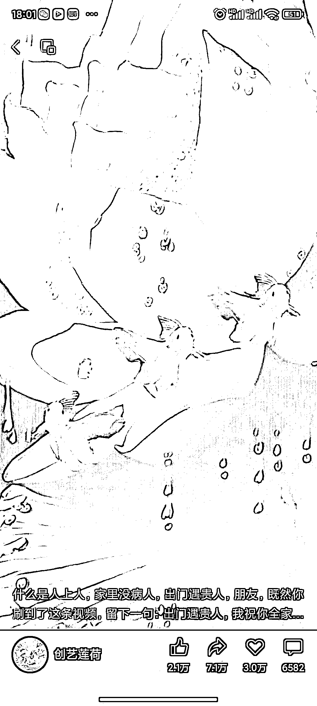

# 中高考前，AI动图视频号可以这样切入

刷到“创意莲荷”这个视频号后，我得到一个思路：让 ChatGPT 参与内容生成，再用 MJ 出画面，做成动图类视频号，正好赶上接下来中考、高考的时间节点。

变现方向可以考虑两类：一是做小程序取图，二是围绕祈福场景卖相关商品。

参考呈现形式可看这里：

评论区有人问：这种变现具体怎么走？我的回答是，可以开通橱窗，上架挂件、福袋这类商品，也可以直接提供出图服务。