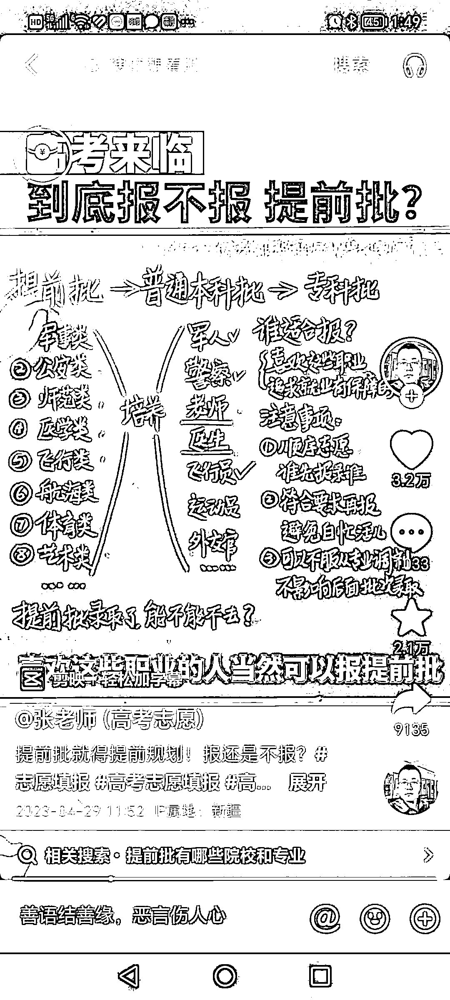
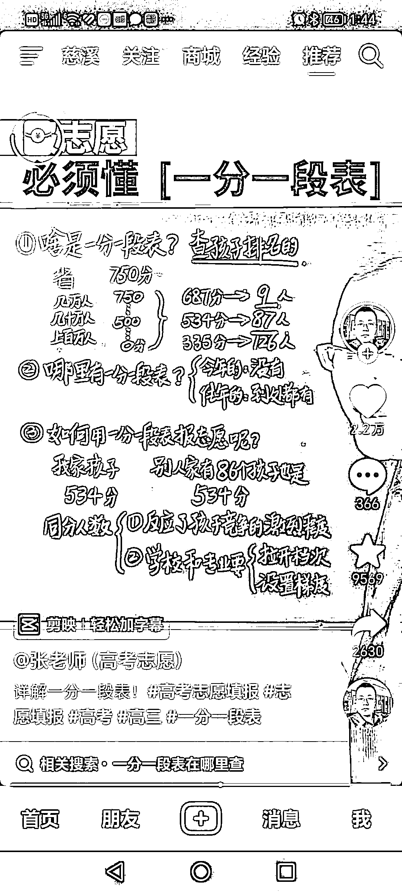
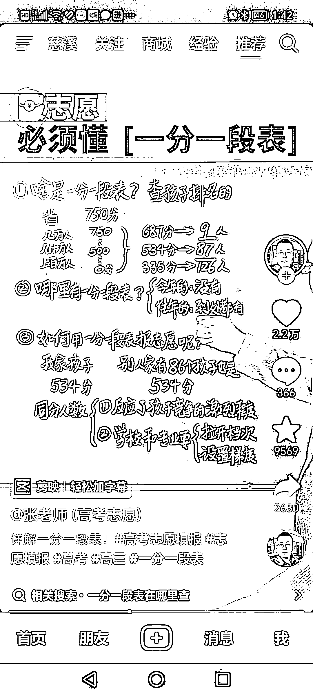

# (11 赞)高考志愿直播不拼高科技，粉笔黑板反而最圈粉

作者：  远方

日期：2023-05-10

知识付费直播眼下在各平台都火得不行，主播们为了抢流量，设备是一个比一个高级，电子大屏、智能互动板、虚拟背景轮番上阵，恨不得把直播间布置成科技展馆。

今天刷到一个讲高考志愿填报的直播间，画风却完全不一样。主播就摆了一块旧旧的小黑板，拿起粉笔直接开讲，配置朴素到极点，结果点赞量和评论量都相当惊人。我又去翻了翻他往期的视频，发现他之前也用过那种可以移动展示的电子屏，可数据始终比不上小黑板来得猛。

细想一下，这招确实高明，大概有三层道理：

1. 黑板一亮相，直播间立刻有了课堂的味道。观众一看到它，脑子里那根“我是来学习”的弦就自动绷紧，乖乖进入听讲状态，停留观看的时间自然也就拉长了。

2. 操心高考志愿的家长，基本都集中在七零后、八零后。黑板加粉笔对他们来说是学生时代的标配，看着就熟悉、踏实，天然多了一份亲近感。

3. 同样是输出干货，不少高报主播只是坐在镜头前对着空气口播，讲完也就过去了；小黑板往那里一挂，每条重点都写得清清楚楚，观众抬眼就能看到，信息传递的效率完全不在一个级别。

这套思路，其他知识付费主播或卖资料的主播完全可以借鉴。开播之前，把当天要讲的核心内容往黑板上一写，观众潜意识里就会觉得“这下得认真听了”。如果面对的受众是四十岁往上的人群，效果大概率还会更上一层楼。

评论区：

暂无评论