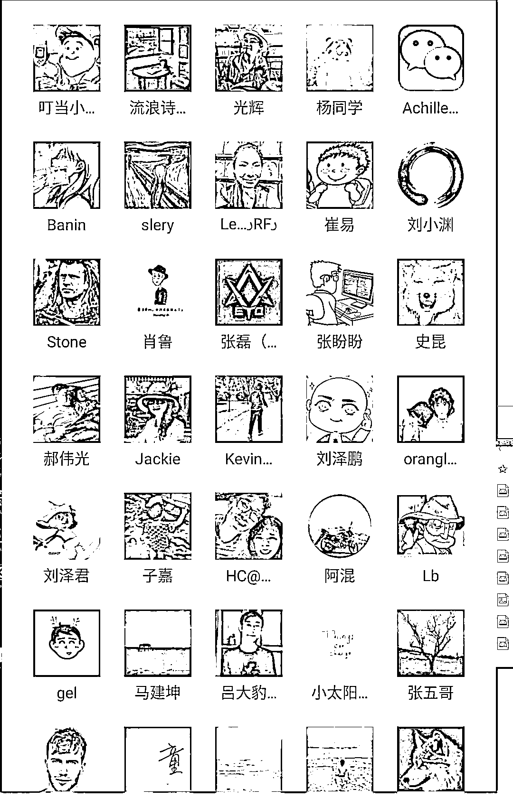

# 毕业头像拼图，能收费的模板工具

高考刚落幕不久，毕业纪念的需求就冒头了。高中同窗分别前总想留点纪念，文化衫上常要印图案；图案有个偷懒思路：把班级群成员头像拼成一张图放上去。🛰️自带的排列效果偏粗糙，若做个工具，让用户挑模板、把群头像合成到一张图，基础功能白用、模板付费，应该有人愿意买单。

用“帝都群”头像做了个示意，会PS的朋友可以套个模板试效果。毕业季就在眼前，高中、大学、研究生毕业都能派上用场；离校十年、二十年的聚会，看起来也有不少市场。

互动里，田土土觉得这想法不错；龙哥追问张五哥为什么总盯高考；秀燕晒出相似样式，还打赏3.33升级；有人问具体怎么做；秀燕提到群内可找立早葵或mi；龙哥最后感叹“抓得够早”。

张五哥的回应挺坦诚：他有个小私心。自己与曹大、欧神年纪相近，都是70后，但别人的学霸优势随岁月越拉越开；80后又一路上冲。如今学新东西，他常觉吃力，可时代变化太快，不学又不行；将来没有一技之长，只能被潮流推着走。他判断，下一个十年真正带动潮流的，大概率是今天高考的这批人；这十年也是他们参与巨大变化的关键期。提前了解、试着理解他们，或许是自己不被淘汰的奇招。于是借圈里主题把目光锁定他们：大一、大二……毕业、工作、结婚、买房……连续关注十年，看能否攒下理解优势。