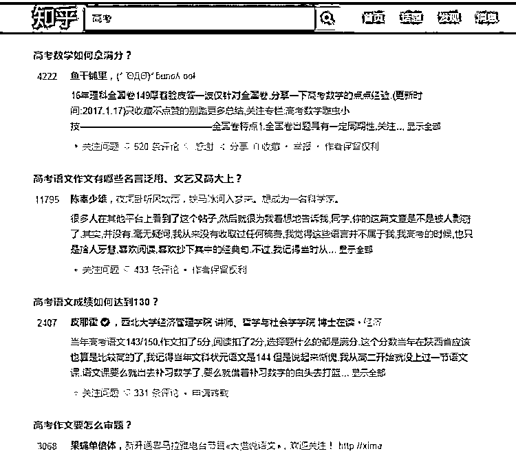

# 高考估分，能开个盘吗？

作者：niege｜2017-06-05｜思路·高考｜（精华帖·18赞）

我把龙哥👸号那篇《从0到0.1，如何从知乎神贴找到创业机会》又翻出来读了一遍，随后到知乎搜“高考”，把相关问答粗略过了一轮。

数据我没法系统统计，但观感很集中：多数内容都在讲数学语文怎么提分、志愿如何填报，以个人经历为主，顺带给自己👸号导流。赞数高的回答读着很过瘾，如果知乎当时有赞赏入口，估计能收到一些打赏。可真要据此做收费社群或知乎Live，没有影响力积累很难；做工具型产品，成本又太高。像猿题库这样学生长期使用的应用能跑通收费，换成普通团队，信任门槛和成本门槛都不好过。

不过，除了提分和志愿，还有一类“体验型”需求值得看：从最后一科交卷到成绩公布，这段空窗期里分数悬着、压力也悬着，很多考生既闲又焦。我自己经历过，那段时间他们一边花着零花钱玩，一边忍不住盯分数、猜结果。

于是有个想法：把尚未揭晓的估分当成筹码，让他们带点下注色彩地玩一把。

举个例子：考生估总分500分，下注200元；最终成绩若落在480至520分之间，返还双倍400元；若落在区间外，这200元就不退了。规则简单，👸号、🛰️群、小密圈都能组织。

这种玩法有人接吗？还真有。前阵子群里一位伙伴收到“得到”邀请，去北京参加罗胖组织的活动，我提议设个盘：他能不能单独跟罗振宇或和菜头合影。有人直接发大红包押他能成，最后没拍成。

至于信任，运营时间够长的👸号和🛰️群能兜住一部分。

会不会赔？我手上没有足够样本证明考生估分有多准；凭个人观察，考后能把分数估得比较接近的人并不多。区间和赔率都可以调，所以对组织方和考生来说，都带点趣味。

纯属脑洞😂欢迎大神拍砖

评论区也挺有意思：悠长假期的鹿提到，Fenng以前就公开开过盘口接受下注，后来赔了；niege追问结果，听完说早知道也去押一把；龙哥则直言，站在信息弱势方会亏得很惨；niege查过“信息弱势”后承认有问题，表示受教；^_^秀燕留下一句“感想快行动 厉害 来个1.21”。