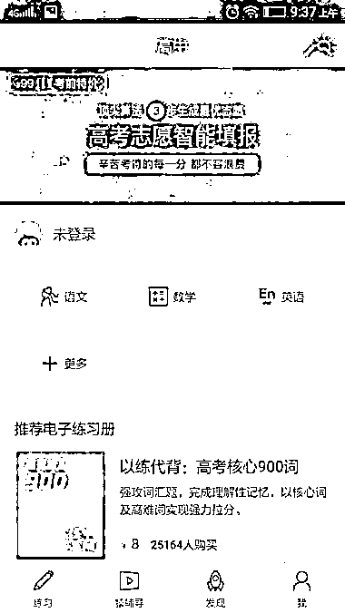
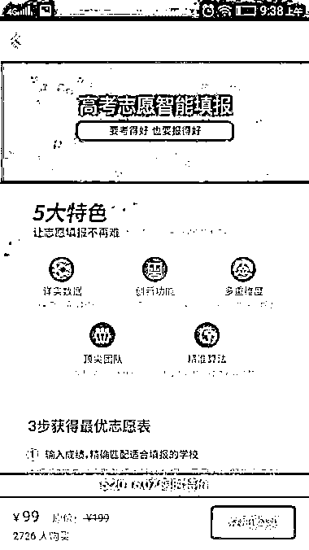
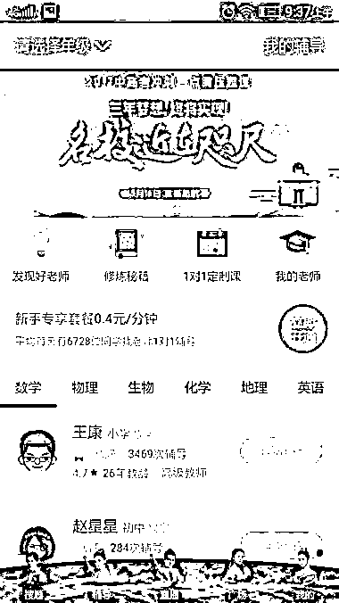

# 高考流量，App怎么借势？

文/niege（2017年6月5日）

张五哥前脚聊到志愿填报类工具，我后脚就发现市面上确实已经有产品在跑。起因是小密圈里有伙伴提到“猿题库”，我才注意到一类很像驾校宝典的题库应用——只是它面向初高中学生。看用户规模和活跃度，再瞧功能覆盖，我原先“学校对手机管得严、这类产品难做大”的判断被直接推翻，多少有点落伍感😂

配图1展示的是猿题库：主打的练习册和猿辅导都要付费。按圈里伙伴的说法，它的路径是先让学生在线刷题，再把大量作答数据中的高频易错点整理成练习册出售，各类练习册的成交量动辄数万；猿辅导则让老师在线视频讲解，对线下补习班冲击不小。

配图2正是张五哥说的志愿填报工具。猿题库这类产品来借势再自然不过：刚熬过高考的家庭，只要服务能提供一点参考价值，往往不太计较花费，所以图中标价99元的项目能积累数千付费用户，并不奇怪。

同类玩家还有不少：配图3中的“阿凡题”，以及学而思网校、芥末堆、作业帮、学霸君、新东方在线等。面对高考这样的节点，不借势反倒奇怪。作者还打趣：这个热点不算敏感吧，求加精😜

评论区也有共鸣：Jimi 认为，这类热点对相关产品来说本就不该错过；龙哥把帖子加精，并称赞猿题库的转化思路，认为这确实切中了需求；作者 niege 也回谢了打赏和加精。York 说，加入小密圈的一大收获，就是观摩别人追流量的各种方式，并训练自己对热点的敏感度；Steven 则补充，猿题库后来就是猿辅导。