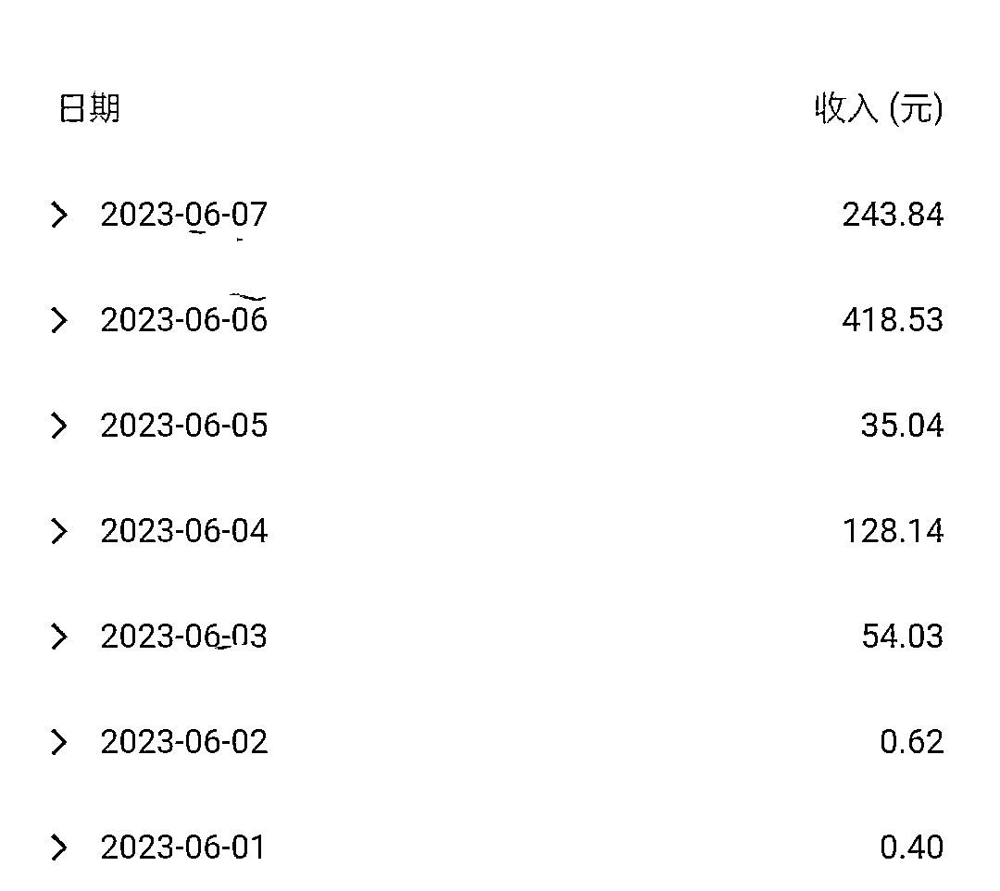

# 十分钟一篇情感稿，流量主一周也能赚

我拿GPT做了一次实测：情感类故事从下指令到成稿，通常五至十分钟就能搞定。把这类内容发到公众号并开通流量主后，一周结算下来，收入表现并不差。若想提高天花板，可以同时运营多个账号做成矩阵，把单账号的收益模式复制、放大。

留言区讨论集中在几个问题上：七十七想知道需要多少阅读量才能达到这个收入；随想关心有没有可参考的对标账号；知新把收益拆成流量主智能广告、自己接广告和带货几类，询问情感故事主要靠哪一种；胖大魔想听复盘。老传和小浩哥则在评论中确认，这次主要来自流量主后台收益（1）。小浩哥还表示过几天会写一篇帖子，胖大魔也表达了关注。