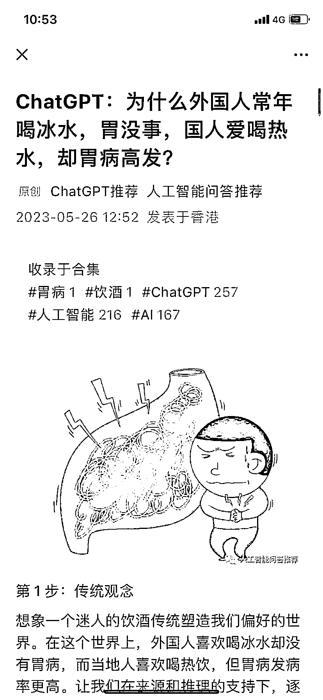
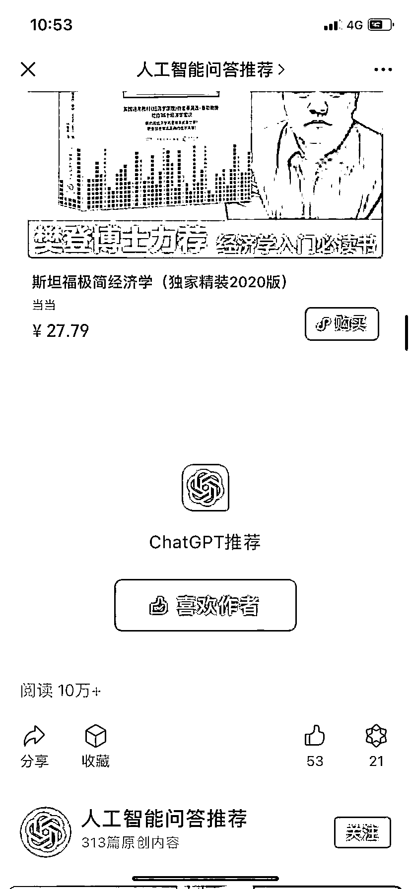

# 161 赞案例：ChatGPT 搭配争议话题，公众号阅读破 10w+

作者：鞭炮｜日期：2023-06-05

在公众号选题里，ChatGPT 一旦和容易引发讨论的话题组合，流量通常不会差。中医、喝冰水这类内容就是典型例子，数据表现相当亮眼。

我注意到的这个账号，平时推文阅读只能算普通，但这一篇直接冲到 10w+，留言区也讨论得很热闹。

评论区同样有看点。亦仁表示“中标，术值+1”，并提醒大家点开上方专栏里的 #中标，全部中标风向标都能在那里查看。鞭炮随后向亦仁道谢。晓光则指出，这个号同时做流量主收益、商品返佣和付费阅读，变现组合很厉害[强]。鞭炮也回应，能搭配的玩法确实不少，只是页面看上去会有点杂。