# 风向标加一篇公众号文，我赚到6135元

这篇精华帖在社区拿到了115个赞。入驻生财有术还不到三十天，我靠着站内风向标和公众号里的一篇文章，把一条完整的实操链路跑出了6135元收入。下面不绕弯，直接复盘产品、流量、转化，以及那次顺手安利带来的额外收获。

**1、从ChatGPT风向标里，我看到了红利**

ChatGPT火起来的时候，我一开始没太在意。后来身边讨论的人越来越多，短视频也反复刷到，我才决定认真研究。先加了一个知识星球，折腾几天还是不会用；最后付费请教几位业内人士，才搞明白怎么登录，但离熟练使用仍有距离。想到刚加入的生财有术，我就去站内搜资料，发现关于ChatGPT的风向标内容相当密集：它是什么、怎么上手、怎样提升工作效率，几乎都能找到。

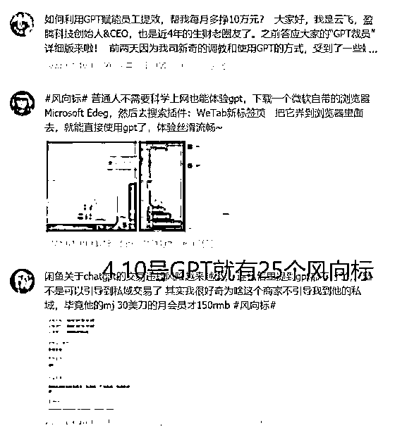

仅4月10日一天，我数下来就有25条相关风向标。边学边试用了几天，我确认它确实好用：问题抛过去，回答很顺，有些思路靠自己根本想不到。比如替朋友问“怎么网恋”，它会建议先选合适平台、完善资料、寻找匹配对象，再通过持续互动建立信任，还提醒要尊重对方，最后不忘补一句：网恋有风险，奔现要谨慎。

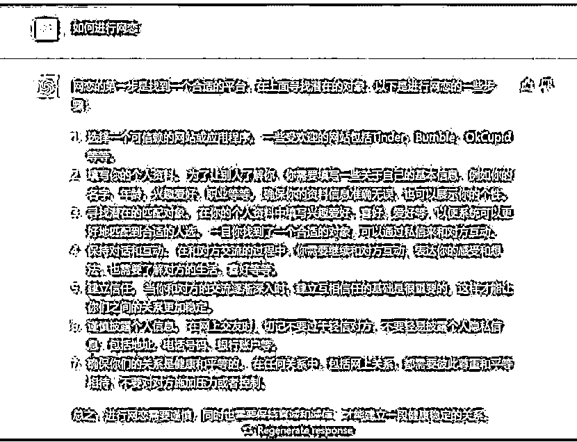

我又替朋友问“网恋多久适合见面”，它回答没有固定周期，最好先相处数周到数月，彼此了解后再选公众场合见面，安全第一；同时也提醒，网恋虽美好，期待别拉得太高。

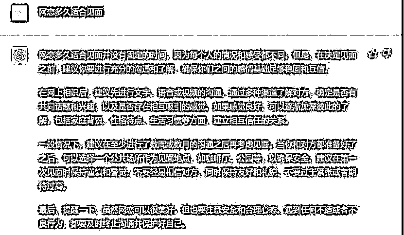

新闻里也常见“见光死”的例子，期望越大，落差往往越大。写作方面，我前后问了上百个问题，它几乎有问必答，不仅拓宽思路，还能润色文章，效率提升很明显。我赶紧推荐给写作朋友，有人却不买账，说ChatGPT写出来不是“123”，就是“首先其次然后”，程式化太重，上不了台面。我告诉他，直接复制当然不行，必须再加工；写作真正关键的是思路，不是堆修辞，而ChatGPT恰好能提供大量思路。只要会用，写出信息量充足的文章并不难。因此我判断，它对写作者是实打实的利好，于是决定做一个GPT社群，带喜欢写作、也想搞钱的朋友一起玩。我找圈友书豪对接朋友，拿到100个账号，又参考市面同类社群，普遍定价在100到200元之间。我最终定199元：账号赠送，附安装指导和长期交流群。毕竟此前写作培训我卖过799元，199元不算高。产品有了，流量从哪来？一是公众号原有粉丝，二是我早先头条专栏沉淀下来的读者。

**2、写101篇公众号搞钱文章，意外引来700粉丝**

1月26日，我突然给自己定了个目标：写101篇搞钱文章。刚开始真不知道写什么，就去翻同类公众号，把别人的选题收集下来作参照。选题虽然参考别人，内容却来自自己的见闻，所以动笔并不难，一连日更18天，写了18篇。复盘时我发现效率偏低：每天都要临时想选题，想完再写，耗时太多。于是我花两三天，把后面83个选题全部提前构思好，放进印象笔记。

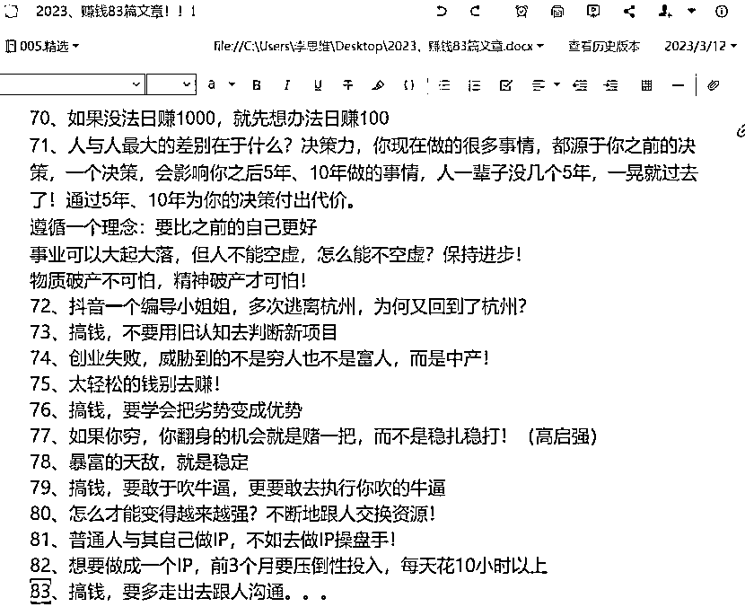

之后每天早起，看哪个选题顺眼就写哪个。有了选题库，心里踏实很多；虽然不少文章后来并没按库里的题目写，但那个“储备池”一直在，就像填空题，题干已列好，只需往空白处填答案。执行过程中，我还摸到了公众号的流量密码：标题里带上“钱”“日入5万”“月入10万”“年赚100万”这类词，很容易被系统推荐。比如下面几篇：

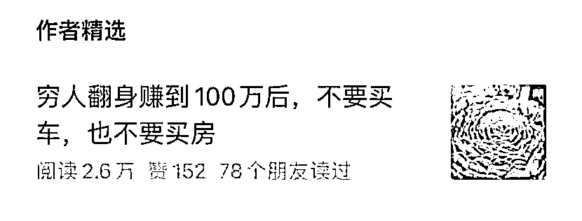
《穷人翻身赚到100万后，别急着买车买房》——2.6万阅读

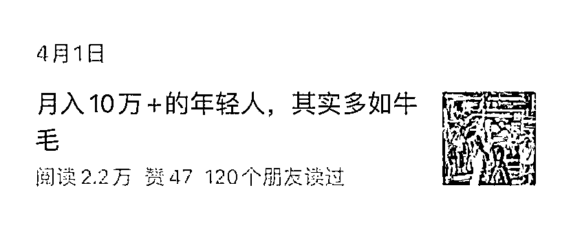
《月入10万+的年轻人，其实多如牛毛》——2.2万阅读

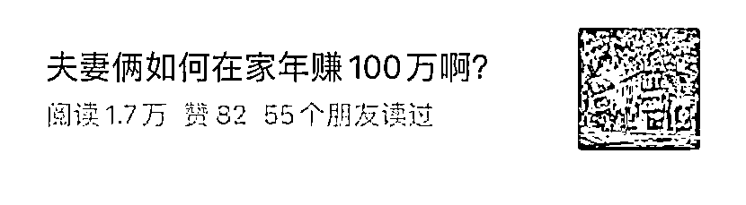
《夫妻俩如何在家年赚100万？》——1.7万阅读

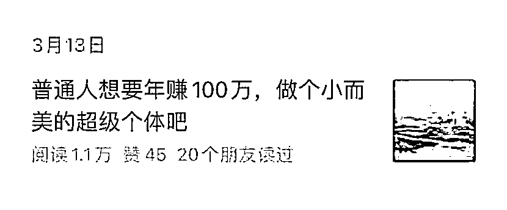
《普通人想年赚100万，试试小而美的超级个体》——1.1万阅读

看出来了吗？都是高收入数字，再配一个反常识角度：赚到100万偏不买车买房、夫妻在家怎么年赚100万……这样的标题更容易被系统推荐，阅读量自然上来。起初我没想引流，只是想找回写作手感，毕竟之前一直写东西，后来做其他项目停了较长时间。没想到随便一写，阅读量就不低。我想流量不能浪费，便学着同行用资料引流，微信一下加了700多人。为了效果更好，我关掉了文中广告，最近连底部广告也关了。

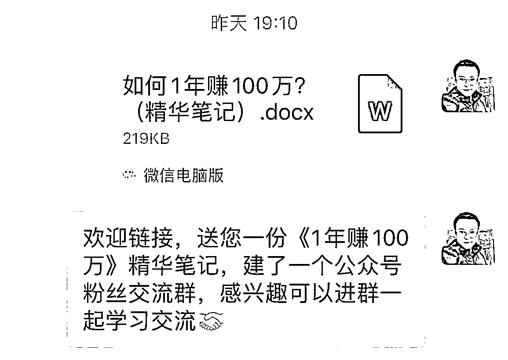

引流方法不复杂：送和文章主题匹配的资料，我准备的是《如何1年赚100万？》精华笔记。

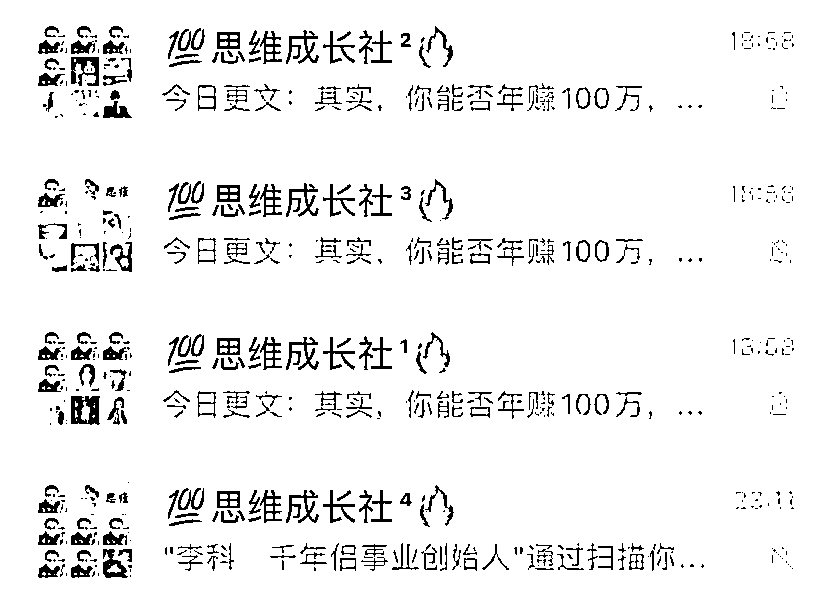

加到微信后，再引导进微信群。我建了4个免费群：思维成长社1234，平时分享文章和自媒体干货，每周六晚8点讲一节思维系列公开课。

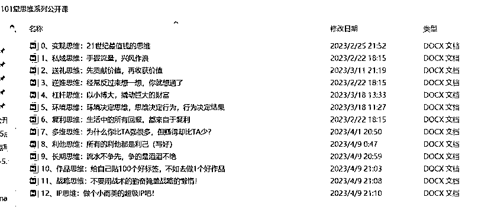

目前已分享9节，还剩4节。后来我发现这个系列可以扩展到101堂，眼下已想到84个思维点，还差17个，回去再补。公众号搞钱文章加社群公开课，很快拉近了我和新朋友的关系，也为后面的群发售埋下伏笔。

**3、头条往事：跟风做专栏，却带来1000+粉丝**

这次GPT社群有一半成员，来自我早先头条专栏的读者。我以前做图文自媒体，主战场是头条，其他平台辅助。那时在头条写作还比较小白，什么火写什么，征文、流量文、带货文都试过。

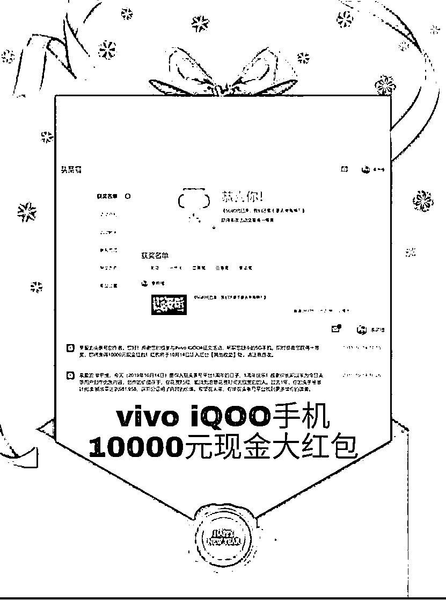

征文最高一篇收益10024元，题目是《5G时代已来，我们还要不要去考驾照》，写的是我裸辞回家考驾照的坎坷经历，拿到一等奖10000元，另有24元流量收益。

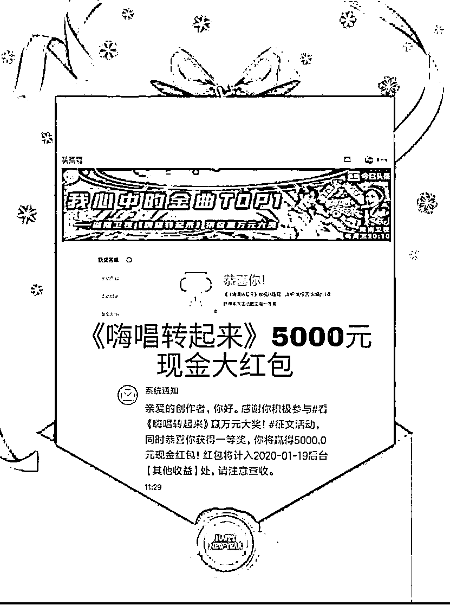

还有一篇5000元征文，写综艺节目。当时听了几首歌觉得有感觉，随手成文，没想到拿了一等奖5000元；阅读量只有100多，流量收益几分钱，可以忽略。

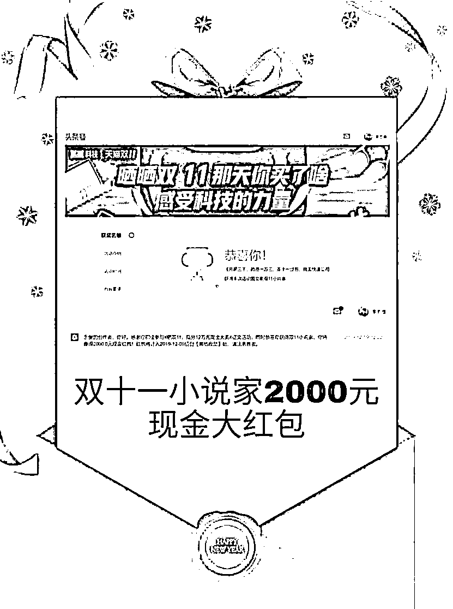

还有一篇2000元的《月薪三千，消费一万三，双十一过后，我去快递公司当小哥》，写我双十一超前消费、负债五位数，节后去快递公司通宵干了7天只挣520元的故事。这个数字我至今记得很清楚。后来把经历写成文章，拿到“双十一小说家”2000元现金红包；此外还有4000元、1000元、500元等，不一一列了。

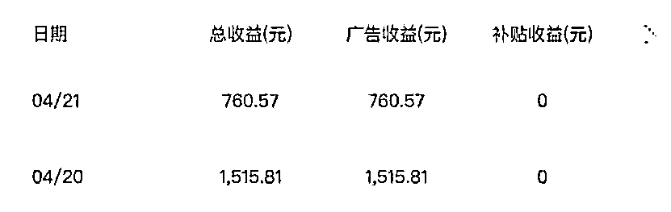

流量文最高阅读166万，发在百家号，收益2200+。

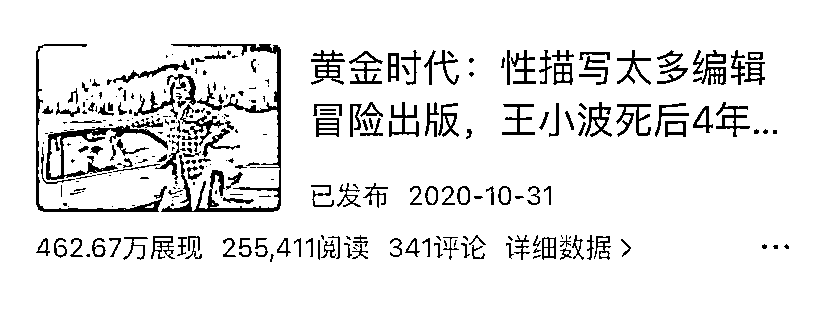

带货文最高一篇阅读25.5万，带了1000套王小波的书，佣金加流量收益累计5w+。当时大意，收益截图没保存好，没法展示，但那时写作社群的伙伴应该都见过。

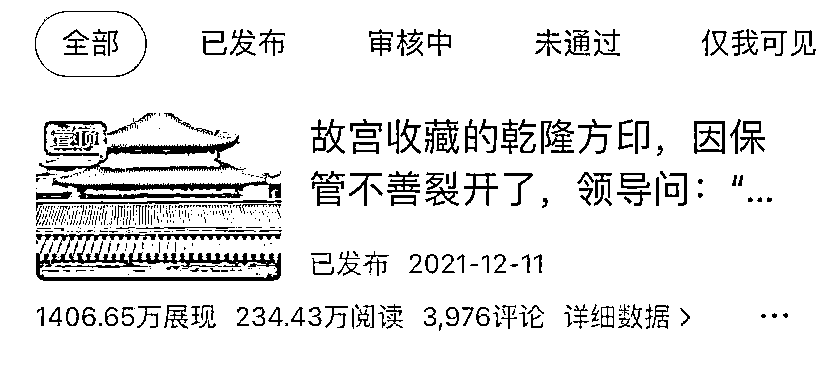

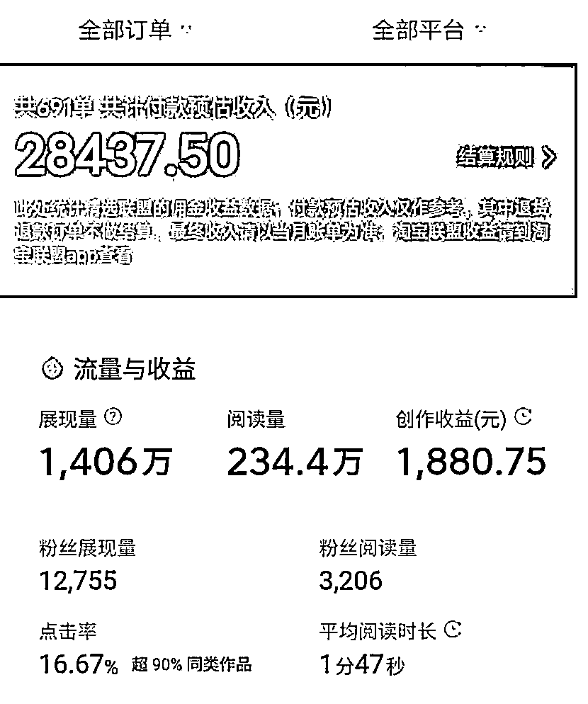

另有一条1400万展现的带货微头条，佣金加流量收益3w+；大小微头条带货爆款加起来，累计大约30w。

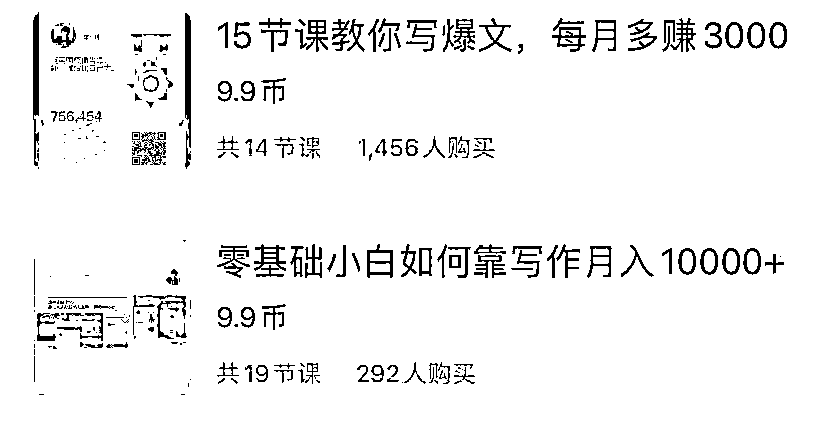

后来我做了写作专栏，主题是如何通过写作变现。上面这些征文、流量文、带货文成绩，既构成了专栏内容，也成了卖专栏的背书。其实做专栏也是跟风，无心插柳，没想到卖出1500多份，往微信引流1000多人，还拉了2个写作群，几乎都满500人。那时还没有“私域流量”这个概念，但后面做写作培训、西瓜商单、头条带货、买卖万粉号等项目，我才发现私域真香：既能做培训赚钱，也能带队写作赚钱，还能对接资源赚钱，而底座就是专栏引来的1000+粉丝。微头条带货最火时，我把手上5个号全用来带货，恨不得一天写10篇。印象里真试过一天10篇，一个字一个字敲了15000字，从早写到晚，第二天头昏脑涨。幸运的是，那10篇全爆了，赚了好几万。后来头条带货熄火，大多数作者收益直接腰斩，要么去上班，要么另寻出路。事后复盘，我当时没多花时间搞专栏引流，如果引来几千上万人，今天可能是另一番局面，因为那时流量真好搞。可大家都沉浸在带货日入过万的快感里，没这个意识，好时机就错过了。如果回到过去，我一定会狠狠做专栏引流。但时光不能倒流，只能抓住当下、看向未来。所以我现在仍以引流为主，当前是公众号，之后准备加视频号和小红书，正在学习和操作；听说今年生财会开很多小红书航海，正好跟上。

**4、首次群发售，两轮合计进账6000+**

产品是ChatGPT社群，流量来自公众号读者和头条专栏读者，转化方法很常见：发朋友圈、发公众号，再拉群分享，分享结束开始销售。群发售我参加过不少，但自己真正操盘是这个月才开始。以前听别人说一场群发售变现几万几十万，很厉害，可作为参与者，并不知道细节里藏着什么门道。所以第一次拉群分享加发售比较仓促，准备不够充分，只卖出20个社群；第二次也差不多，卖了20个左右。两轮累计进账6135元。数字不算多，但经验很实在：发售前要预热，提前在朋友圈和公众号预告，还要找人助攻；成交时得备好话术和收益截图。发售后要设截止时间，最后1小时、30分钟、15分钟、3分钟、1分钟都提醒一遍，因为总有人拖到最后一刻才来。

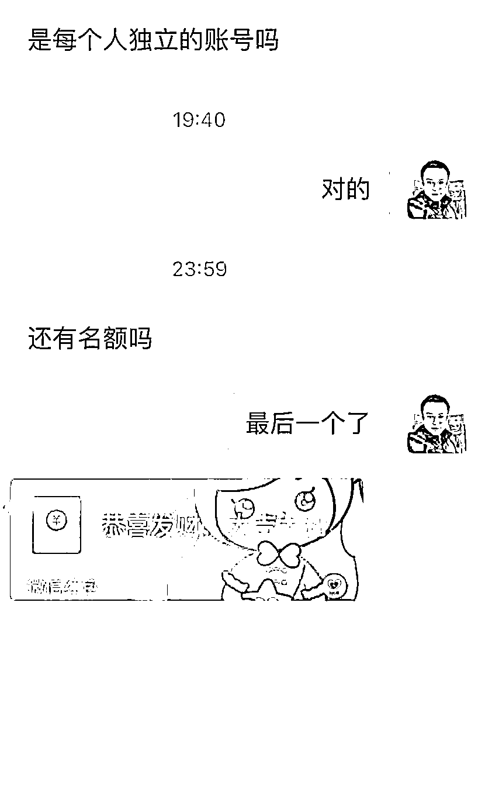

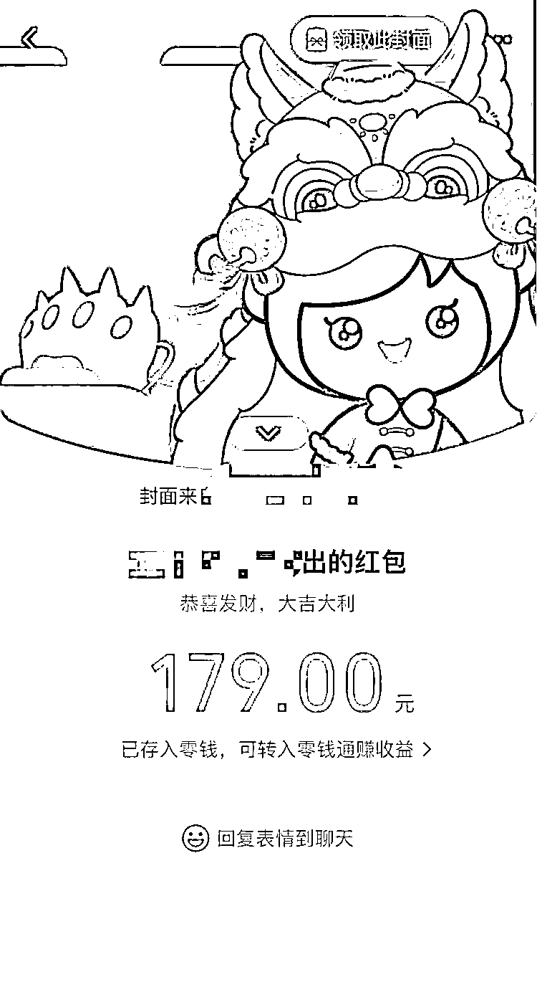

第二次发售ChatGPT创富研习社时，有位姐姐在23点59分59秒突然转来179元红包，我又惊喜又觉得神奇。总之，截止时间一定要设，时间一到立刻恢复原价；平时按原价发圈卖，特定节点再降价促销。社群分享和发售当天，我还会朋友圈刷屏，制造畅销氛围。道理和开店一样：排队的人越多，店显得越旺，路人也更愿意进去，羊群效应。短时间出现大量转账截图，目标人群会觉得很多人已经加入，自然也会生出“我也想进”的念头。发圈文案主要面向公众号粉丝和专栏读者。

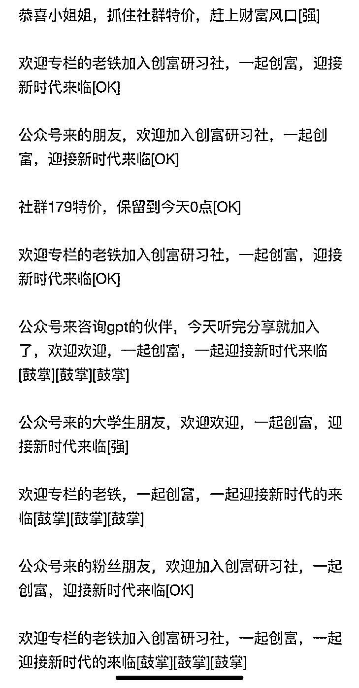

截图当天全部发完，第二天恢复原价后，我会把之前的特价内容删掉，再按正常价售卖，让已加入的人有种捡到便宜的感觉。以上就是我加入生财不到一个月，借风向标和一篇公众号文章启发，跑出6000+收入的全过程。

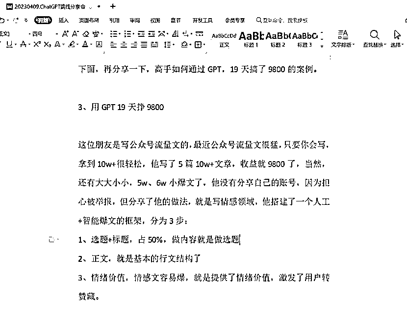

那篇文章是生财有术公众号的《参加2场航海，我成功用ChatGPT写出10W+公众号爆款的复盘》，我借用了里面的例子做分享。感恩，也送上祝福。

**5、随手分享，竟安利一位小姐姐加入生财有术**

最后说说安利一位小姐姐加入生财有术的故事。她是我社群小伙伴，之前通过写作营认识，年轻漂亮，搞钱很积极，最近项目遇到瓶颈，我就建议她去生财看看更大的世界。她起初不想加入，1965元对刚毕业的大学生来说不低，犹豫了好几天。后来她看到周围朋友发圈、拉群宣传生财有术，好奇去了解，很快觉得这里适合自己：内容包罗万象，精华帖多，高手层出不穷，氛围好、人才多，活动也丰富。了解完，她当即跟我说要加入，而且想当天就进，非常迫切。

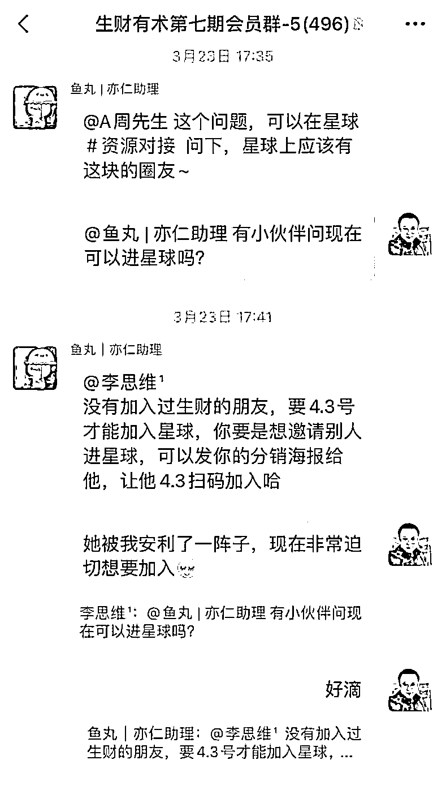

3月23日，我在会员群问鱼丸：有小伙伴问现在能进星球吗？鱼丸说4月3日才能加入。我说她被安利了一阵子，现在非常迫切。为什么急？3月23日加入比4月3日多13天，能更快看到精彩内容，更容易抓住时代红利，也能更早见识更大的世界。

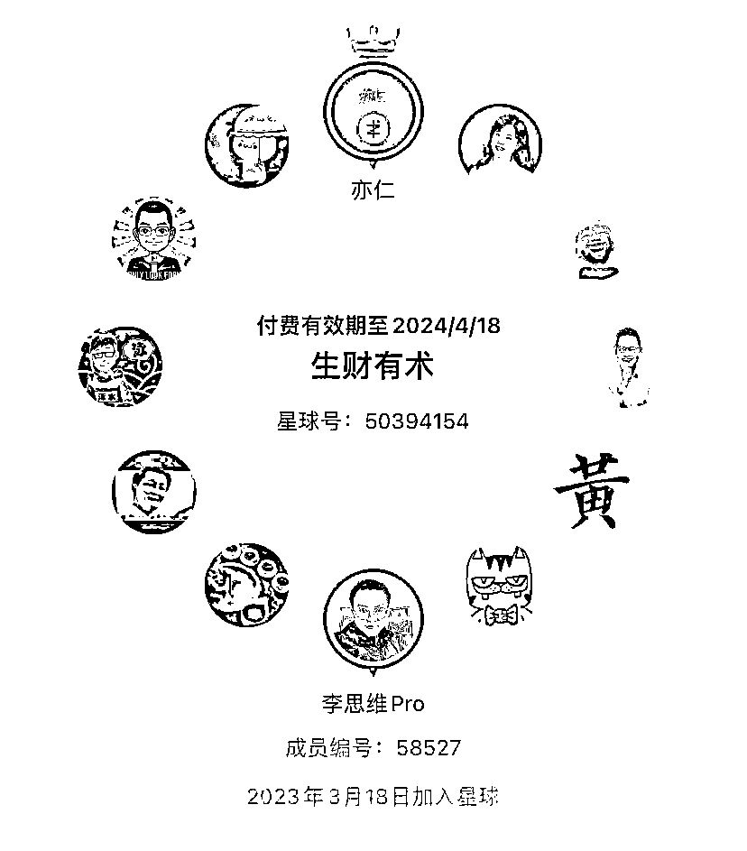

我是3月18日进星球的，比4月18日加入的伙伴多一个月。不到一个月，我受ChatGPT风向标和生财有术公众号文章启发去实操，直接赚到6135元，等于赚回3张门票钱。

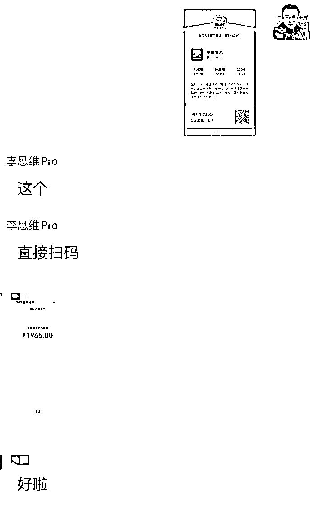

还安利了社群一位小姐姐加入生财有术，既有佣金，又有纪念T恤，现在想想都觉得很幸运。最后，愿生财有术的新老朋友，都能生财有术。