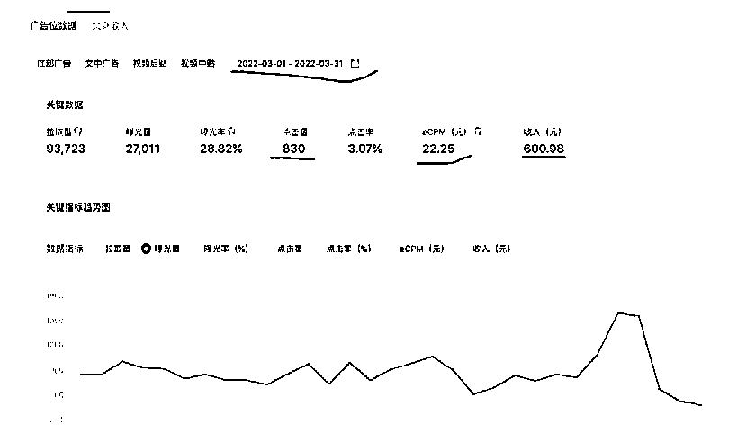
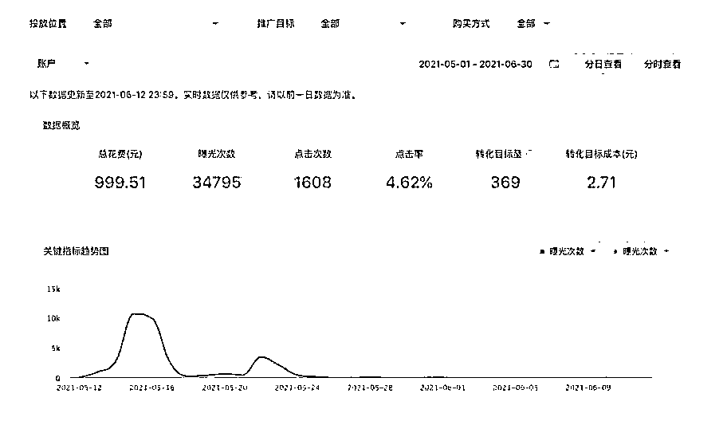
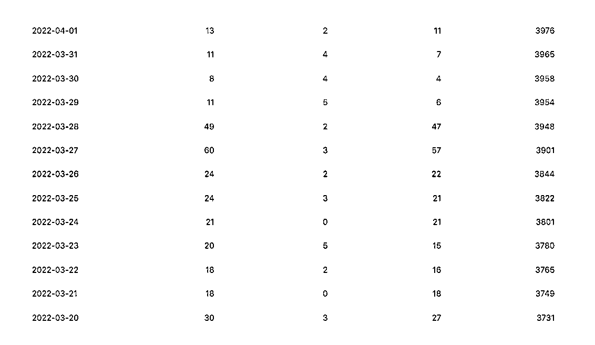
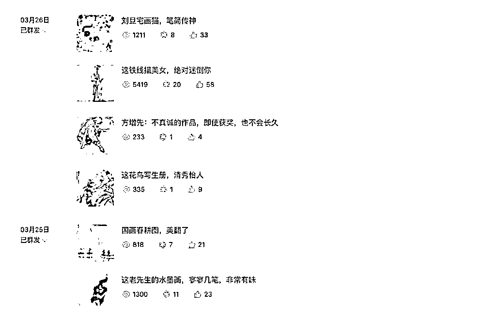
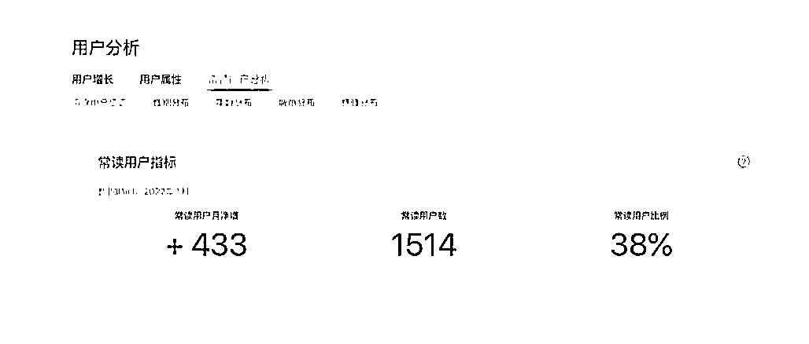
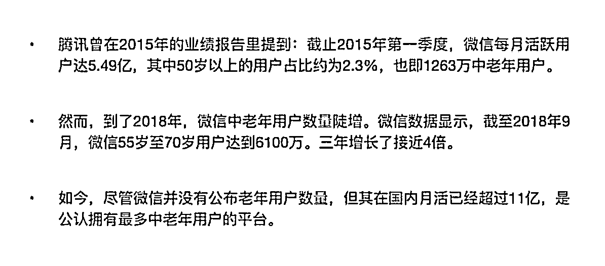

# 公众号细分市场月入过万：一次偶然测试的复盘

大家好，我是渔火，目前在新消费领域创业。今天想聊聊，我是怎么在公众号的某个细分赛道上找到机会，并且拿到结果的。说实话，这原本只是我随手做的一次测试，没想到后来居然成了稳定的被动收入来源。

先晒一下现状：我有10个号，每个号每个月靠着流量主收入，能稳定带来500到1000块——注意，我只开了底部广告。再加上每个月自然成交的书法国画课程，大概有5000块，全部是不花力气来的。算下来，月被动收入在15000左右。成本方面，每个号找代运营，每月160块，每天更新4篇非原创文章，10个号加起来，一个月总成本1600块。

这个结果完全超出我的预期。所以就像生财的实战理念说的：不动手，永远没结果；只要做了，就有希望。

（这是其中数据居中的一个号，目前3900粉丝，3月收入600元）

下面我从三个方向，把这件事讲透。

## 1、这个项目的起始复盘

先说我躺赚的来源，其实就是很多人都知道的公众号流量主。但我的号粉丝量并不高，最多的一万，最少的三千，内容做的也不是主流大热门，而是书法、国画这一类细分领域。

事情是这样的：去年5月，我批量投了一批广点通，做了10个号，全是书法国画方向的内容。当时每个号砸了1000块做启动量，初衷很直接——搞流量，把人引到私域，再卖书法国画课。熟悉我的朋友应该知道，我之前闲时做过在线书画院，前后累计变现了300万。

这就是其中一个号的投放截图。说实话，那时候我对广点通并不熟，再加上投的钱太少，成本控制得很差。像这个号，1000块只换来了369个粉丝，算是花费比较高的了。

后来我找了代运营持续更新内容，淘宝上一抓一大把，160一个月，每天4篇。一段时间后发现，靠这种方式往私域导流、转化高客单，效果很一般。于是我就把它搁置了，完全没再花心思。但神奇的是，过了一个月，我偶然登录后台，发现这些号每天居然有十几个自然新增关注。更意外的是，几百粉丝的号，竟然跑出了几篇几千阅读量的内容，而且不是孤例，好几个号都出现过千阅读。

这时候我才反应过来，是人群选对了。结合之前做用户调研的结论，中老年兴趣群体天然喜欢分享、喜欢浏览，这本身就是流量生意啊。于是我把所有号的流量主都打开了——开通过程很简单——被动收入就这么来了。

从去年9月开始，每个月的收入就已经能覆盖代运营费用。到了现在，每天新增关注稳定，阅读量也稳定。

 

今年2月，10个号加一起，月利润突破了一万。说实话，我挺惊讶的。但我没有选择马上放大这件事：第一，我现在全力扑在新消费创业上，抽不出时间；第二，我对广点通投放本来就不算精通；第三，广告费一旦加大，单个用户成本可能会涨，又会多一个回本周期。所以暂时放着没动——但目测放大个几倍，问题不大。

## 2、这种类型的项目还能做么？

我的观点很明确：能做！而且我觉得这事儿对普通人非常友好。公众号流量主尽管已经红海，但细分市场里依然藏着大量机会。

但有一个前提：你得懂你的目标用户。理解他们的行为习惯、聚集地、真实需求，才能判断这个领域适不适合做、能不能放大。还是那句老话，先建立自己的底层逻辑，再去做判断。

举个例子，如果让我做宝妈类、副业类、文艺类的流量主号，我会觉得不合适。要么单位用户获取成本太高，要么用户本身就是深度互联网人群，对内容质量极其挑剔，要么就是没有在微信里主动分享的习惯。结果往往是流量主点击率很低，或者你花钱砸了个启动量，之后却再也等不到自然增长。

反过来看中老年市场，或者说中老年兴趣市场，我认为里面存在各种形式的流量生意。中老年人在微信生态里的体量非常大，而且她们是真的热衷于转发分享。这里放一组我之前看到的数据：

有了规模数据，再看中老年群体的线上特征。这一波人，是互联网远远没有满足好的用户。现在很多适老化产品，只是把功能做得更简单、更易用，但从深层需求看，还差得很远。她们爱分享，其实是渴望自我表达和社交认同。就像很多父母喜欢给子女转发文章，背后是强烈的表达欲和社交需求。

美篇就是个典型例子。之前看过它的数据：累计注册用户2亿，累计创作用户4000万，累计作品3亿，累计上传图片60亿张，App月活1200万，日访客2000万。到如今，美篇已经成了很多中老年创业项目获取流量的重要阵地。

这也是我为什么当初觉得能做，并且很快就能产生被动收入的原因。靠几百个基础粉，就能出几千阅读的文章，说到底不是内容有多牛，而是这个群体的行为习惯决定的。只要用户本身爱分享、爱看文章，你就天然能用很小的基础量撬动流量。

类似的垂直细分市场还有很多。只要你对某个人群有足够理解，发现他们热衷分享、有阅读习惯，就完全可以小范围测一下。至于具体怎么注册公众号、怎么开通流量主，这种操作层面的东西，我就不展开了，真的很简单。

## 3、想赚钱最重要的是什么？

我一直觉得，最关键的一点是：对自己有清晰的定位，找到自己擅长、并且做起来不痛苦的事，然后锁定一群人，深挖他们的需求。带着流量端、产品端、变现端的底层逻辑去找，很容易就能抓到一小块细分市场。再针对用户需求打造MVP，冷启动试一下，剩下的就是用心提供价值，然后静待花开。

不过结合最近的思考，我想再加一端：用户端。也就是用户端、流量端、产品端、变现端，四端齐备。

我发现很多人对用户的思考太浅了。举个例子，之前听一个消费品案例，很多创业者上来就说自己的用户是“25到35岁的宝妈”。注意，25到35岁，这已经是两代人了，消费习惯和行为模式完全不同。混为一谈的话，很容易出现定价失误、营销错位。

再比如做外卖CPS、表情包引流小程序变现的那些人，底层逻辑其实非常相似，只是业务形态不一样。他们无一例外，都是对用户的需求和行为有深度理解，然后才去思考流量怎么搞、产品做成什么形态、最后怎么变现。

包括亦仁之前分享的第六期的一些变化，里面很重要的一点，就是实战、出结果。这本质上也是对用户的理解足够透彻——透彻到清楚我们到底想要什么。

只有把用户研究透了，你才可能持续做出超预期的产品，才可能找到流量洼地，找到最适合这波人的营销方式。

今天就先分享到这儿，希望这个方向能给大家带来一些启发。我们下次再聊。