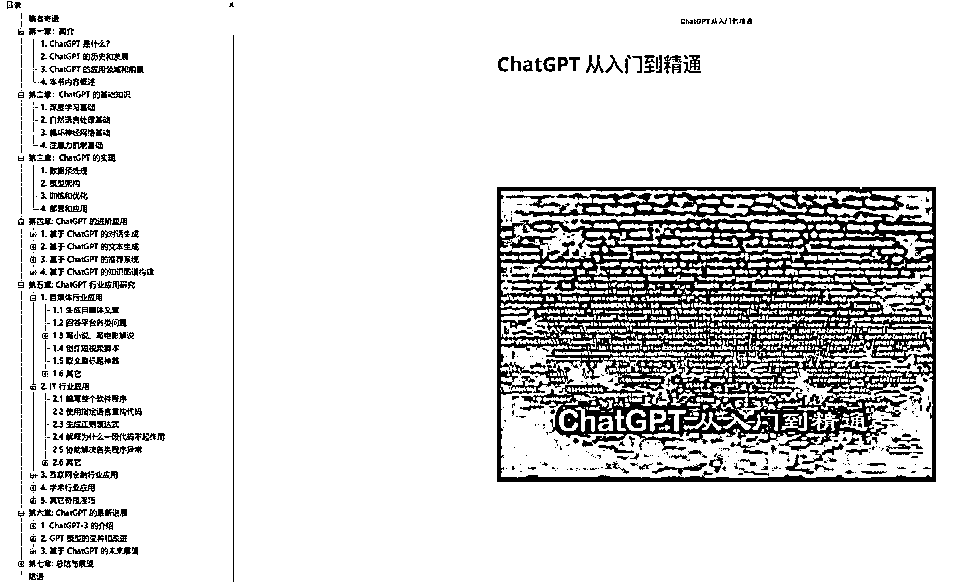
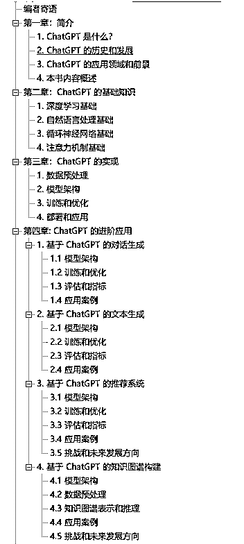
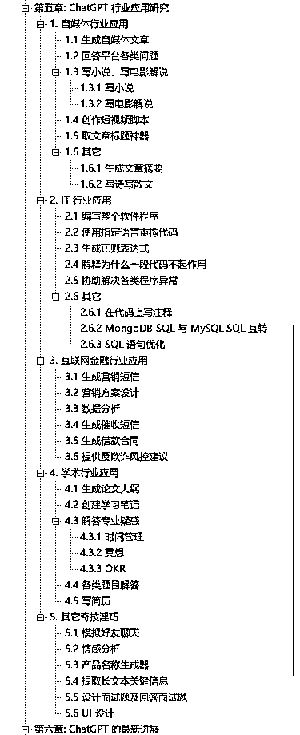

# 230赞精华帖：ChatGPT实战涨粉3万

我是毅鸣，人在深圳，本职写代码。在生财社区待了几年，一直没什么存在感。年前我上线了一个公众号，把 ChatGPT API 接了进去，没想到一天就涌进三千多名新关注，七天带来两万多元收入；未满一个月，关注人数又多了三万以上。这个过程里踩过一些坑，也沉淀出一些心得。

后来我借助 ChatGPT，把这段经历整理成《ChatGPT 从入门到精通》。结合自己反复试用和实际操作，我梳理了覆盖多个行业的上百个应用案例。这本书有 116 页，字数接近 10 万。若能给有需要的朋友一点参考，就很值；也欢迎一起聊聊。

评论区里也有不少交流：

- 文轩问我：老哥，公众号不怕被封吗？我回：慌😭。
- nickki 问：靠什么赚钱，是广告主收益吗？现阶段主要是卖会员和次数。
- 他又追问：现在收入是不是不如起步时？毕竟 ChatGPT 账号的注册流程和账号买卖已经在网上泛滥。我认同这个判断，也提到看到不少同行定价偏高。
- 王小蒙留言：“毅鸣惊人[强]”。
- 骏马也来道谢，称我为“毅鸡老师”。