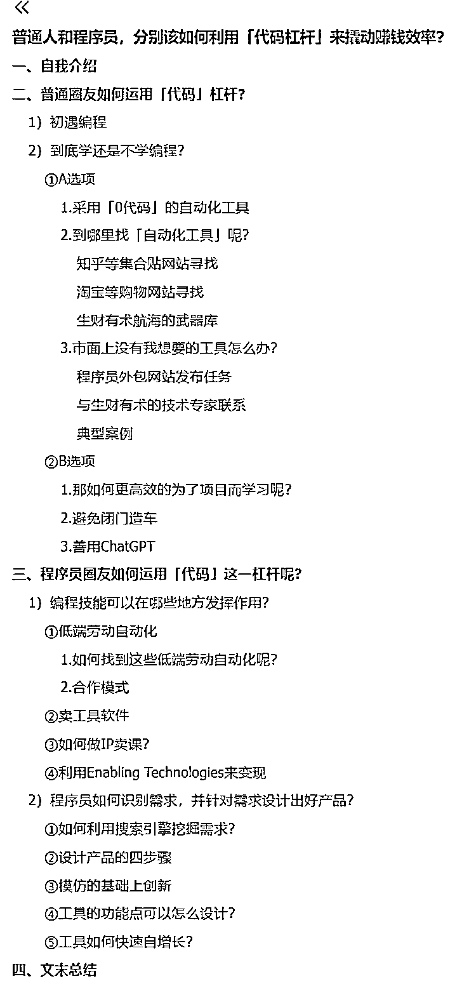

# 不会编程和会编程，怎么让代码帮你赚钱？

文｜Jimmy Chen（禾急）｜2022-12-23

赚钱的朋友们，初次见面，我是禾急。这是我第一次在圈里发帖。此前我曾和七小哥熬到凌晨三点，一起写完一篇ChatGPT商业拆解稿，相关链接见原帖。最近看精华帖、跑大航海项目，我注意到一个现象：圈友特别愿意借助工具把项目推进得更顺；自动化、编程类广告也在不断暗示，工具能让人从重复操作中抽身。我本人是物理系学生，平时对技术感兴趣；为了把这件事讲明白，我查资料、做梳理，最终写成一篇长文，想帮大家理清：没有技术背景的人，以及会写代码的程序员，分别怎样借“代码杠杆”提升赚钱效率。

全文框架先放这里：

一、先做个自我介绍

二、非技术圈友怎么用“代码”这个杠杆？

1）我是怎么第一次接触编程的

2）编程这件事，学还是不学？

三、程序员圈友怎么发挥“代码”杠杆？

1）编程能力能用在哪些地方？

2）程序员如何找到需求，并针对需求做出好产品？

完整正文请移步飞书：https://voe5smm5ts.feishu.cn/docx/FHLsdBXHYoF4QhxgpXZcPTUynBe

评论区也很热闹：七小、凡灵逸尘、炮爷（不睡觉）等圈友来捧场，花天卓以两年老朋友身份称新朋友很厉害并致谢分享；AUDI说文中不少场景自己也曾想到，还做成工具上线，并认为作者列举得更全；晨曦则感叹作者是04年双鱼、广州靓仔、18岁。初次发帖，谢谢大家支持。