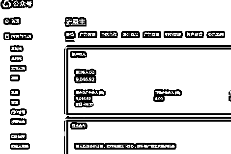

# 实习月薪3000，副业被动月入5万+：我的老年流量主复盘

先做个自我介绍：我叫程序员田同学。做小程序这行已经五年，最近三年则把主要精力放在老年私域用户，以及👸号、小程序流量主这两个方向上。三年前我还只是个大四实习生，月薪只有3000；一路摸索到现在，在继续做好本职工作和个人IP业务的同时，我用兼职方式运营着几十个👸号和小程序。

先看数据：今年二月上线的那款小程序，目前同类能带来收益的老年小程序，我手上已经有十二个。

今年新开的老年👸号也跑出了收益，类似账号现在有十五个。

放在赚钱这种高手扎堆的地方，这些数字也许算不上什么；但对我这样的普通人来说，在目前的人生阶段，我已经挺知足。

接下来我会把这段经历拆开讲：从一度迷茫，到慢慢找到赚钱方向，再到老年私域粉丝如何引流、如何变现的具体方法。

完整内容在这里：
https://q2srbwoeiz.feishu.cn/docx/N147dCBZJoN4sxxAprMcVZZHnWf

最后要特别谢谢涛哥对文章的耐心指导。大家如果有问题，也欢迎来交流。

评论区里，有人问：把抖音、视频号上热度高的养生视频和这类小程序结合，效果会怎样？作者的回答是：内容并非最关键，老年用户更偏爱军事类内容，而且养生类内容不能上架小程序。另有人关心，同一IP下运营多个👸号是否会有影响。