# (精华帖)(293赞)电子书应用，帮我攒出百万被动收入

作者：胡不归

日期：2023-02-10

钱大致能分两种挣法。第一种，干活时进账凶，一停就掉下来，甚至归零，上班薪水就是典型。第二种，前期把东西搭好，之后哪怕人不在场，也能持续收到回报。写书拿版税、在商店放几款iOS应用，都属于后一种。

我后来的百万级被动回款，主要就来自第二条路。先把结论放这儿：它不靠玄学，靠的是一次投入、反复收钱，外加踩中了一个移动端红利期。

我是胡不归，生财最早一期圈友，在互联网行业做了十多年产品与运营。几个月前从北京搬到苏州，现在在家全职带娃，欢迎同路人交流 :) 篇幅不短，先给目录：

**1.** 我为什么偏爱持续回款型副业？
**2.** iOS应用怎么从0走到1？
**3.** 从1到N，拼的是重复劳动
**4.** 还能从N做到N×N？
**5.** 一夜之间归零
**6.** 复盘与教训
**7.** 现在还有窗口吗？
**8.** Q&A

照例先放图。下面只是其中一个AdMob后台，23号前后结算，累计到账九万余美元；苹果侧的付费与内购每月25号入账。加上上班薪水，我一个月能碰三次进账 😀

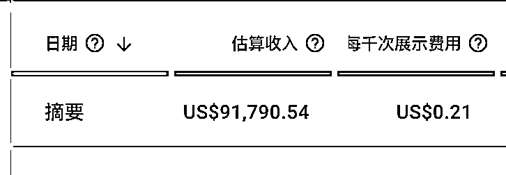

**1. 我为什么偏爱持续回款型副业？**

挣钱方式在我这里就两类。

一类是即时劳动型：忙起来日入四位数甚至五位数，可一旦停工，现金流立刻跳水，比如工资。

另一类是先建设后回款型：前期集中铺一次路，后面长期有进账。写书出版、上架几款iOS应用，都是这个逻辑。

我早年在初创团队做核心成员，早九晚十一、一周六天是常态，登记结婚前夜还在公司熬到凌晨两点。平时根本抽不出整块时间，只有周末能挤出几个小时，所以更适合第二种模式。

另外，我一开始也没指望靠它暴富，只想在主业外多一门手艺、多一条进账渠道，对冲互联网行业的不确定感（同行应该都懂 😂）。折腾着折腾着，就进了iOS应用这个门。

**2. iOS应用怎么从0走到1？**

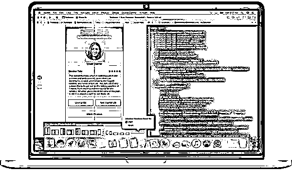

2015年前后，手机端正高速扩张，公司重心也从电脑端迁往手机端。替公司办理企业级iOS开发者资质时，我出于好奇和练手，顺手开了一个自己的开发者号。

翻了翻入门文档，主要是为了平时和研发同事沟通更顺，看完觉得开发一个应用似乎没想象中那么玄。

iOS的开发环境是Xcode，里面有不少可视化组件，拖放拼装就能做出简单功能，不写代码也能跑起来。

说干就干，我用一个周末做出了首个作品“XX图集”。逻辑很轻：把某个领域的图片归好类，逐张放进工程，取个顺眼的名字，配大约百字关键词，走打包上传流程，很快通过审核。

上线头一周，搜索自然量每天带来约百次安装。后来我把免费下载改成六元买断，后台点几下就行，每天仍有五到十单。那几天心里挺美，像早年个人网站收到第一笔广告款 😀

iOS应用有几个实打实的好处：

**1.** 搜索入口能贡献约七成下载，只要功能对路，自然量不缺。
**2.** 收款链路齐全：可以买断，也可以免费下载后做应用内购买。
**3.** 资料随包交给苹果分发，不用自建后端，分发不额外花钱，稳定性好，容量也不设限。

听说电子书站能挣钱后，我就把同一套思路放大，做了六十多个读书类应用，组成矩阵，完成了从1到N的积累。那时被动回款已经能覆盖家庭日常开销。

**3. 从1到N，拼的是重复劳动**

尝到甜头后，我每个周末抽半天去咖啡馆，机械地重复一套动作：

**1.** 找图片素材。
**2.** 把素材放进Xcode，生成应用。
**3.** 做图标，风格很朴素，有时直接放“XX图集”几个字。
**4.** 参考同类产品取名、写关键词。
**5.** 打包上传，等审核。
**6.** 把免费改成买断价。

连续几个月循环下来，手里攒了十多个图片合集应用，月均被动收入约两千，刚好覆盖早饭和通勤。

但问题也来了：

**1.** 审核被拒，理由要么是功能太单薄，要么被怀疑抄袭。
**2.** 安装量低迷，一天个位数，甚至一周个位数。
**3.** 免费时有人下，一改付费就归零。
**4.** 素材和灵感枯竭，容易做的似乎都被做完了。

刚起步就像撞上了墙。

后来和朋友闲聊，他说有个电子书站流水不错，可惜被举报后备案没了。我听完留了心：这是不是又一次从网页端搬到手机端的机会？当时应用商店还没有备案要求。

2016年前后，商店里的免费读书应用已经很多。我打听了一圈，听到的多是“别做了”。cocoachina这个老开发者社区里也少有人看好，理由集中在两点：赛道人挤、版权雷区变高。

我有三点不同判断：

**1.** 数量多不等于饱和。现成产品大多粗糙，内容也偏旧，仍有空位。
**2.** 免费读书应用遍地都是，说明版权灰区还在，风险尚可控。
**3.** 大家都点头的结论，常常是反向指标。

想清楚后我决定做。可阅读类应用的技术门槛，比图片拼装高得多，已经超出我的能力。

没收入前请外包不划算，我于是找到GitHub——全球开发者共享源码的地方。

在上面搜到一套能读EPUB的项目，作者文档写得完整。照着说明操作，编译打包居然顺利通过。

麻烦来了

作者是巴西人，只适配了英文和少数小语种。中文EPUB拖进去经常报错、闪退，因为不少中文文件制作时就不合规范。

我发邮件联系对方：先夸项目好用，再提中文适配问题，附上几套有问题的文件供调试，最后用PayPal转了20美元表示支持。

对方大概很少收到打赏，热情得很，一周内就把适配修好了。我合作过几十位程序员，像他这么主动的真不多。更关键的是，我有了直通渠道，等于白捡一个技术合伙人。后面有了收入，我又转了几笔美元致谢。

接下来就是把图片合集的打法搬到读书应用上，并做升级。

内容选品分两条线：

一条是长销书，比如名著、鲁迅文集。热度普通，但需求稳定，作为矩阵基本盘。

另一条追热点，典型是热播剧原著，像盗墓笔记、亲爱的翻译官。平台和卫视每年有排播表，可以照着提前一两个月铺应用。

这类应用开播时安装量冲高，播完慢慢回落，长尾大约半年。跟风者也不少，但多数等热播后才上。我提前抢跑，在热门剧搜索结果前五里常能占一席。

**打包与发布**

应用名依旧直白，如“XX原著小说”。图标做了几套模板：纯色底加“XX原著”、角色海报加“原著”、书籍图标配书名等。

一个应用只放一本书，大概率过不了审；那就多放几本做成系列，比如言情、武侠。这样更容易过审，也能提高打开频次和活跃度。

界面素材也换了几套风格，主要用创客贴和iconfont的图标拼出来。

核心的EPUB文件，早期从百度搜来的质量参差，有的错字连篇还塞广告。后期我常泡电子书论坛，也在淘宝付费买精校版，拿到不少一手文件。

**矩阵互推**

折腾一段时间后，账号下已有六十多个上架应用，用户画像高度一致：爱看书的人。

终于在一个国庆长假，我把流量较好的应用集中更新了一次，纯体力活。统一加入互推模块：下载A的人，还能看到B、C、D，形成内部闭环。

之所以“悄悄”做，是因为苹果并不允许把应用推荐当功能，但当时管理不算严。

到这一步我仍没自建服务器，所有应用都是本地包，对外说“支持离线”。代价是改任何小功能、甚至改一个字，都得重新打包发布。

后来我看到友盟的在线参数功能，可以在不发版的情况下热更新配置。研究一阵后派上大用场：新应用上架时，用在线参数让矩阵里的老应用一起推荐它，等于零成本冷启动，效果很好。

**广告与内购**

靠买断卖电子书这条路，我验证过，走不通，而且版权风险最高，相当于直接交易。

我接入了Google AdMob（文档详细，有中文支持，早期可直连，后来需要梯子）。用户阅读时展示横幅，点击产生收益；累计读到一定页数或时长，再弹插页广告，顺便提醒休息，变现路径很顺。

AdMob是少数接受个人开发者的广告平台，国内广点通等大平台要企业资质。

对高质量用户，我通过苹果内购提供6元、12元永久去广告。内购代码同样来自GitHub现成项目，复制几行就能用。

广告与内购收入大概二比一。能明显看到，选内购去广告的人越来越多，说明为内容付费的习惯在养成。

月被动回款也陆续过万、过两万，副业养家基本够用，主业工资可以整笔攒下。

**4. 还能从N做到N×N？**

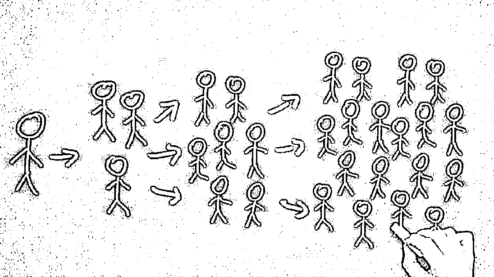

矩阵规模起来后，同行压力随之而来。

一个应用刚有热度，一周内必有模仿者。正常竞争我不怕，怕的是有人直接破解：iOS资源包几分钟就能被拆，EPUB原样拿走，连界面素材都照抄（这么糙也抄……）。

我的应对有三招：

**1.** 多开几个开发者号，把同一套内容微调后打成不同应用，自己跟自己竞争。既覆盖更多关键词，也营造“赛道已经挤爆”的氛围。
**2.** 用Calibre批量处理上千个EPUB：加水印降低被搬运风险，同时规范格式、减少崩溃、提升阅读体验（电脑连续跑十几个小时，确实活久见）。
**3.** 对恶意抄袭过分的对手投诉反击。有效果，但不明显，还埋下了大隐患。

N×N完成后，副业进入约两年的平稳期。每月花几个小时，收入能维持在三万到五万。

主业依旧辛苦，但有这笔钱托底，心理负担小了很多。

这期间，孩子出生，公司差点被收购，我受Google邀请去中关村总部做客，也有人上门谈收购，有媒体想采访（我拒绝了），自己还生过一场病、做了个不大不小的手术。

周末我仍会去咖啡馆坐坐，操作一番后成了那家店的资深会员（嗯？）。

最终手里留下三个开发者号加一个备用号，矩阵同时在线超过200个应用，每天自然下载5000+，累计下载500万+，日活2万+，日启动20万+。这个用户规模，已经超过一些互联网公司。

几件趣事：

**1.** 那些当备胎的应用，设计和关键词都随便糊弄，能上架就行，下载量却常比主号还高。世界确实充满不确定性。
**2.** 靠提前布局和闭环互推，某个热门关键词搜索结果前五名里，常有三个来自我的矩阵。
**3.** 我给用户一次机会：打五星就能免一段广告，借此攒了不少好评。其实iOS追踪不到用户是否真的评价，点按钮跳到评价页后关掉，甚至给差评，效果也一样。
**4.** “吞鲲”广告还有印象吗？那个团队砸了巨额营销费，好巧不巧撞上我一个应用的关键词，结果那款应用单天下载破万，收入一天涨几千。当时我正在公司带项目，这笔意外之财全给团队发了红包 😅。
**5.** AdMob结的是美元，大额结汇时银行监管常来电话问。每人每年有五万美元额度，后来我用家人身份多开了几个广告账户。

**5. 一夜之间归零**

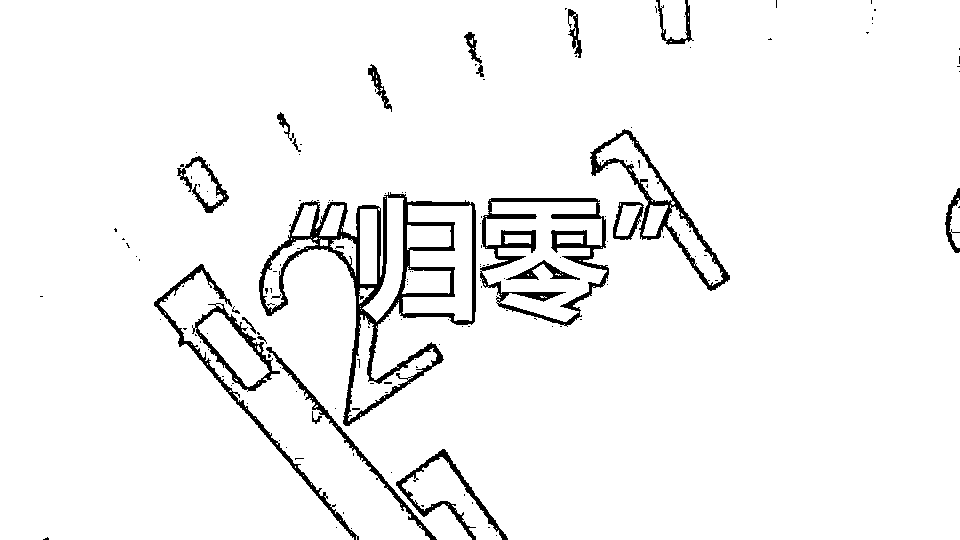

前面说我投诉过竞对，没想到最后演成一场混战，倒为版权合规化“出了力” 😂。

此前只要版权方反馈，无论应用多火，我都会直接下架：一是避风险，二是互联网人的基本操守。

混战开始后，仿佛人人都成了版权方。一个月几十封侵权投诉，真假难辨。

混战始于一些玩家无差别砸盘，阴招损招让人开眼：批量注册苹果小号投诉侵权、恶意刷差评、先刷量再举报、付费后秒退款、伪造官方邮箱给苹果发函（如“阅文集团 yuewen@vip.XX.COM”）、照搬网上模板伪造律师函、伪造版权证明、伪造身份引战嫁祸……

我这个十几年网龄的互联网老boy也没忍住，火力全开加入战斗，导弹核弹一起上……过程不细说。结果是惊动了苹果和重量级版权方：2018年底到2019年初，商店里大量电子书应用集体消失，我的主力号与200多个应用一夜被封，且X年内不得再申请，被动收入跌掉90%。

祸福相依。混战结束后不久，我看到新闻：有开发者因电子书网站侵权被正式起诉并判了实刑。这在当时很罕见，毕竟互联网有避风港原则，某度文库都大摇大摆商业化多年。

应用相对网站还是新事物，司法实践通常谨慎且滞后，但这一判，显然给掘金者敲了警钟。

**6. 复盘与教训**

**1.** 风控能力就是止损能力。

我虽然做了多账号矩阵，却没把高风险和低风险应用分开管理。像图片合集、世界名著这类风险不高，每月能贡献三成以上收入，作为基本盘很稳。可账号整体被端后，这部分也一起没了，实在可惜。

**2.** 选对竞争对手。

别跟没有底线的人拼底线。别贪一时之快；能化敌为友的，才是高手。

**3.** 私域运营要真执行。

2016年起，私域打法逐渐成熟，企业微信替代wetool后更是进入合规爆发期。我在公司带团队搭过私域，但对自己的应用矩阵始终只当小副业，没打算投更多资源和精力。

否则，日活两万多的垂直读书人群沉淀到微信，会是很可观的资产，变现空间也大得多。后来那些书单号，简直像出生在罗马。

**4.** 该退就退。

N×N完成后，我的能力和精力已到瓶颈。应用打磨、变现效率、用户运营都露出短板。比如多数应用直到下架，都没配上push推送这个基本运营功能。

期间有做流量的团队上门，显然研究过我的模式，出价百万想买断矩阵。我当时嫌交接麻烦、怕影响主业，没认真接话（实话）。

现在想，买家很可能就是竞争对手。买断止战，其实是双赢。

我的主业是互联网出境旅游。从BAT出来后一直在这家公司，和一群志同道合的人做了多年，一度看到IPO曙光。期间婉拒过猎头邀约，确实当事业在做。

可口罩一来，整个行业说没就没。手上据说价值八位数的期权，也随之一夜蒸发，像做了场梦。

**7. 现在还有窗口吗？**

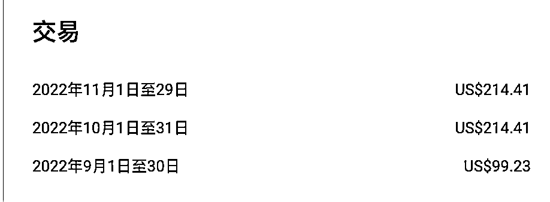

iOS应用还能做吗？

我的判断是：能。竞争烈度可能只有X宝、X音、XX号的十分之一，蓝海仍不少。

之前聊过的老照片修复项目，有朋友应该有印象。我当时凑热闹和朋友做了个应用，两年没更新维护，每月仍有大几百收入。
**8. Q&A**

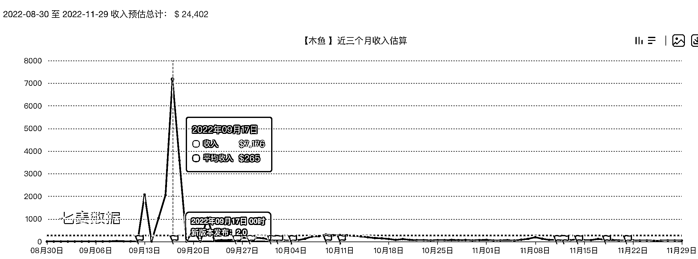
# 小众APP，也能闷声赚钱

前阵子电子木鱼突然刷屏，最猛时一天进账五万元；即便现在，单靠内购每天也能稳定收五百多。想做这类生意，手里至少得有苹果手机和苹果电脑，还得能把应用送上架——这些硬条件天然筛掉了不少玩家。说白了，卡住你的难题，也会变成别人的门槛；完全没门槛的买卖，往往火不久。

接下来聊聊一套简单的起步思路。

【找需求】

**H5**

我刷抖音时看到几个讲道家知识的小号，数据挺亮眼。去百度指数（index.baidu.com）查了“道教”“道家”“道德经”“道藏”等词，发现这几年搜索热度稳定，还有往上走的趋势。

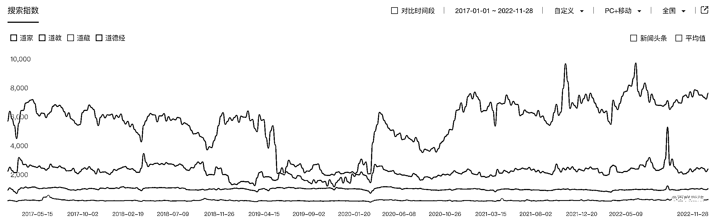

【看市场与竞品】

**H5**

需求有苗头后，再到七麦数据（qimai.cn）看市场。以“道藏”来查，指数显示4601，意味着这个词天天都有人搜。

搜索结果第一名是《诸夏道家古籍》，开发者是个人，应用在图书类免费榜进过前500，预估日下载100到200，上架半年评分只有1星。

当然可以继续拓词，比如“炁体源流”“道德真经”“三洞真经”等，分析得越透，成功率越高。

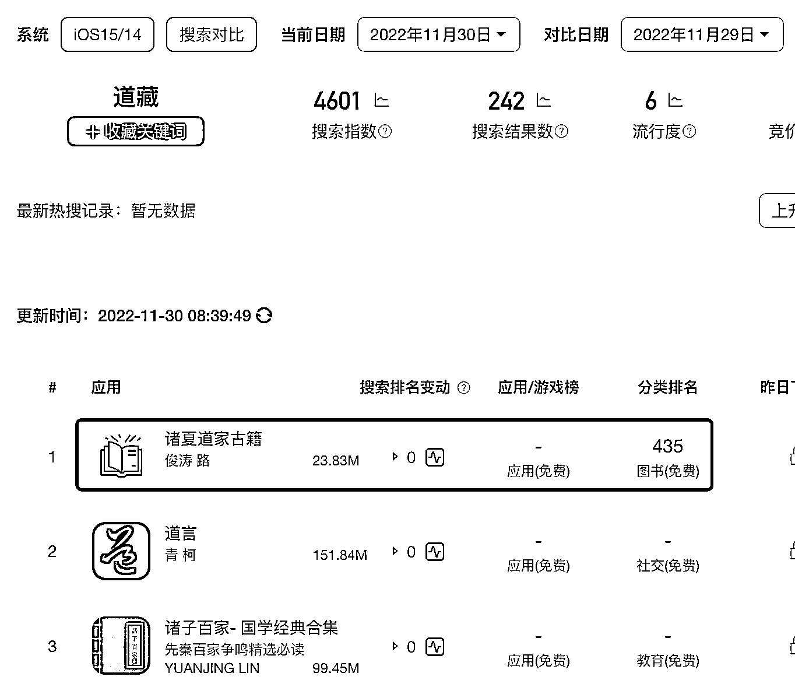

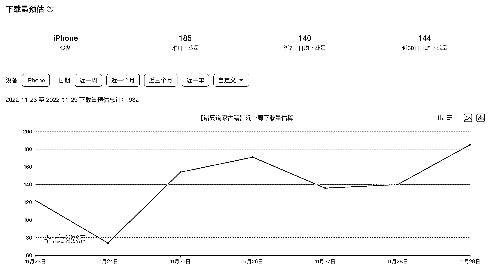

把有下载量的同类APP从App Store下下来体验。以《诸夏道家古籍》为例，做得相当粗糙：左侧导航点了没反应，正文翻译按钮一点就报错，难怪只有一颗星。

**1. ** 掂量自己的开发能力——包括个人开发、资料搜集整合、从**github**搬代码、找技术合伙人等，判断能不能比它做得更好。

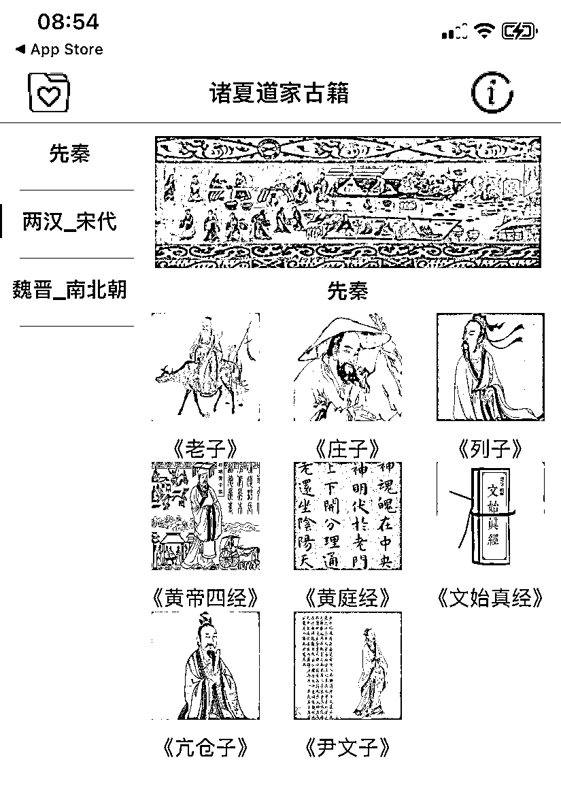

【找资料做**APP**】

**H5**

先看源码支持什么文件类型，再去百度（淘宝效率更高）搜“道藏 epub”“道藏 pdf”“道藏 txt”，下载对应格式的内容来生成APP。

epub源码参考：https://github.com/FolioReader/FolioReaderKit；pdf源码参考：https://github.com/Alua-Kinzhebayeva/iOS-PDF-Reader；txt源码参考：https://github.com/coyingcat/TxtReader。注：每吃透一套源码，就相当于多开一条赛道。

【**APP**发布上架】

**H5**

应用名控制在23字内，副标题15字内，关键词写满100字——这三项是搜索自然流量的主要来源，可参考同类APP调整优化。

还要准备图标（图怪兽或PS简单做）、展示视频或截图（Xcode自带模拟器可直接录屏截图）、介绍描述，这三项决定用户搜到后愿不愿意下载。

按流程提交审核，新手常会卡壳，善用网络搜索逐个击破即可。

APP上架常见问题：https://blog.csdn.net/suifengpiaoluo/article/details/124847124

【流量优化】

**H5**

这类蓝海小众APP，除非撞上热点，日均下载大多几十到几百。好在用户群精准，碰到能解决刚需的功能，付费意愿更强。

除了继续优化标题、副标题、关键词、截图和描述，还可以有意识引导用户给好评。手上有现成资源，也能用已有流量做冷启动，比如下载APP并截图，返现或返积分。

更复杂的刷评、刷榜、刷购买量，对ARPU值还没验证的APP不建议碰。

【商业化变现】

最简单：直接设成付费X元下载。用户没有试错机会，适合刚需且小众的APP。

付费榜参考入口：
https://www.qimai.cn/rank/index/brand/paid/device/iphone/country/cn/genre/5000

最普适：更通用的做法是挂谷歌admob（apps.admob.com）。它不要求企业资质，收入按月以美金结算，满100美金起付；横幅、插页、开屏、激励广告都能接。效率还可以，文档细，遇到问题也有技术支援。

多维度：部分偏高端的用户已经养成付费习惯，不爱广告，更愿意直接买断全功能。

把苹果内购组件（iAP）接进来，用户就能在应用里花钱去广告或解锁功能。举例：免费版阅读时横幅一直挂着，每翻10页弹一次插页，而且只能看前100页；付费后这些限制全部取消。

内购可以单独用，也能和广告搭配。

更长远一点：用多个APP组成矩阵，把精准用户导进私域，慢慢做长期转化。有说法（未证实）称，做得还可以的道家知识微信号，平均每个好友一年能贡献200元以上，毛利率超过80%。

**8. 你可能还想问的几个问题**

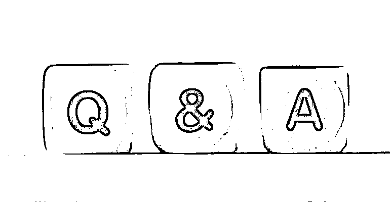

**Q**：做**iOS APP**一定得会写代码？

A：不一定。我本人就不是程序员，不过iOS开发教程至少要通读一遍，还得有快速学习、见招拆招的能力。说实话，不少程序员反而不适合干这个。我见过一些技术人，要么只盯代码，要么眼高手低；写代码强，但在发现需求和推广营销上短板明显，补不回来。找程序员做技术合伙人也是个办法，优势互补，收益一起分。

**Q**：电子书应用还有机会吗？

A：有，现在仍有人在做。一类是经典书，比如世界名著，流量比较稳，但赛道拥挤，得做出差异。另一类敢冒风险博高收益，比如换着马甲的笔趣阁。

**Q**：哪些类目能做？

A：放开想象，多去七麦（qimai.cn）看市场。平台正热的内容，先问自己：未来几年还会有人持续搜吗？

比如最近常被提起的行业资料库、中医养生知识、世界货币知识……电子木鱼火了后，同一个开发者又做了电子转经筒、赛博佛珠，功能极简单，流量也不差。

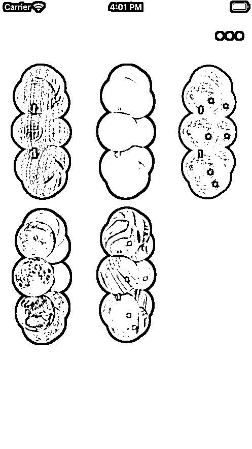

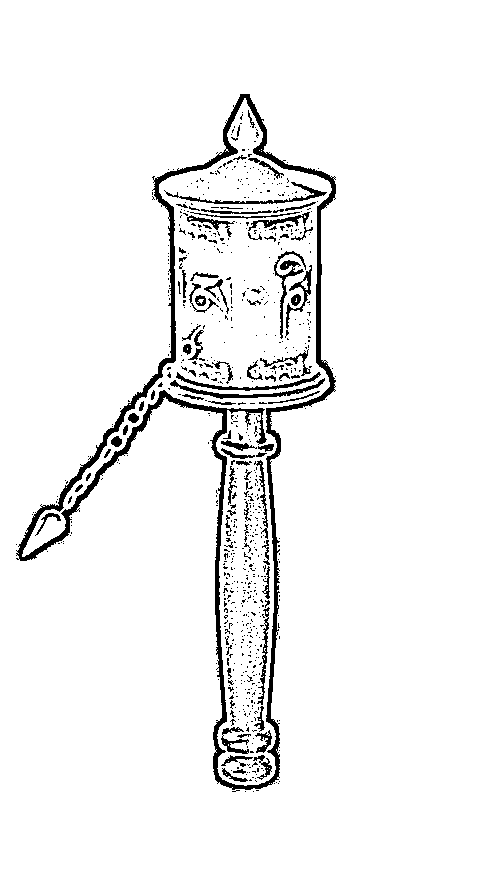

**Q**：为什么只做**iOS**，不做安卓？

A：我精力有限，iOS先做了。安卓盘子更大，机会确实可能更多。但要注意：安卓靠自然搜索带来的下载占比远低于iOS；上架前要申请软著；资金账户和内购得自己搭；admob在国内安卓基本用不了，想接广点通这类广告平台还需要企业资质。反过来说，你能把这些坑填了，它们就是你的壁垒，安卓当然能做。

**Q**：为什么不做小程序，偏要做**APP**？

A：从公司视角，我常劝团队别做APP，改做小程序，因为私域运营的价值已经被反复验证。可放到个人副业上，把运营能力、竞争强度、审核推荐机制、变现路径一起权衡，小程序和APP各有优势，压根不是同一条赛道。单说小程序总包不能超过20M，就卡住了很多想法。当然，如果有成功案例，欢迎来聊 😀

以上是一点过往经验，希望对大伙有一丝启发 💡

我是胡不归，身在苏州的85后全职奶爸，欢迎各位大佬来撩，也求推荐工作。

评论区：
肖江波：快速翻了一遍简单教程，感觉也没那么难[心碎][心碎][心碎]
Summer：几年前我们干过这行，刷榜撸广告费，同行内卷太狠，互相恶意点击是家常便饭，一天几十万广告费撸得心惊胆战
苏玲：认真看完，花了整整一个小时[强]感谢分享
亦仁：感谢分享，已加精华。
时兴淘太狼：思路打开了，感谢
陈真：脑子：这个我也会，手：这都什么玩意，这么难？
代码君：iOS最难的不是项目，是上架，经常被拒，不然光卖马甲包就年入百万
乔：安卓的也能做吗？