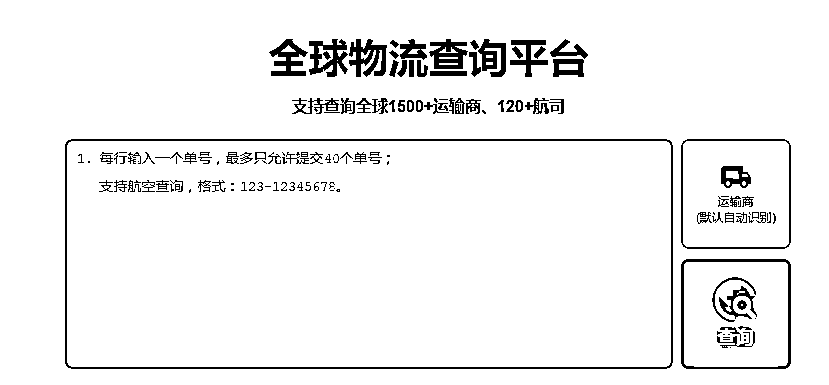
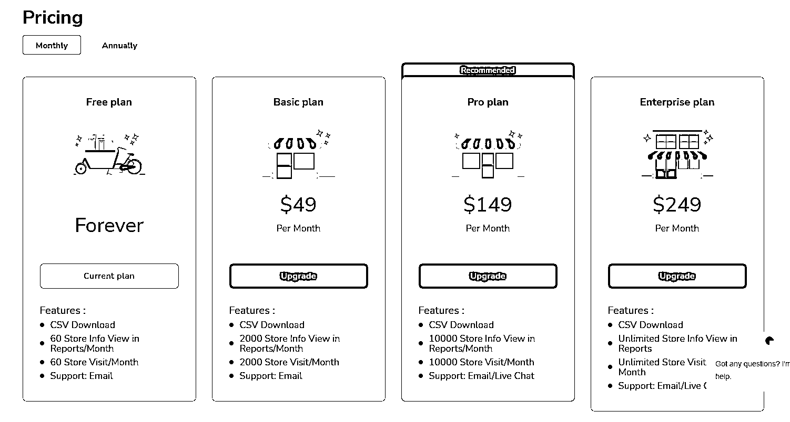
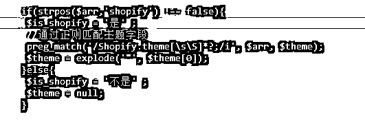
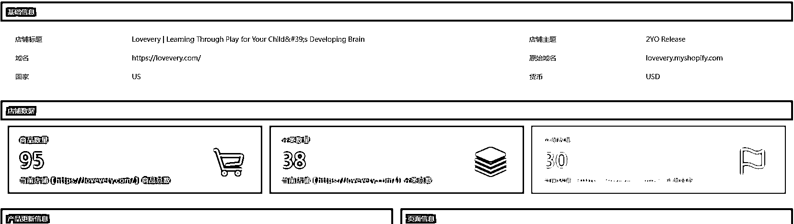

# 独立开发者的小工具“躺赚”指南

先做个自我介绍：我叫吴大白，程序员出身，后来带着技术背景去创业。现在主攻跨境电商，公司业务集中在亚马逊和独立站。

这次受赚钱邀请，在英文工具站小航海里担任教练之一，下面内容来自我的一次航海分享。如果你正想靠工具产品变现，这些经验或许能带来一些新启发。接下来，我会从五个方面展开。

**1、需求是怎么被看见的？**

先说两个小需求。

**需求1：快递状态查询**

公司每月发出的国际包裹不少，物流周期又长，难免出现未妥投之类的情况。一旦未妥投，物流商通常要赔付。于是，批量查询并持续监控包裹状态就成了刚需，几乎每家做独立站的公司都会碰到。

业内有两家比较知名的查件服务商，类似国内快递100，17track是其中之一。它表面的盈利方式很直接：每查一单收几厘到几分钱；背后还有数据等更复杂的模式。我们公司以前每月在这上面要花大几千，旺季甚至上万。过去我把它当成日常开支，没认真看，直到某次月会上和仓储物流团队复盘，才注意到这块成本。

它的原理并不复杂：把市面上多家快递公司的接口接进来，统一对外查询，再做一点基础分析，比如统计半个月还没签收的包裹、筛出妥投失败的订单，让运营能顺着包裹追到具体产品和销售渠道。这些功能开发门槛不高，却极大提升了效率。

**需求2：Shopify站点分析**

这个需求很有代表性的产品是Commerce Inspector。只要做过Shopify，大概率对它不陌生。做独立站的人，几乎都要研究竞对网站，而能快速收录并监控大量独立站，对这类用户来说就是刚需，和现在做抖音离不开抖查查是一个道理。

可以看看shopgram.io。它最初是个免费站点，收集了上百万Shopify站点和商品，分类后供用户查询；从去年开始收费，而且价格不低。

**2、为什么我判断它值得付费？**

这两个场景都落在独立站这个细分领域，既能帮人提效，又是客户不能忽略的需求。

先看快递查询。公司每天几百几千单发出去，快速监控和分析包裹状态是必备动作。如果只靠人工去和快递公司核对，尤其还不止合作一家快递，头都会大。我们公司每月在这上面的支出是真金白银。后来我让公司技术把常用的几家快递接口打通，先做了内部版本；目前还准备开放给几个关系不错的同行，一起分摊维护和服务器成本。但多数跨境公司既没有技术思维，也缺少开发能力，只能购买成熟服务，这就是类似公司能存在的原因。

再看站点分析。选品和竞品分析必不可少，不用类似工具，就像蒙着眼睛做判断。有人会担心数据类工具开发和维护成本太高，个人玩家玩不动；先看第三点，再决定也不迟。

**3、怎样找到最适合自己的开发模型？**

需求看到了，也知道能收钱，很多人却卡在这一步：服务器买哪种、域名怎么选、技术栈用哪套，甚至纠结产品叫什么名字。人一纠结，事情就很难往前走。纠结久了，热情会被时间消耗光。

想在这个圈子混，先把手弄脏、把东西做出来，才有后续。以快递查询为例，先列一份大纲：挑几个常用快递，最好让身边做跨境的朋友推荐；去官网注册账号、申请API，这类接口一般开放；先接两三个API，做一个基础MVP跑起来。更省事的做法，是直接调用17track这类服务的API做一层封装，对外提供查询，只在数据分析上比原服务稍强一点，然后想办法找到一个客户。

Shopify站点分析的核心无非是数据来源。一个Shopify站点只要有网址，就能获取商品SKU、页面、分类等信息。网址怎么来？两个办法：

一是从现有工具上直接爬取，效率最高。

二是在Google里搜【site：shopify.com】，能拿到大量Shopify网站。

这里也顺带列几个常见的Shopify站点内容接口：

获取产品接口：{自己的域名}/products.json?limit={数量}&page={页数}

获取页面接口：{自己的域名}/pages.json?limit={数量}&page={页数}

获取分类接口：{自己的域名}/collections.json?limit={数量}&page={页数}

用代码可以检测目标站是不是Shopify；同理，先抓取页面源码，再用正则匹配特定字符，也能识别它套用了哪套Shopify模板。

更多组合玩法留给大家自行发挥。把这几个接口用起来，前文提到的站点分析工具在开发上几乎没什么技术门槛。

技术栈挑自己熟的，不必反复比较；能抓到老鼠的猫就是好猫。域名、服务器同样别过度纠结，把精力压在离目标最近、最值钱的事情上，准没错。

**4、如何用最小MVP跑出第一个用户？**

找第一个用户，很多人觉得最难，我反而认为这是整件事里最容易的一环。下面几个小技巧，如果照做还找不到第一位客户，欢迎来找我，我给你当第一个客户也不是不行。

a、先发动熟人。每个人身边总有几位朋友和目标人群相关。做上面两类产品，朋友圈里找几个跨境圈的人并不难。实在不行，先免费给对方用，好用自然会付费，更重要的是你能拿到真实反馈。愿意一直心安理得白用的人其实没那么多；真碰上了，也算你运气好。只要你敢站出来展示作品，朋友多半愿意帮你指条路。

b、围绕工具功能写一封真诚的销售信，发在朋友圈，也可以请朋友帮忙转发。行业社群和网站同样是渠道，比如龙哥盟、行业🐧群等。只要产品和销售信足够真诚，总能遇见对味的人。我以前不少工具的启动用户就是这么来的。

c、给工具录一个清晰的宣发演示视频，发到抖音等渠道；预算允许就投一点小广告。曝光量够了，产品又确实能解决需求，还怕找不到第一个用户吗？

**5、怎样让工具产品自行运转，接近“躺赚”？**

个人开发者都希望作品能自己跑起来，帮自己实现“躺赚”，但这件事确实有难度。除了工具本身的运维迭代，营销也不能只做一阵子，而要贯穿始终。下面分享几个做法，让垂直于行业细分人群的小工具尽量实现“躺赚”。

a、学会分销。最好用卡密或工具内部邀请链接实现自动化。微商那套层层分销很凶，核心是让每个人都有利益。我们不必做到层层分销，但可以设置推荐奖励，奖励不一定是钱，也可以是垂直行业资源、工具使用权等。

b、学会建立“护城河”。这是商业里的常用词，放在工具营销里也适用。比如给做Shopify分析的用户定期开建站训练公开课，给做快递查询的用户对接价格更低的物流渠道。这些做法既能增加盈利方式，又能拉近客户关系，提高转介绍。

c、围绕工具目标人群的利基市场，开发更多符合需求的延伸工具，也就是常说的“工具矩阵”。流量可以共享，这也是一种另类的“躺赚”。

d、最最重要的是保证工具质量。可以通过不同方式引导用户提出建议和需求，再持续优化迭代。营销可以交给客户，但工具本身才是根基；做好维护迭代，是所有“躺赚”实现的基础。

最后再说一句：上面两个工具，我们这边都已经有了内部使用版本，只是一直没有对外。这两个方向的开发实现成本与收益回报之间差距很大，所以拿出来和大家分享，有兴趣的可以去研究，中途有问题也可以找我聊聊，若能帮到你，是我的荣幸。

另外，景区里常见的电子导览，扫码就能听景点讲解，确实方便。你有没有想过，景区导览这件事里，也藏着尚未被看见的机会？