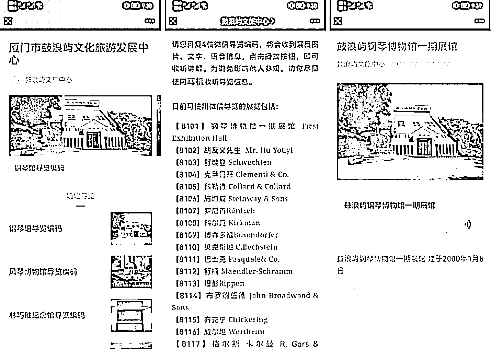
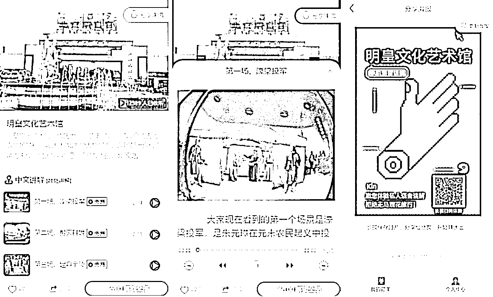
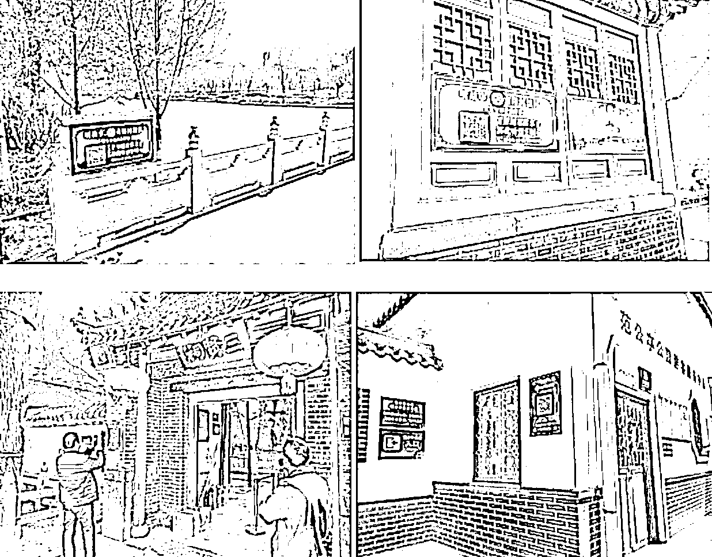

# 扫码听讲解，月月进账两万

作者：雨辰

大家好，我是雨辰，一名 90 后创业者，平时做 H5 营销 SaaS 工具。2019 年，我给景区搭了一套语音导览，后来每月不用投入太多精力，也能有两万多元的被动进账。这个项目启动成本不高，钱主要花在录音、程序开发和服务器上，跑通后收入可以持续产生。下面把我的实操经验拆开讲讲，希望对你有用。

目录：

1. 需求从哪里来？
2. 推广怎么铺开？
3. 收入怎么来？
4. 复盘

**—01—**

**需求从哪里来**

2019 年 12 月我去厦门鼓浪屿玩，顺手关注了景区官方👸号，发现里面提供语音导览。体验却别扭：每听完一处，游客得先退出，翻找下一处编号，回到👸号输入编号，再点进页面继续听。这套流程下，很少有人愿意把全部景点听完。

景区游客有听讲解的刚需，请真人导游又贵，电子导览是合适的替代品。它其实很像知识付费音频课：讲解内容现成，整理成易懂的语音页面，再让游客付费收听，是否可行？

旅行结束后，我陆续关注上百个景区👸号，想确认市场里是否已有玩家。结果发现，这已是竞争很充分的红海。规模稍大的 4A、5A 景区基本都配了导览：少数自研，界面和操作体验却不算好；多数接第三方系统，携程、金牌讲解、三毛游、古猫等平台功能成熟，付费销量也不低。单个景区售价大概 5 到 20 元，按合作景区数量就能粗算收入，大平台动辄覆盖几百上千家，加总起来相当可观。平台方主要前期投入录音和系统建设，上线后维护量小，属于前期辛苦、后期持续收钱的生意。

鼓浪屿这样的 5A 景区尚且只是简陋方案，更小的景区很可能连语音导览都没配。当天我在网上找到一套业务逻辑相近的源码框架，约一周时间搭出 MVP，核心就两件事：用户付费收听，以及分销返佣。

系统有了，我又整理资料、做推介 PPT、注册👸号、购买域名、上线一个静态单页官网并用表单收集意向，同时申请商标。准备完这些才正式去谈合作。早期合作方式对景区很轻：他们无需出资，只要给讲解稿和景点照片；录音、系统搭建、展牌二维码设计由我们完成，景区负责印刷并摆到园区里。游客扫码付费收听，收入双方各拿一半。

**—02—**

**推广怎么铺开**

1. 从老客户里定向推荐

我们原本就给中小商家做营销活动 SaaS，注册客户已有数万。先从老客户里翻过往活动记录，筛出景区、博物馆等主办方；因为之前合作过，联系很顺。回访后确有收获：一部分景区已上线或暂时没需求，但有几家一直想做却没落地。我们方案前期不让景区掏钱，还能带来额外收入，双方很快签约并拿到授权书。

拿到解说词后，我去淘宝找真人配音。常规报价约每百字 20 元，量大能压到每百字 10 元；用于景区讲解已够用，但低价主播经验有限，容易念错字音，需要反复返工。录音完成后，把文字、图片和音频录入系统，交景区验收；通过后设计二维码展牌，由景区自行印刷并摆到显眼位置。游客扫码后可先免费听前几个景点，想解锁全景区讲解则支付 5 到 10 元。

2. 发展代理合作

回访对象里，有些只是曾替景区办活动的执行方，并非景区本身，但他们握着景区关系。这类伙伴就转成代理：由他们去谈，谈成后从项目收入中分一部分给他们，只要景区持续有流水，代理也能持续分到。目前约一半合作景区来自代理渠道。

3. 做知乎和百度知道问答

站外推广主要放在百度知道和知乎问答。先把与景区导览相关的问题链接收集起来，逐题准备回答，再请人代发并优化到前三名。现在主动来问的客户基本来自知乎，累计收到 52 份留下联系方式的合作申请。

4. 试水百度 SEM，未跑通

我们也在百度、360 投过竞价，计划约跑了一个月，几乎没转化，只好停掉。原因在于点进来的人多是普通游客，想找某个景区的讲解，并非目标客户。印象里只有 2 个景区管理方通过 SEM 咨询，最终也没成交；当然，这与我们并不擅长 SEM 也有关。

**—03—**

**收入怎么来**

1. 游客付费收听

直接签约的景区，我们分五成；代理谈成的项目，我们拿两成半。景区有淡旺季：节假日单日流水可达几千元，淡季通常每天几百元。游客付费这部分约占总收入七成。

2. 👸号沉淀

游客收听要先关注👸号，粉丝因此沉淀在我们手里，后续无论是卖号还是接广告都有空间。眼下粉丝只有几万，尚未专门做粉丝变现。

3. 给景区做定制

还有景区希望有导览却不愿向游客收费，就改为景区按年采购。价格依据景点数量，目前合作区间为每年 5000 元到 2 万元，这部分约贡献总收入三成。

**—04—**

**复盘**

整体看，这个项目进入门槛不高，启动投入集中在录音、程序开发和服务器三块。若能打通景区、博物馆、游乐园、展厅等资源，后续便能形成较稳定的固定收入；签约对象越多，收入也会随之增长。

评论区里，禹问：文案、音频都摆在外面，怎么防复制？我回复：音频能加水印；文字很难彻底防抄，除非去做著作权登记。禹接着补充：只能加快覆盖，用大量用户把成本摊薄，让后来者进不来。我也认为，这是理想状态；现实是技术门槛不高，谁都能实现，最后拼的是手里的独家景区资源。Hugo 说，这个项目有意思，商务推进和独家资源才是核心。龙哥表示已加精华。还有朋友提到，他认识的人五年前就开始覆盖景区；我追问了对方目前的合作景点数量和收益。