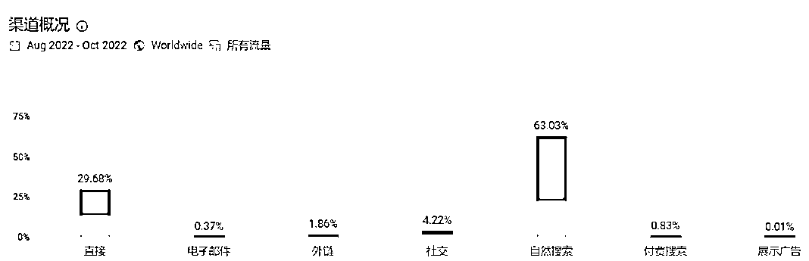
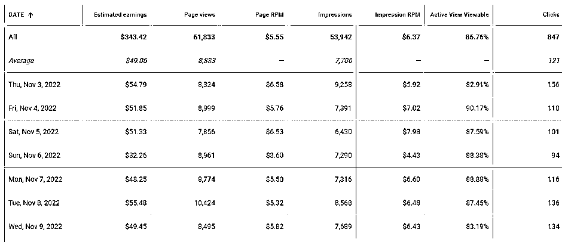
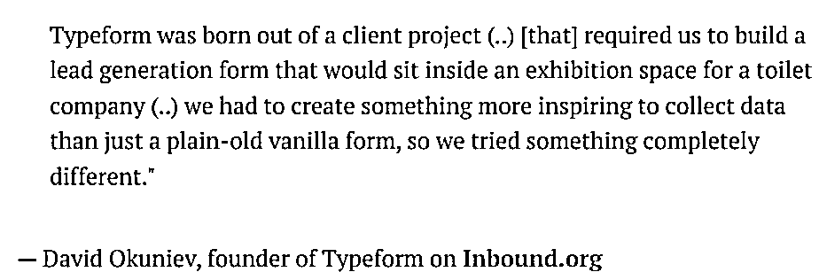
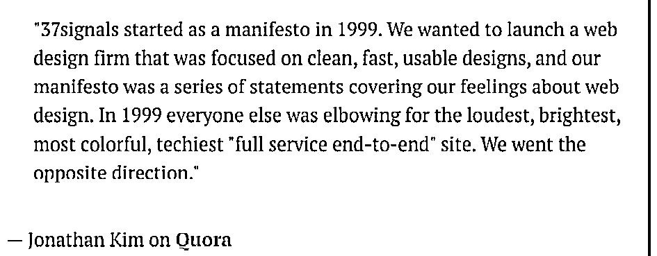

# 产品灵感从哪里来？

作者：刘小排  
日期：2022-11-10

大家好，我是刘小排，好久没出来和大家聊天了。我在一家头部服务机器人创业公司做产品总监，平时和机器人打交道；周末偶尔手痒，也会以独立开发者的身份做点小产品。这篇文章，主要想写给独立开发者和创业者。

在我看来，一个成功率比较高的产品 idea，通常要同时满足三个条件：

第一，需求必须真实存在；
第二，你得是这个领域的专家，哪怕正面对决，也比对手做得更好；
第三，你能长期坚持，尤其是最初缺乏正反馈的阶段。

基于这三个条件，我总结了五种常见的寻找 idea 的方法。按我个人判断的成功率从高到低排列，分别是：

1. 原生 idea ★★★★★
2. 抄成功竞品，再做出差异化价值 ★★★★
3. 分析搜索关键词，找到尚未被满足的需求 ★★★
4. 有人愿意预付费找你定制需求，再将它产品化 ★★★
5. 生造的 idea ★

下面一个一个聊。

## 一、原生 idea：从自己的问题里发现机会

英文叫“organic idea”，这大概是硅谷创业圈最推崇的思路，无数科技创业和投资大佬都买账。

它的意思很直白：解决你自己遇到的问题，让自己成为产品的核心用户，并且每天使用它。

Paul Graham 有一篇流传很广的文章，核心观点是：创业点子的动词，不应该是“想出来”，而应该是“注意到”。那些从创始人亲身经历中自然长出来的项目，被他称为 organic startup idea，而最成功的初创公司几乎都从这种点子开始。原文链接：http://paulgraham.com/startupideas.html

硅谷还有句老话叫 eat your own dog food，也就是“吃自己的狗粮”，意思同样是：你得先当自己产品的用户。这句话过去五十年里被无数公司和大牛反复引用。

独立开发者 Peter Levels 在《Make》这本书里也说过：最重要的就是从解决自己的问题里寻找 idea。他还建议，每天记录3个自己遇到的问题，攒一周，你就能得到21个产品 idea。

这样的成功案例实在太多。苹果的起点，是沃兹出于个人兴趣组装电脑给自己用；Facebook 的前身，是小扎自己想用的一个给女生打分的网站，叫 hot-or-not；Airbnb 则是因为创始人交不起房租，开始出租家里的气垫床，顺带提供早餐，Air Bed and Breakfast 就是品牌名的由来。BuiltWith 最近也热度很高，公司只有一个人，年收入却达到1400万美元，起因只是创始人想知道别的网站用什么技术栈，于是干脆自己做了个工具。生财有术这一社区，最初也是亦仁找不到聊创业的交流场所，索性自己建了一个。还有 nomadlist.com，Peter Levels 本人就是数字游民，想知道哪些城市适合数字游民生活，最开始只做了张 Excel；后来发现很多人都在传阅，才把它产品化。等到其他团队带着更多资金、资源和人力想来复制时，全都打不过他，因为没人比他更懂用户需要什么。

为什么这套方法成功率高？回到那三个条件：需求真实，因为来自你自己的感受；你是专家，因为你已经研究了很久，市面上没有让你满意的方案，你最懂自己要什么；你也能坚持下去，因为你自己就是用户，发自内心希望产品越来越好。哪怕日后有人觊觎你的成功，你作为专家也完全不慌。

当然，它也有一个绕不开的问题：你怎么确认自己的需求，别人也需要？这个问题没有标准答案，世上不存在成功率100%的创业方法。只能说，原生 idea 的赢面会比其他方法更大一些。

## 二、先抄成功竞品，再做出差异化

对大部分生财有术圈友来说，这是我个人最推荐的方法。

它最大的优势是：成功竞品已经替你验证了市场存在、这条路能走通。生财有术本身就像一座案例宝库，里面沉淀了大量实操经验，你完全可以从模仿入手，再不断优化、做出差异点。

“抄”这个字听起来不太好听，但好不好听不重要，能解决问题就行。

商业世界里，这样起步的成功公司太多了。Google 是世界上第11个搜索引擎，它先照着前面的产品做，再用 PageRank 算法让搜索结果排序更合理，这就成了差异价值。百度是学 Google 的，但主打“更懂中文”。腾讯早期模仿了当时已经很成功的 ICQ，先做 OICQ，后来又改名 QQ，产品体验和用户增长都明显超过原版。后来的微信，这个 idea 也并非原创。优酷、滴滴、微博、淘宝、抖音……几乎都是先“抄”，再做出差异化价值，最后跑出来的。

这方法优点很明显，但坑也不少，至少两点要记住：

1. 你的差异化价值具体是什么？这是最容易忽略的问题。
2. 你能否比原版更懂用户？能不能像 QQ 对 ICQ 那样，在产品体验和流量渠道上做出优势？如果做不到，模仿就只是模仿。

## 三、从搜索关键词里挖出空白需求

第三种方法，是把搜索关键词当成一个观察窗口，借此发现还没被满足的需求。

全球每天约有30亿次搜索，其中20%的搜索词组，是昨天从未出现过的。换句话说，每天都有新机会冒出来，就看你能不能发现。

这套方法更细的操作，生财有术的三林老师专门分享过，我不再展开，直接放传送门：https://t.zsxq.com/07kJf0JJ2

靠此方法成功的典型代表是 Veed.io，创始人有一句金句：“Make something people search for”——做人们会去搜索的产品。Veed.io 也确实是这么做的，目前每月网站流量超过2100万，其中63%来自搜索引擎。

我自己也是这套方法的实践者。今年9月，在生财有术的海外工具小航海中，我偶然发现一个不错的关键词，用一个周末——准确说是半个周末，一天——做了个很简单的 MVP。现在，它每天能给我带来大约50美元的广告收入，差不多是躺赚。但这才只是开始，后面我多半会继续投入，把它做成更好的产品，把变现方式从广告逐渐变成付费。平时太忙没时间折腾，所以我现在正期待下一个周末早点来。

这套方法最大的问题是：好词真的不好找。怎么办？只能多试，同时把试错门槛降到最低。如果你真能保持每天做出1个 MVP 的节奏，一个月就能试30个产品 idea，然后看数据说话：哪个 MVP 数据好，就把资源集中到哪个上面。

至于怎么用一天时间做出 MVP，下周我会专门写一篇，拆解一个我亲手做的真实案例。

## 四、把付费定制需求，做成标准化产品

这个模式我很喜欢：有人愿意提前付费，请你做某个定制需求，你再把它产品化，卖给更多人。

生财有术的码叔就是这套方法的典型。他从今年6月开始自学 Google 插件开发，半年时间已经变现了好几十万，而且方法可以复制。他的原则是：永远从真实定制需求出发，从来不自己生造一个 idea。某个人正好有这个需求，又知道码叔会开发，于是付费请他做；码叔做完后，再想办法把它变成标准化产品，触达更多客户。

我自己的经历也有几分相似。十年前，我在一家主要接欧美外包订单的软件公司工作，公司叫重庆诺怀软件科技有限公司，到现在还在运作，我是其中一个小股东。老板很早就看明白了：既然客户愿意花钱让我们做，说明需求真实存在，那为什么不试试把它标准化，卖给更多客户呢？后来这家公司也陆续推出了一些小型 SaaS 产品，有的还做得不错。

国际上更出名的案例是 Typeform 和 Basecamp。它们最初都是软件外包公司，从客户需求中找到共性，再将之产品化。创始人的原话是：

生财有术里有很多独立开发者，经常接到付费定制开发的需求。与其各自单干，不如大家一起组织起来，发掘其中产品化的机会。

## 五、生造的 idea，尽量别碰

严格来说，这不是一种好的方法论。靠凭空生造 idea 做成的公司，屈指可数。

把它单独列出来，是为了提醒大家：下次脑海里突然冒出一个“天外飞仙”式的想法，感到“我想到一个绝妙的点子”的时候，先问自己两个问题：用户在哪里？谁愿意付费？

人最容易骗的其实是自己。我们很容易被自己生造出来的 idea 搞得情绪高涨，但请记住：千万别轻易爱上自己的点子。

## 六、整体建议

最后给我的整体建议：

1. 想做长期价值，请优先考虑原生 idea。它成功率最高，你做的时候也会更有激情，甚至产生一种使命感。
2. 想在短期内快速出成果，可以考虑第二种方法，先拿到正反馈。这是见效最快、弯路最少的路。生财有术的圈友尤其要重视，别坐拥金山却浑然不觉。
3. 第三种和第四种方法，说穿了，你需要一套“系统”。怎么构造一套系统，让你能快速发现关键词、快速做出 MVP？怎么构建另一套系统，让你能持续接到有人愿意付费定制的需求？

欢迎大家来评论区和我一起讨论。