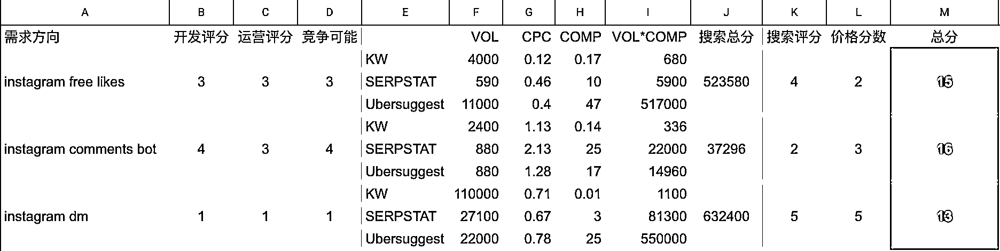
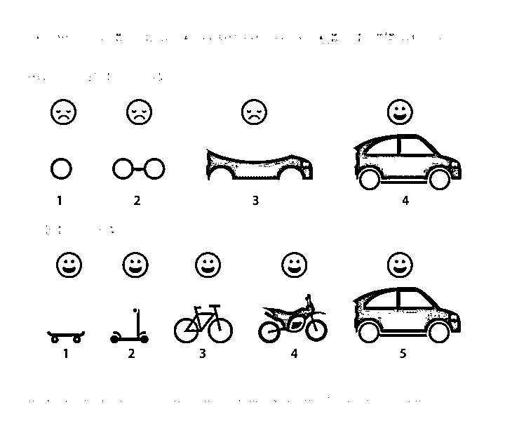

# 小众产品找需求：8步落地路线

文/壹树 · 2022-06-17

做产品时，用户、痛点、问题、竞品、数据、产品这些词总在脑海里打转。真正关键的是把它们连成一条线，这条线最终会指向一个可能落地的产品。每个人都有自己的解法，常言道“条条大路通罗马”，挑一条自己最熟的路走，效率往往更高。

方法很多，但先固定一套自己顺手的动作。下面这套流程，是我做浏览器扩展小产品时常用的顺序，不一定适合所有人，却是我目前最习惯的：先定平台，再站到用户位置；从问题出发，翻译成需求；随后看竞品、查数据，做出决策，最后落到产品。做iOS、安卓产品也可以参考，再按实际情况调整。

## 1、平台：先选有足够用户的地方

我们在网上冲浪时常常没有明确目标，很容易逛着逛着就迷失。所以要先把自己限定在某个区域，为最终产品找一个起点。

平台不能随便盲选，最好选用户基数够大的地方，比如全球流量榜前200的网站，或者某个垂直赛道前10的站点。用户足够多时，即便只解决其中1%人群的某个问题，规模依然可观；后期投放推广也能有相对清晰的人群标签。

## 2、用户：注册进去亲自体验

选定平台后，注册账号，以普通用户身份走一遍。把显眼的按钮都点一轮，常用功能流程多体验几次，平台的基础功能也就摸得差不多了。这个过程中，运气好的话能直接发现问题。

同理心是产品经理常被要求具备的能力，但面对新平台，共鸣往往没那么容易产生。更实际的做法是体验产品流程，多想想它到底解决了哪些核心问题。

## 3、问题：主动把问题挖出来

体验完平台，不一定马上能找到使用上的毛病，那就换几条路：

1. 先揣着半个问题去搜索；
2. 拿26个字母逐个组合去搜索；
3. 带着好奇心和工具去制造问题。

这个过程要记录：感兴趣的问题记下来，数据表现突出的也记下来。它可能显得有点漫无目的，因为一个问题常会延伸出四五个问题，浏览器标签页越开越多。但别偏离最初选定的平台；就算撞见其他平台的有趣问题，也先记下，不要立刻跳出去。

## 4、需求：看别人已经给出的答案

找问题的过程中，常会发现一些用户已经给出了可行答案，而且大多做成了成型产品。别人也要发软文引流，所以别吝啬点击，直接进产品官网看介绍，重点看四件事：

1. 它主要帮用户解决哪些问题；
2. 主要功能模块里，哪些收费、哪些免费；
3. 产品定价策略；
4. 官网访问量，可以用SimilarWeb查。

## 5、竞品：分清通用免费和差异收费

走到这里，相关竞品资料通常已经攒了不少。有的功能强，有的功能单一，但各有核心价值。我做竞品分析时，一般把它们归成两类：通用免费功能与差异收费功能。

通用免费功能如果各家高度重合，多半处理的是不痛不痒的小问题，主要起引流或占位作用。差异收费功能则会直接拉开价格差，这个价差可以反过来当作定价参照。很多时候，只要围绕一个差异点解决用户某处需求，就能做成一个小产品，并在现有用户群里分到一杯羹。

## 6、数据：别忽略侧面信号

寻找答案时，除了记录工具数据，还要留意一些容易被忽略的数字。比如Quora、Reddit、Youtube、Medium这类问答站或个人站，回复总数、点赞数、浏览量、评论数，都能作为关键参考，从侧面反映用户群体是否够大。

Quora、Reddit、Medium上的长回复尽量细看。针对现有竞品，其他用户常会提出意见，可以带着“产品名+Review”去找。这些意见很可能就是将来的改进方向。一个产品还有用户反馈，说明它仍有不足，也还有再往上走的空间。

## 7、决策：用评分表帮自己下判断

通常我会把第1到第6步反复走几遍，甚至十几遍。次数越多，可选项越多，摆在面前的选择也越多。

比如我曾围绕instagram相关需求做了一张评分表。它不一定有很大实际意义，因为评分偏主观，更多靠直觉和经验。当我不知道该怎么开始时，就交给这张表来决定，按自己定的规则走。

表单地址：
https://docs.google.com/spreadsheets/d/1fw6106Zh4IH4duvrKoh0MWQXeEIMDHa78RwFbmdSby0/edit?usp=sharing

需求方向：这个扩展要帮用户解决什么。
开发评分：越容易实现，分数越高。
运营评分：是否需要精细运营；instagram dm这项我给分偏低，因为Google前三名已有结果。
竞争可能：参考Google首页竞品的访问量，再看Chrome Store同行的用户量和评分，综合打分。
搜索评分：用搜索数据工具得到总分后再折算。
价格分数：看定价空间，通常拿竞品做参照；igdm属于安装型软件，报价可以拉得比较高。
兴趣评分：我后来删了，因为多数方向我都感兴趣，区分度不高，:P。

注：每项最高5分，最低0分。

表格填完后，就挑总分最高的方向去做产品。这张决策表也不是一次性用品；产品用户量起来后，它还能服务后续产品矩阵。用户都来自同一个平台，你能满足的需求面越宽，用户对你的依赖就越强。

## 8、产品：设计阶段的关键是做减法

决策过后进入产品设计。这个环节最重要的是做减法。

任何产品，人人都能说出点所以然，“人人都是产品经理”也说了很多年。但先别激动，克制一下，回到最小可用产品（MVP）的思路。

例如：

1. 做自动化工具，先别急着堆各种设置，只放“开始”和“结束”两个按钮就够；
2. 做电商店铺分析工具，也别一上来给一堆筛选条件，先把店主最关心的数据摆出来。

减，继续减，直到用户不用想就知道怎么用你的产品。

## 总结

这8个环节，先逐个理解它们背后的意义，再把它们串成一条线。想一下子变成习惯不现实，但建议按这个顺序多练，让好奇心带着走；熟起来以后，你会看见以前忽略的问题。

另外，这套思路不只适用于浏览器插件，换到其他产品同样能用。

入门篇在这里：https://articles.zsxq.com/id_5n39xwuf7b8o.html
备注：文中提到的搜索方法可看第七章：https://docs.qq.com/doc/DVkpNanBSQkxYckZR?u=5f10639b05044d3086bcdef7e7f9e631