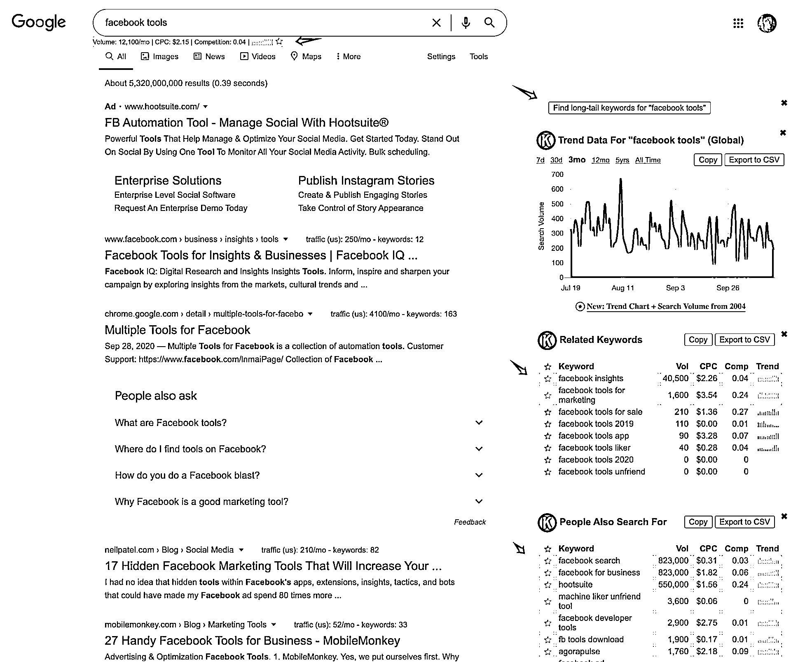
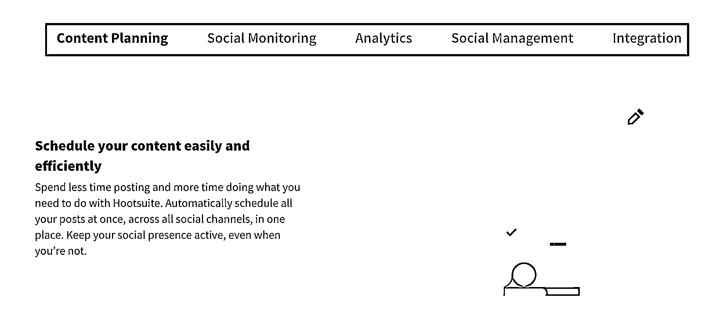
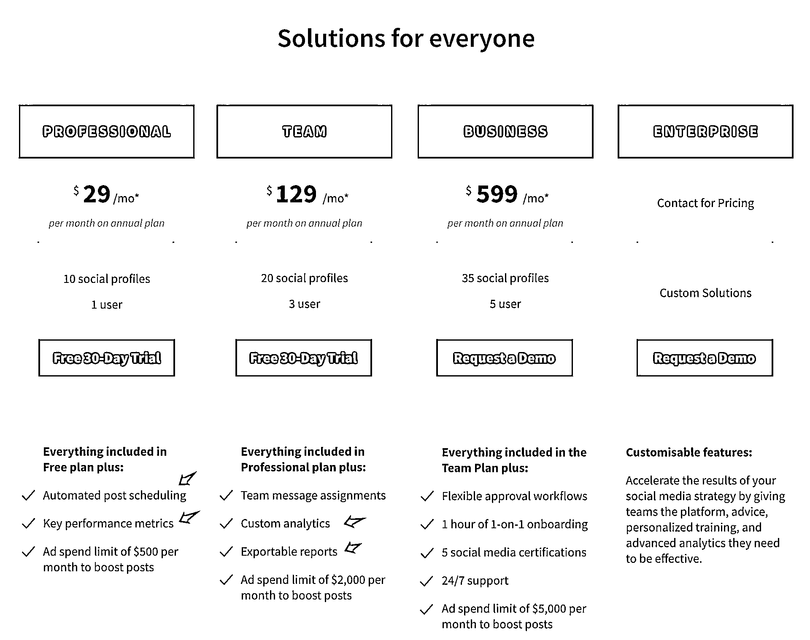
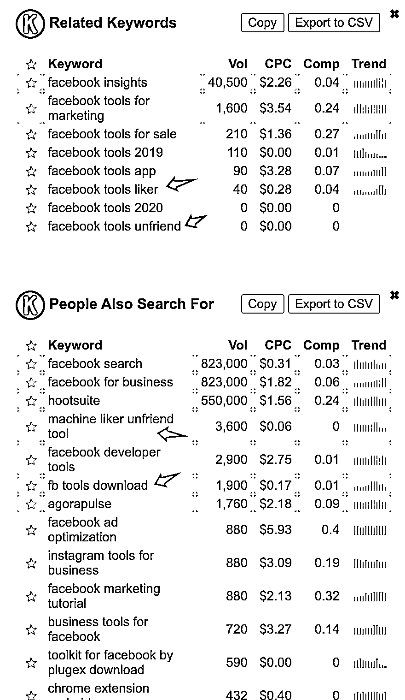
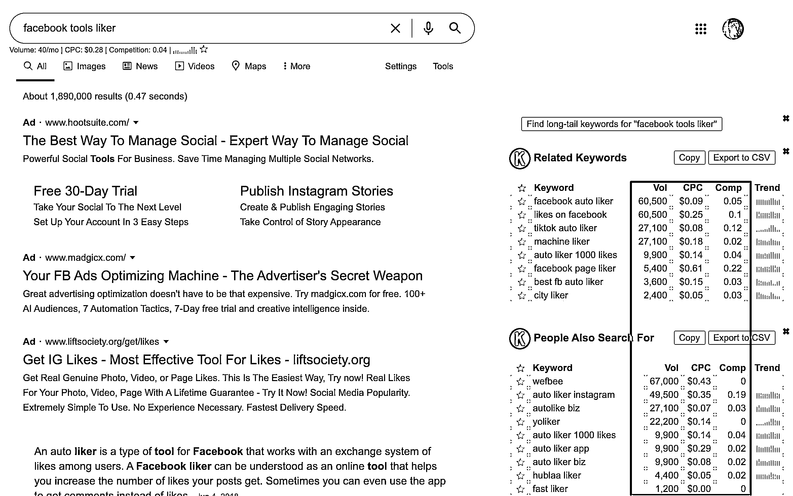
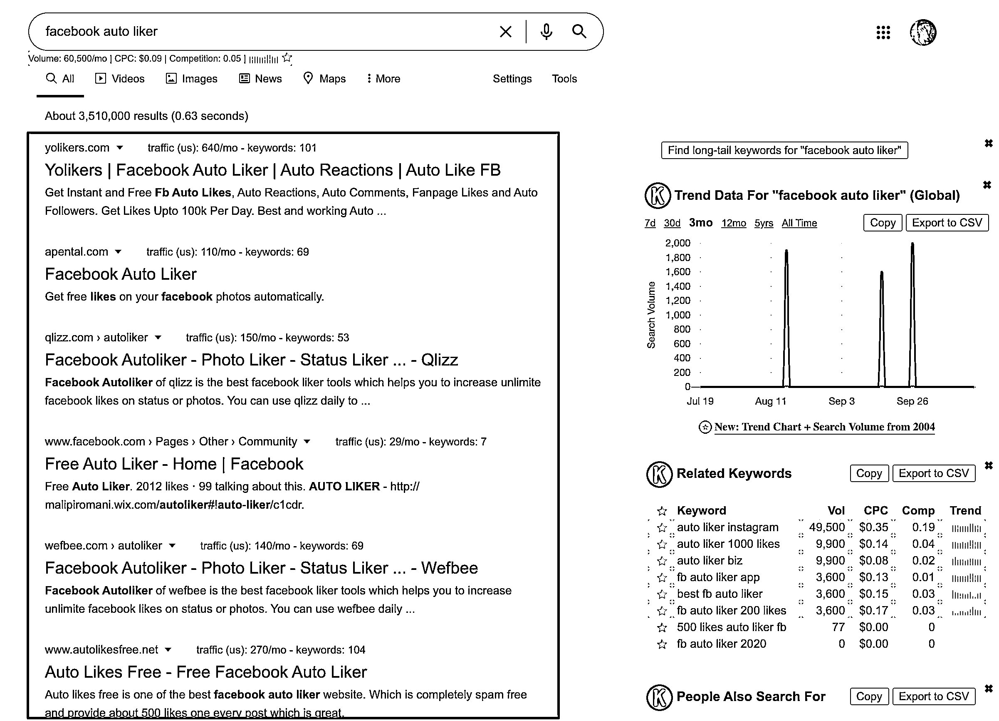

# 小众插件掘金：一套入门级选品思路

大家好，我是壹树。过去近四年，我独自扎在海外浏览器插件这个偏冷门的细分市场。今年 5 月，我离开职场，正式把这个“小生意”从副业转成主业，现在专门做细分软件和插件的变现。

今天不绕弯子，直接分享一套适合入门的需求挖掘方法：先用宽泛关键词找到成熟大产品，再拆它的功能模块，顺着功能挖长尾词，最后用长尾词的搜索数据判断小产品有没有机会。

这套流程会用到一款浏览器插件，安装需要梯子：

Keywords Everywhere - Keyword Tool  
它付费，充 10 美元得 10000 点数，能用挺久。  
https://chrome.google.com/webstore/detail/keywords-everywhere-keywo/hbapdpeemoojbophdfndmlgdhppljgmp

做细分产品，工具类是很稳的切入点。它之所以“小”，是因为只瞄准用户的一个具体需求点，而这个点就是产品原点。当然不能瞎找，可以从视频、图片、社交、电商等常见领域切进去。

下面就一步步演示。我们拿 Facebook tools 这个宽泛词开刀。搜索后，插件会直接在页面列出 Volume、CPC、Competition、Trend 等关键数据。它们只是参考值，换别的同类工具数据会有出入，但仍有判断价值。

先简单说明这几项指标：

- Volume：单月搜索次数
- CPC：每次点击的广告成本
- Competition：竞争强度，数值从 0 到 1，越大越难
- Trend：搜索热度的走向

通常要把前三项放在一起看，对它们的组合保持敏感，否则容易错过机会：

1. 搜索量高、CPC 低、竞争度也低，这种关键词值得重点关注。
2. 搜索量小、CPC 高、竞争度接近 1，说明里面已经挤满了对手。

不过对细分产品来说，大词并不好用。搜索量再大，现在去抢基本是当炮灰；用户意图也太泛，没法直击那个具体需求点。

这时如果看到相关广告，别忽略，点进去。接着重点浏览它的功能介绍页和定价页，这两处信息量很大。

功能页会告诉你它提供什么能力、帮用户解决什么，借此判断功能边界，也能大致评估技术实现难度。

定价页通常会把功能点拆开列出来供对比，比如 automated post scheduling（定时发帖）、key performance metrics（关键性能指标）、custom analytics（用户分析）、exportable reports（导出数据报告）。这些既帮助我们理解产品，也直接暴露了用户能感知的“点”。

从这些页面里可以提炼出 automated、scheduling、export report、analytics 之类的词，它们就是产品的需求点。把它们和 facebook 拼在一起继续搜，常能挖到平时注意不到的细分方向。

再去看 Related Keywords 和 People Also Search For 区域，通常会冒出一批更细的词，很多是英语动词结构，比如 Facebook tools liker、Facebook tools unfriend、FB tools download。

点进去会打开新世界，比如 Facebook tools liker。

再点 Facebook auto liker 看看这些站，它们不是靠爱发电，都是能赚钱的。

接着还会看到 Facebook auto poster、Facebook auto friend request 等词，这些就是细分产品的需求点。

到这里，你会看到各种各样的细分产品机会。只要把 Facebook 换成 Instagram、YouTube、Amazon、Shopify、eBay 等平台，数量多到挖不完。

发现需求点之后，怎么用数据判断要不要做成产品？下面是我做插件总结的经验阈值，不一定百分百准确，但可以参考：

- 社交方向：月搜索量过 2000、竞争度低于 0.25 就可以做；CPC 一般不高，但订阅用户流失偏快。
- 电商方向：月搜索量超过 500、竞争度低于 0.2 可以试；这类 CPC 往往偏高，不过订阅流失率低，变现更持久。
- toB 方向：月搜索量高于 1000、竞争度低于 0.2 就可以做，流失率比电商类略高。

我建议从自己熟悉的技术平台开始。每上线一个产品都要复盘，复盘能提高下一个产品的成功率，这一步非常关键。

习惯这种搜索方式后，你会发现不少工具类产品底层逻辑很像，变的是平台或载体：PC 转手机，手机转平板，exe 转浏览器插件。每次迁移都会重新洗牌用户。如果某个需求点的搜索数据不错，尽快做产品，变现并没有想象中那么难，因为它已经在别的平台或载体上被验证过。

相关工具推荐：  
https://neilpatel.com/ubersuggest/  
https://serpstat.com/

下一篇我会补上海外小众产品在收款渠道上的那些坑。8 月我的 PayPal 和 Stripe 接连被冻结：疫情期间付费用户增加，争议率升高，触发了银行风控。结果，我所有插件的付费订阅都没法自动续费。后来花了一个月，挽回了接近 50% 的付费用户，:P。

对小众产品感兴趣的朋友，可以加微信交流：shuhankuang

另外插一句：G Suite 已经更名为 Google Workspace。它拥有 20 亿用户，且以 toB 企业用户为主，里面同样有插件市场，你懂的。:P