# 从TikTok搜索热词里，找到出海产品的赚钱机会

作者：三林  
日期：2022-04-11

标签：Google搜索流量、关键词挖掘、TikTok、SEO；全文约3000字，读完需8分钟？

大家好，我是三林，一直做互联网产品。前阵子写过一种“资源套利”型下载站：靠SEO把搜索流量接进来，再引导到公众号靠广告变现，它盯住的是国内用户想用谷歌浏览器插件但下载麻烦的痛点。那么顺着需求找，还有没有类似的机会？我决定拿TikTok当样本来拆。

挑TikTok的原因是它足够热门，很多圈友也在试水。我的做法并不复杂：把TikTok相关的搜索词拉出来，比对它们在Google上的搜索量，看哪些词长期稳定且量级可观，再看看市面上有没有对应的产品在满足。用户愿意主动搜索，说明背后有真实需求；大数据会把这些需求暴露出来。

本文目录
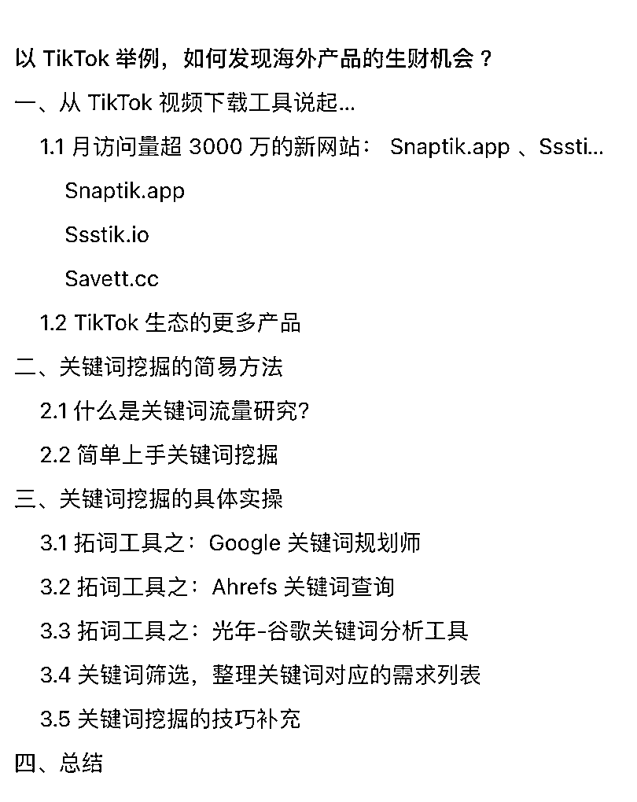

一、从TikTok下载站先说起
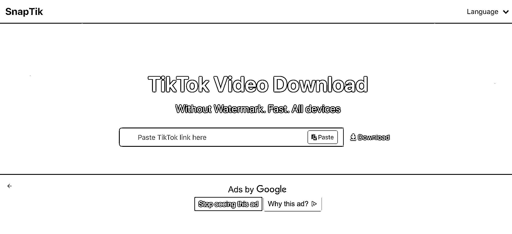

用搜索量扫一圈，最先被发现的品类，就是帮人下载TikTok视频的网页工具。我统计了一批第三方下载网站，流量排前10的站点，合计月访问超过8000万（SimilarWeb口径），其中两个表现格外亮眼，下面单独拆解。
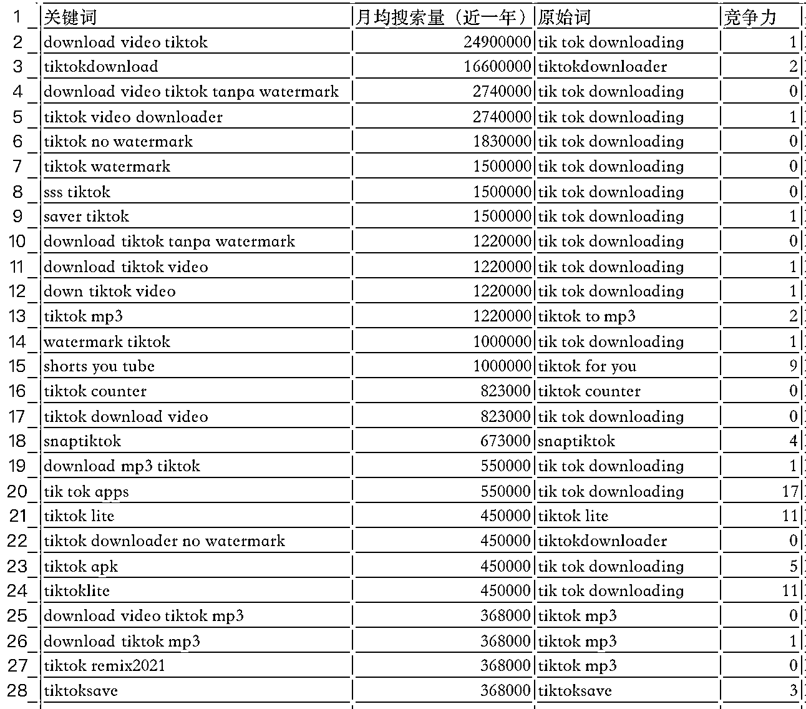

这些下载站主要承接一组词：tiktok video download系列。拿“download video tiktok”来说，过去一年的月均搜索量达到2490万次。

1.1 月访问量超3000万的新网站：Snaptik.app、Ssstik.io

Snaptik.app主打TikTok视频无水印下载，宣传卖点是快速、无水印、全平台可用。SimilarWeb显示，它上一月访问总量为3100万（桌面网页+移动网页），全球排名约2000位。流量来源中，搜索占了46.7%，也就是每月约1400万次访问来自搜索引擎；直接访问占50.5%，平均访问时长在1分钟左右。
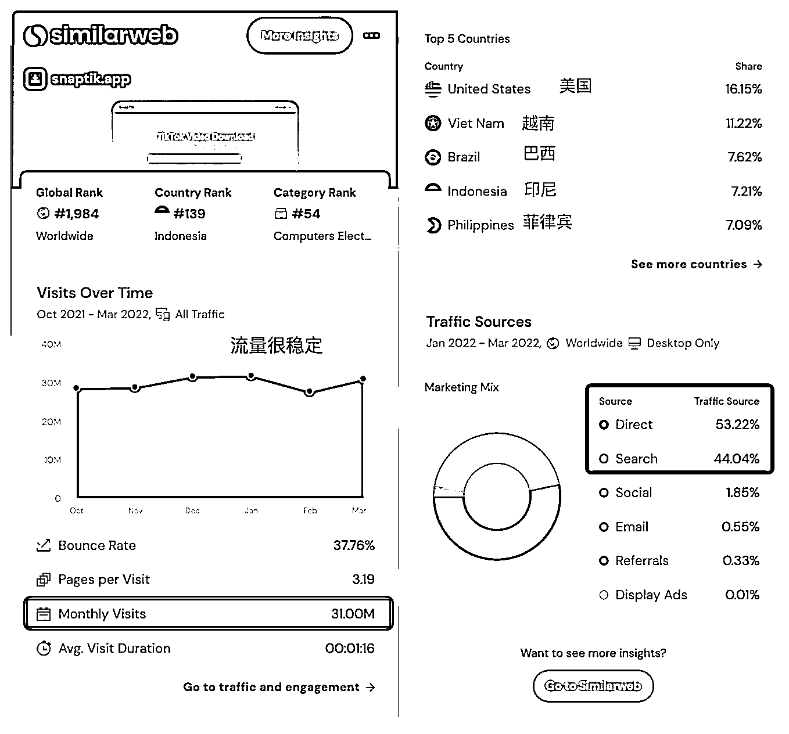

Ssstik.io的产品定位和Snaptik几乎一致。ahrefs.com的数据显示，它只用了一年半，月访问量就从0涨到3100万。SEO在这里起到了决定性作用：覆盖5.8万个搜索词，自然搜索每月带来2400万次访问，且完全免费；按ahrefs的流量估价，这部分价值大约8.1万美元/月。印尼是它的第一大市场，覆盖1.1万个词、月访问1300万。
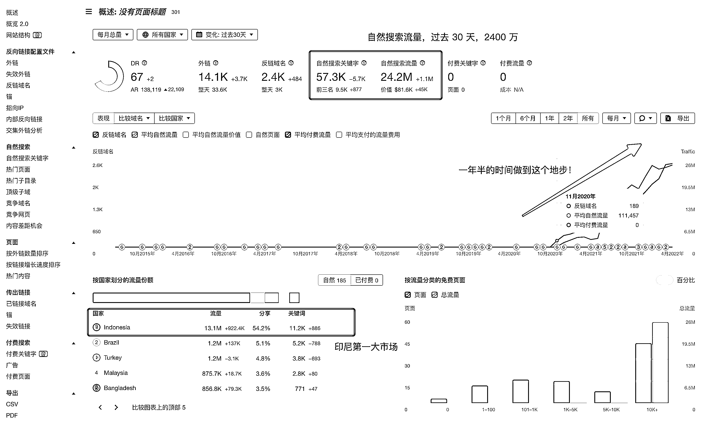

Savett.cc也是同类下载站，属于后起之秀。去年10月才上线，半年时间月访问量就做到300万。它的搜索流量占比达到68.7%，ahrefs预计其中90%来自免费自然搜索。
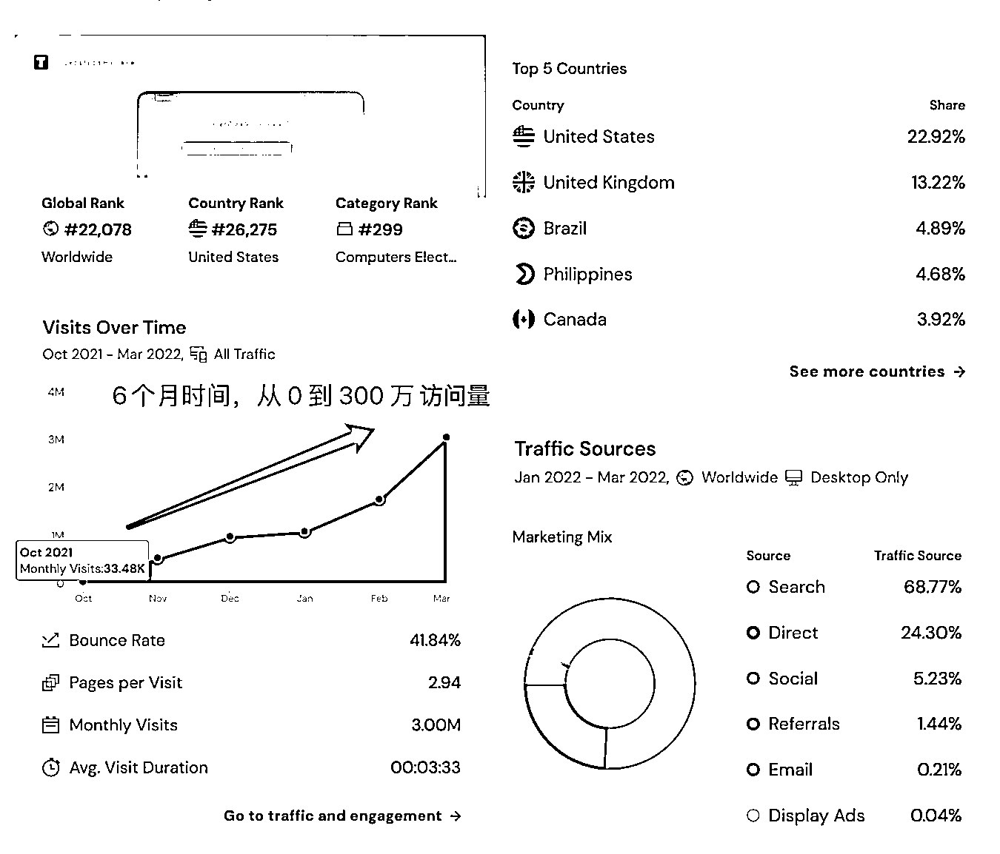

除了以上三家，还有十多家网站专门做TikTok视频下载，流量同样不低。我把它们整理成了一个表格，可通过下面的飞书链接查看：
https://py64k0scfh.feishu.cn/sheets/shtcndvM7W7voqAaJVuu06zNPCh
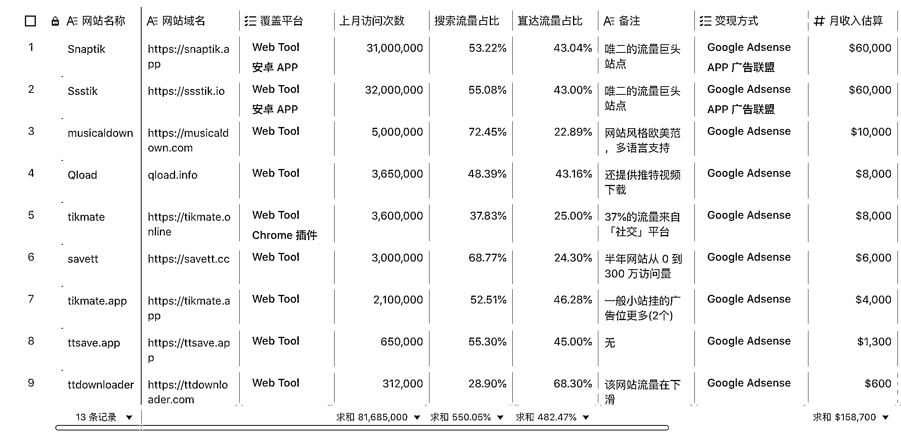

这样的流量能不能赚钱？当然不能小看。Snaptik和Ssstik每月都是3000万访问量，页面非常简单克制，只放一到两个广告位。按千次曝光2美元粗算，单月广告收入约6万美元，一年折合人民币约500万（非净利润），差不多是一年一套房。别忘了它们还都上线了去水印下载APP，Google Play下载量均超过100万，APP广告收益还没算进去。这类模式可以概括为：背靠大平台的需求，用足够简单的产品承接，再靠SEO把量做起来，直接变现。

1.2 TikTok生态的更多产品

从TikTok的C端需求来看，去水印下载的搜索量，远高于“tiktok 18”“tiktok pron”等成人向相关词。当然，TikTok本身并不是se情平台，但这些搜索需求确实存在。

再快速看几个TikTok生态产品：

1. tokcount.com：实时查看TikTok博主粉丝数的网站。月访客180万，平均停留时长7分钟。页面很简单，主要展示某个博主的粉丝数据（可刷新），竟然也积累了不小的用户量。它只针对一个搜索词：TikTok counter。这个词在Google每月有82.3万次搜索。

2. 搜索词“tiktok to mp3”“tiktok to mp4”：把TikTok视频转成mp3或mp4格式。mp4好理解，但都2022年了，还有转mp3的需求？答案是不仅有，而且量很大。YouTube上这类工具的流量更猛。

3. “TikTok view”“followers”“likes”等词：对应的是买播放量、买粉丝、买赞的网站。这些站虽然有天然搜索流量，但竞争激烈，同样在Google投关键词广告。

4. “Tiktok fans”则对应一款APP：TikFans - get tik tock followers + tik likes。核心是做任务互粉，下载量超过100万，评价数接近11万，且以五星好评为主，规模不小。

……以上案例，我只用了一招：查关键词搜索量。

二、搜索词挖掘的简易方法

2.1 什么是关键词流量研究？

上面的工具型网站，几乎都把SEO当成生命线，所有流量都指望搜索排名。我一直记得亦仁在2017年写的那篇《通过Google挖掘细分市场的一个案例》，第一步就是围绕巨头平台做搜索发现。搜索时输入框的联想推荐、页面底部的“其他人还在搜”，都能无门槛地呈现需求，优点是好上手，缺点是不知道该从哪个词开始，而且容易漏掉很多有代表性的词。在SEO圈，这被称为“关键词挖掘”，它是一个系统工程：想覆盖一个行业，通常要挖出数百万个带搜索量的词，耗时一个月左右。不过想快速入门，有工具辅助并不难。

2.2 简单上手关键词挖掘

分享我的五个步骤：先定母词。确定研究对象是TikTok、YouTube还是Tesla后，列出成组的基础词，比如TikTok下我会选tiktok video、tiktok live、tiktok shop、tiktok fans，把大概边界划出来。接着做扩展。用Google关键词规划师等工具，把相关搜索词都捞出来。第三轮清洗，把无意义的词删掉，再继续扩展一轮。第四步，把搜索结果分门别类，看哪些词的流量更有代表性。最后，挑出有商业价值的词，研究对应产品和服务的承接方式，存入自己的项目库或需求池，等调研清楚后再决定切入。这里不展开。

三、关键词挖掘的具体实操

3.1 用Google关键词规划师扩展搜索词

这是Google Ads后台自带的功能，需要先有商业账号。开户有一点门槛，找国内代理商就能解决。进去之后有两个入口：一是“发现新关键词”，二是“查询关键词数据”。
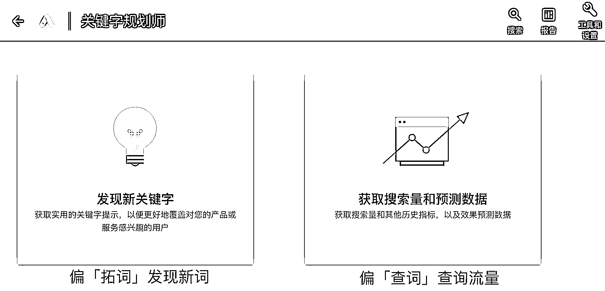

在“发现新关键词”里输入一个种子词，系统会返回相关词、每月搜索量、广告出价等数据。这个功能本意是服务广告投放，拿来当需求调研工具也很顺手。
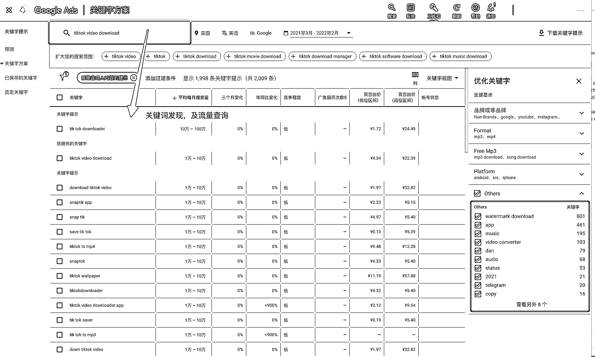

这就是第一轮扩展。筛掉无关词后，可以继续“二阶扩展”。通常一个母词能扩展出约1000个相关词；有一两千个高质量母词，最终扩展到上百万个带搜索量的词并不稀奇。

3.2 用Ahrefs做搜索词深挖

Ahrefs在海外SEO圈很受认可。它的Keyword Explorer和Google关键词规划师不同，更适合对某个具体搜索词做精准研究，颗粒度很细。以tiktok video downloader为例，数据面板长这样：
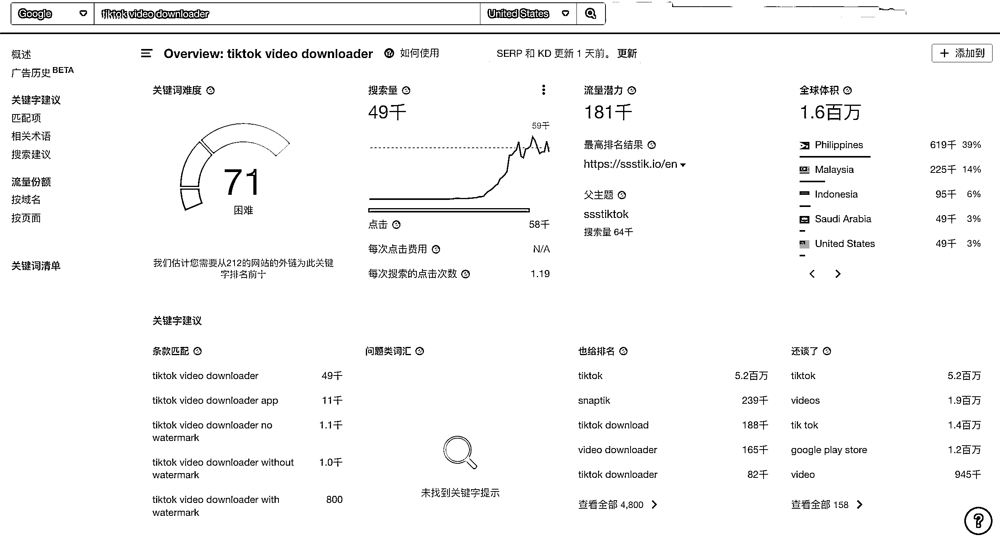

它还会列出“直接匹配”的相关词：
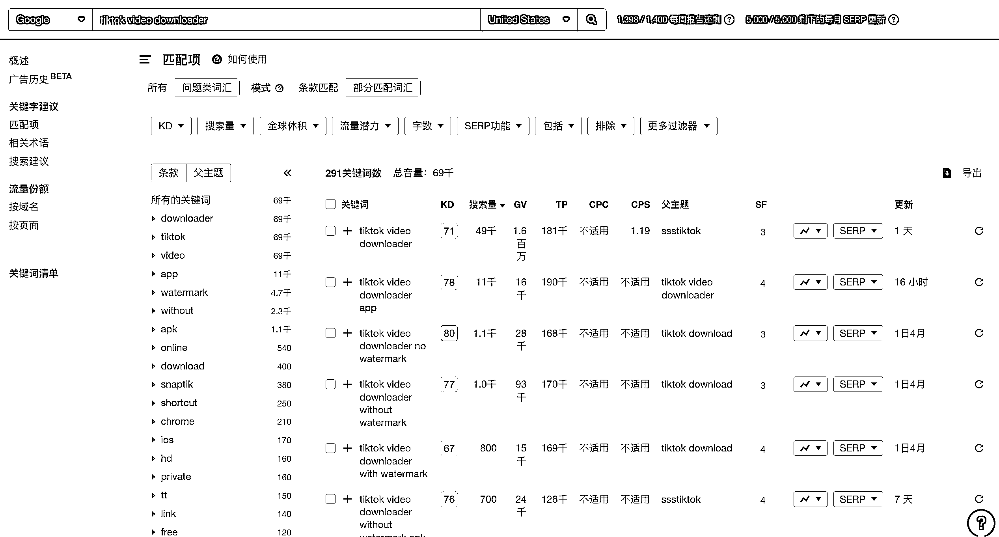

推荐的其他相关词也可以批量下载，作为下一轮扩展的种子。
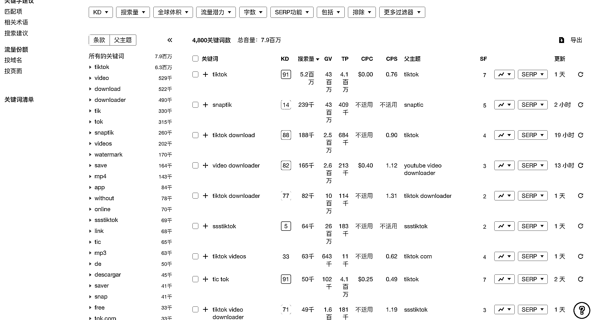

Ahrefs功能强，学习成本也不高，去电商平台租共享账号就行。另一个工具SimilarWeb也有关键词分析板块，但我觉得它的数据量不够充裕；不过要查网站访问量，SimilarWeb比Ahrefs更准。

3.3 批量扩展利器：光年-谷歌关键词分析工具

这个工具来自国内流量增长咨询公司“光年实验室”，优势是支持批量查询和导出多维度数据。数据量一大，网页版就不够用了，需要申请Google Ads API。它的数据来源和Google关键词规划师同源，可以当成增强版来用。
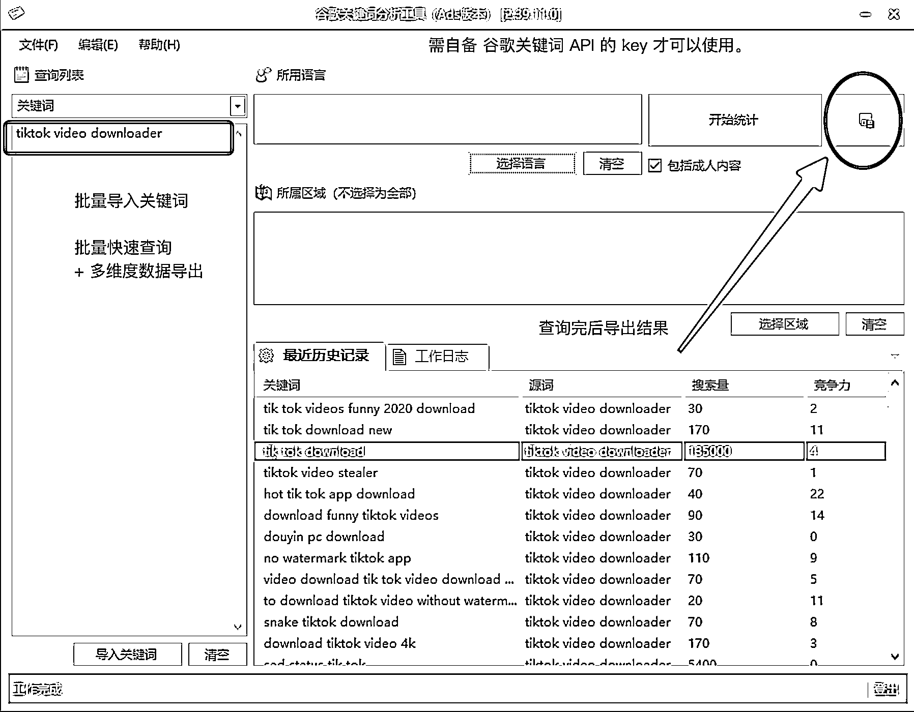

3.4 筛搜索词，整理需求对应表

经过一轮轮扩展，你会得到一张很大的词表：
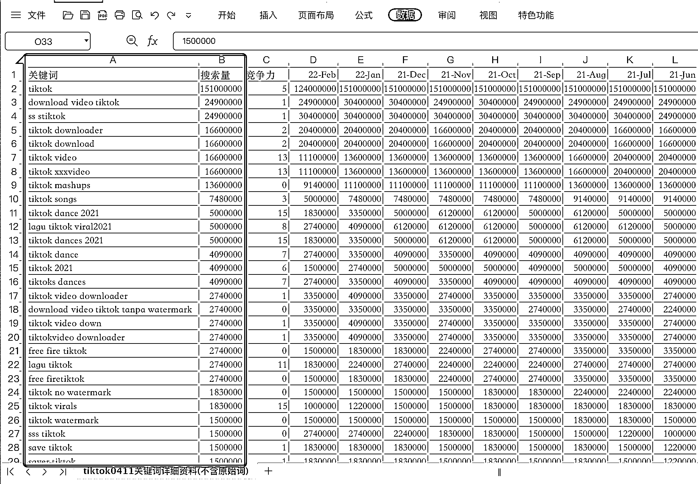

按月搜索量从高到低排序，逐条看，重点看月搜索量超过10000的词。我整理了部分TikTok相关词和对应网站的对照清单（已排除性相关词）：
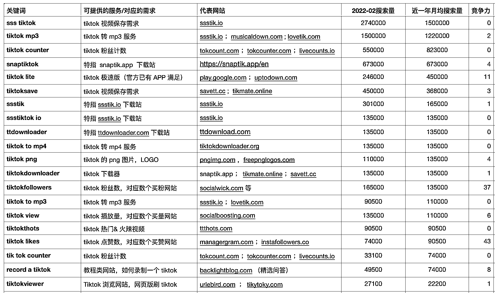

这么看，需求就清晰了。其实很多关键词对应的需求还没有被充分满足，这里只是示例。继续深入，说不定你会有新发现，欢迎来找我交流，我知无不言。

3.5 搜索词挖掘的补充技巧

母词要多，也要准。数量最好达到四位数的量级：几千个母词，才能扩展出几十万甚至上百万的词。如果不精准，就会混入大量无关结果，清洗成本太高。比如TikTok这种大词，容易带出大网红姓名，第一轮就要删掉。

母词从哪里来？提供三个方向：

1. 从目标网站挖：打开竞品网站，首页、关于页、页脚导航，都能提炼出词，slogan、页面描述、meta keywords都可以保留，凡是描述业务的词，越全越好。

2. 围绕行业做发散：结合自己所在的行业做头脑风暴，直接相关词、行业上下游词、人群词都算。

3. 借付费投放词做参考：Ahrefs有“付费关键词”功能，能查到某个网站正在投的关键词。这相当于直接参考别人的真金白银——愿意花钱买的词，精准度自然有保障。下面以Shein为例，Ahrefs收录了它的7.4万个付费词，可以筛选导出进一步分析。
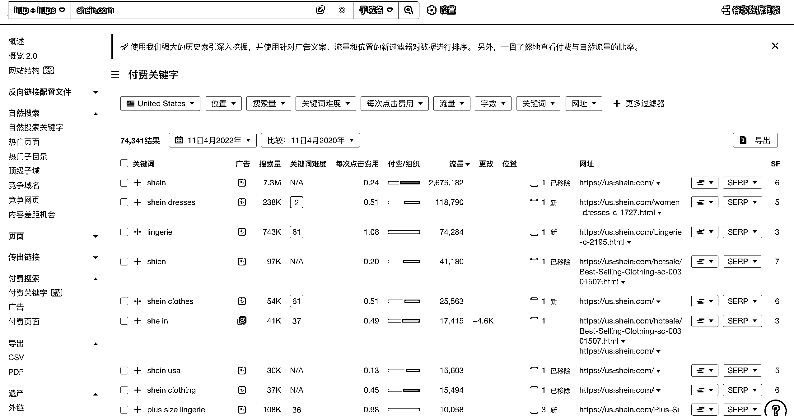

四、总结

Google搜索数据，本质上是一张用户真实需求地图。对某个行业做完整的关键词研究，需要耐心地挖词、选词；我分享的是快速上手的路径。TikTok只是样例，同样的方法也可以用在Shein上——传闻它最新估值1000亿美金，周边还能长出什么机会？

平台会变，需求不会。过去Instagram/YouTube下载站的经验，放到TikTok上可以重新再做一遍。我把这种通过Google搜索发现需求、识别产品机会的方法，称为“生财机会”。

关键词研究越做越有意思：你常常会发现，居然有人这样搜索；顺着词点进去，又会惊叹原来还能这样做。它的应用范围也不限于需求发现和SEO/SEM，还可以用于内容选题、信息流投放、舆情监控、KOL挖掘等场景。动手试试，期待听到你那一句“我靠，绝了！”哪怕只找准一个词，也可能是伟大事业的开端。

评论区：

三林：这句“我靠，绝了”我很喜欢，一楼先占了[偷笑]。
闲富（软件定制）：我最近搞了个海外TikTok刷粉站。
颜周：去水印工具，其实就是把国内玩法搬到海外再用一遍。
三林：也未必是国内先做，好几个站点是印尼人搞的，国内也有低调大佬在做。
三林：不错，等你分享更多经验。
闲富（软件定制）：市场已经很热了，现在工会招募主播更迫切，找主播类工具可能更有机会。
Sunwei：先赞再收藏，有些思路我也想过或实操过，感谢系统梳理，私信加个微信[握手]。
三林：文章里不能放超链接，只能在这里补上亦仁那篇经典文章。快五年过去，有些东西经得起时间检验。https://mp.weixin.qq.com/s/cXa6Rwiet5gN8bSe-h4QNw