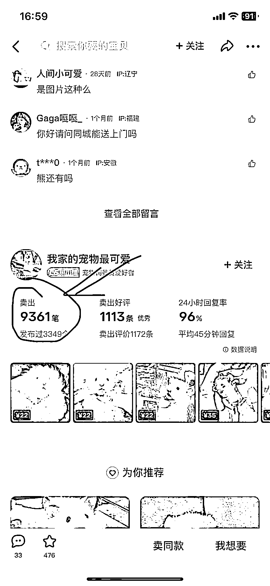
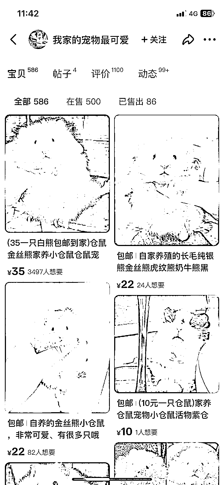
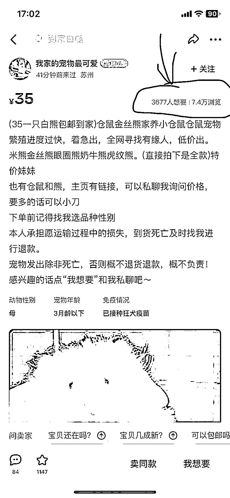
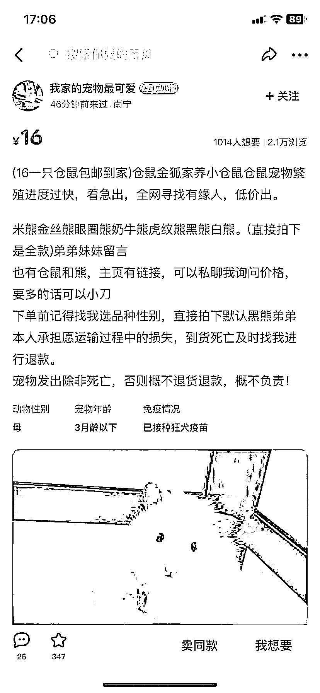
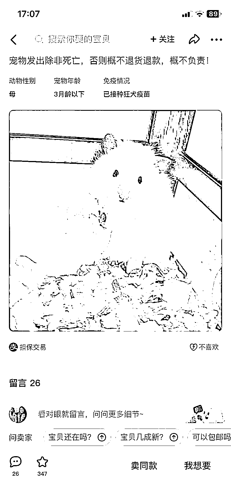

# 闲鱼宠物生意，适合长期做

在闲鱼，宠物相关需求一直很旺。猫、狗、兔子、仓鼠、乌龟这些品类都有不错的销量。这个方向适合当成长线项目，做得越久越容易积累优势，新手也能从零开始尝试。

具体操作不复杂：准备一张清晰好看的宠物实拍图，配上几版风格不同的介绍文案，再用偏低的价格吸引人来咨询。

有个账号只做仓鼠这个细分品类，累计成交接近一万单，低调赚到了钱。思路还可以再延伸：把客户引导到🛰️做二次变现，后续卖笼子、主粮、零食以及周边用品，打持久战。客户会越攒越多，收入也会逐步增加。

互动答疑：

有人问，低价引导咨询后怎么促成成交？关键在于图片展示和沟通话术。如果暂时不会，就去研究同行——用买家的身份找几个同行聊聊，图片和话术很快就能摸清。也有人问货源，作者表示后续会继续输出，关注即可锁定。