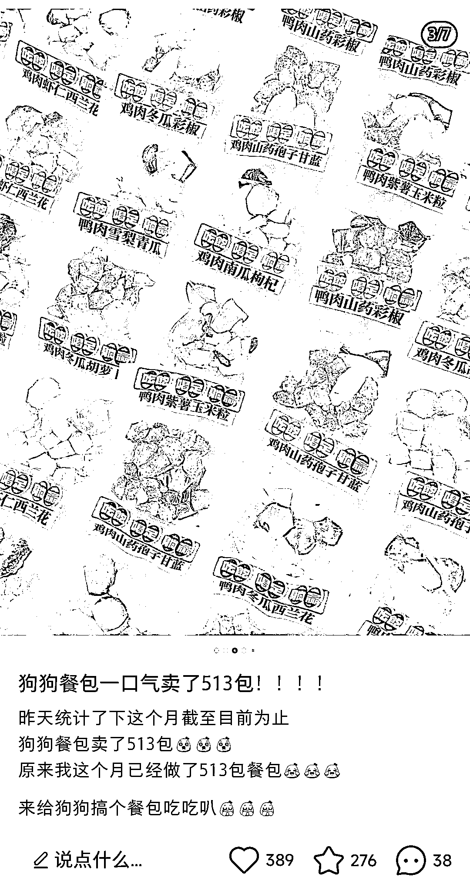
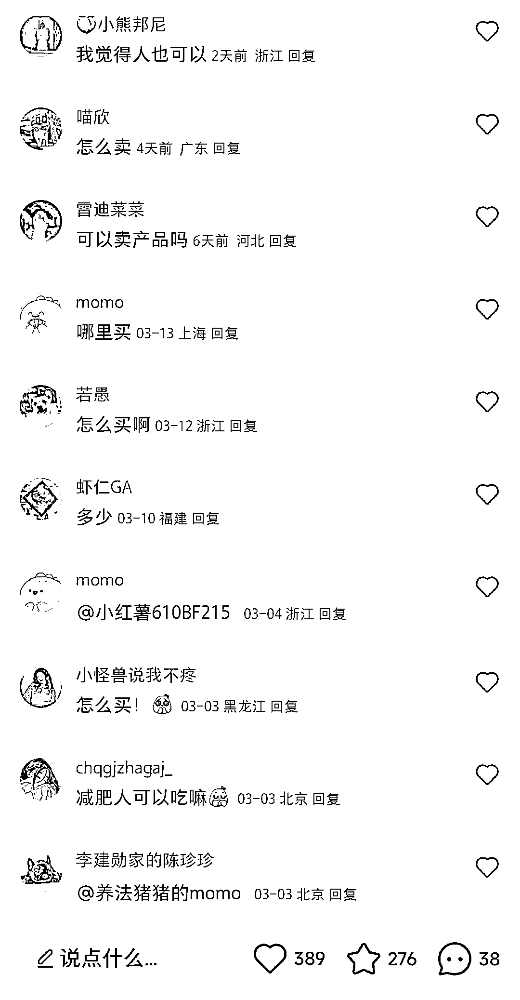
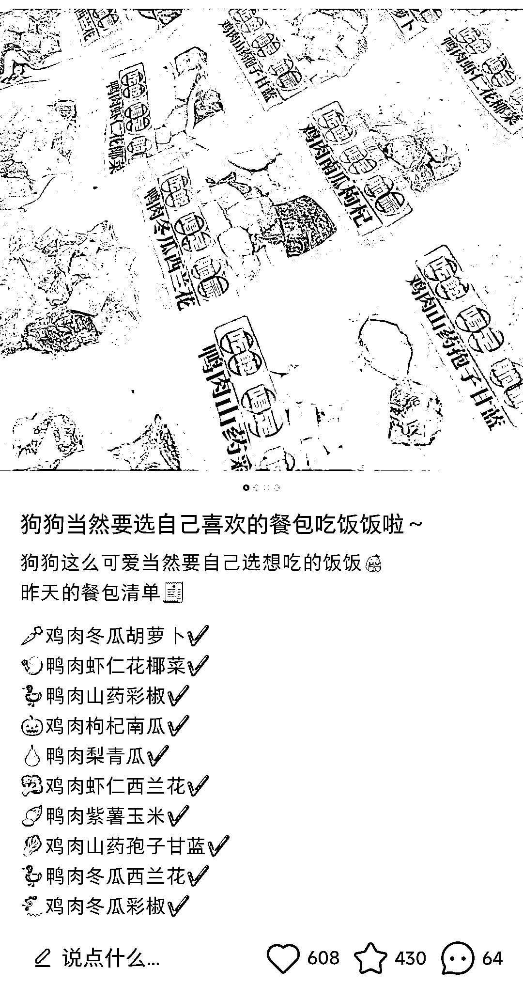
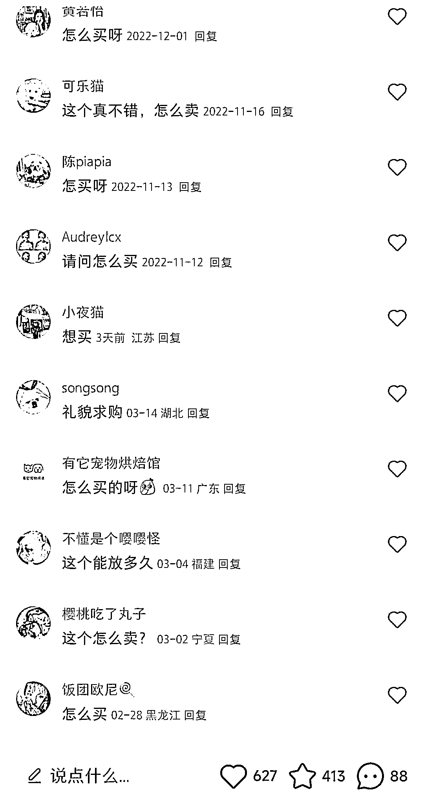

# （57 赞）精致养宠，鲜食复购很猛

在📕上，养宠用户对喂养格外讲究。按比例搭配好的宠物餐包、提前做熟并塑封分装的鲜食，再加上多种组合方案，都有不小的市场。卖家一般会把这些精准客户引导到🛰️里完成交易，来的人需求明确，再次购买的比例也高。除了日常复购，还有人询问制作方法、想学习配方，或者洽谈代理合作；更有意思的是，有用户会问这些食物人能不能吃——从营养配比来看，也确实贴近减脂餐的思路。

评论区：

少儿探索科学实验室：宠物烘焙可以安排起来了

陈真：还能上门给猫咪现做饭

二帮主：看着真精致，定价多少

明哥：这类产品去哪儿找

北斗：让我想到快餐店那种加热即食包

Jay：确实有搞头

Jay：哈哈

古朴：有拿货的路子吗