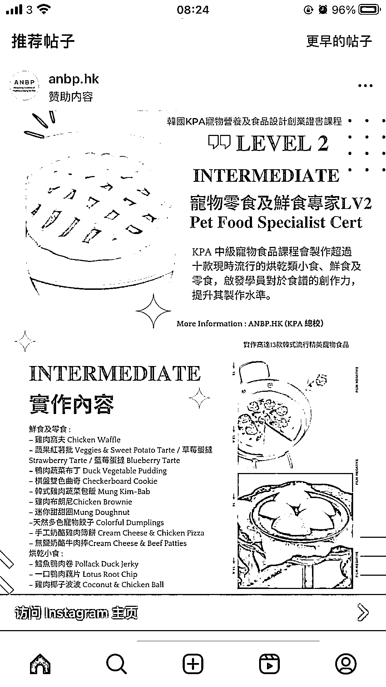

# 小而美的宠物零食，机会真不小

宠物行业整体被看好，其中像零食这种轻巧、细分的品类尤其值得关注，贴近社区的小而美模式也很有想象空间。

之前我在星球里看过一个海外案例：一位女士专门做宠物饼干，还在自己的网站上出售配方和制作教程，收益相当可观。

最近刷 Instagram 时，又看到一条广告，推的是某韩的宠物零食制作证书。

这么看，宠物市场确实有戏，特别适合做小而美、社区型的生意。

评论区：
君顾：把中国食谱放到海外网站卖也行，直接去淘宝买食谱，再翻成英文就好[耶]
超级玛丽：厉害！又学一招！
龙哥：中标，术值 +1。

点开最上方 #中标 专栏，能看到全部中标风向标。