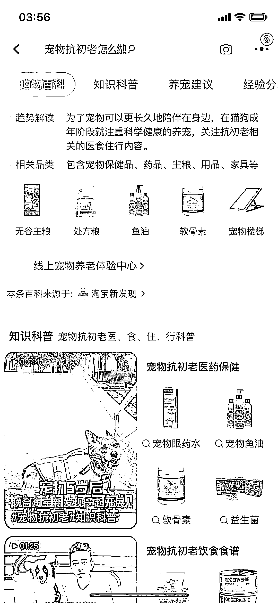

# 宠物也逃不过“初抗老”

过去一提到抗衰，大家似乎默认这是女性的焦虑，抗老产品也大多卖给有消费能力的成熟女性。价格不便宜，销量却一直不错。

后来，只做成熟女性的生意已经不够了，“轻熟女”概念被造了出来，紧接着“初抗老”概念登场，相关产品和服务也迅速跟上。

如今，这股风刮到了宠物身上：从日常粮到营养补剂，再到体检服务，都能看到“抗老”二字。

而若把目光只放在7岁后的宠物身上，商家的野心显然装不下。于是，“宠物初抗老”概念被提出，配套产品和服务大量涌现。

不得不说，宠物市场的潜力真不小。

