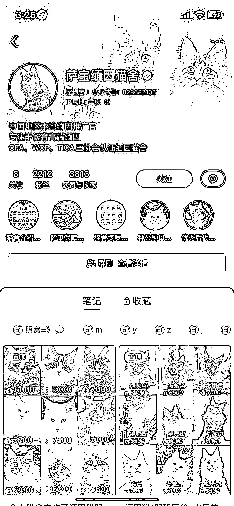
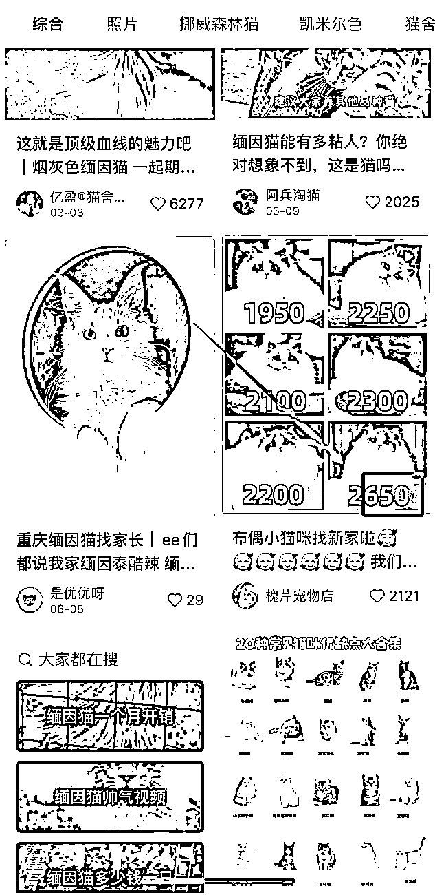
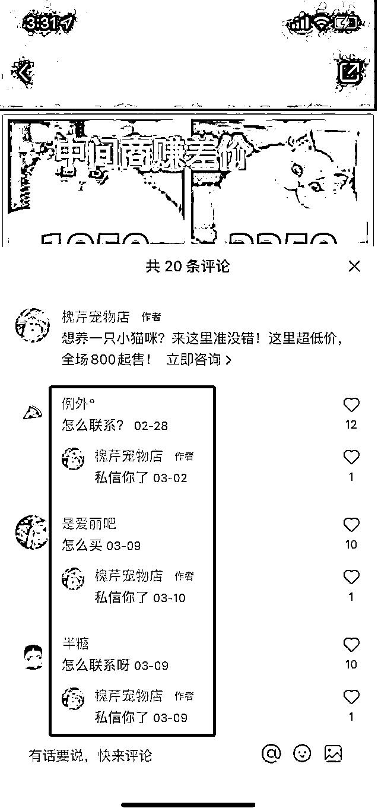
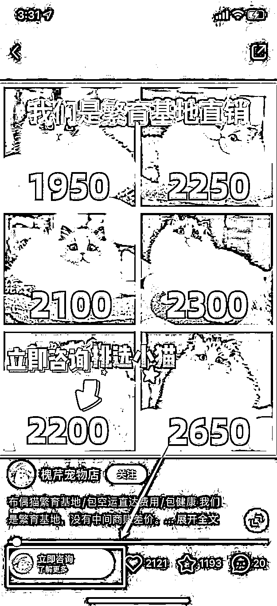
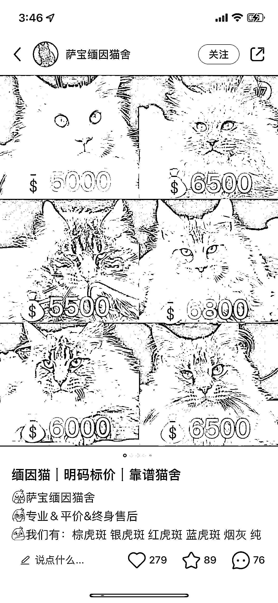
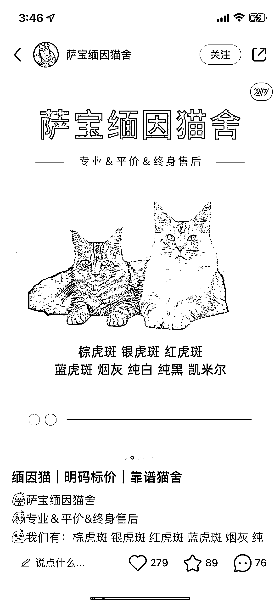
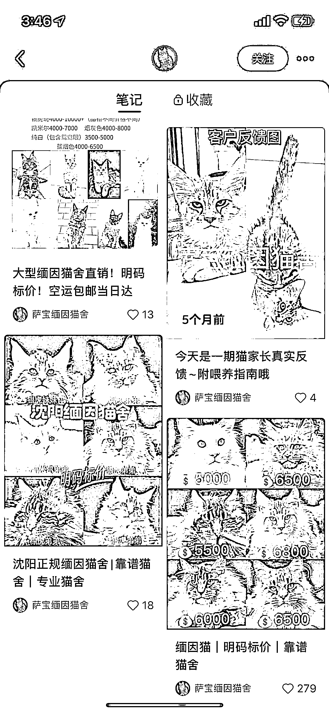
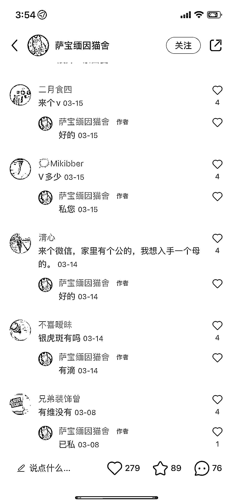
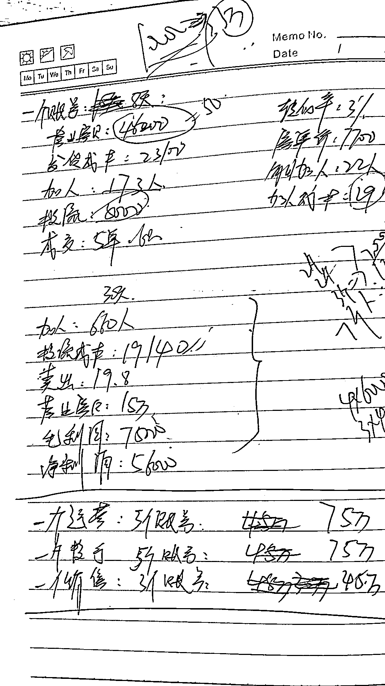

# 卖猫月赚十万，我为何主动收手

这个项目我们掏过钱、亲手操盘、也确实见到了回头钱，最后却自己按下了停止键。先把门槛说清楚：如果你盯的是每月百万甚至几百万的利润，这篇不用看了，这也是我否掉它的原因；但如果你只是想一年多落几万到十几万，下面这套打法可以慢慢嚼。

生意本身不绕：卖的是活体猫，客源来自📕，成交挪到私域，发货走代发。当时那个号粉丝连两千都不到，每天却能往🛰️里送进一百多个高意向客户。

我按「怎么做—怎么想—怎么复盘」的顺序讲。

## 实操：四步走通

**第一步，先找同行，再挑同行。**

📕搜「缅因猫」，把在投广告的号全记下来。辨认不难：笔记右下角挂着「赞助」字样的，基本就是花了钱的。

记完还得过筛子：点赞多、评论区热闹，并且留言里明显有人想加联系方式买猫的，才留下。这步别偷懒，因为要的是能掏钱的客户，不是来看热闹的。

**第二步，拆同行的壳，照着搭骨架。**

挑好目标后，把昵称、简介背景、置顶内容、合集分类、引流路径这些零件一件件拆开，然后做到几乎复刻。

**第三步，备素材，投到底。**

基础信息、群聊这些设置完，开聚光账户。它跟巨量那套投放工具类似，早期返点给到15%，后来听说缩水了。接着就是成批写笔记、试素材。

我们没安排运营去听什么标题课、封面课，只要求他们把爆款笔记里的零件拆下来重新组装。连抄都还没抄利索，谈原创没意义。

每条内容先扔几十到一百块试水。一旦发现哪条加粉便宜、转粉率高，立刻放开预算猛投，不设上限，直到获客成本冲破红线才收。所以账号里不少笔记看着很硬、点赞寥寥，但来的全是要买猫的人；点赞高的那几条，恰恰是测出来便宜后被放大的素材。测出一条好素材，靠它赚几万到十几万并不稀奇。

就这一个号，每天进🛰️一百多人，单粉成本压在三十块以内。这还是销售接不住、货跟不上的状态下；撒开量，一天几百人我觉得都行。

**第四步，进私域，促成交。**

销售和货源是我们最烂的两环。销售就抓三件事：分钱、抄同行、筛人。提成给到营业额的5%，约等于利润的一成，因为猫的毛利普遍过半；流程照着同行搬，再慢慢磨；最后按结果淘汰。前后试了三四个，留下一个能打的，转化做到2%到5%。

货源更弱，全走代发。闲鱼上找过，也专程飞到沈阳谈过。朋友圈素材直接从供货商那儿搬，遇到不懂就问。就靠这套，第一周出了四只猫，毛利两万多，投放只花了三千出头。

## 判断：选品压过技巧

**第一，选品决定天花板。**

为啥花钱买流量？因为简单、能复制。免费流量当然香，但除了IP这类极少数玩法，想长期稳定拿免费流量太难；流量不稳，团队和供货链就搭不起来。

不过不是什么货都能套。我们卖缅因猫，便宜的五六千，好的过万，单只利润几千起步，试错空间大。运营笨一点、销售弱一点，都还有时间补。你要是卖几十块的衣服，内容、销售、供货哪一环都不能瘸，一瘸就全盘输。

所以我常讲，学营销之前先学挑货。标题封面那些技巧，跟选品不在一个层面上。认知维度高一级，运营手法就不值几个钱。

类似品类还有不少：孩子的夏令营游学，国内国外都行；本地家装设计；本地月子会所。做不大，但客单价高、竞争没那么凶，一个月进账几万到十万有机会。当然，活猫这步棋我们也有没想周全的地方，后面复盘说。

**第二，站在前人的肩膀上走。**

最好的课堂不在讲台，在一线；最好的老师不是讲师，是竞争对手。我尊重创新，但生意上更认「先抄后超」。没当上第一之前，先把第一学到位；等要争第一了，再谈创新。

这些年能挣到钱的事，基本都是找到对象认真模仿；那些脑洞大开的点子，基本都黄了。有参照物，你至少知道差在哪，没做好还能改；纯原创，你连自己合不合格都判断不了。

**第三，用算账的思维看事。**

选品思维在运营思维之上，算账思维也在运营思维之上。内容、引流、话术当然还能磨，但那是负责人和一线该操心的，我只盯数据。

当时转化3%，加粉成本29块，客单价7700，毛利率65%，而且运营、销售、供货都还有很大空间。按这组数推算，单粉成本150块就是盈亏平衡点。所以我把红线设在50块以内，低于这条线就放开投。

**第四，筛人比育人重要。**

事靠人做，人是最关键也最缺的。想留住人，先把钱给足，再谈感情。我们的做法是让📕运营和销售的工资达到重庆同岗位均值的1.5倍以上，然后只筛不养。

我们拿做电商的路子去做招聘：先摸清重庆📕运营岗的行情价，再反推自己的薪酬包。把每家公司当店铺、每条招聘当商品、每个应聘者当买家，就通了。

真找到那种自驱、肯学、会复盘的人，钱到位，他自己就烧起来了。你就不必天天教他怎么起标题、怎么作图。

## 复盘：前端能放大，货端拖后腿

还是那句：选品决定天花板。决策能力是人一辈子最重要的本事——读哪所学校、学什么专业、待在哪个城市、进哪行、干什么岗、跟谁过日子，这些比埋头苦干和智商重要得多。

那我为啥后来不干了？

回到生意本身，最后拼的是品质、价格、服务，以及背后的成本和效率。网络只是给渠道换了层皮，商业内核没变。卖活体，终点还是货。货是整条链的起点和终点，货的问题不解决，模式就放不大。

流量是阶段性的，红利的本质是信息差。信息差一没，获客成本必然涨。到那时候，拼的是品质攒下来的复购和品牌溢价。我们原本想的是：靠高单价活体在第一环就把钱赚了，再用猫建立信任，在私域卖周边，一份流量用几次。

可猫是非标品，只只不同。品相决定转化，品质决定售后。拍得好看的素材本就难找；真正品相好的猫，养户自己圈子就消化了，轮不到市场。市面上流通的，良莠不齐，我们压根控不住。卖出去的猫，总有出问题的。

这不是多签几个养户能解决的。养户再多，我们对他们也没有真约束，口头保证等于零。这些养户体量都小，好猫不愁卖，我们对他们的约束就像空中楼阁，很可笑。

我做这事也不是只图一个月几万、十几万。真能解决货的问题，让我重金投入我也肯，比如自建猫舍、自己繁育。但那么多养户做不大是有道理的：繁育是极精细的活，要专业的人、专业的设备、专业的管理。一两只猫生病没处理好，整个猫舍就可能完蛋。

这不是砸钱就能摆平的，所以大多数养户都维持小规模。量小的时候，主人自己上心还能顾过来；量一大，就超出他们的管理半径了。

前面说「站在前人肩膀上」，这就是活教材。全国为什么没有一家做得特别大的活体猫机构？不是没人想到，是这生意本身有大坑。

那我为什么还分享？因为我虽然没见到年入千万的案例，但普通人一个月挣几万到十万并不难；真深耕这个赛道，一年几百万也有机会。

我们的项目已经停了，号送给了当时负责人的太太。靠📕的长尾流量，她上个月还出了六只猫，挣了几万。我做项目要养稳定的流量渠道和销售团队，这有成本；货不稳，大团队反而是包袱。她一个人，想放大也放不了，一天接十个就到顶。实际上她要带娃、做家务，一天也就接两三个，照样挣几万。量小的时候，靠我们挑的那几个供货商，一个月出十几只猫，品质售后都保得住。

我也知道有人全职干这个，甚至自建猫舍加同行合作，品质过硬，猫价一到几万，一年也能做到几百万利润。但搁几年前，这收益也许让我心动；可我是小比例参股，还得找到特别懂行、有积累的团队，才只是有机会做到几百万，跟我的期待差太远。

以上就是完整复盘。我没有这个项目的课，大家也别找我学习、请教、合作或者牵线资源。就是单纯分享一个我们跑通过的项目，给做📕的朋友一点参考。

补一句：📕对往私域导流查得极严，重则封号。开了聚光之后，导流顺得多，也能明着来，我们号没因导流挨过处罚，这也是我选付费的原因。另外，这篇讲的是卖猫，但整套打法放到📕别的品类同样成立。