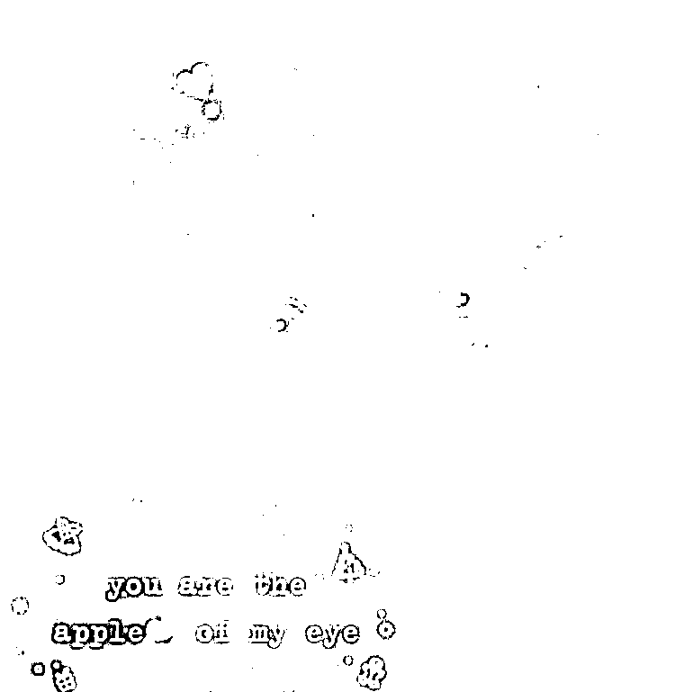

# 猫舍真能年入百万？万字拆解繁育盈利模式

文/CC｜2020年12月24日

最近，开猫舍被不少人当成门槛不高的副业，在生财社区的讨论热度一路走高。这篇收获136赞的精华帖，用万字篇幅尽量把猫咪繁育产业链上的每个变现节点讲透：既有零基础也能尝试的路子，也有靠技术吃饭的做法，还有愿意重投入的“氪金”玩法；文中还梳理了多个年入数百万元的模式与案例，并列出新手常踩的坑，帮后来者少交学费。作者也提到，其中不少思路换个行业照样能迁移。全文当作圣诞礼物送给大家，同时盼着能换回一颗“龙珠”作回礼，哈哈。

原文链接：
https://shimo.im/docs/6AAqCKl6m3Uxdv3L/

留言区同样有信息量：
- 闫寒13286294：这篇可算发布了；眼见你连日通宵扒记录、找材料，再不出稿，头发怕是保不住。
- 红桃六：感谢分享。最近在玩知乎，发现其中的推理路径和这套说法能对上，学到不少。
- Locked：活体买卖牵扯多，既耗精力，也耗心神。
- 热爱搬砖的陈玩玩：这必须加精啊！
- CC：养的时候其实不算累，累的是养之前的盘算；前期不肯动脑，到出售阶段就要加倍操心。
- CC：知乎上信息真假混杂，别照单全收；写的人身份不一样，站的角度就不同。百度贴吧的内容则几乎不用参考。
- Locked：我平时跟猫科动物打交道很多，之前也动过做高端猫舍的念头，后来发现门道太多；真要做好，基本得全职扑上去，而且未必能赚。我的感受是，繁育人得发自内心喜欢这行，只把它当挣钱工具很难长久。