# 零基础做宠物知识号：起号、涨粉与接单全复盘

文｜虾饼  
2023年6月21日

宠物内容已经很挤，头部账号之外，素人还有没有缝隙？我的体会是：大池子被切碎之后，常常会露出一块新空间。做📕宠物科普前，我没有任何基础，纯粹爱分享。起步时只是利用零碎时间套热门标题试发，约三十天积累近千关注。后来转全职做宠物科普，靠品牌合作变现。如今单月到账，比过去上班全年还多，这在最初完全不敢想。

普通素人做宠物科普，胜算不小。相较萌宠、吃播，它学习成本低，新手容易开始；账号有起色后，还能复制同类型矩阵做引流和卖货。接下来把我做📕宠物科普的经验与操作拆开讲。

一、先认识我

大家好，我是虾饼，赚钱圈第三年，跟着谢无敌团队学📕两年。2021年底离职后开始经营📕，选的是宠物里的细分方向——宠物知识科普，单月最高收入抵过去上班一年。

📕对素人相对友好，上手不难，推荐机制也比较照顾新账号，普通人有机会从打工人转成全职博主。

宠物行业近年走势不错。比起养娃，不少年轻人更愿意养养育成本低、陪伴价值高的宠物，把宠物当家庭成员，也愿意为它们花时间和钱。

我选这个方向其实偶然性很大，没有做很科学的调研分析，更多是从自身长处出发。我是铲屎官，很爱自家毛孩子，平时逛论坛取经、学科学养宠、淘好物，也爱把知道的安利给朋友。所以我的底牌是：懂一些养宠知识，且愿意输出。大类锁定宠物，细分落到科普，算是误打误撞踩中新人也相对好进的入口。

起号节奏：2021年10月，我趁上下班路上发轻量科普和毛孩子日常；测试后发现科普更吃香，借热门标题的势，约一个月涨到近千粉。广告零散接，单条几百元。2022年2月，一套爆款模板让我七天涨粉三万，合作询盘变多，单条报价进入四位数。

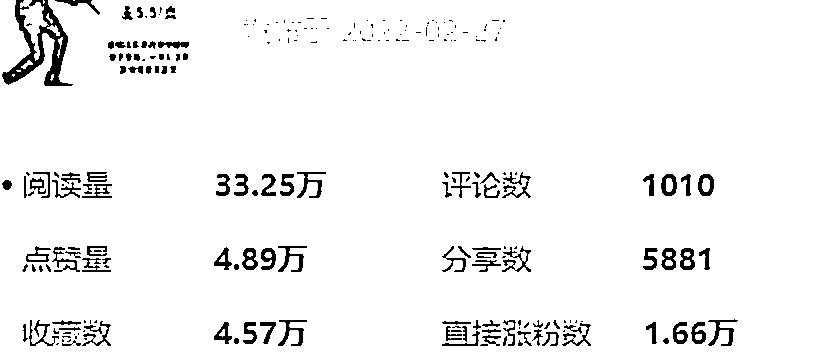

二、赛道地图：萌宠、吃播、科普

宠物内容大致分三类：萌宠、吃播、科普。

（1）萌宠 难度：5星

1. 硬条件：宠物形象有记忆点，或运营者很会包装
2. 软条件：会讲剧情、能拍能剪
3. 好处：大盘流量足，出头部概率高
4. 短板：泛粉多，人群不精准，商单价格偏低，且不容易复制

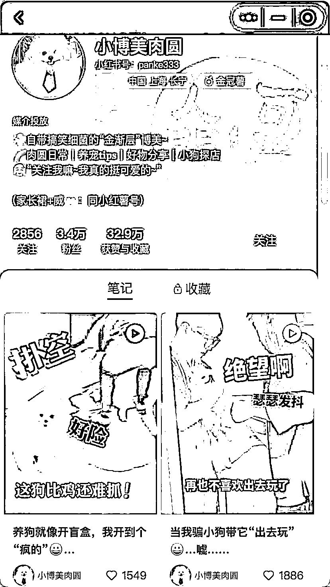

（2）吃播 难度：3星

1. 硬条件：宠物进食状态有感染力，或场景布置能力在线
2. 软条件：会基础拍摄剪辑
3. 好处：流量中段，成片比萌宠轻，可复制
4. 短板：与萌宠类似

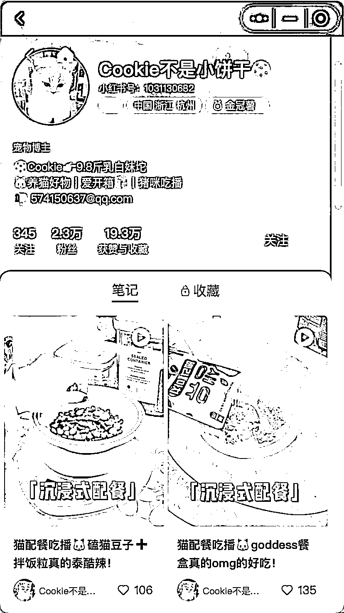
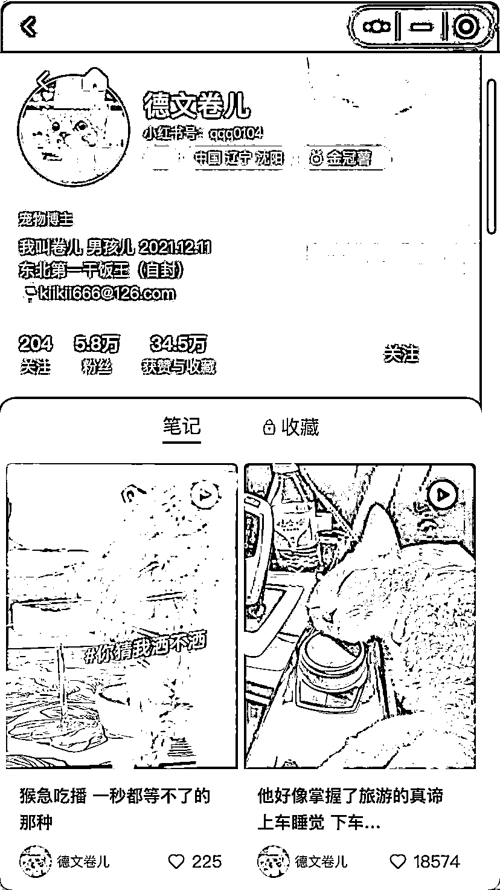

（3）科普 难度：2星

1. 硬条件：有养宠知识积累
2. 软条件：会简单拍摄剪辑或文案排版
3. 好处：制作轻、近乎零成本，粉丝画像更准，商单报价更高，可批量复制
4. 短板：流量池小，出头部难

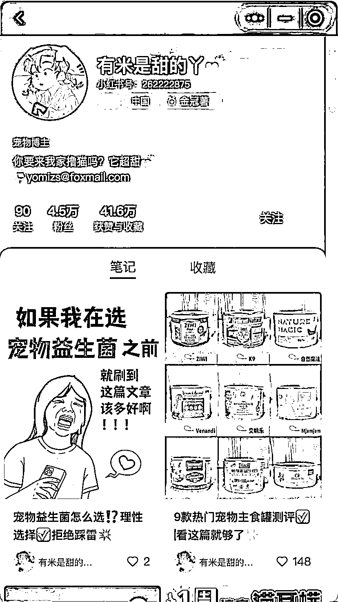

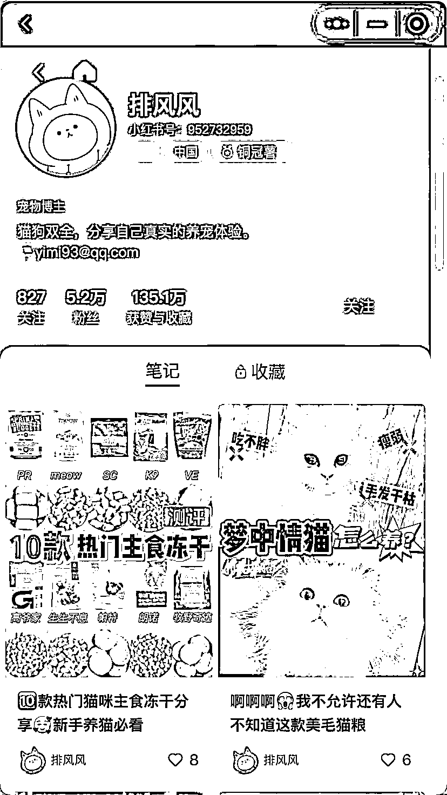

科普能规模生产，所以机构和品牌常从这里切。团队作战胜在人力足、产能高，一组号里跑出几个，整体回报就不差。

1、品牌

品牌自营矩阵，往往一个小团队就够，比长期按月投博主更省。  
例子：诚实一口

品牌矩阵号及作用：

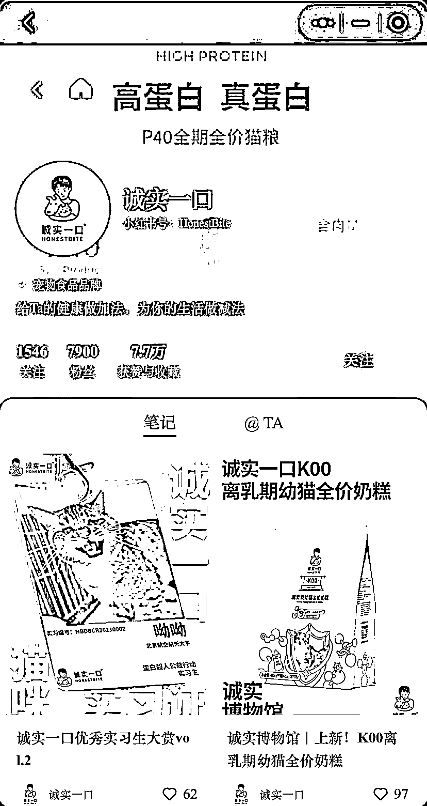

官方专业大号1个：承担品牌宣传与活动发布

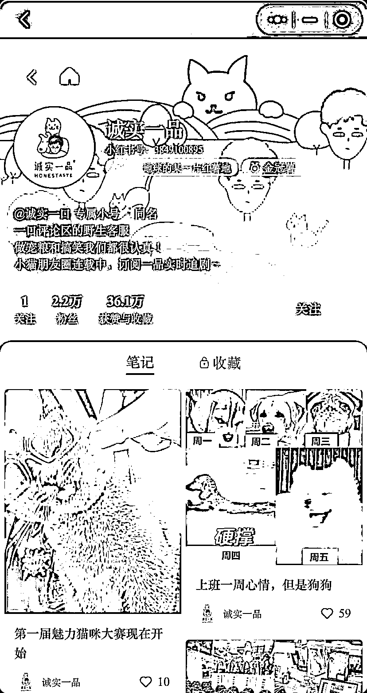

官方专业小号1个：负责品牌宣传和引流

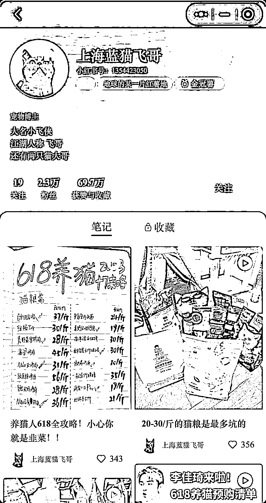

个人猫号N个：给品牌打软广

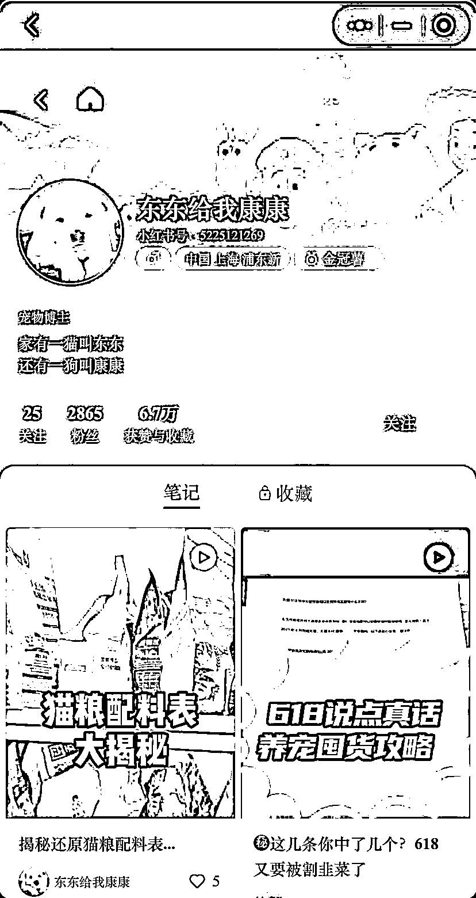

个人狗号N个：给品牌打软广

诚实一口的小号策略值得看：内容有趣但信息浓度不高，先让品牌显得有性格、好接近，用户好感起来，知名度也打开。早期个人号以图文为主，用爆款模板铺量；后来加视频，成本上去了，传播面和影响力也放大。视频打法与图文爆款同源：猫号某条爆了，选题保留，台词微调，放到狗号还能再跑一轮。

2、机构

机构做法是成批起号，选题、封面、剪辑共用一套方法；号起来后接品牌推广。因为手里账号多、层级全，报价带拉开，品牌可选空间大。  
例子：方片新媒体

矩阵号：

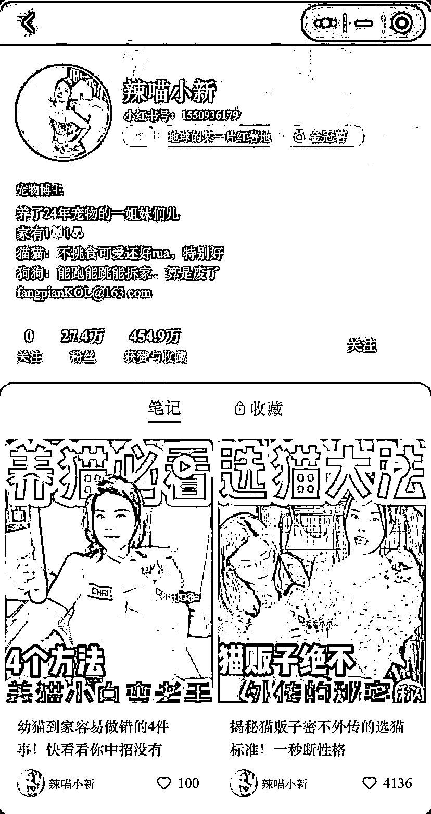

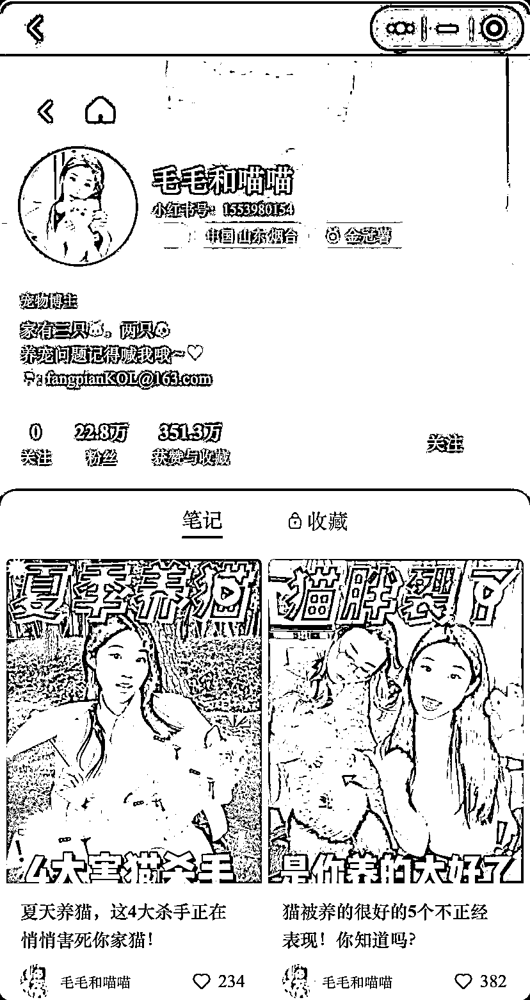
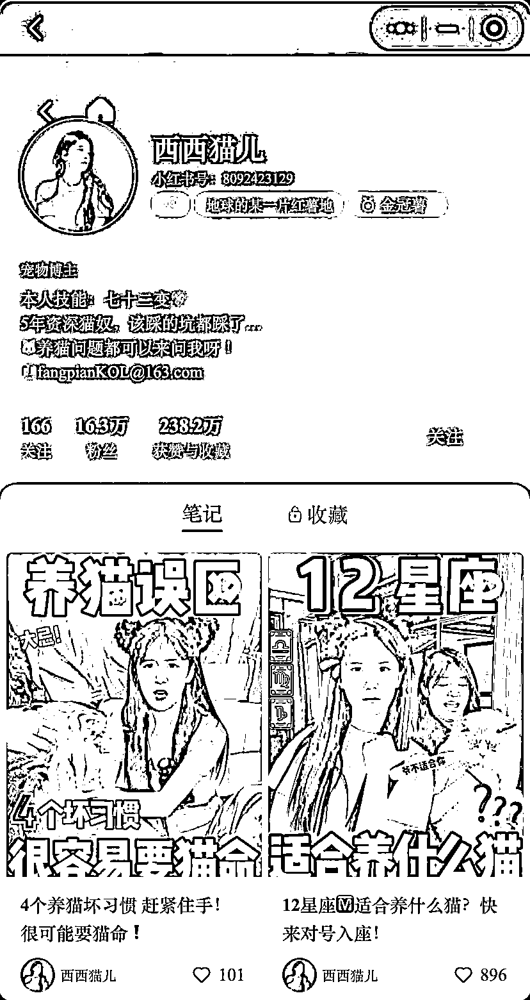

他们账号数量多，但风格统一，刷到基本能认出来。毛毛和喵喵还换过出镜者，猫猫是谁并不关键，脸长什么样也不重要。批量起号对机构是家常便饭，只是宠物赛道做矩阵的机构不算多。我判断原因有二：适合批量复制的品类有限，目前集中在科普；宠物品牌预算普遍不高，利润没法跟美妆比。

3、素人入场分析

平台风向变化明显：去年宠物赛道扶持多，常给流量，还建作者群运营；今年大部分扶持取消，活动变少，类目缩到萌宠和异宠，很多作者群也散了。现在新号反而容易拿到自然流量，老号更多依赖推流。品牌和机构下场后，素人空间被压，质量一般或自然流量偏弱的账号，接广难度比过去大。不过对素人而言，宠物科普依然是值得试的蓝海。我的建议是：新手先用爆款模板把号跑起来，再选路线——要么做同类型矩阵引流卖货，要么深耕内容，往更有深度的科普博主走。

三、落地步骤

（1）账号门面

1. 定位上，科普号用真人露脸往往更能沉淀IP；若让宠物担主角，得把萌宠内容一起做，效果才稳
2. 昵称尽量埋搜索词，如“某某养猫”“铲屎官某某”“某某聊宠物”
3. 头像选真人照，亲近感更强，人设也更完整

（2）内容来源

1. 豆瓣、贴吧、知乎：适合查选题资料，高质量经验帖较多
2. PetMD、ASPCA、icatcare：用英文关键词在谷歌检索，可找到不少同类站点；资料要自己翻译，但有专家把关，比中文论坛素人发帖更严谨
3. 谷歌学术：适合找文献，宠物相关研究国外更先进、资料更丰富
4. 📕：内容质量参差，主要用来模仿呈现方式，如标题、封面、排版等

（3）创作流程

1、找选题

1. 别把自己锁在本类目，其他类目的爆款也能拆。比如：

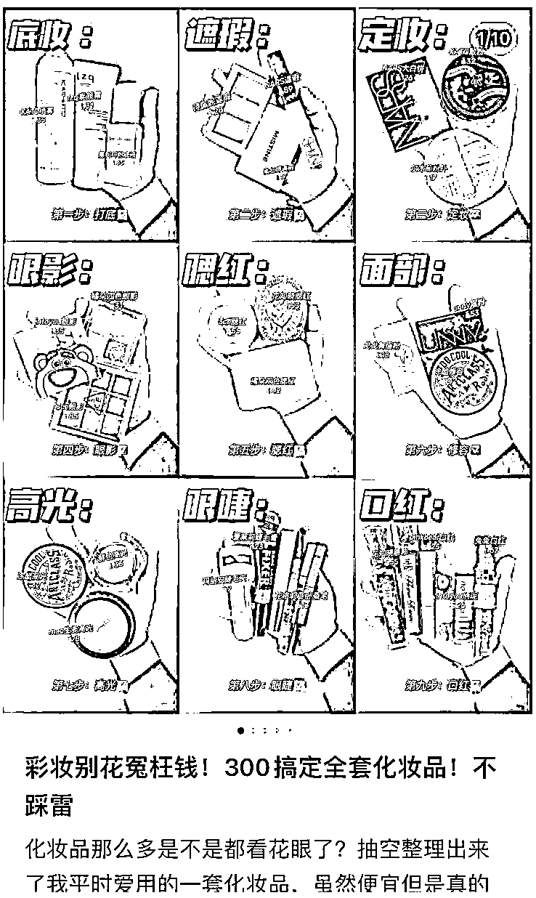
 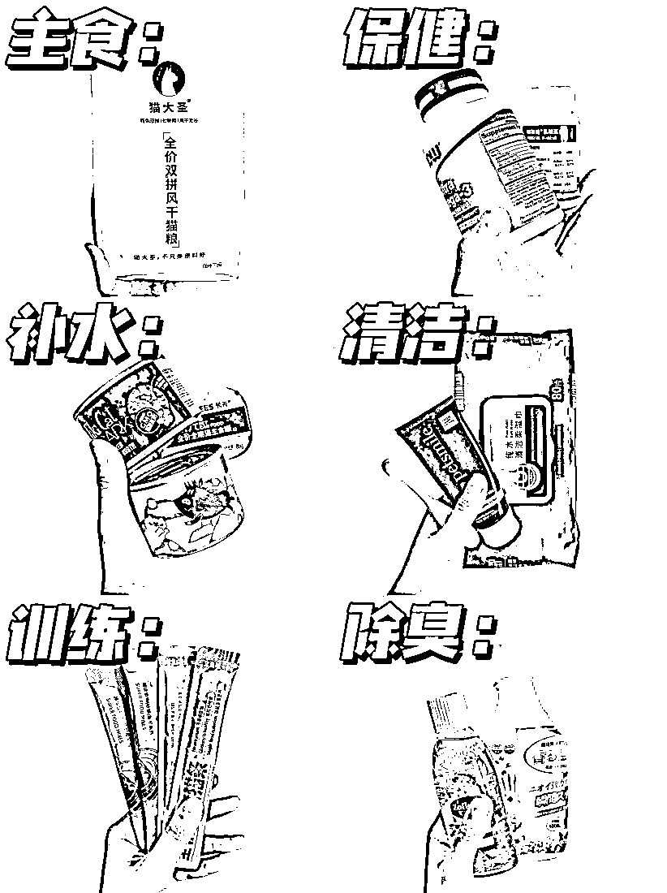

账号“好会养猫一女的”用“两百元置办猫咪日用消耗品”这个题（选题、标题、封面一起参考）

2. 内容分配上，起步阶段可把三成留给引流型内容（追热点、套模板），七成用来体现账号价值；这七成里提前留出产品位置，为以后接单做准备。调性也要守，若总发低价养猫题，高端品牌来找的概率会降。

2、定封面

信息流里，封面就是第一道门槛，不够吸睛很难被点开。但每篇都复刻爆款并不可取，费时且没有自己的标记；更稳的做法是定一个带个人特点的封面模板。

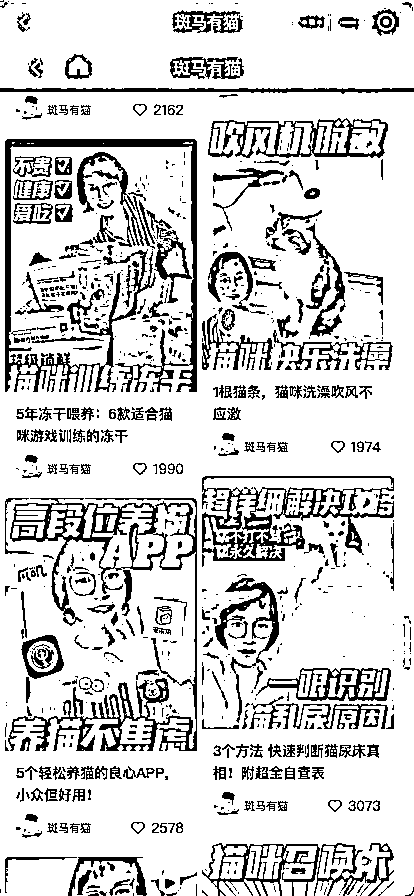

统一花字，封面均为人像

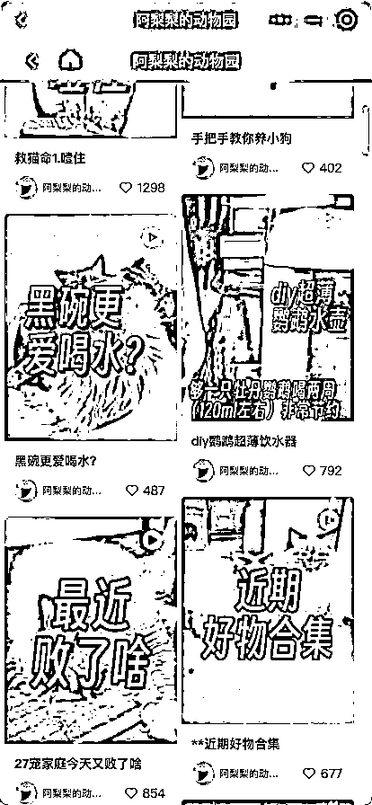

统一花字、封面、视频特效，但这位博主也经历很长时间蛰伏才找到自己的爆款方向

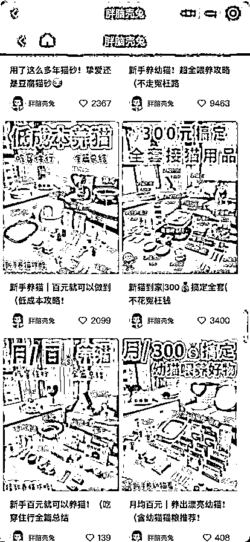

统一花字，封面均为多物品摆拍

3、定图片内容

内页图片不必像封面卡得那么死，形成自己的版式就行，不用篇篇模仿爆款，但可读性要保住。

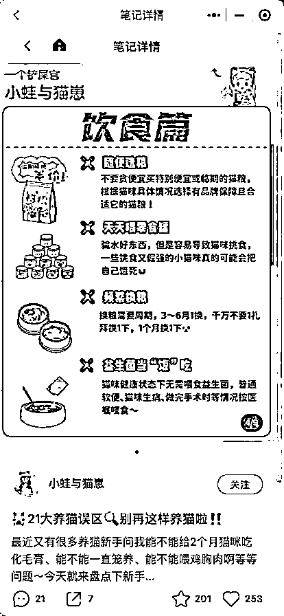

笔记科普部分  
模板可拆为：底图、标题、段落、配图，这些可用固定字体配色和排版

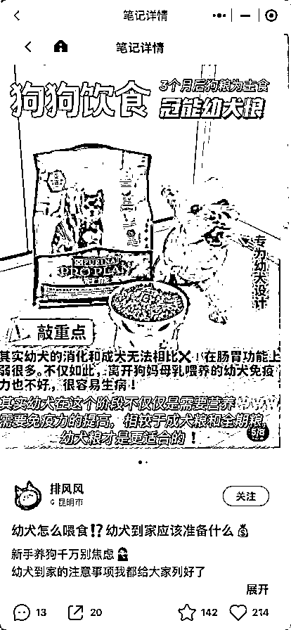

笔记推广部分（宠物与产品合影）  
拍摄模板可拆为：宠物与产品合影、产品细节图、宠物试吃图；  
推广部分文案模板：大标题、小标题、卖点详解等字体配色和排版

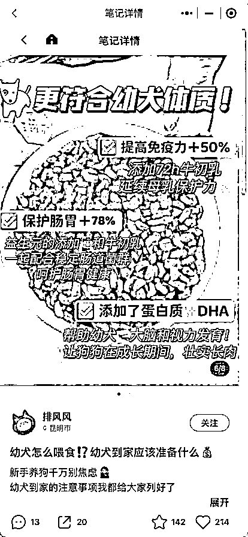

笔记推广部分（产品细节图）

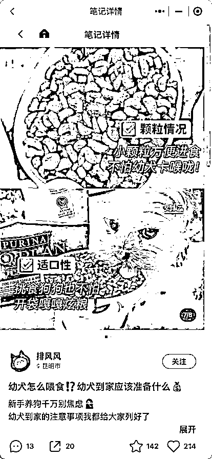

笔记推广部分（宠物试吃图）

4、定文案

这部分前面有人拆过，做法无非分段：开头打招呼，中段抛疑问、埋关键词，收尾介绍自己并引导互动，我就不重复。

四、怎么变现

对小白来说，最轻的变现入口是接推广。

（1）怎么提高接广率

1. 笔记里提前留广告位。比如科普“猫咪软便怎么处理”时，留一段讲日常粮或营养品如何配合，植入就自然出现
2. 个人简介放联络方式，方便公关找到你；邮箱现在不方便留，可用特殊字符替代，工具：exotictext.com/zh-cn

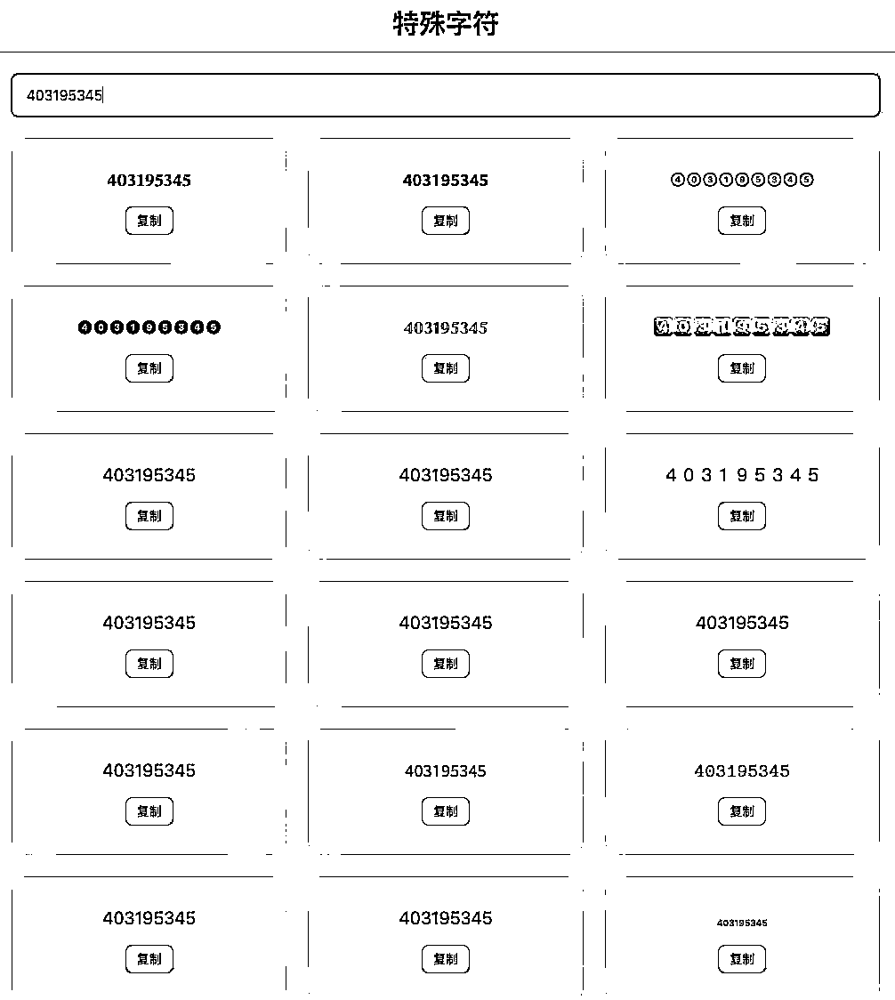

3. 满一千粉尽快开通报备合作权限，品牌可能在蒲公英平台看到并选你：

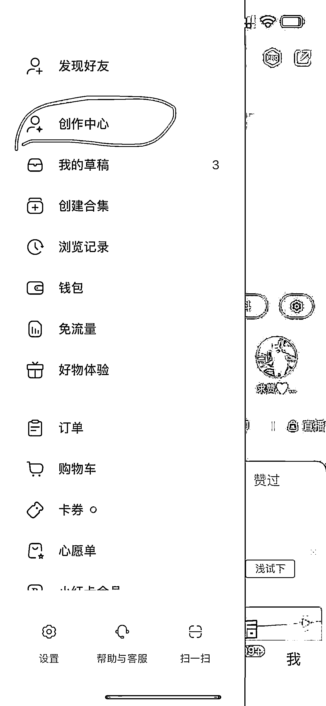

📕-我-左上角三条杠-创作中心

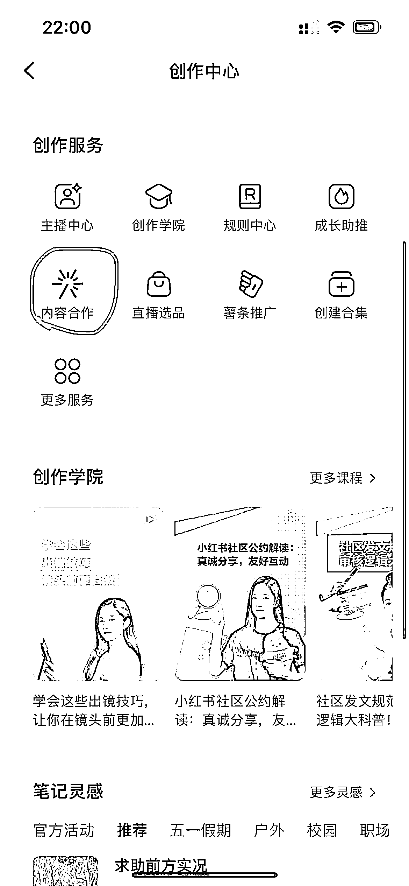

创作中心下滑-内容合作-进去后有开通指引

4. 也可用第三方通告平台，注意甄别，比如螃蟹通告、布偶通告（小程序）。平台里常有新媒体群入口，多加群、互换资源，通告信息会多起来
5. 碰到想合作的品牌，也可以主动私信

（2）推广合作流程

① 合作形式

合作分报备和非报备。报备是平台认可的品牌合作，要交平台服务费；非报备是私下合作，属于暗广。非报备又分单品和合集：单品是一篇笔记只出现这个品牌；合集是多个品牌付费，同时出现在一篇里。单品里还有一种伪合集：画面看似多个产品，实际付费只有一家，用来降低被判定私自推广的风险。

和PR沟通时，要问清：

1. 档期：初稿、终稿、发布日期
2. 授权转发：能否发到电商或内容平台，是否免费，授权多久。尾部博主通常免费，周期三个月到半年
3. 授权投流：能否在📕投流，是否免费，周期多长。投流能涨数据，但品牌若出负面，笔记还继续投，会伤账号形象，所以最好设期限，比如一年内免费，一年后再看是否续、是否加钱
4. 笔记发布后的保留期：通常一年或永久
5. 排竞：发布前后几天不能发竞品内容
6. 活动出席：美妆、穿搭品牌可能请达人参加发布会等

② 如何报价

推广分无费和有费。无费是置换，品牌送产品，你出一篇笔记，类似好物体验；有费是给报酬。报价大原则按粉丝量10%～20%，再结合账号情况调整；近期流量好、定位与品牌匹配度高，可以往上谈。

还要看是否重长期合作：报价高但效果差，品牌可能不复购；原价2000一篇、预算一个月只够一次，若谈到1500一篇，可能一个月合作两次。

再看对接方：直接品牌还是机构。机构通常要返点，即推广费返还一部分。返点20%左右合理，35%以上偏高。图文报价一般低于视频，约视频的60%～70%；若你本身以图文为主，图文报价也可与视频持平。报备笔记报价应高于非报备，因为要交平台服务费，还要接受更严审核、更高配合度，到手低于非报备就不划算。

一定要跟PR确认：当前报价对应哪个月，是否必须当月发布；若延到下月，是否涨价（保价）。修改次数也要说清，尤其是视频：脚本改几次、后期改几次、大改是否加钱。

有些合作不按固定价结算，而是按周期互动量阶梯付费，比如7天到100赞多少钱、到1000赞多少钱；也有按带货佣金，给基础费后按销量额外结算，或没有基础费按纯佣。

寄样有两个概念：寄拍和送拍。寄拍多用于高单价产品，拍完要寄回；送拍是产品直接送你。

③ 结款

结款要问发票。机构对接通常帮你开票；品牌对接可能要你提供替票或上诺诺网代开。替票是你外出消费，用合作公司抬头开票，再交给品牌报销；代开可上某宝搜发票管家，里面有诺诺网代开服务，选税点低的城市开给品牌。

还要问结款周期：发布即打款，还是等多久；结款方式是打私人账户，还是注册类似人力家的第三方平台，这类平台会代交税并解决品牌发票问题，比较省心。

除接推广，发笔记挂商品链接也能挣佣金，类似抖音小黄车，满1000粉可开通。还可以开📕店铺，自己带货，无粉丝门槛，找到货源即可。