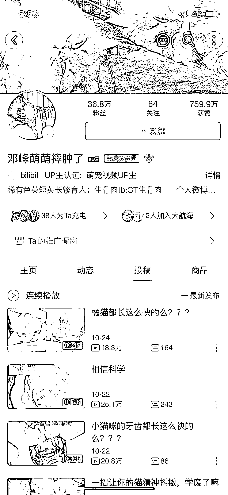
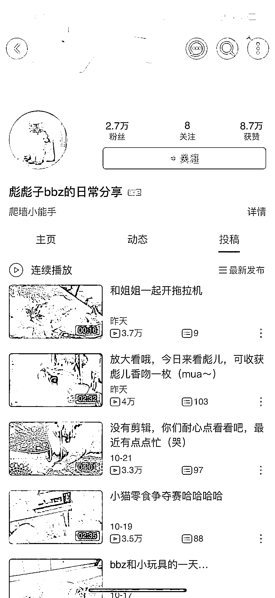
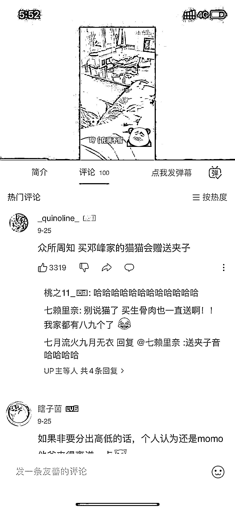

# (8 赞)萌宠账号起号的野路子

作者：time

日期：2021-10-26

生财茶馆里又有人分享了一个B站萌宠号快速起号的冷门操作——直接去买网红猫舍家的那只网红猫。

配图第一张就是那家网红猫舍。后面几张，则是那些因为买了这猫、并跟着猫舍在各大平台大力宣传而吸引来的粉丝。说白了，就是把这群喜欢特定猫咪的人，整个给截流到自己账号里。

对猫舍来说，靠营销把猫的身价抬上去了，卖得贵；对买家来说，买一只自带流量的猫，开个号就能接住大批粉丝，一个几万粉的B站账号，基本就能把买猫的钱给回本了。

花出去的钱又变成了流量，流量又带来了收益，这么一搞，正向循环就转起来了。这个案例，真的值得多琢磨几遍。

评论区：

亦仁：这个中标了，术值+1。点击顶部 #中标 专栏，可查看所有中标风向标。

朋友叫我阿锋：有点意思。