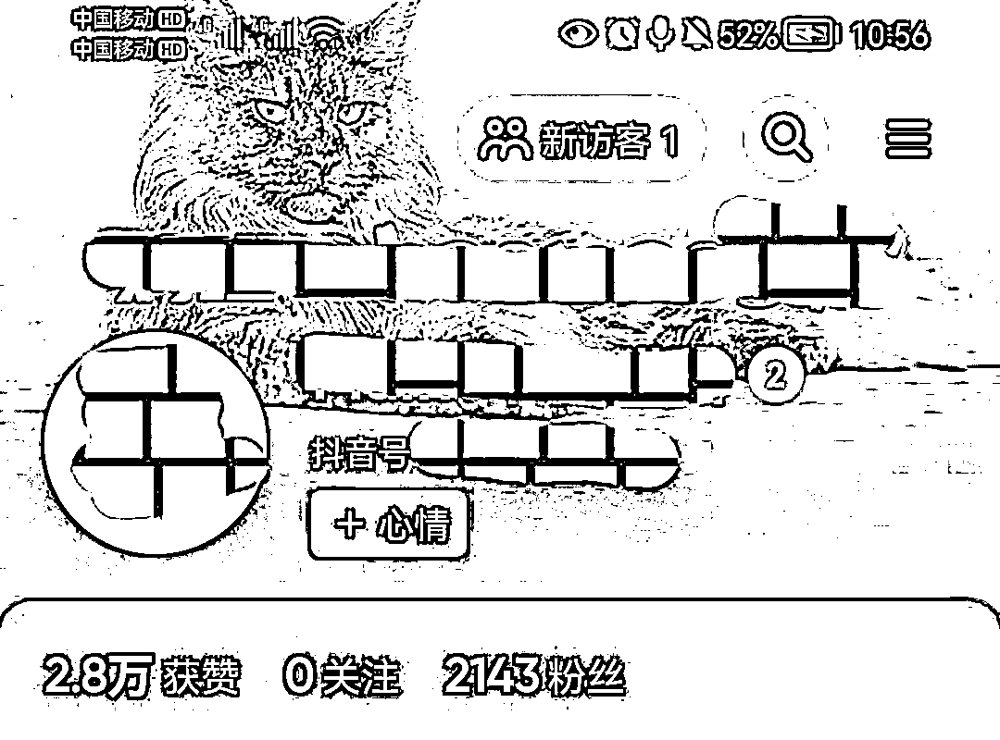
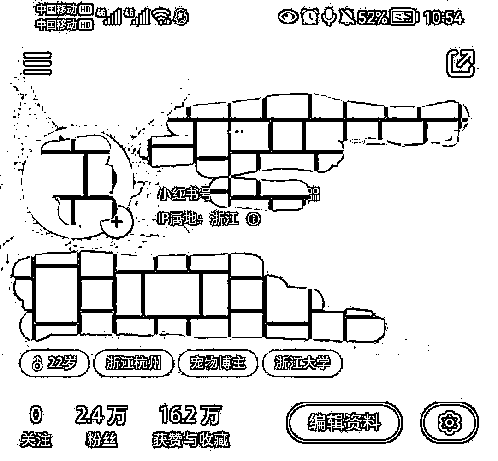
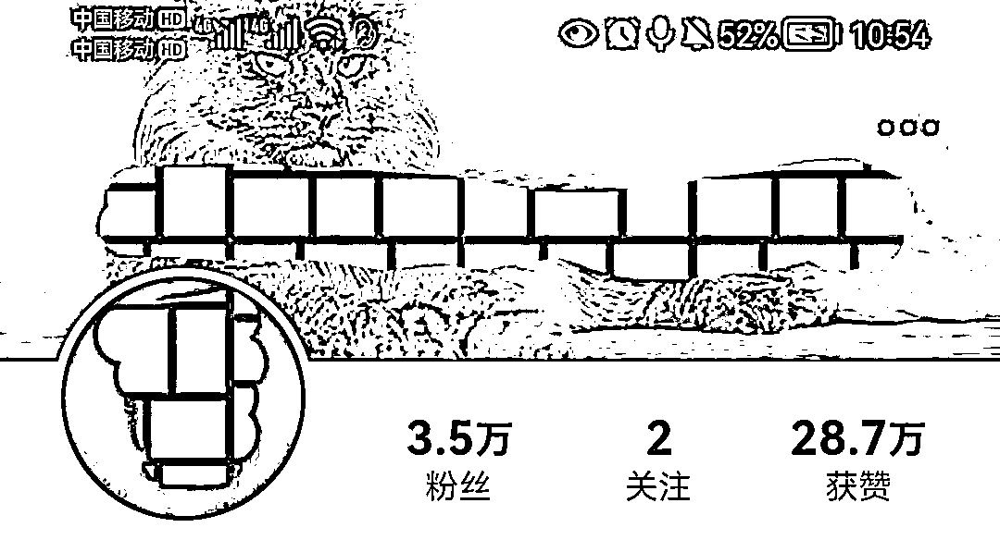
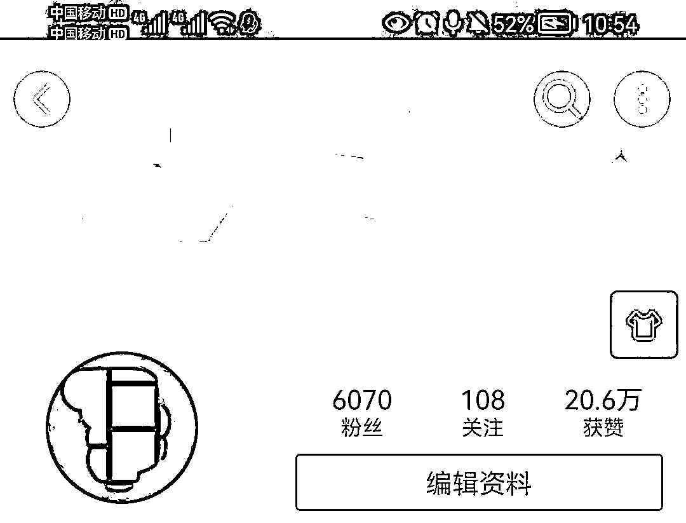

# 几万粉宠物号，为什么一分钱没赚到？

粉丝数看着不少，收益却一直是零。这个宠物号我做了不短时间，最难受的地方就在这儿：流量端还能折腾，转化端却非常薄弱。说白了，会拉流量，不代表会赚钱。

起因是一次线下交流。感谢生财有术的龙珠见面会，也感谢盗坤老师，那天聊了很多。现场有位伙伴本身就养宠物，我们便决定一起做一个宠物账号，故事也从这里开始。

真正做起来后，问题逐渐清晰：不是流量不够，而是账号定位没打准。起初我就打算靠导流完成变现，可把流量引给朋友后才发现，双方定位对不上，导过去也接不住。当时我还判断，如果账号体量在万元以下，或许反倒更容易跑通变现。现在看，定位不匹配，粉丝再多也很难变成收入。

评论区给了我不少启发。有人问能不能卖狗粮猫粮；一一则拆得更细：第一，变现要前置，第一个粉丝出现时就该想清楚怎么赚钱；第二，流量直接导给朋友却零收入，这让我想到以前做教育，哪有什么绝对不精准的流量，用户愿意看完视频还加微信，这个动作本身就不简单，可能只是需求没挖对；第三，起号阶段要参考同行，同行在推什么品，我们就跟着测什么品，实在不行，把流量导给同行也能产生收入。小花还建议，现在可以继续导给猫狗粮店铺，把此前导过的流量转去卖猫狗粮。我也回应说，可以试试。

所以，宠物号粉丝多，不等于收入多。定位、需求和变现路径要一起设计；从第一个粉丝起就考虑赚钱；多观察同行在卖什么；导流也要找匹配的承接方。哪怕自己不带货，把老流量导给猫狗粮店铺，也能让它重新产生价值。别等粉丝攒到几万，才发现自己只会搞流量、不会做变现。

完整复盘放在这里：https://shimo.im/docs/16q8M18JmdhplRk7/

 

