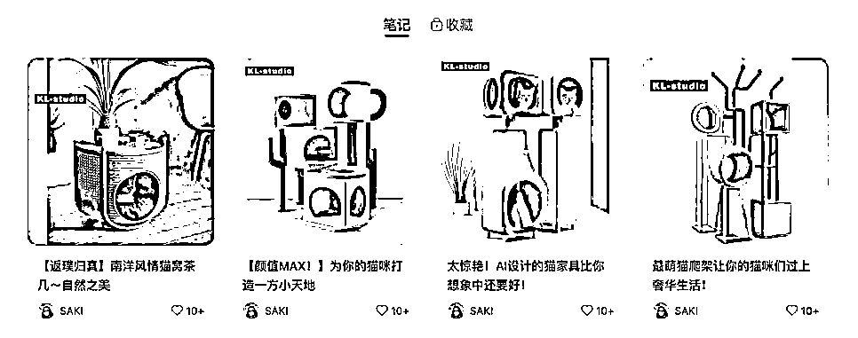

# AI 宠物用品设计，网友投票选爆款？

最近刷到一个设计师博主，分享了自己用 Midjourney 做猫爬架工业设计的思路。她把 AI 生成的一组猫爬架效果图发到小红书上，让网友直接投票，选出觉得更好看、更想买的那一款。这不就是妥妥的数据分析吗？

以前的设计流程，通常是设计团队内部开几轮会，层层筛选出最终方案，再决定生产哪一款。现在这个流程被倒过来了——先让大众评审用点赞和评论表态，哪款呼声高，就优先安排量产。

感觉用不了多久，会熟练使用 AI 绘图会成为设计师的基本功。毕竟 AI 出图的效率摆在那儿，几分钟出十几张概念稿，再配合网友投票反馈，产品方向能摸得又快又准。这样一来，那些出图慢、思路慢的设计师，恐怕真的会被优化掉。对企业来说，这才是实实在在的降本增效。

评论区也挺精彩：

三农玲花：这个思路很妙啊！让网友投票决定生产哪款，既做了市场调研，又提前攒了一波关注度。宠物赛道本身需求就很刚，很多人把毛孩子当亲娃养。顺着这个思路想，我所在的体外诊断行业，居家自测产品是不是也能用 AI 设计 + 网友投票的模式？这样既能加速生产设计，也能更快打透市场？

冯冯 FOX：我个人感觉，居家自测产品大家更关心的还是“好用”，比如检测更准、出结果更快。而宠物用品现在已经卷到了“好看”，放在家里要颜值高、还得能搭配家居。如果细分到儿童检测产品，那用 AI 画出更可爱、颜值更高的外观，可能相对蓝海。

三农玲花：对，可以分三条线来看：第一条，宠物用品已经这么卷了；第二条，居家自测（像抗原、HIV 自检）还在功能完善阶段；第三条，儿童自测产品如果让 AI 来画外观，做得可爱讨喜，孩子喜欢，那这个赛道就值得切入——前端可以从自媒体内容开始，后端对接工厂定制。

一时：这是用哪个 AI 生成的？

冯冯 FOX：Midjourney。

亦仁：中标，术值+1。在上方 #星球栏目 专栏中，点击 #中标，可查看所有中标风向标。