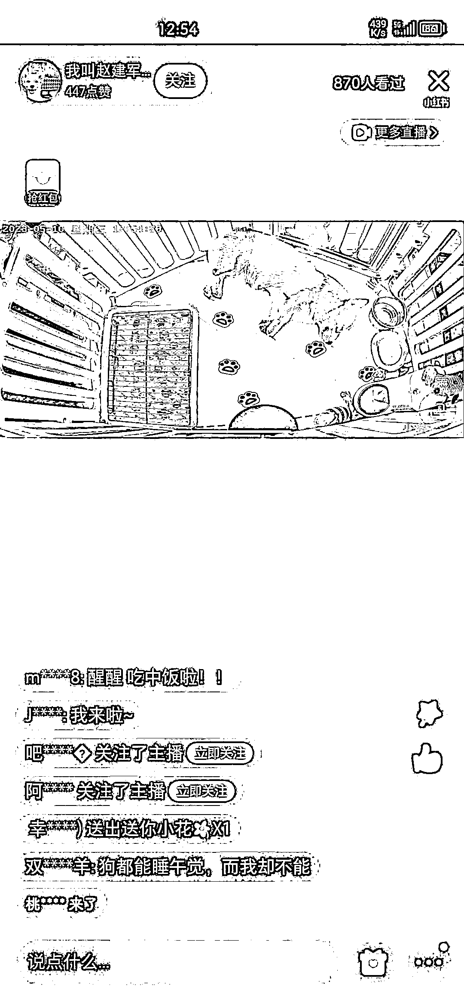

# (79 赞)架个摄像头拍家里的猴子，宠物号带货新思路

作者：  程序员言午

日期：2023-05-10

刷小红书的时候看到个挺有意思的玩法——有人直接用摄像头挂在家里，对着自家猴子来个24小时直播。这博主本身就是做宠物内容的，靠着这波直播把流量做起来，再顺手带点宠物用品，全程连脸都不用露。做宠物类目的朋友，这路子值得琢磨琢磨。

评论区：

速影 : 这玩意儿真能赚到钱？具体怎么变现啊

墨鱼 : 我第一眼没反应过来，还以为是“自己在家的猴子”[奸笑]

晨冬 : 我第二眼也是这么理解的[捂脸]

刘文强 : 我第三眼还是[捂脸]

辛禾 : 巧了，我今天也刷到了[偷笑]

周宇 : 我家狗子跟它有得一拼，可以借给你直播，自带技能，包两顿狗粮就行[呲牙]  
亦仁 : 中标，术值+1。想回顾所有中标风向标的话，去上面专栏点 #中标 就能看。

程序员言午 : 看着就是靠狗子吸睛，后面卖宠物周边变现呗