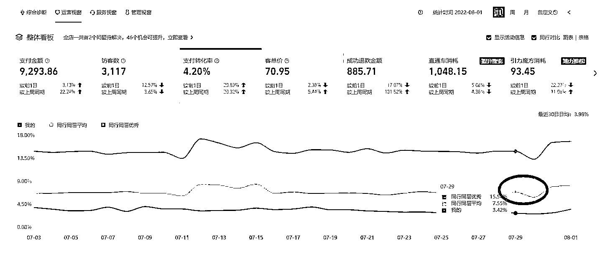
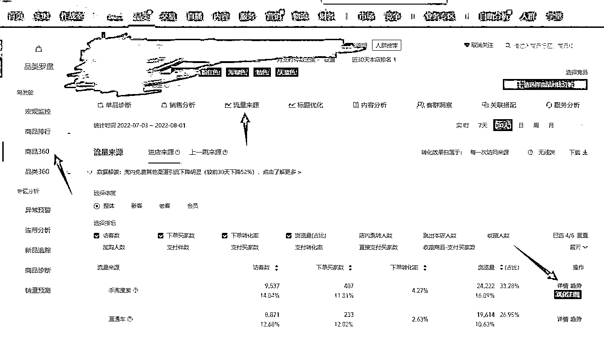
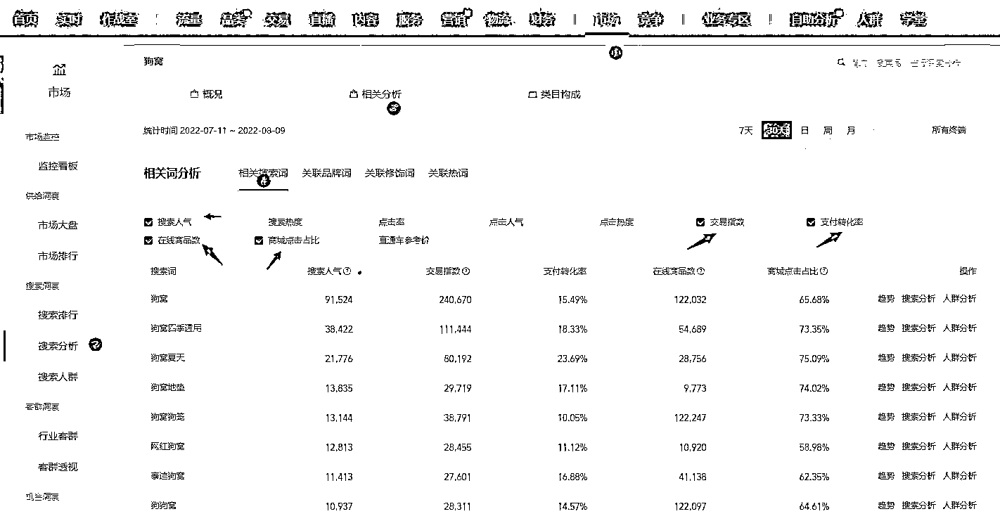
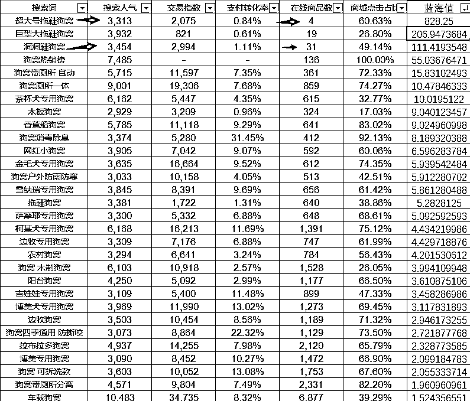
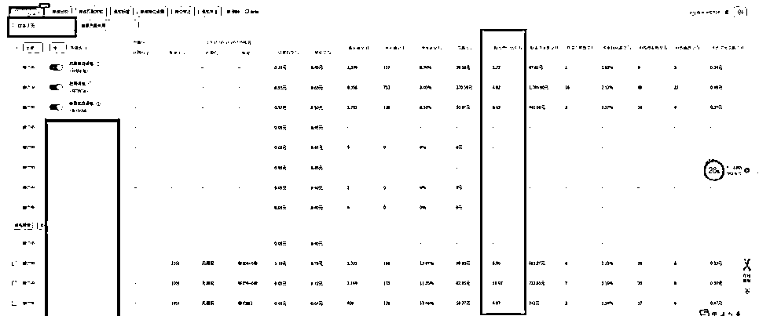
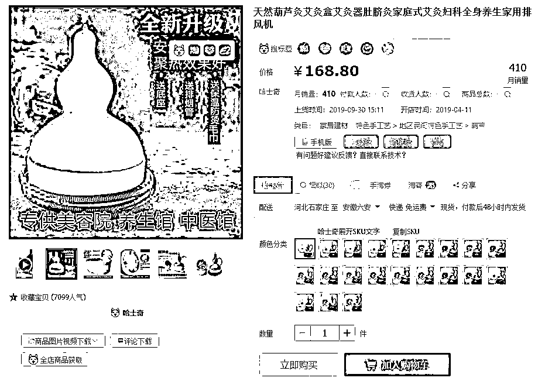
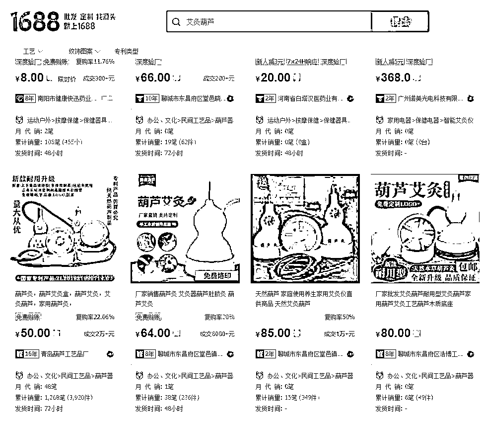
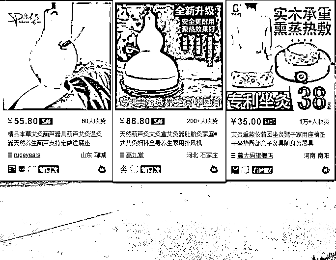
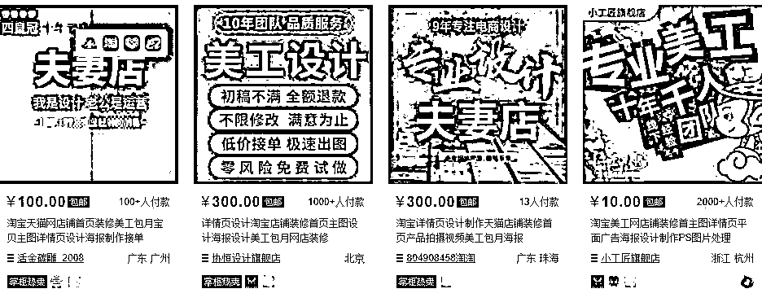

# 4 款爆品撑起 500 万年销，我的选品与运营心得

大家好，我是惊涛，电商从业 6 年，一直在天猫和淘宝这两个平台折腾。2018 年之前，我和团队做生日礼物，巅峰时一年能卖到千万级别。那之后我独立出来，现在主营宠物用品和生日礼物品类，年营收大概 500 万。不过今年明显感觉吃力，预估要缩水三成左右，不知道其他淘系卖家最近怎么样？这是我头一回在公开场合做分享，希望借这个机会多结善缘。

## 一、选品阶段，我盯住这四类产品

### 1. 首选月销千单左右的机会款

我把目标锁定在月销 1000 单这个档位，原因很简单，这个量级是我使劲够一够就能摸到的。算笔账就清楚了：每天靠人工操作补 10 单，直通车投放带来 10 单，自然搜索再贡献 10 单，一个月的单量差不多就凑齐了。

具体操作层面，人工干预这块我是找放单主持来安排，淘系一单成本大概 10 块钱，补单节奏跟着转化率走，保持在和行业均值差不多就行，别拉太高。

新品刚上架那会儿，权重还没建立起来，直接搜全标题就能找到；差不多养一周左右，权重慢慢有了，改成半标题也能搜到；等权重彻底站稳了，就去补那些本身有自然成交的词，以及搜索量比较大的词。查词路径是：生意参谋——品类——商品 360——流量来源。

直通车这边，我主攻精准词和蓝海词。拿我卖的狗窝来说，“狗窝”这种大词太泛了，我把它丢进生意参谋——市场行情——搜索分析，按 30 天维度排序，筛出“狗窝可拆洗”这类更贴合的词，再丢进直通车里跑。蓝海词怎么找？把“狗窝”作为种子词输入，勾上相应选项，同样按 30 天排序。

把数据导到表格里，搜索人气除以在线商品数就算出蓝海值，然后按蓝海值从高到低排一遍。

排完你就会看到“超大号拖鞋狗窝”“巨型大拖鞋狗窝”“洞洞鞋狗窝”这类词，搜索热度不低，但真正在做的人很少，这就是金矿。放到标题里也好，放进直通车也好，效果都相当不错。找到了合适的蓝海词，就以 7 天或 14 天为周期去做测试，留下转化表现好的，砍掉效果差的。头图同样得测，至少要做到行业平均水准，不然质量分很难养起来。前期只要不亏本，就放开限额去推，先把单量堆起来；等量起来之后，再把重心转移到投产比上，逐步调整关键词出价，让钱花在刀刃上。

这里有俩坑得提醒一下。第一个，前期千万别碰大词。你一个新品，销量和评价都比不过老链接，这时候去抢大词流量，转化惨不忍睹，钱也白烧。第二个，点击率要是达不到行业平均，质量分就上不去，点击单价也没法降下来。所以一旦发现点击率不达标，马上换直通车图，别犹豫。

### 2. 毛利率要控制在 30% 到 50% 之间

为什么死守这个区间？因为后期要靠付费流量去带动自然流量，如果毛利连 30% 都没有，推广这把火根本烧不起来。做电商不是做公益，赚不到钱的产品不值得做，更何况人工、水电、房租，每一笔都是真金白银的开销。

落地怎么算？两个路子：一是拿着样品，在本地找能生产的厂家，越小越好，小作坊愿意接小批量单，直接问 1000 个什么价；二是去阿里巴巴上找加工厂，同样先问 1000 个的报价，注意量一定要报够，报太少拿不到好价格，多找几家对比。

拼多多也能拿来比价，有些品在上面和淘宝的价差已经到了三成，遇到这种可以买样品回来看质量，靠谱的话直接在上面进货也没问题。

### 3. 优先选能自产或能二次加工的产品

先解释下什么叫二次加工。之前我们做生日礼物的时候，有个木刻画就是典型的二次加工——把木板、木框这些原材料买回来，自己设计图案自己雕刻，这就叫二次加工。

这么做的核心逻辑是建壁垒。要么产品需要额外加工工序，要么对手根本找不到工厂来生产，这样一来，大部分竞争者自然就被挡在门外了。落地时，还是去找身边的工厂谈，记得要会“画饼”：我们店年销 500 万，现在准备全力推这款，第一批先少量生产试试水，后期跑通了，一年 1 万件不是问题。重点在于展示你的实力，用最低的单价、最小的起订量，先拿到一批货来做测试。阿里巴巴和拼多多上的玩法一模一样，这里就不展开了。

### 4. 专挑视觉做得烂的竞品下手

柿子要挑软的捏，选品同理。优先找那些主图、详情页都惨不忍睹的对手，这类店铺通常拍摄和运营水平也不行，我们后期自己把主图和视频做精致，竞争力自然就出来了。举个例子，下图中 1 和 2 就是典型的反面教材，换作我们来做，肯定直接对标图 3 的效果。

样品到手之后，我会自己上手拍照、设计详情、剪视频，确保视觉体验全面压制对手。这得益于我以前就是搞摄影和设计的，所以可以全流程自己完成。如果你没这个技能，也有两条路：要么花时间自学美工和拍摄，但周期比较长，大概三个月才能上手做一些基础操作；要么等产品数据跑出来还不错之后，直接找外包，淘宝上专门做详情页和主图设计的服务不少，一个产品五百块上下就能搞定。总之解决问题的路径多得很。

## 二、运营阶段，两个核心动作

### 1. 新品上架，定价直接比对手低 5 到 10 块

为什么？新品阶段，销量和评价都是短板，消费者凭什么选你？最朴素的理由就是便宜。但注意，便宜一两块意思不大，便宜太多又会搅乱市场行情，最后大家都没钱赚。定好一个有竞争力的价格，再用直通车和人工操作去追单量、追坑产，把排名顶上去。具体操作上，上架时直接把价格调低，或者用打折软件做促销，怎么方便怎么来。

### 2. 主图、详情、直通车，上线之后就进入无限优化循环

一个新品想一次就做到目标月销量，基本是幻想。刚推出的时候，你对市场的理解、对对手的摸底都还很浅，只能靠不断调优去逼近正确答案。详情页一般不用大动干戈，重点放在主图上。这些年我做了不少产品，发现一个规律：有些品天生主图点击率高，你随便拍拍都能跑出好数据；有些品就是天生点击率低，怎么折腾都上不去。优化的思路就两条：一是让主图贴合真实使用场景，二是把卖点直接怼到用户脸上。拿美容院毛巾来举例，第一种就是把毛巾随意叠放在一起，没有任何场景感；第二种让一个女生躺在美容床上，一看就知道是美容院专用的，目标客户自然会优先点进来。

卖点这块，有的品主打夏季专属，有的品强调四季皆宜，取决于你想传达什么。还有一个省事的办法，就是照着卖得好的竞品抄作业——人家的点击率已经证明了一切，照着场景布置和产品摆放去模仿，出效果的速度是最快的。

## 三、踩坑多年攒下的几句实话

选品这件事，再怎么强调都不过分。这几年我们陆续上架了差不多 40 款产品，但真正赚钱的也就那 4 款。如果我能复制出更多这样的小爆款，收入绝对不是现在这个数。今年我正好 30 岁，古话说三十而立，也是这一年加入了龙哥盟，看到不少圈友年纪不大却已经做出了很亮眼的成绩，希望以后能和大家多交流多学习。对我来说，今年就是人生新阶段的起点。

评论区里有人问：现在拼多多对无货源打压比较狠，从上面拿货还方便吗？作者的回答是：拼多多现在退款率偏高，如果你的拼多多账号多，可以继续做一件代发；账号少的话，建议把卖得好的款备货十天左右，自己发货，或者干脆去找阿里巴巴的货源。还有人留言说自己在做宠物私域，想找宠物用品的代发渠道。