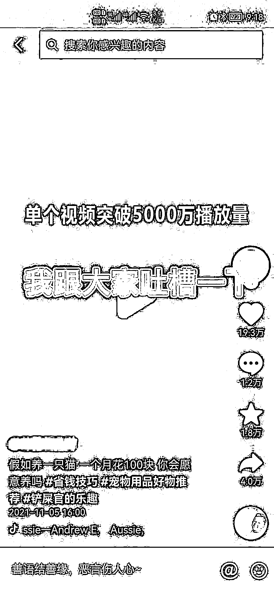
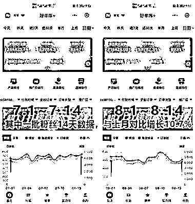

# 百万猫车群产出骤降，我靠重组选品团队救回来了
（精华帖 · 46赞）

文/阿豪｜2022年8月15日

我是阿豪，广东揭阳人，97年生，在互联网行业创业多年。

先说说猫车群是什么：它服务的是养猫这一精准人群，卖的东西覆盖猫粮、猫砂、猫罐头、驱虫药、猫玩具等淘客活动商品。获客上，我们在抖音发短视频并投豆荚，把流量导入私域。其中一条视频播放量最高做到5000万，也正因这条视频，我们在猫车赛道打出了名气。到现在，抖音累计为我们带来20多万粉丝。

下面是我复盘的全过程：猫车群产出为什么掉下来，以及我后来怎样把它重新拉起来。

完整版复盘已放在飞书，可移步阅读：

https://dl3446n2rd.feishu.cn/docx/doxcnYRDCx9o6PjX51UoOFOqE7g

互动区：

- 快印老司机唐应群：采集群能适配不同行业吗？  
  阿豪：淘客圈里，每种粉都有对应的采集群。
- Believer：上个月才注意到这个需求，想入行，能请教吗？  
  阿豪：微信 5435154，欢迎交流。
- 苏生：谢谢分享。
- 叶晓宇：刷到过你的视频。
- 亦仁：感谢分享，已加精华。