# (精华帖)(129 赞)TikTok 流量变客户：私域成交全拆解

作者：饼

日期：2022-09-19

这套玩法的本质，是把短视频和直播间带来的平台用户，导进自己掌握的聊天工具里——Line / WhatsApp / Facebook / Instagram 都行。人一旦进了你的池子，后续触达成本就能压得很低，甚至接近零；再靠持续沟通、产品讲解和聊天节奏，把关系养熟，最后落单。

我是饼，毕业后这一年多一直泡在 TK 上，方向是给独立站导流，以及在私域里聊单卖货。短视频起过几款爆品，TikTok 私域的第一笔像样收入也来自这里。下面把我踩过的路、试过的方法摊开讲。

全文脉络：

一、TikTok 私域是什么，为什么值得做？
二、什么货适合放进 TikTok 私域？
三、TikTok 上怎么持续找到客户？
四、客户来了怎么推进成交？
五、信任这一关怎么过？
六、私域怎么养出复购？
七、实操中要避开的坑

希望看完能给你一点启发。

一、TikTok 私域是什么，为什么值得做？

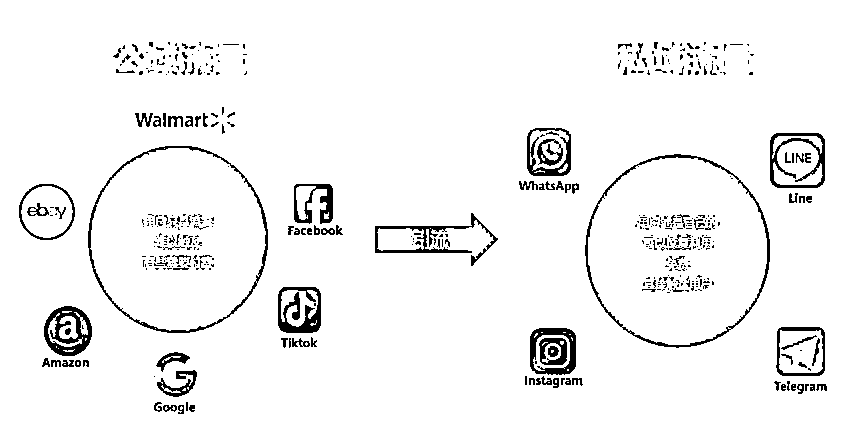

先分清两个概念。亚马逊、TikTok、Google 这类平台上的流量，本质是公共资源；有些公域曝光还要花钱买，比如在百度、Google、FB 搜关键词，自然结果和竞价广告同屏出现，后者就是付费位。私域则是一个相对封闭的客户池，归你自己调配，能反复使用。

TikTok 近一两年在全球蹿红，月活用户超过十亿，体量已经压过 Facebook、Instagram 等老牌社交平台。面对这么大的免费流量入口，把用户往私域承接的玩法就出现了：

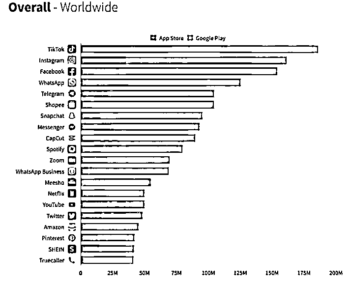

具体做法：借短视频或直播曝光，把看客引到 Line / WhatsApp / Facebook / Instagram 等自建社群工具里。这样你手里就有了可重复触达、成本很低甚至免费的客户，再通过长期维护、产品讲解和沟通引导，把订单拿下。

眼下 TK 上更常见的是独立站、小店这类站内或站外成交。但 TK 逐步闭环，跨境店开放时押金门槛不低，部分类目要 4000 英镑，折人民币约 32000；英国用户在小店下单的习惯还没完全养成，东南亚小店单笔金额偏低，独立站又存在视频转化和回头客不足的问题。此消彼长，私域的优势就出来了：

1. 池子里的竞争没那么激烈，买家不容易到处比价。
2. 加价空间归自己定，利润上限更高。
3. 老客能反复买，收益更偏长期。
4. 还能招代理，让渠道帮你出单。

打个比方，平台像一片公海，私域是你挖的鱼塘：先把鱼苗收进来，养大了卖掉，或者让大鱼继续繁殖。

独立站和小店多半做一锤子生意，客户难沉淀，二次购买率也低。私域只要产品和服务扛得住，回头客会源源不断。比如一只手表，进货 400 元，在私域里卖到 400 美元甚至更多并不稀奇。

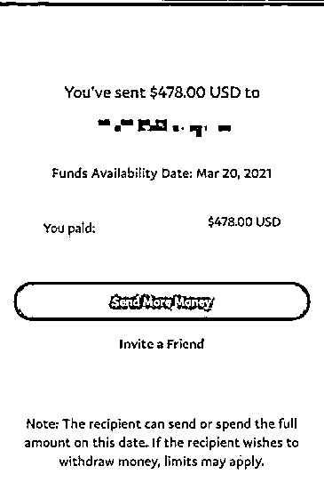

二、什么货适合放进 TikTok 私域？

用户被引到私域后，要花不少时间建立信赖，询盘一多，人力成本就上来了。所以选品时，毛利必须够厚，才养得起客服和运营。通常这类货有几种特征：认知差、供应链优势、加价空间大、能反复卖。

举几个方向：

1. 单价高的：3C 数码、奢侈品（箱包、鞋履、腕表）。
2. 容易反复买的：电子烟、情趣用品这类带依赖性的。
3. 定制型：手绘涂鸦鞋。
4. 精神文化型：塔罗牌、佛珠手串、转运水晶。

三、TikTok 上怎么持续找到客户？

平台流量大，但得找到入口。下面五条路都有人跑通。

**1. 短视频内容**

TikTok 的底盘是短视频，视频流量最大。先想清楚内容走什么路线：如果要把自己包装成工厂，就拍生产线，让 B 端看到你的专业、品类丰富和差异化；如果想抓 C 端，就多给产品特写，用夸张、有梗的呈现方式抢注意力。

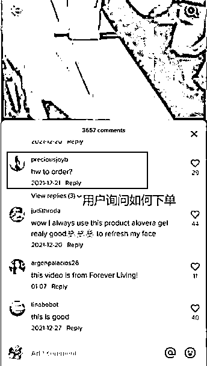

**2. 评论区截流**

刷抖音时常见大 V 评论区冒出热评，这套在 TK 也能用。去热门评论下面跟评，同样能蹭到曝光。

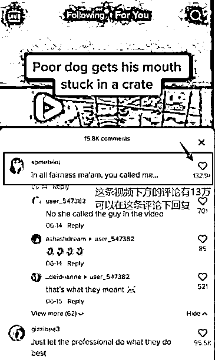

**3. 互关私信**

TikTok 私信有门槛：双方互相关注后才能发消息。做法是到相关视频下面找有购买迹象的人，或者去同类账号的粉丝列表里捞人。老外回关率不算低，十个里大约两三个会回。对方一回关，就把自我介绍和联系方式递过去。

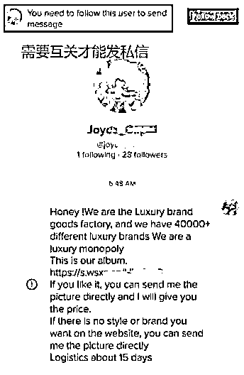

**4. 直播引流**

直播间互动强。我最早做私域时，主页放链接，直播里讲产品，再用背景板和贴纸提示观众去找主页客服下单。每天开两三个小时，WhatsApp 能进来几十到上百个询单。

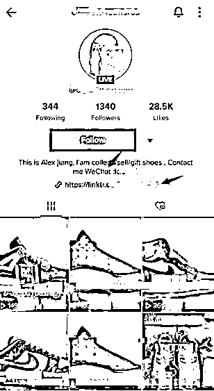

**5. 标签推荐**

发视频时自己加话题标签。用户搜索相关词时，带标签的内容更容易排在同行前面。

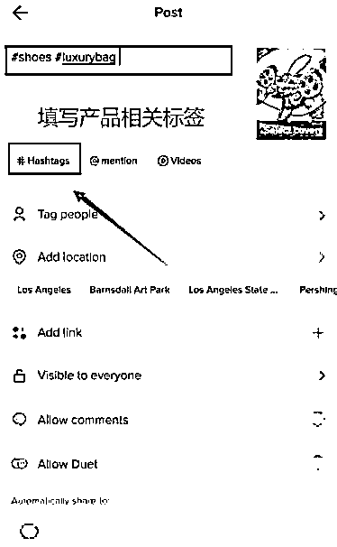

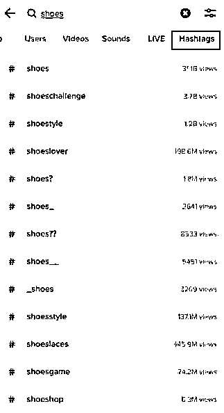

按流量体量排，大致是：短视频 > 直播 > 互关私信 > 评论区截流 > 标签推荐。

短视频一旦冲破流量圈，触达的是全球用户，所以它也是大多数人最快接触私域的入口。真人直播要求你懂产品，还得把场景搭专业；无人直播若能找到稳定素材源，也值得一试。

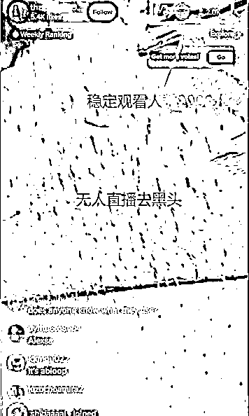

效果好坏，关键看短视频和直播内容能不能精准勾住目标人群。内容要随产品和平台生态调整，光摆产品很难留人。下面拆几个内容案例：

**a. 直击痛点**

短视频有黄金三秒的说法。开头几秒就得让观众停下，直接告诉他：这东西就是解决你某个麻烦的，用了就顺。TK 带货吃新、奇、特，我们早先做泡泡枪、玩具枪，就是靠这三点冲起来的。

做奢侈品私域时，我们把一堆包塞进大箱子，说这是邻居托我代买的盲盒。观众好奇，就会多看几秒；视频里再埋一句“想要的可以找我”。第二天播放量冲上百万，WhatsApp 客服回了一整天都没清完询盘。

**b. 颠覆认知**

把产品的质量、价格或用法，做成跟用户原有印象相反的样子，就像张小泉的刀不能拍蒜那样出人意料。举例：老外觉得某类东西很贵、平时舍不得买，你给出的价格却远低于他的心理线，求知欲会推着他来问。

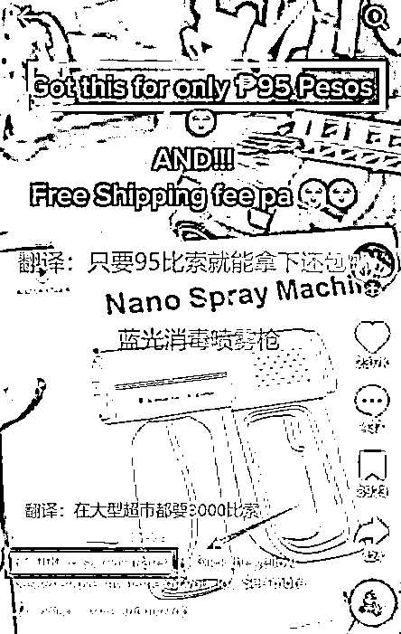

**c. 强烈反差**

把使用前后的差异摆出来。TikTok 上常见的一抹白、减脂类产品都吃这套。常见结构是：使用前状态 + 产品展示讲解 + 使用方法 + 使用后效果。反差越强，好奇越重；如果观众正好有同样烦恼，就会去评论区找用过的人。这时把钩子埋好、评论控好，信任一建立，对方会主动来加你。

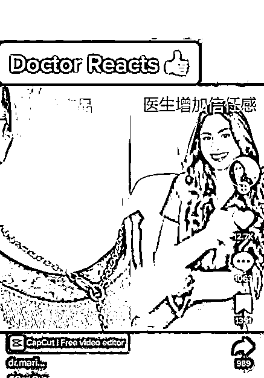

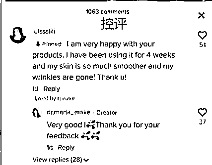

**d. 讲故事立人设**

不少老外吃故事这一套。有些账号卖得动，未必货多强，而是叙事抓人。@woofpalace 和 @Investmentjoy 就是 TK 上靠故事变现的代表。

前者做宠物定制项链，用短视频记录自己在 TK 经营小生意的日常：订单、顾客和爱宠之间的故事，再加上被亚马逊同类产品挤压、差点撑不下去的卖惨桥段。结果吸了 50 多万粉，订单多到接不完。

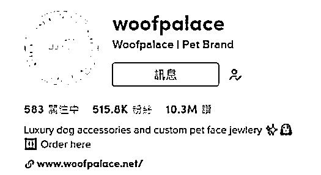

后者卖教人赚钱的课程，把流量往私域引，再推自助饮料机、洗衣机项目。他的作品和封面几乎都绕着钱转，内容无非是自己怎么赚、每笔收多少；简介里强调从穷小孩起步，既拉近距离，也把身份标签立住了。

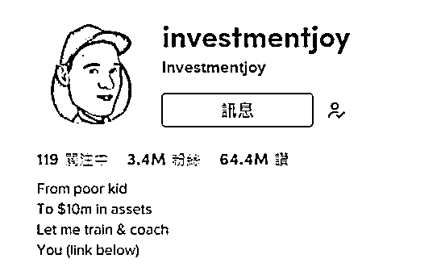

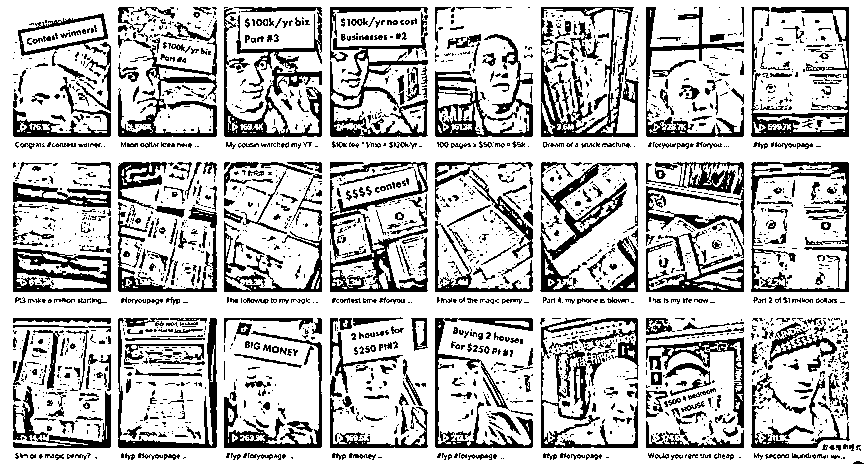

**e. 衍生内容**

我们做佛珠手串时，核心卖点是宗教文化。平时发佛教起源、传播脉络之类的内容，借信仰把用户带进圈子慢慢养。圈子里推手串时，配上佛教典故和一张开光证，信仰感直接拉满。

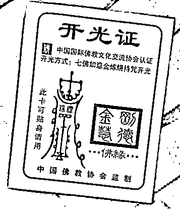

这些只是样例，方法可以混用。比如“直击痛点 + 强烈反差 + 颠覆认知”，就是现在不少带货视频的通用配方。

四、客户来了怎么推进成交？

**1. 先用视频、直播、评论等入口，把用户往主页或关注按钮上引。**

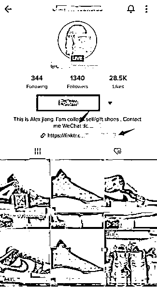

**2. 观众点主页链接，跳到聊天软件；或者你先回关，再私信发联系方式。**

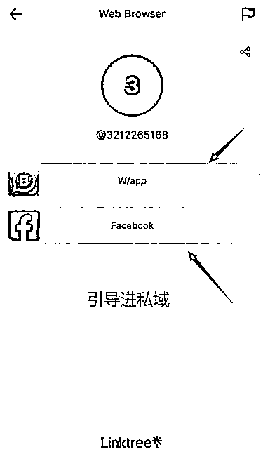

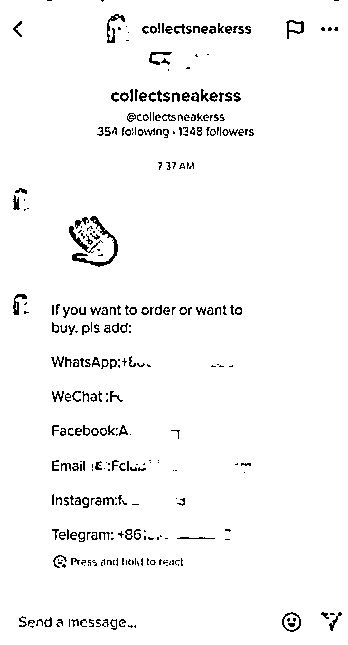

**3. 接下来就是询盘、按话术推进、讲产品、收单。**

a. 用户询盘

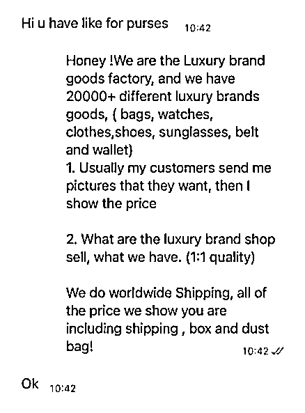

b. 说明支付方式

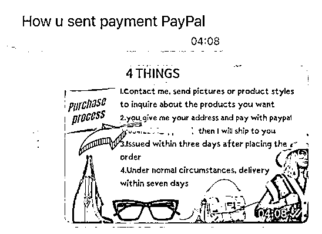

c. 讲清运费和时效

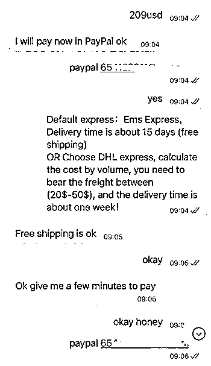

d. 用户付款后收地址

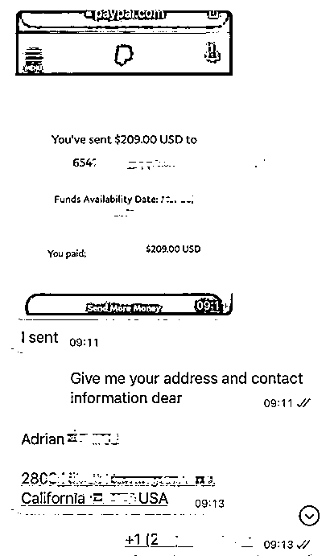

e. 承诺发货时间并致谢

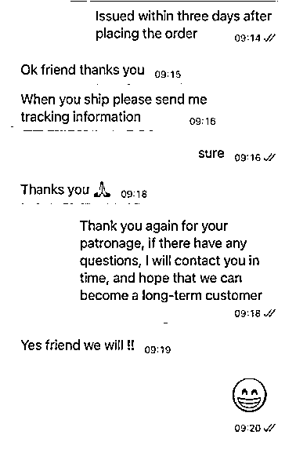

五、信任这一关怎么过？

常有人问：聊几句就让人转钱，对方不怕被骗？实际有办法降低顾虑。

1. 多数订单走 Paypal。顾客转账时能选“购买”或“亲友转账”。若选购买，而你的账号不是即时提现类型，钱会被平台压 21 天，或等买家确认收货才放款。这个机制对消费者是层保障。

2. 设一个引流款，必须是你手上最便宜又拿得出手的。新客没交易过会谨慎，先推这个：价格低、质量不差。很多人会先拍它，收货后再问体验，关系维护好，复购就来了。

3. 聊单、视频或直播里最好有身份标签。可以是工厂老板，也可以是固定卡通角色。我们之前直播就套过熊猫服，名字叫 panda，既能让人好奇停留，也能留下记忆点。

4. 客户池要经常晒单。新客没买过会翻你的圈子，看有没有成交记录和评价。这个靠日常运营积累；初期没有，就自己开几个号留言、做几张成交截图。注意小号也要包装：搜几个人名，把头像和帖子搬一遍，最好再弄几张买家反馈图。

5. 聊天别太僵，bro、sis、dear 这类称呼能拉近距离。但语气要自然，光靠翻译软件常常词不达意。英文缩写也可以多用：ASAP 尽快、TKS/THX 谢谢、COD 货到付款。

6. 遇到特别谨慎的买家，可以先收部分预付款（通常这部分已覆盖货值和运费），再承诺货发出后把打包视频、运单信息发给他，确认后再付尾款。不用担心发货后对方赖账，货物没出关前还能截停。

如果这些方法都用了，对方仍不信，就别耗了。把圈子运营好，真有需求的人迟早会回来。

六、私域怎么养出复购？

1. 产品和服务持续打磨，质量是回头客的第一驱动力。
2. 算准回购间隔，时间快到时主动联系，问使用感受，顺便推新品。
3. 节日、换季、固定节点做优惠。利润空间够，就配点高感知的小赠品，成交率会明显上去。
4. 第一印象很关键，要把人设立住。比如兼职赚学费的学生，或者工厂老板清库存求助。让顾客记住你这个人或这款货，哪怕当下不买，以后想起来也会找回来。
5. 用社群工具做留存：Line 的 VOOM、Ins 帖子都能发新品、折扣、抽奖，提高粘性。WhatsApp 的朋友圈要对方存了你的号码才看得到，所以我们通常配合 Ins 做——用户关注 Ins 就减 10 美元。圈子里也可以偶尔搞秒杀，刺激想买又犹豫的人。
6. 老带新：对方砍价时，让他拉人换优惠。拉 1 人减 10 美元，拉 5 人送一枚精致戒指，让大鱼带小鱼。

案例展示详解

**1. 前期准备：**

1）结合自身资源或擅长的领域定品。
2）按目标国家选聊天软件并注册：

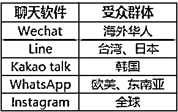

3）准备自我介绍：你是谁、做什么、能提供什么、产品相册或独立站、下单与支付方式、物流时效、退换规则。
4）收款：Paypal、Westunion（西联）、TransferWise、Alipay、MoneyGram、银行卡转账。一般 Paypal 就够。
5）物流：特殊品类要找货代，否则清关过不去；普通货走 DHL、联邦、UPS，通常 7-15 天可到。

**2. TikTok 准备：**

1）账号包装：

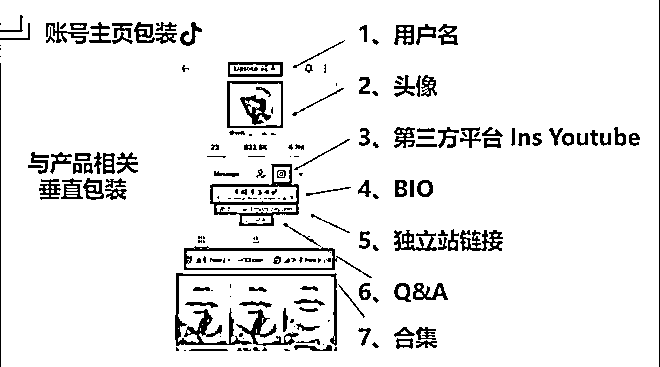

2）找对标账号拍，或找素材源做二次创作。对标可在 TK、国内抖音、小红书找。
3）内容垂直。垂直度就是你的专业度：

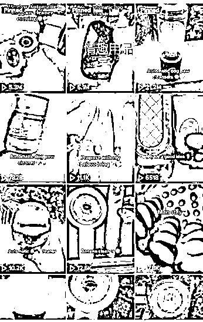

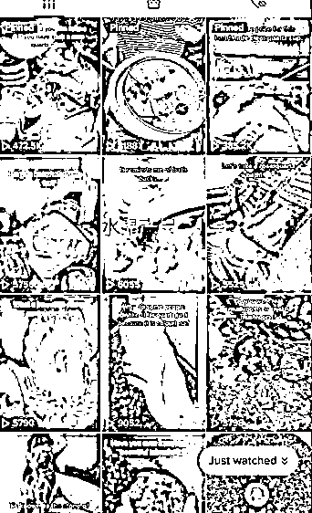

4）视频、标题、评论区做引导。千粉号可直接在主页挂链接。没到千粉，可以拿一个千粉号，或刷一个千粉号，在视频贴纸、标题、评论区里 @ 它。用户点一下就会跳到该主页，重点包装好这个千粉号即可。

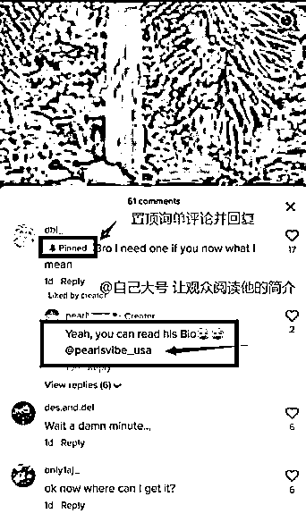

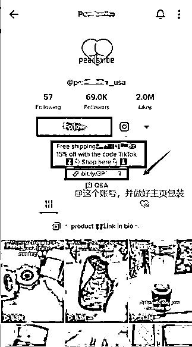

七、实操中要避开的坑

1. 各国消费习惯和信仰不同。若做信仰类或高端定制，先摸清当地消费力和宗教情况。

2. 支付：私域卖货不难，难在钱怎么收回来。比如台湾省，需要当地居民银行卡才能转账，想做这块市场得先解决收款通道。其他区域用 Paypal 时，记得由你发账单给买家，不要让对方直接转；直接转有风险，敏感产品若被备注，Paypal 容易出问题。

物流不用太慌，货基本都能发，差别在价格和时效。找货代要看有没有双清关能力；只负责出关的，到了当地海关被查扣，这票大概率拿不回来。

3. 流量进来后，虽然多数是精准粉，仍要像漏斗一样筛。第一层自动回复筛，第二层询盘筛。当用户开始问怎么发、怎么付，成交概率就很高了。这时给他打标签，方便后续跟。第一层被筛掉的，也可以给点优惠刺激一下，很多老外吃小便宜这一套。

4. 软件小技巧

下载 WhatsApp 要选商业版 WhatsApp Business，里面有些功能很实用：

a. WhatsApp Business 自动回复

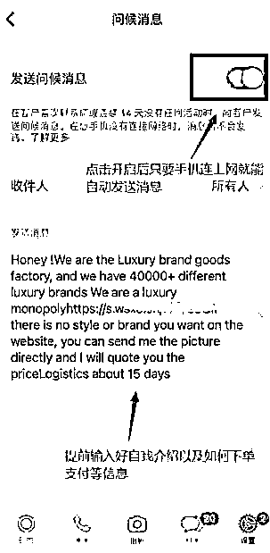

b. 快捷键

高频回复可以提前存好，聊天时直接调用，不用反复敲。

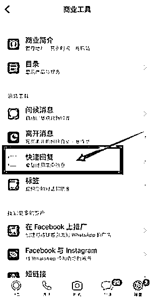

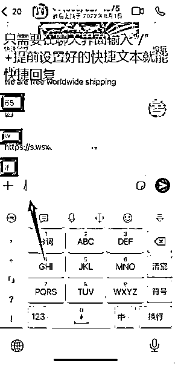

**c**，标签

用标签给客户分门别类，会方便很多：已发货、待发货、已交定金、老客户等，都能快速区分。

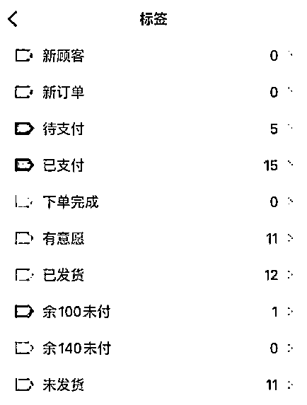

**d**，链接

WA 后台里原生复制的链接，通常是一大串字符，既不短也不好看：https://wa.me/message/XXXXXXXXXX 其实把开通 WA 所用号码拼到 Wa.me/ 之后，就能换成更短、更顺眼的写法：

Wa.me/XXXXXXXX

**e**，翻译

把手机输入法自带的翻译开关启用，就能边打边译；搜狗、百度输入法都支持这个能力。

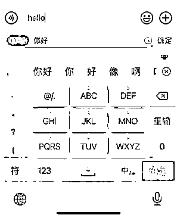

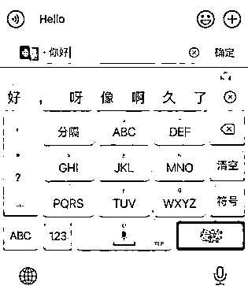

**f**，聊单高频问题

1）这款是正品吗？
2）下单后多久发出？
3）运输要等几天？
4）支持哪些付款方式？
5）有没有优惠？

这些问题提前按实际情况整理成回复模板，聊单时直接调用即可。

**5.** 一个收款套路

有些特殊品类一旦走 PayPal 收款，很容易触发封禁；信用卡收单方也往往不愿承接。于是有人摸索出了 AB 站玩法。

顾客浏览的 A 站展示特殊品类，结算时却被引导到 B 站；B 站上架的全是常规货。除了付款那一步，顾客不会接触到 B 站。

这样一来，PayPal 账单里呈现的，只会是 B 站的普通商品订单。常见配置是 1 个 A 站对应 50 到 100 个 B 站，同时准备多个 PayPal 或信用卡收单口轮换使用，把收款风险压到更低。

评论区：
Sky 老思：这思路可以[强][强][强]
饼：谢谢 Sky 大佬！我当初就是通过您了解生财的[玫瑰]
A 😇路途：很赞[玫瑰][玫瑰][玫瑰]
先赞后看
饼：感谢路总指点[玫瑰]
忽然：精彩[玫瑰][玫瑰]
唐瑞：非常出色
小罗老师：细节很足，实操性也强
Sky 老思：继续传下去，哈哈