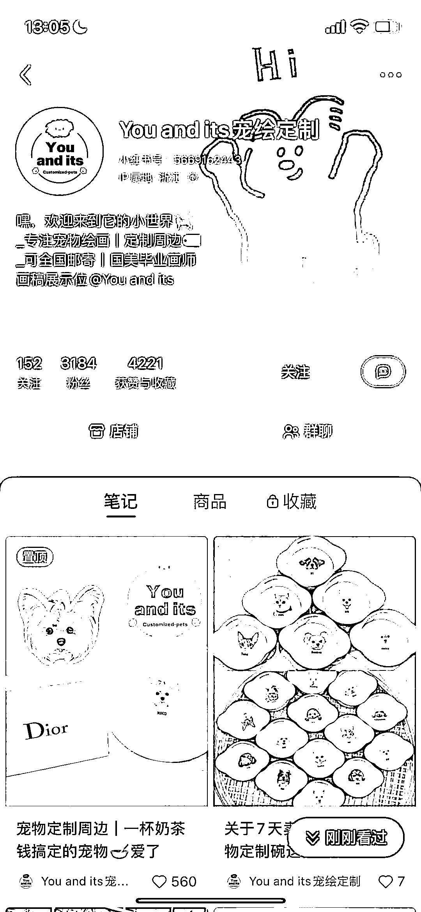
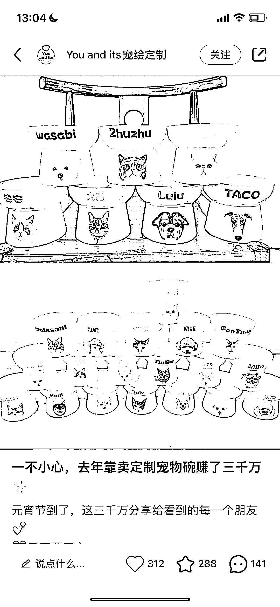

# 宠物定制碗年入3000万？真相是……

宠物定制用品的赛道如今相当热闹，从喂食碗到小窝，各种个性化单品频频走红。有说法称，光是宠物定制碗这一项，一年就能带来3000万的营收。乍听之下，这生意简直赚翻了。

不过评论区很快有人“打假”：网友“不老什人”特意翻出原账号，发现所谓“3000万”其实是“千万要开心，千万要健康，千万要幸福”的谐音梗，是一句对宠物的祝福。作者兰卡也笑着承认，自己当初没细看。这条动态还被亦仁标记了“中标”，提醒大家看待网络信息时多留个心眼。