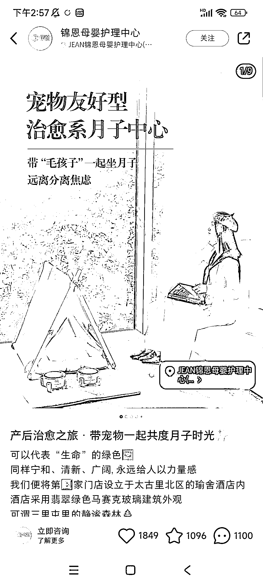
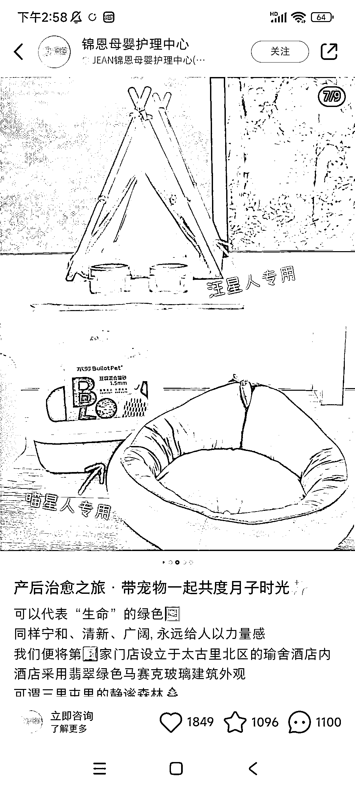
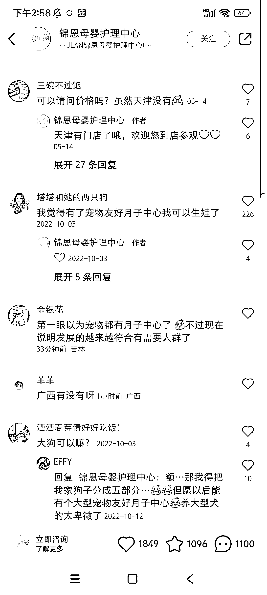
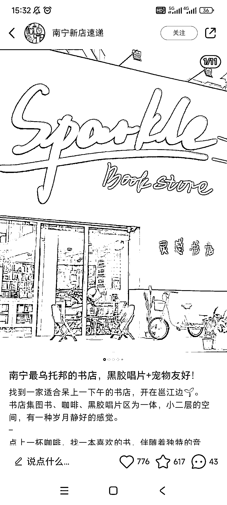
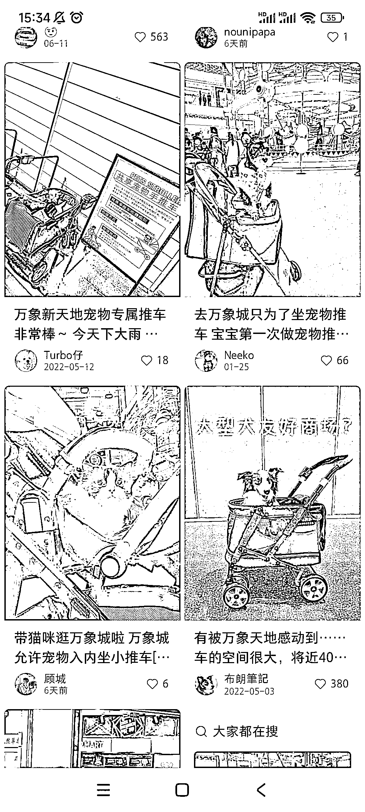
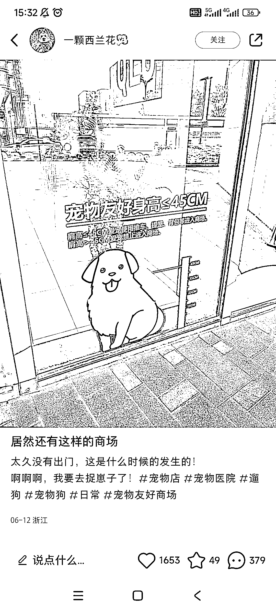
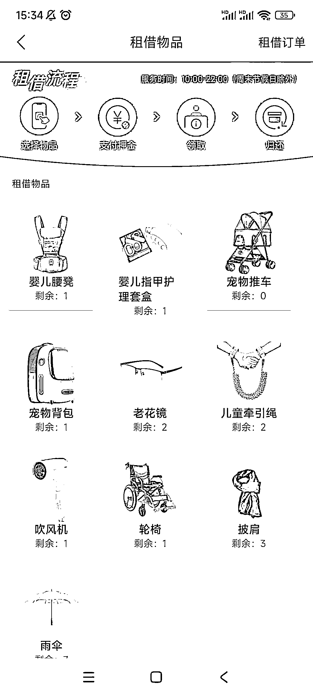

# 宠物友好经济持续升温，月子中心允许带娃入住引围观

作者：阿黎

日期：2023-06-25

宠物友好类的消费场景，眼下是越来越火了。像图 1-3 里这家月子中心，居然允许客人带宠物一起入住，评论区里全是来问怎么预约的。

顺着这个思路往下想：

宠物能进的商场、能带宠物的餐厅；

宠物友好主题的民宿、露营基地；

能带宠物逛的书店；

可以带宠物去做美甲的小店；

还有宠物友好的瑜伽馆、健身房、冥想疗愈空间……

基本上，只要你希望顾客愿意多待一会儿、愿意反复来的地方，都可以考虑给宠物留一个位置。

图 3-6 是我随便在📕上翻到的例子，一搜一大把。

再比如图 7，我们这边万象城的 APP 里，客户服务那一栏，居然提供宠物推车和背包的租赁服务。

评论区：

龙哥：中标，术值+1。

在上方专栏点击 #中标，可查看所有中标风向标。