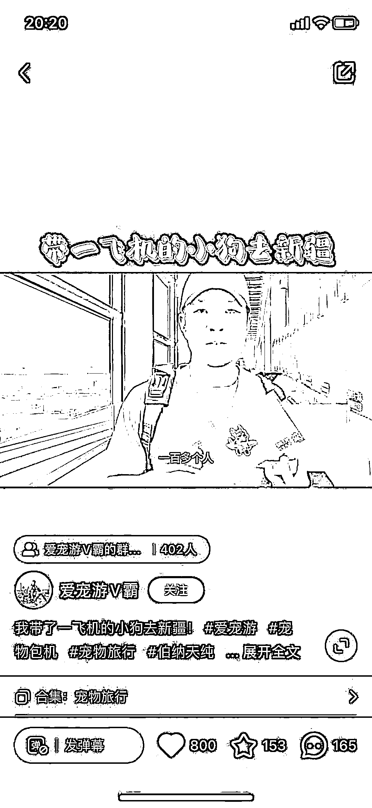
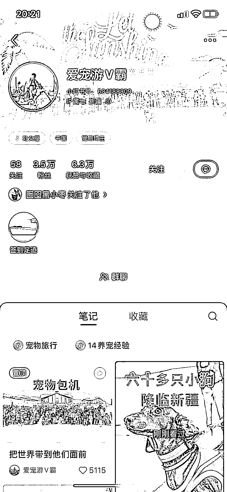

# 旅游业回暖，差异化才是破局关键

旅游业正在回暖，赛道上的玩家也会越来越多，竞争必然加剧。只靠常规路线很难突围，做出差异化产品才是真正的护城河。

比如这个账号推出的“宠物包机游”，让宠物主人能和自家毛孩子同乘飞机去旅行。光是这个创意，就足以让刷到的铲屎官们心动，甚至忍不住直接报名——我自己就是其中之一。

当宠物主们和爱宠一起旅行过，有了真实愉快的体验，账号后续在私域里推荐宠物相关产品时，这群用户会非常信任，付费意愿也高，转化率自然非常可观。

评论区：

龙哥：这个案例中标了，术值+1。在上方专栏点击 #中标，即可查看所有中标风向标。

朱朱侠：确实，中国正快速进入老龄化和少子化社会，养宠人群却在增多。以前可能是几个家庭合养一只狗，现在一个家庭往往有两只狗，未来陪伴经济还会继续扩大。

丁 Ding：感谢龙哥大大！

丁 Ding：没错，现在就是这样，宠物赛道潜力巨大～

西区大表姐：真巧，我本身就是做包机业务的，最近也在关注宠物包机这个方向，你看到的这家确实是国内最早一批做的。