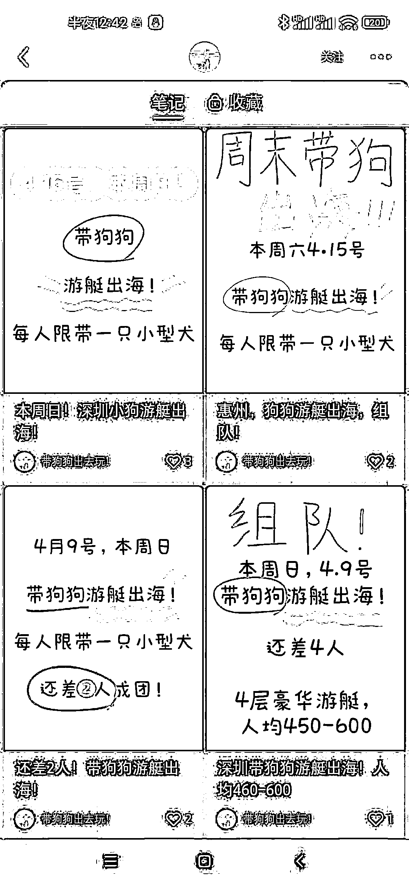

# 带宠出游，📕的新机会

城市里能让狗尽情撒欢的地方不多，爱宠人却总想带毛孩子出去走走。这份心思，正在📕变成一类目的性很强的客群：他们不是随便刷旅游攻略，而是明确在找“能带宠物一起玩”的产品。带宠物周边游因此值得做，用户意向清晰，流量也更容易沉淀。

拿游艇周边游来说，单人带一只宠物的体验价大概五百元。客单价不低，但宠物主给毛孩子花钱时，价格敏感度往往很低。产品还能继续往上做：游艇之外做飞机团，甚至推出高客单的包机出游，把规模做成矩阵。

图文笔记可以围绕四块来写：1. 出发档期；2. 折扣卖点；3. 玩法安排；4. 关键提醒。五一假期是天然出行窗口，节点要提前卡住。

落地时，先联系本地能提供游艇服务的商家，谈好导流返佣，再拿产品去📕做一轮测试。想扩大规模，就去养宠社群做针对性触达，把精准人群引进来。内容也别只押一个平台，可以分发到抖音、视频号，把游玩现场开播，顺手积累内容素材。

这个方向目前仍偏亚文化，竞争不算激烈，但市场还需要开发。履约环节不能掉链子，过去就有团队因服务没做好翻车：拿简陋渔船接客，途中遭遇暴雨，体验崩了，随后平台上出现大量负评。做带宠游，体验和口碑比流量更要紧。评论区有人说这个主题好，能“以狗会友”；这个项目也被标为中标、术值+1。

在上方 #星球栏目 专栏中，点击 #中标，可查看所有中标风向标。