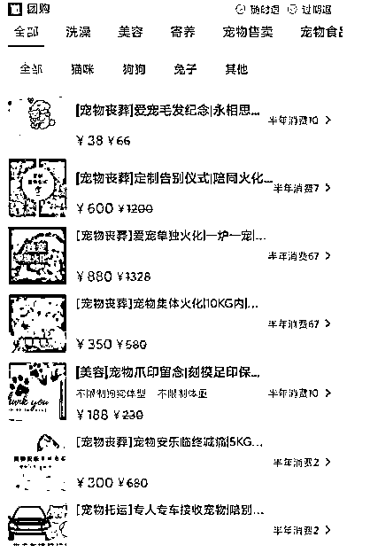
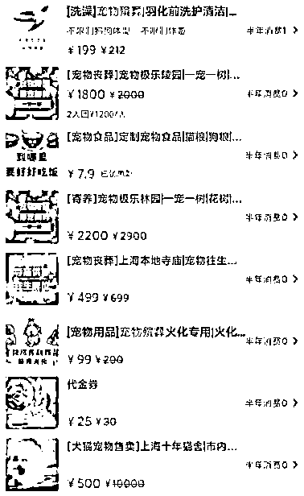
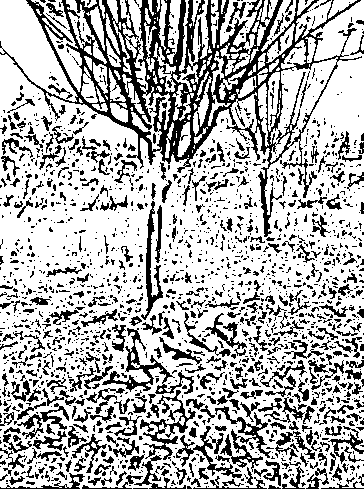
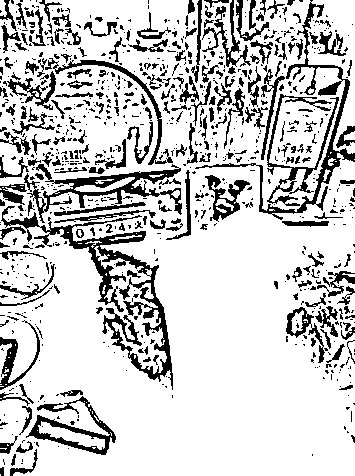

# 宠物殡葬生意怎么做？单店月利润15万+的起盘全攻略

最近和一位在上海做宠物殡葬的朋友深聊了一次。他的美团单店月利润能做到15万-20万，目前已经把模式复制到了江浙其他城市。我把聊到的核心信息梳理成一份完整的起盘攻略，想了解这个赛道的人可以参考。

先看行业背景。国内宠物市场已经进入平稳增长的成熟阶段。2020年市场规模接近3000亿元，根据艾瑞咨询《2021年中国宠物消费趋势白皮书》的预测，未来三年行业还将以14.2%的复合增速增长，到2023年有望达到4456亿元。白皮书同时提到六大趋势：城市化推动“猫经济”升温、国产品牌获得更多机会、低线城市养宠渗透率提升、宠物医疗线上化、服务更精细多元、线上线下全渠道运营成为品牌扩张主通道。

宠物殡葬之所以能成为一门生意，核心在于宠物本身就是孤独经济的产物，也是家庭的一员，有着天然的情感属性。让毛孩子体面地离开，越来越多的人愿意为此买单，尤其是在一线和新一线城市，接受度正在快速提高。

获客方面，目前这类店铺主要依靠美团和大众点评，百度、抖音是第二梯队。新兴小众本地生活服务通常先在上海跑通，所以上海的美团上相关店铺数量也最多。

再来看产品与服务。主流宠物殡葬店的产品体系可以分成两类：

一类是引流款，也就是火化/埋葬服务，基本都提供上门接送宠物。

另一类是利润款，这部分通常不会直接挂在团购页面上，即便展示也大多是示意价。客户咨询火化或埋葬时，再顺势推荐附加服务。愿意为宠物找殡葬店的主人，当时往往不太在意花费，所以附加服务很容易成单。

常见的利润服务包括：

- 不同价位的骨灰盒；
- 独藏/合藏、单独火化/集体火化，价位各不相同；
- 爪印、毛发留念保存；
- 告别仪式、哭丧、超度等，基本参考了人类丧礼的各个流程，中式西式都有，属于超级利润点；
- 埋葬地的花样套餐：持续多年的花果拜祭、挂树上的专属纪念铭牌、种一棵专属小树，树上的果子还能寄给主人，也是超级利润点；
- 羽化前的洗澡清洁服务；
- 祭奠专用食品；
- 骨灰寄存服务等。

（专属小树+祭奠服务）

（西式祭奠仪式，全程拍照+录像）

关于客单价，别被美团上几百元的团购引流价迷惑。这个行业加项非常多，最后付款大多通过支付宝或🛰️完成，所以团购展示的销量并不能反映真实成交水平。主流客单价集中在5000-8000元，我这位朋友的门店基本能保持每天1-2单。

起盘过程并不复杂，启动时两个人就够——一个人跑前端接单和销售，另一个人做后端服务。

第一步，找一处便宜又宽敞的场地作为殡葬服务中心。客户基本不会过去，所以选在郊区最合适，也能降低被邻居投诉的风险。服务中心里可以单独设置骨灰存放区域。

第二步，在淘宝上买一台动物焚化炉，价位从几千到几万不等。再采购仪式所需的骨灰盒、宠物食品、铭牌等材料。如果要做树下埋葬，周边最好有野林子。

第三步，把仪式感和情绪疏导能力打磨到位。可以多参考人类的仪式场景，设计一些可定制、能创造利润的服务细节，同时练好录像和拍摄技巧。

第四步，准备一辆小面包车用于24小时上门接宠物。车里要布置得整洁专业，车况、司机仪表、话术、见面时的销售流程都需要精心设计。很多客户不会跟着去殡葬地，但会把宠物送上车，所以必须在当时当地通过话术和行动给客户足够的安全感，才能把附加服务的成交率拉到最高。

第五步，获客端重点做美团和大众点评。评价内容和卖点包装一定要做好，目前美团在这一块还有流量红利，竞争不激烈，同行运营水平也普遍一般。即使客户会货比三家，只要销售能力、简介资料、案例包装到位，成交率就能拉起来。有余力再做抖音、百度，也可与宠物医院、宠物社群长期合作。

朋友调查过，杭州每天宠物死亡数量大约300只，这个数据不一定准确，可能以猫狗为主。他目前的目标是杭州每天做到1-3单。

最后说一下风险和坑。整体看这行风险不大，主要集中在三个方面：

一是政策还不明朗，有关部门目前没有明确的准入门槛要求；

二是防疫与环保问题。选址时把这两点处理好，后期问题不大。建议老板对宠物致死疾病有一定知识储备，能找个兽医朋友更好，接单时先问清死因，做好自身卫生防护；

三是司机、运力、人力成本，要提前算好账并控制住。

我的判断是，在省会城市、发达城市及以上区域，现在都能做得起来，美团/大众点评的流量完全够用。有兴趣或有资源的朋友，可以直接联系作者进群，有空可以互相勾兑资源。

作者还在评论区补充了一个进阶玩法：统一品牌，把全国所有美团门店的销量集中到一起。也就是说，单店显示出来的团购销量是全国所有门店的总和，这样能极大提升转化率，让客户感知为连锁品牌。作者本人可以做美团运营来保障流量，等形成多店规模后，还能进一步变现。