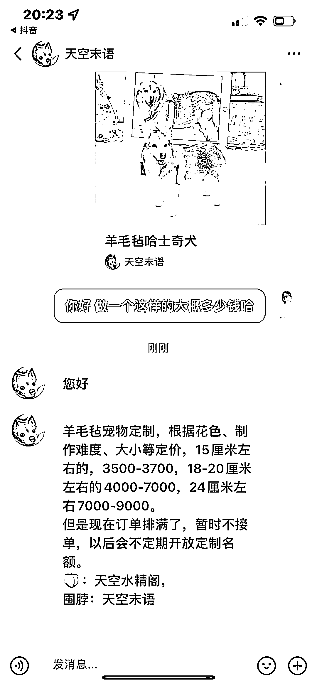
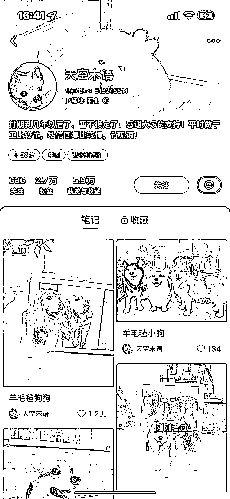
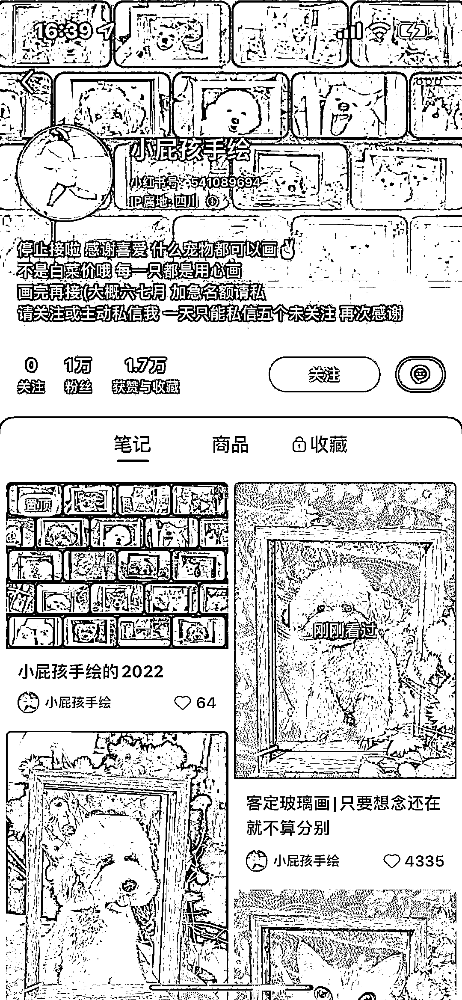
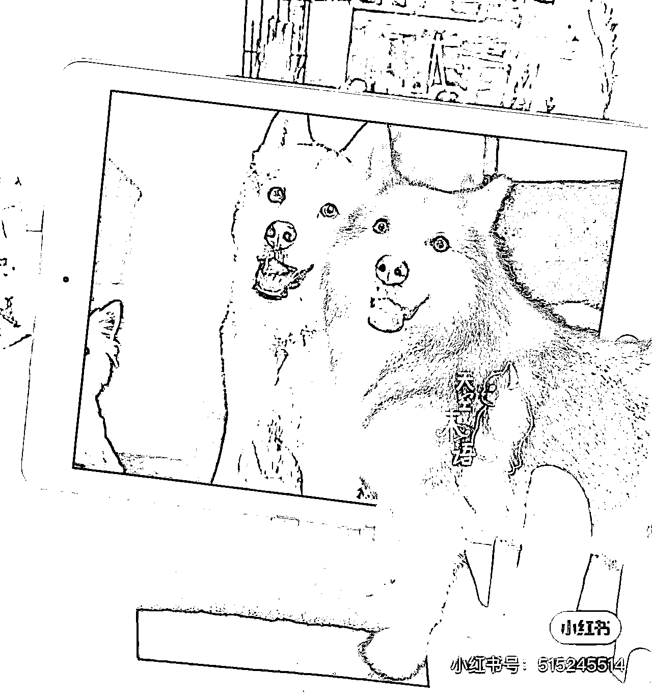
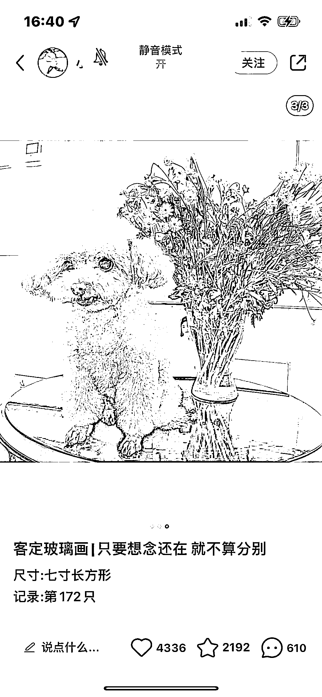
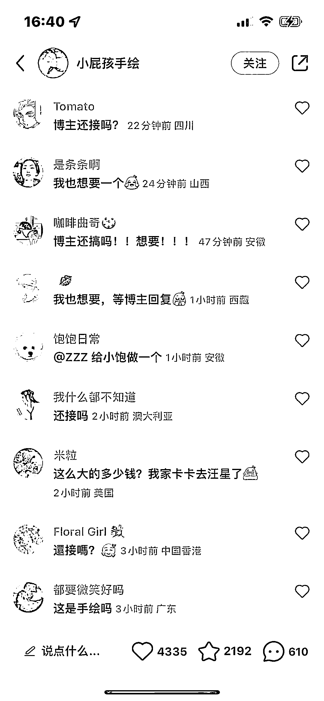

# 宠物走后，羊毛毡画订单排到六月

作者：张义维｜2023-02-02

刷抖音时发现，有博主在承接一种特殊定制：为已经离开的宠物制作羊毛毡画。这个细分方向眼下热度不低，也确实能挣钱。更直观的信号是，有创作者的订单已经排到了六月。

评论区：

龙哥：中标，术值+1。到上方 #星球栏目 的专栏里，点开 #中标，就能查看所有中标风向标。

明月几时有：能不能当中间商？只做引流获客，接到订单后把成品交给上游完成，再发给客户，从中赚抽成。

秋冬。：可以整合技术人员，做培训，同时由平台引流接单、派单。

明月几时有：投入应该不小。