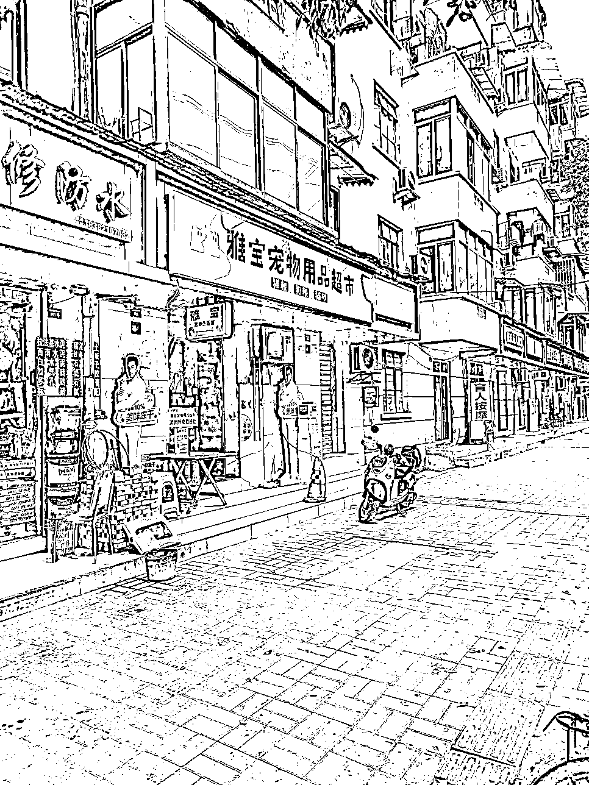

# 巷子里的宠物铺，外卖也能卖货

2023年2月20日，奔腾分享了一条拿到30个赞的见闻：有家实体宠物用品小店，门面没选在热闹地段，反而藏在不太起眼的窄巷里。进去一瞧，陈设很简单，几组货架就是全部陈列，看店的是位阿姨。可它没只等路人进门，而是借助美团外卖把货卖出去。

评论区里，老彭直呼这门生意很妙，甚至比情趣用品还更妙。奔腾跟帖解释：普通门店往往不备宠物用品；他以前见过一个快递代收点，顺手兼卖过这类商品。亦仁则判定这条信息“中标”，并给术值加1，还提示：在页面上方的 #星球栏目 专栏里点击 #中标，就能浏览全部中标风向标。奔腾最后说，这条内容来来回回改了好几遍，自己一时都不知道怎么回复才妥当。