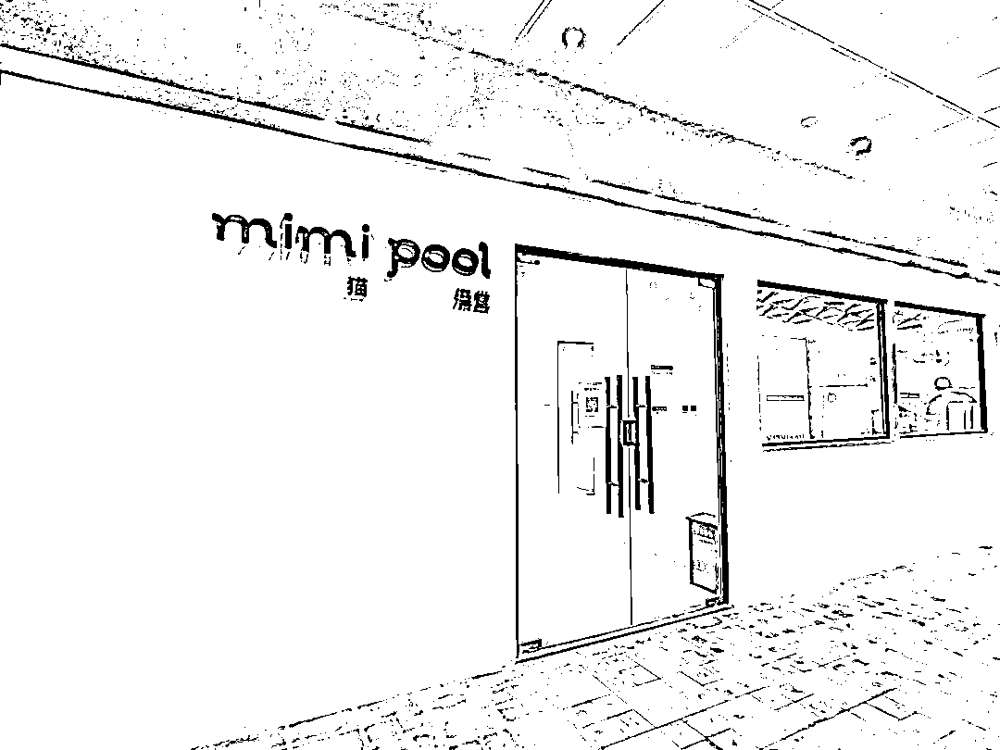
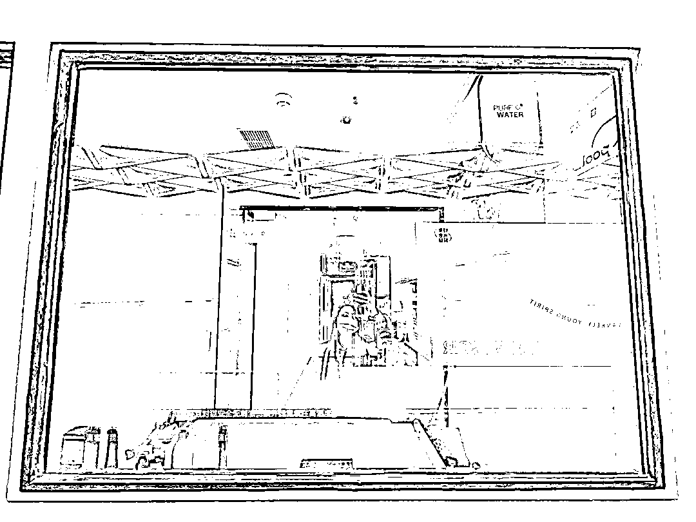
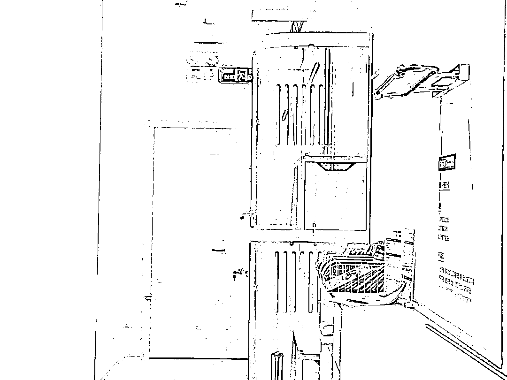
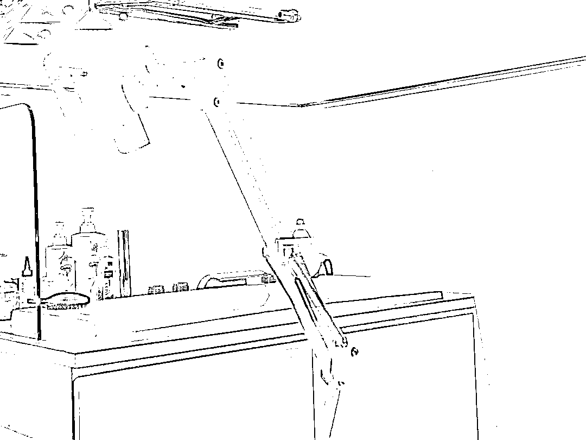
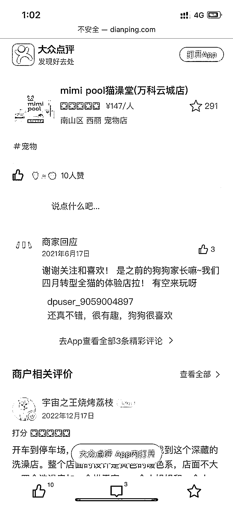
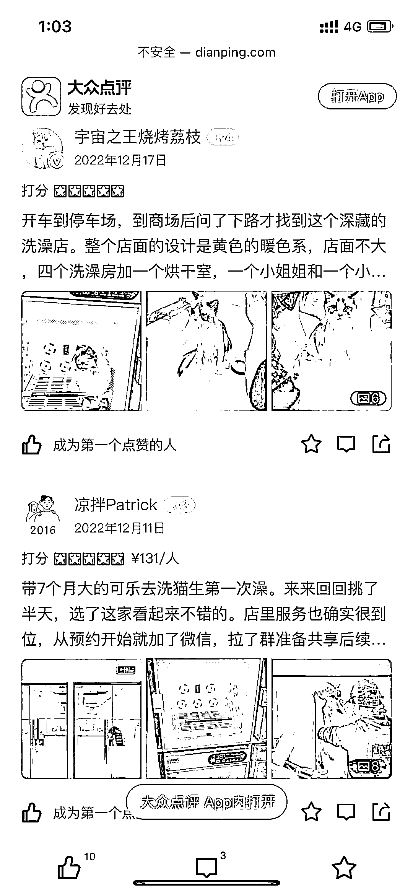
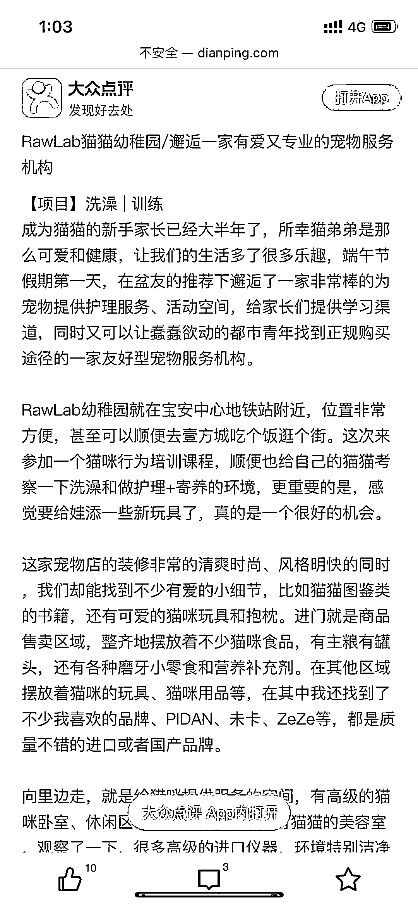
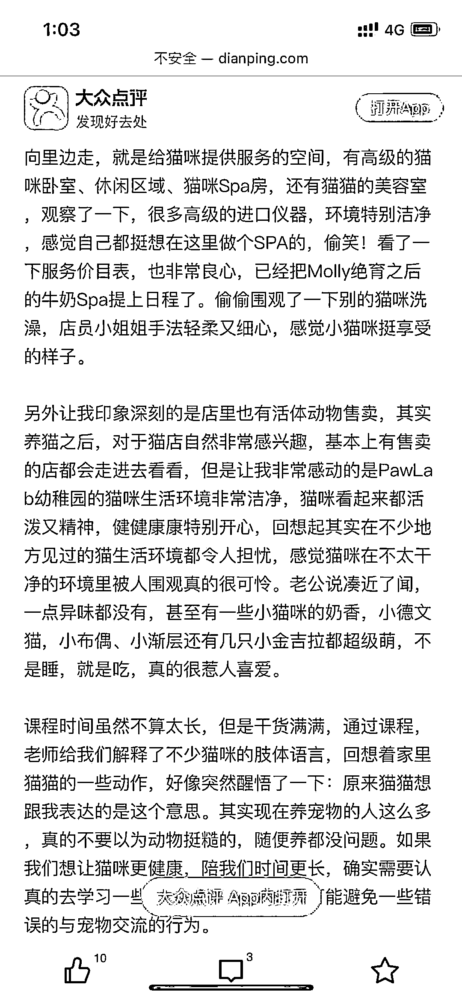
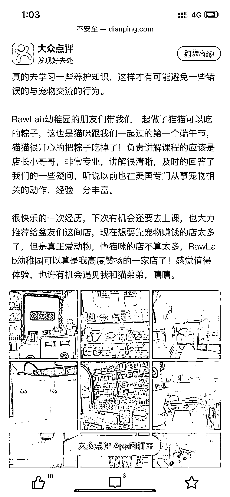

# 头回碰见：大商场里给猫洗澡

在大型商场里遇到一家专门给猫做洗护的门店，我第一反应是意外：每月租金要五位数、甚至六位数，这样的猫澡堂到底怎么撑下去？

隔着玻璃，店里的操作和细节都能看得挺清楚。它最早做的是狗狗洗护，后来转成了猫澡堂；眼下单次洗澡价格大约150元，同时还经营活体、宠物用品和课程等业务。

这个业态目前还比较少见，但和普通宠物店相比，它更聚焦、更垂直。手上有猫舍、猫淘客群等资源、在本地有粉丝积累的圈友，很适合给它做精准导流。往后宠物消费继续升温，这类服务的热度多半还会往上走。

 

评论区：

龙哥：这条中标，术值+1。到上方 #星球栏目 的 #中标 专栏，能看到全部中标风向标。

白猫｜今天是虎斑猫：高端洗美收费高，可服务耗时也长；店面面积固定，客人一多会不会都卡在排队上，接单能力有限？

曾丽@丽丽曾：这些细节我不太了解，现场倒是没看到排队。