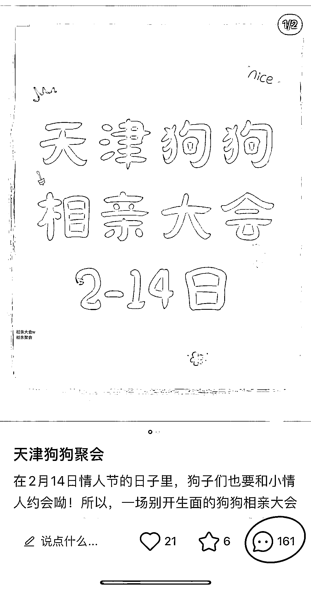
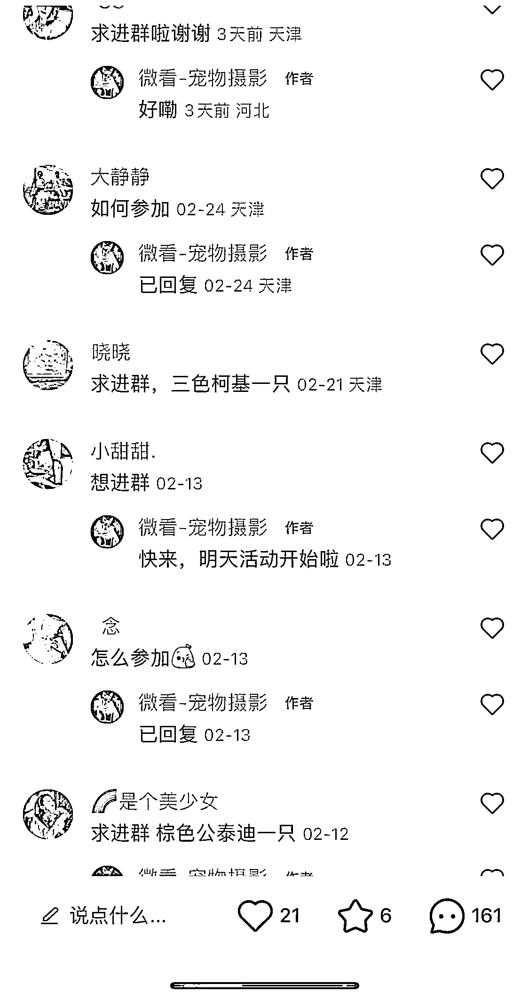
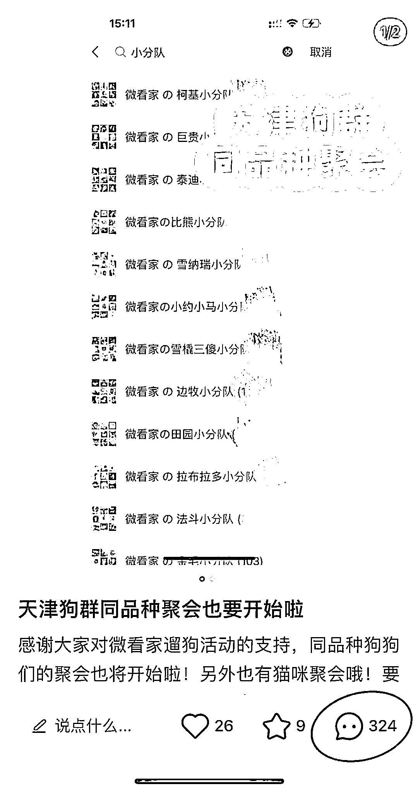
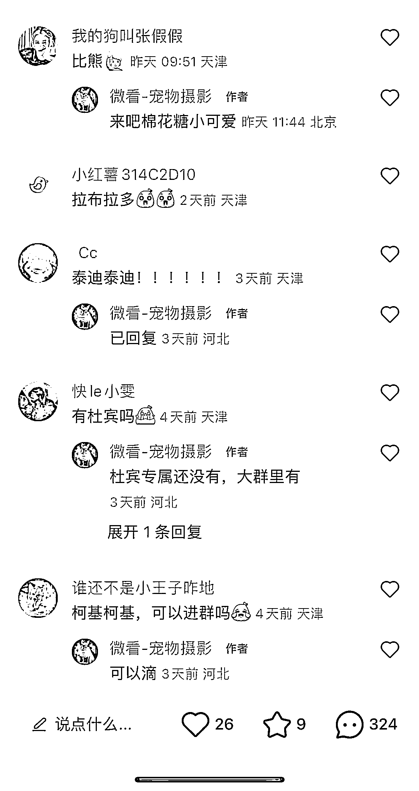
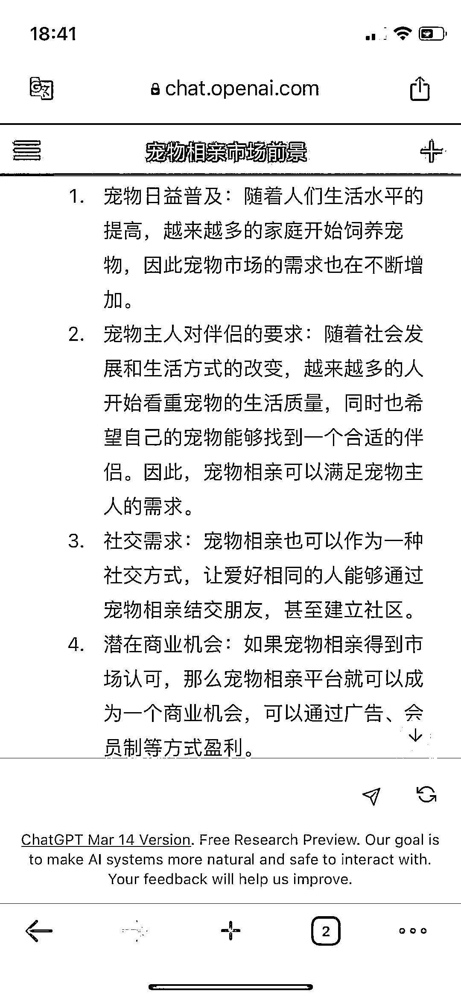
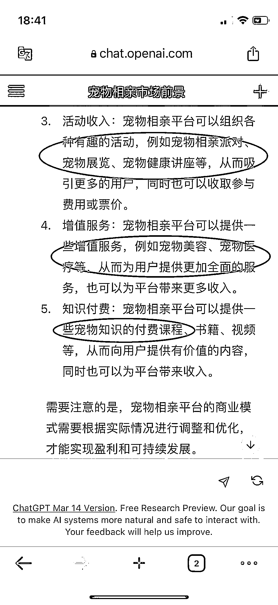

# 宠物相亲，不止于相亲

文 / Mr. Lucky · 2023年3月20日

线下聚会里，一位朋友抛出过“给毛孩子安排相亲”的念头。我随后在小红书做了检索，发现用“宠物相亲”或“宠物聚会”作主题办活动，很容易把一批养宠用户导进群聊。号主本职是宠物摄影，靠这类面对面活动，参与者之间的信任和黏性都会往上走。除此之外，宠物美容、医疗、口粮、玩具都是可做的生意，再往远端看，殡葬、标本等业务也有延展空间。

评论区：

亦仁：中标，术值+1。想看全部中标风向标，去上方专栏点 #中标 即可。