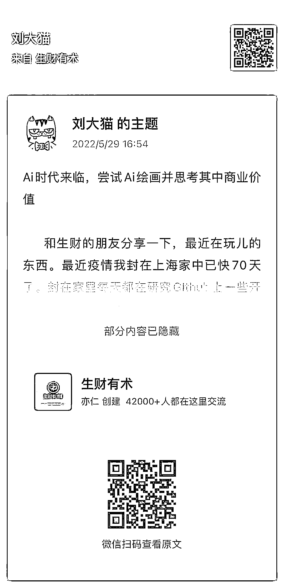
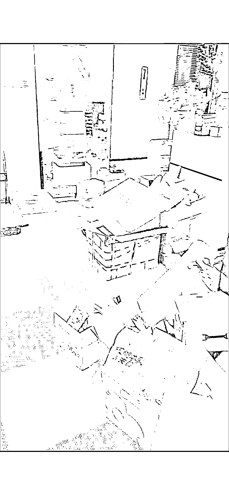

# 钱不好赚时，先把货卖好

每年我至少会在生财冒一次泡。上一次发帖差不多是一年前，聊的是AIGC，当时我可能是社区里最早谈这个方向的人之一。谁能想到一年后，GPT、ChatGPT、AIGC成了全民热议的话题。不过今天我不打算讲靠AI赚钱。

眼下经济承压，我个人感受是钱确实没那么好挣，所以也没把太多精力放在追新概念上。先把个人的智能用好，再去谈人工智能吧。最近一年，我最上心的事，反而回到了一个特别朴素的赚钱路径——卖货。

绕来绕去，我越来越觉得生意的终点还是把商品卖出去。过去大家总说消费升级，但我更想抓住消费降级带来的机会。经济环境不好，消费自然会往下走。

中国制造业的实力很强，大部分东西都能以很低成本造出来。自从习惯在拼多多、快团团下单，很多日用品我就不太愿意去京东、天猫买了，价格确实低，质量也差不了太多。

说到快团团，这真是个好东西。我身边关系最好的兄弟每天都在研究它，我也跟着一起琢磨。不夸张地说，他现在的净利润已经达到数千万，我们还会在这个体系里继续深耕。

在我见过的国内系统里，快团团的设计算得上极其聪明。它的产品侧显得很克制，只做工具，却严密地防止生态过度集中；供应链和团长体系都在大量站外社群里生长，结构相当完整。帮卖机制与产品规则同样出色，带来一种模式上的升级，社区团购、s2b2c之类以前的做法，其实都能被它涵盖。

快团团更匹配百元以内客单价的低价快消商品。整个平台的GMV已经有数千亿。手上有货，能在生态里找到人代卖；手上有流量，变现也相当轻松，比淘宝客强不少。若货、流量都没有，那我也给不出什么建议。

刚起步时，尽量多混进几个团长群、供货群。进去后你会直观看到群友如何做买卖、跑供应链，对它的认知会更落地，不再只当它是个普通工具。

再细的内容我就不便展开了，生态里不少大团长不愿被外部渠道过多讨论，讲多了容易挨骂。有兴趣且有资源的人，值得花时间研究这套系统及生态结构，别停留在表面，而要真正钻进核心去琢磨。这次只做整体层面的交流，算抛砖引玉；许多东西得亲自摸索、深挖才有真收获。具体问题、私信我都没法回复，眼下也无法带人操作，还请理解。

（配图第二张是我们每天收到的样品）

——————

链接微信：damaobtc

——————

评论区摘录：
有人问小白适不适合入局，作者回应：如果小白指的是“三无”——没钱、没流量、没货，那他不太了解。也有人感叹卖货似乎都挺挣钱；还有人问大佬的货能不能给帮卖、想深耕快团团该通过什么渠道了解，有评论提到去沸点会能认识团长和群接龙的能力；另外有人感谢团长送书《价值森林》，也有人夸《增量价值》写得好，并组织公司同事集体学习、做读书笔记。