# 水果团购副业跑通记：半年净入近十万

跟着盗坤老师那篇分享，我把一个几乎不用先垫钱的副业做了起来。先看结果：项目运转半年多，累计成交四十多万元，净赚接近十万；五月单月流水达到十六万，如今已算一份较稳的副业。和大佬不能比，但对我这种此前没在工作之外赚过钱的人，算是磕绊着迈出了第一步。

项目来自盗坤老师去年十一月在赚钱分享的批发市场水果团购方向，投入低、好模仿，正适合当时的我。

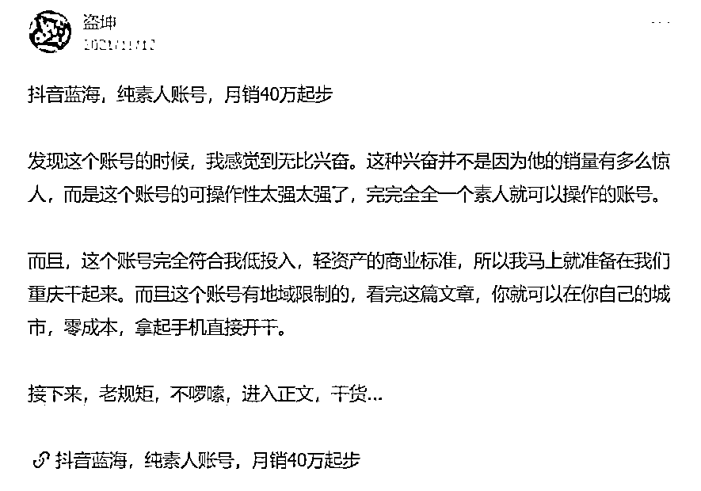
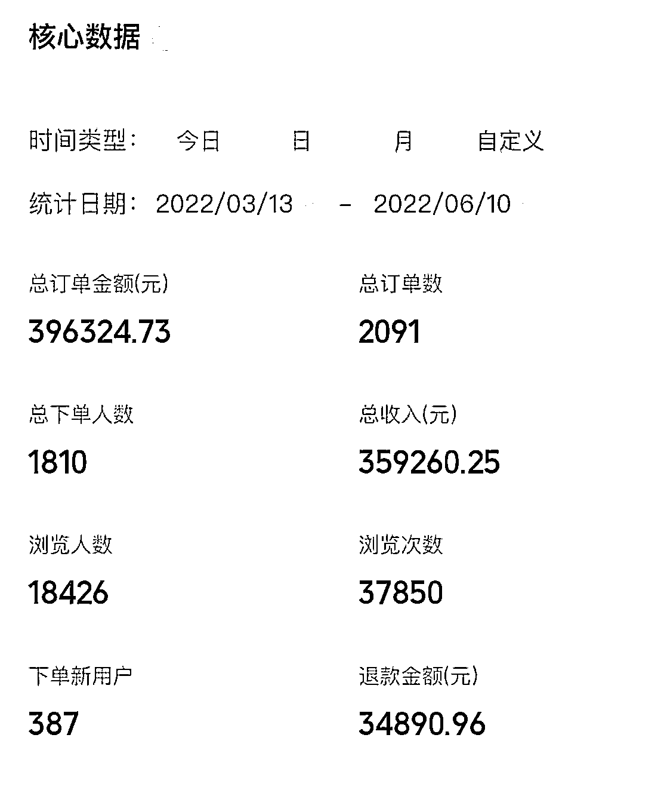

补充一句：后台记录窗口只有九十天，所以截图覆盖不了完整周期。

这篇复盘约八千字、十五分钟。我会讲起盘、从零到一、踩坑和后续困惑。新手可当参照：起步难、调整、小成绩、纠结；也欢迎其他城市实践，尽量避开北京。经验丰富的朋友，希望针对我最后的问题给建议。

## 先摸清门道

我叫许老师，在青少年编程教育做了六年。这个行业从概念到细分市场，我陪一家创业公司从二十来人做到年收入近十亿的头部，也见过创业从零起步，职场回报不少。双减后前景不乐观，公司能维持但增长很难，我开始找下一步。加入赚钱后，我一直留意可尝试的副业，最好能慢慢做成小业务，先赚钱再做大。

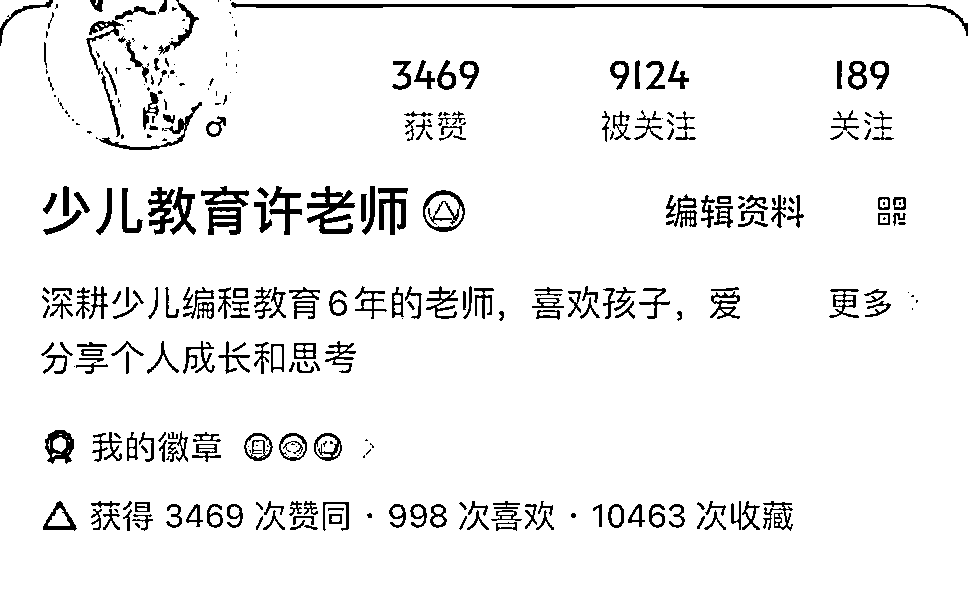

在赚钱翻了不少帖，短暂试过知乎好物，也考虑过📕个人号，都没坚持。看到盗坤老师帖子时很激动：普通人几乎零门槛、竞争不拥挤、变现较快，太适合新手。评论区也有不少有价值的讨论，把关键点拆出来了。

我人在北京，新发地是亚洲最大的农产品集散地，这事能不能做？我决定边调研边跑市场。

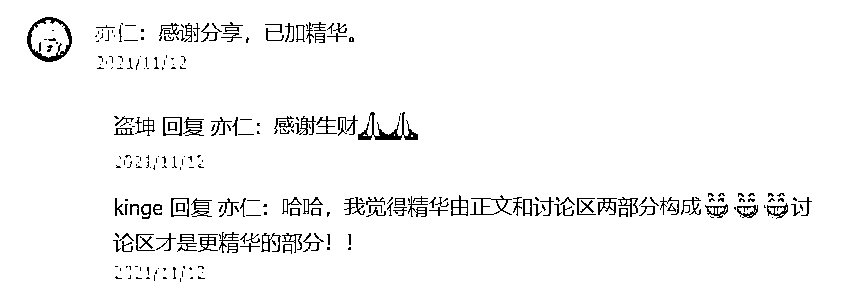

我在📕搜新发地、批发市场、草莓、车厘子等词，发现不少卖水果账号粉丝少但互动好，评论区很多“怎么买”“求团购群”。需求强，也说明📕导私域可行。

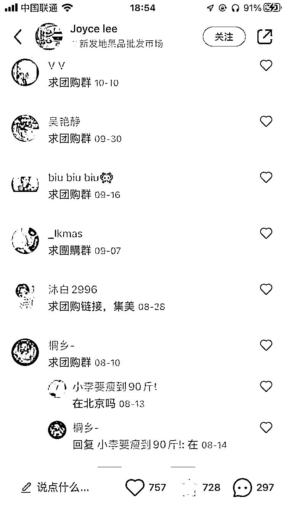

这些账号很多留了🛰️，我顺手加。其中一位从2020年4月新发地疫情后开始做，每天开团，每次稳定百单以上；按客单价一百算，月销售额二三十万，私域只有三千人。有人跑通，说明方向靠谱，也有了参照。

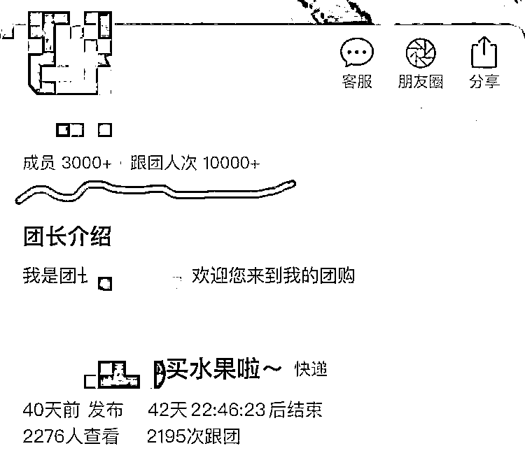

同时我跑新发地。十一月中下旬丹东99红颜草莓刚上市，批发48元一斤，水果店和抖音普遍八十多，价差有利润。草莓娇嫩，网购不便，水果店贵，📕想买的人多，适合做团购。调研一周后，我决定从草莓起步。

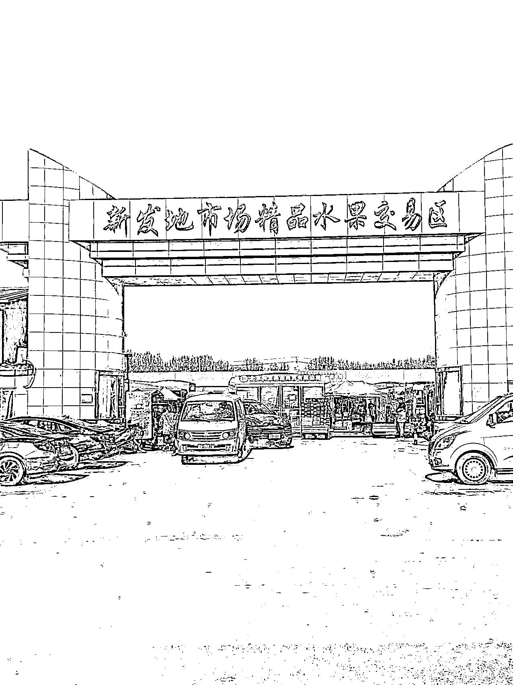

这个阶段，我更确认项目可行，找到对标同行，也定下第一个品。

## 开始试水

准备开干，流量是首要问题。原帖讨论说不能只靠熟人，所以我不做社区宣传；我不会剪视频，又有主业，没时间直播，于是放弃抖音。调研发现📕问水果的人多，就选📕往私域引流。

发帖、人设、标题、对标、爆款这些技巧，赚钱精华帖很多，我大多看了，然后每天刷📕、看水果帖、模仿着发。至今仍是入门水平，不敢班门弄斧。

幸运的是，第三篇帖子有了1万观看、第一次99+，加了两三百🛰️，建了第一个群。那篇写得很直白：我要从批发市场团草莓，想跟的来。流量很精准，都是想买草莓的人。

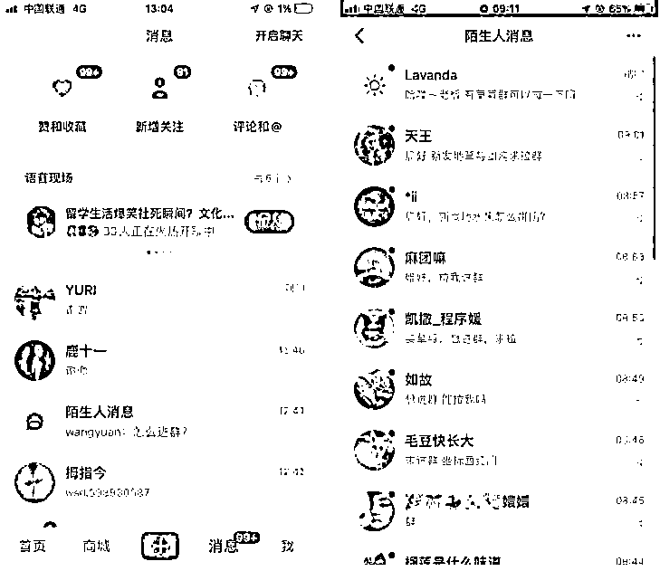

有了群，我开始开团。也吸收评论区建议：尽量把水果做成标品，减少客户选择。第一次卖2斤装丹东99红颜草莓，标价120元，进价48元一斤。首团50单，流量到购买转化约20%，销售额7000元，毛利1000元。从引流到成交，迈出了一大步。

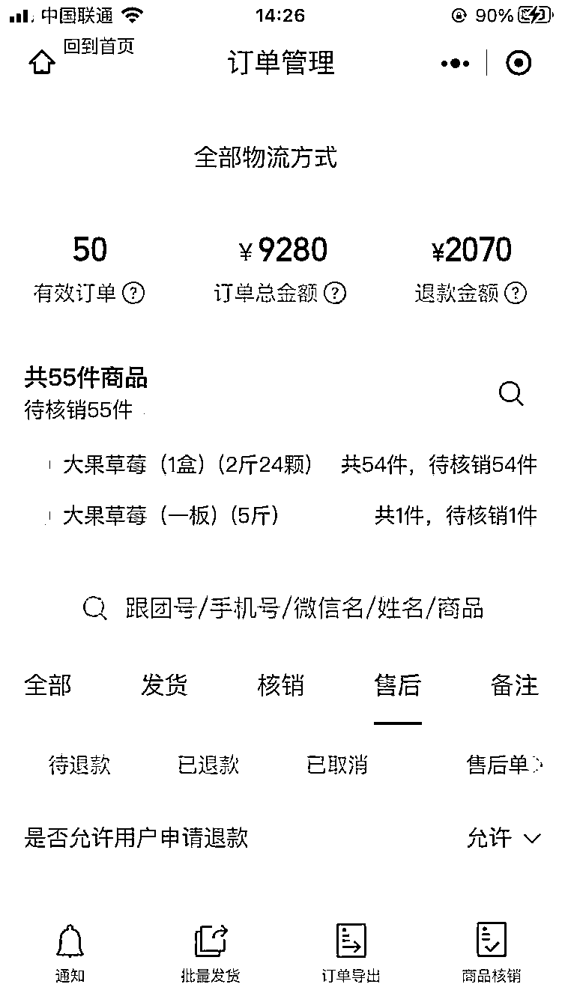

但发货后麻烦来了：售后。草莓娇嫩，有磕碰坏的；有说缺斤短两的——批发市场按毛重2斤，我们没标注，顾客按净重算；还有整盒被快递摔坏的。我们想做回头客，全部赔到位，1000元利润赔掉一半。第一次感到水果生意不容易。

副业就这样开始：一周开1到2次草莓团，隔天去市场发货。第一个月卖三百多盒，销售额4万，利润七千左右；📕引来的私域四五百人，快团团成交比例约一成。

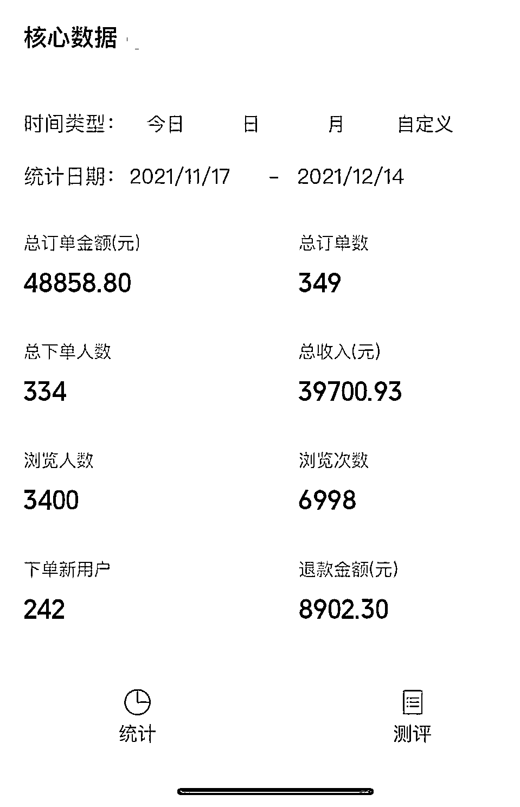

几次之后，客户问蓝莓、车厘子等。我们对新发地不熟，也不懂行情：什么季节卖什么、怎么和批发商打交道，都没经验。批发商看我们面生又外行，询价时当散客，报价和零售价差不大，导致其他水果迟迟上不了。品类单一，客户开始流失。

更糟的是，我引流时在私信里直接问客户🛰️号，可能触发审核，也可能被同行举报，📕被限流一个月。十二月中旬到一月底，老客流失、新客没有，销售额才一万多，几乎没利润，转化也下降，我一度想放弃。

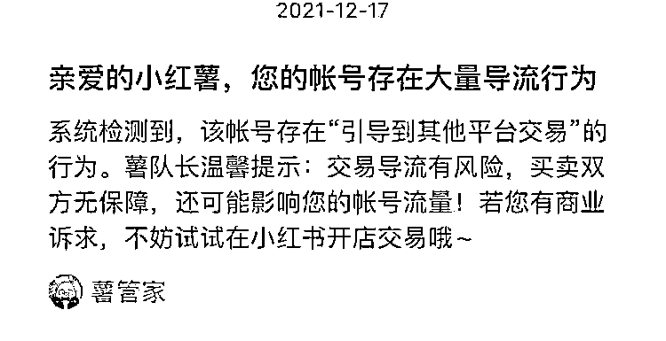
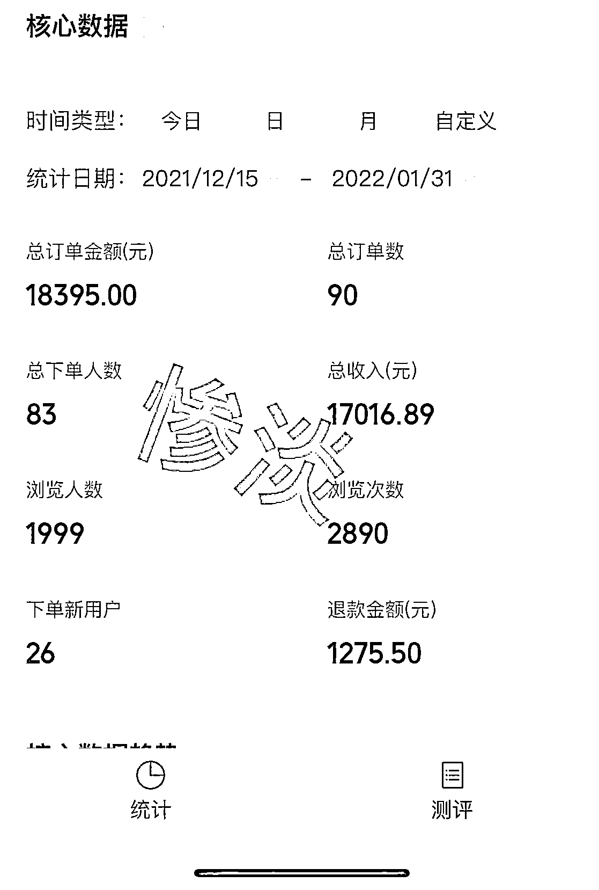

## 中途纠偏

可当时手上没其他项目，这个项目也没整明白。放弃的话，下次做别的还会遇到波折，不能每次都浅尝辄止。过年时我认真复盘，想怎么调。

问题主要两端：后端供应链没弄好，供货商少、品类单一；前端流量要持续有新客。

货源上，我研究同行的团购页面，反推他们上了什么品，再去市场找对应供货商。同行敢上，说明这些商家接受社区团购模式。想通后，找货不再乱撞，而是拿着品去找商家谈供货。

打交道时我发现一个办法：直接问老板是否按快团团模式给团长供货。听懂的人就知道我是团长，会拉群、发链接，订货也在那里完成；没链接但供货的，也让老板拉进群。这像一句暗号，省得被当散客问价。密集跑了一个月，货源基本凑齐，同行有的我们也有。当然也有坑供货商，后面说。

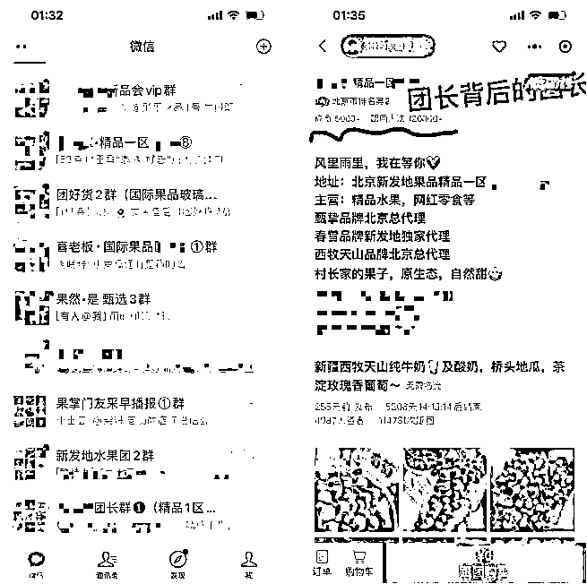

流量端，之前私信被关禁闭，不能再私信，必须在主页留联系方式。我改用置顶笔记放🛰️号，从一月用到六月；中间被关过几次七天，影响不大，后来置顶帖被判定违规隐藏。更安全的📕导流方法我还在试，这次参加📕航海，里面提到11种办法，我会继续摸索。这注定是打游击，方法要常换。

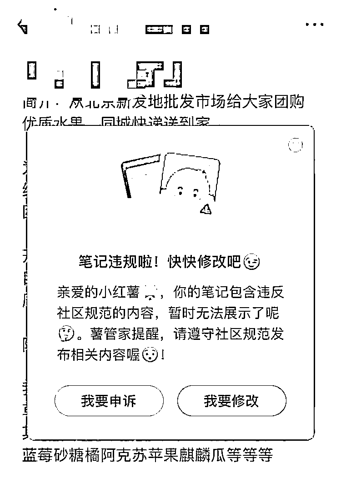

引流稍安全后，就是发帖拿流量。我自认为笔记质量一般，都是直接说从新发地团水果。后面帖子最多1万多浏览、几百互动，陆续发了十几篇，总浏览约5万，给私域带来1500个新流量。加上原有，总共约两千私域；因为定价实在、售后靠谱，复购不错，销售额逐步上升，五月做到16万。📕流量精准，消费力也不错。

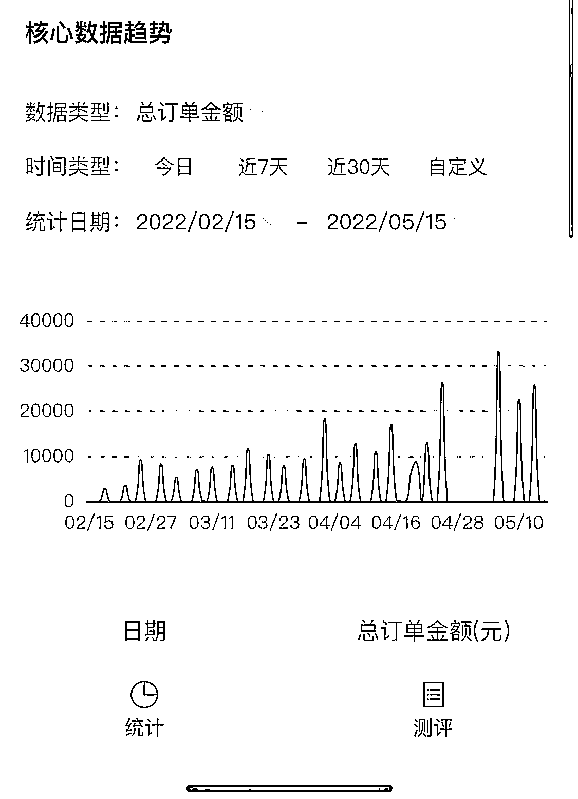

说实话，📕引流我很初阶。精华帖看了不少，但实战比看帖难得多，还得慢慢积累。我想说：坚持发，根据反馈调方向，会有突破；没提升就把精华帖再看一遍照着做。另外，我稀里糊涂有了些本地同城精准流量，帖子质量不高却有人加，说明路子可能对了。我的判断是：没怎么做好就有成效，方向大概没错；做得很好却没流量，方向可能不对。

流量和货源调整完，再说中间转化。我们在这块花精力最少，不到5%，副业精力有限，大头在流量、选品和交付。转化上主要做：开团时在群里营造跟团氛围，次日引导晒图好评，日常发朋友圈，包括新品预告、好吃的水果、客户反馈。我觉得现阶段转化不宜过重：选品、质量、售后不行，运营再好也留不住人。

还有一点，锁定一个优秀竞品抄运营细节：开团时间、群内容、朋友圈、选品、快递、包装；能先照做就先照做。我们踩过坑，自己探索半天，最后发现竞品做法最优，后面又对齐了。

我认为前期核心：一是流量，要有获客能力；二是交付，把售后率压下来，找到好水果、做好交付，复购自然来。有些客户先观望，看你持续在卖、越做越稳，也会慢慢信任并下单。目前转化约10%，还有提升空间，但先优化交付。

下面重点讲交付。水果团购和很多轻项目不同：别的解决流量和转化就基本跑通，水果后端很重，累且难标准化，处处有坑。日常要跑市场、找货源、盯行情、选品、处理售后；这些琐碎决定复购。水果复购高，留住一个老客比拉一个新客重要，几千私域做好留存也能活得不错。每个坑都要用钱填。

这行毛利看着高，实际不咋赚钱，大问题是损耗和售后。损耗方面，有库存就有损耗，所以我们做预订制：客户先下单，再找批发商订货。这也是团长价格能低于水果店的原因——没有店租和库存损耗两大成本。我们只整箱发，不分装；这会筛掉消耗量小的客户，但副业必须取舍。整箱发减轻流程、减少损耗；批发市场整件拿，拆卖会剩零头，自己吃或保存都麻烦。目前损耗可忽略。

重点说售后，真是心累，什么客户和问题都会遇到，新手概率更高。

第一类最致命：拿到烂货，品质本身不行。市场里常说，价格够低，再差的货也能出手。比如怡科莓蓝莓限量版，平时三四十一盒，正常一箱12盒240元，三到五月有的大团长供货150元。便宜是因为品质差：放久了部分发霉，低价收走后挑出坏果，把好的重新装成一箱当好货卖。外表不易看出，客户吃时觉得硬度或新鲜度不够。新团长不会分辨，看便宜就拿，注重品质的客户会售后，即使赔了也大概率流失，因为没达到她的品质预期。这还是轻的，很多客户吃不出来，常买的人才对比得出。

另一种是水果快到腐烂点，批发商低价甩。整箱封好，我们只能抽检，抽到好的就发；快递常温一折腾，到客户手上烂了。我们发生过一两次，售后全赔，还丢了口碑。

怎么避免？第一，熟悉行情，对低价警惕，低价往往对应低质；多加供货商，同品质多方比价，正常价差在5%以内，明显低价避开。第二，出烂货的批发商坚决换掉，有第一次就有第二次。我售后多的几次都出在同一大团长，但他品类全、价格低，初期很重要，我没下决心换，后面又出事。关键是手上有替代供货商，剔除才不犹豫；也要看售后态度，推诿的多留心。第三，当面检查，再熟也要查，尤其樱桃、蓝莓这种每天新到、讲究新鲜度的；货不好宁可不拿、退款给客户，磨合后对方也知道你要什么货。

第二类是运损：发出时好，收到时坏。同城快递才会遇到，社区团购没这问题。生鲜快递没冷链，快递员也难轻拿轻放；草莓、蓝莓、桃子、葡萄都娇嫩，磕碰晃动易伤，配送延迟还会腐烂。选品时就要判断适不适合快递，或能否靠包装解决；不行就别上，否则损失自己扛。快递只看外包装破没破，里面烂了很难索赔。别抱侥幸，想象分拣时被乱扔，看包装扛不扛得住。

怡科莓蓝莓本身包装不适合快递，我们前期只加纸壳就发，开始没大问题。

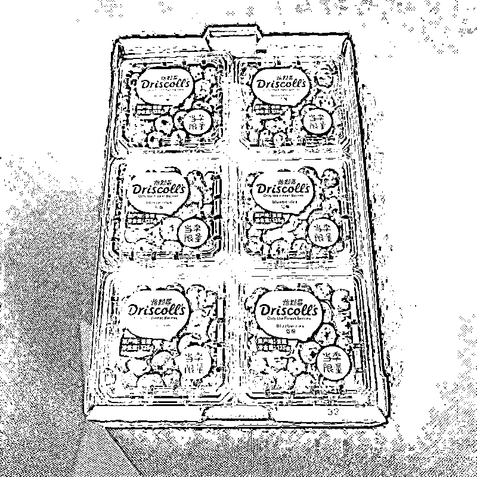

有次活动赶上北京疫情、快递爆单，包装不到位，发60箱蓝莓最后35盒不同程度损伤，有的全烂，有的烂两三盒。光售后赔了3000多，利润全赔进去，口碑和信心也受打击，差点崩了。一天三十多人来找售后，语气都不好，很考验心态。解法是改包装：每小盒垫海绵防晃动，12盒从原包装取出放泡沫箱，防外部挤压。举例是想说，拿货时就要想怎么发：水果本身适合，或包装能改；否则宁可不做。

第三类是缺货。预订制先下单再订货，很难完全避免。批发商走货快，上午有下午没；有的库存管理差，超卖后先到先得，后面的退款。批发商保险，团长尴尬，要解释、要退款。我们还没完全解决，做法是：开团前再和各供货商确认库存，优先库存多的；页面写明个别缺货默认退款，让客户有预期；缺货多就下次补发，并补一次运费，下次跟团能省点，心理好受些。

回头总结：前端持续获客，后端交付售后稳住，中间对标同行优化转化。📕更安全的引流方法我还在探索，欢迎其他城市朋友实践，尽量别选北京；也期待有经验的大佬针对我的困惑多给建议。

有一种情况其实算不上售后，但很值得单独提一下，那就是快递时效。

现在很多做同城水果的商家，中午十二点之前把货装上车，北京五环以内的客户当天就能收到，水果状态自然更好；一旦过了这个点，就只能等第二天。这里面的差别，直接决定了客户收到的水果新不新鲜，也决定了一个售后单要不要出现。

所以，我特别想提醒还没理顺发货流程的朋友：流量别急着放大，更别盼着什么一夜爆单。爆单听起来爽，可后端发货跟不上，随之而来的就是一堆售后问题。你能稳定在时效内发出去50单，就先把流量匹配到这个量级；等一天能处理100单了，再往更大流量池里冲。

前面絮絮叨叨说了这么多，核心其实是一个词：交付。现在大家买水果的渠道实在太多了，如果你的交付环节总出问题——今天烂货、明天运损、后天缺货，那你价格再有优势也没用，客户照样留不住。流量来了接不住，再大的数字都是虚的。

换句话说，这个项目的交付环节很重，我才会花这么大力气来写。决定做之前，一定要想清楚：你能不能承受这些琐碎，能不能把售后当日常。

【总结】

先把项目整体盘一下，也说说我自己的纠结。

从我的实际感受看，这个项目比较适合在一二线城市做。为什么？因为真正能拉开价差的基本都是精品水果，也只有这类产品，才有批发市场团购的土壤。客户找你，要么是想用更便宜的价格买到同样的水果，要么是想买到水果店里没有的品种，说到底都逃不开精品水果的消费逻辑。

再看项目本身的特点：水果属于日常刚需，购买频率高，复购意愿强，客户决策成本又低，你只要服务做好，现有流量就能持续变成销售额，不太需要天天焦虑找新客。这是它的好处。坏处也很明显——利润低，交付重，特别消耗精力。想让大家体验好，选品、包装、快递、售后每个环节都不能放松，还得有一颗特别能扛事的心。再叠加门槛极低，人人都能进场，规模化反而更难。

顺带说说两种模式相近的玩法。

一个是社区团购。同样去批发市场拿货，但客户自己去小区自提，相当于省掉了快递运损，也不用考虑怎么打包发货，交付轻松很多，能上的水果种类也更多，还可以快速扩展蔬菜、海鲜、零食等品类。不过它服务范围有限，一般只能覆盖周边几个小区，扩张性比较差。批发市场里其实很多团长都是这么干的，像我们一样做同城快递的反而少见。

另一个是一件代发。要么找产地一件代发，要么给大团长做帮卖团长，你要做的只有引流和转化，发货售后都交给批发老板或产地。优缺点是反过来的：交付很轻，不太占精力；但利润被压得更低，对后端也没太多把控力，踩坑几乎是概率问题。

接下来说说我的困惑。

做这个项目时，很多瞬间都挺难受的。交付太重，不断侵占主业精力，还要每天处理售后，讲真，幸福感很低。也是因为这个，我特别理解水果行业的人有多不容易。上次我在评论区说拿这个项目练手，盗坤老师直接回复：练得差不多就尽早换，太累了。这句话让我一直很纠结。

作为副业，我的真实体感是：只能让项目勉强跑起来，很难再有精力去把它放大。比如，我能不能做📕矩阵号，大规模获取同城流量？能不能把渠道扩展到视频号、抖音直播？如果流量真起来了，后端怎么承接，而不是停留在一次只能发100单？货源那边还有没有压价空间？私域能不能做得更精细，把转化率从10%推到20%以上？这些想法我都有，但就是没有精力落地。

但要说现在放弃主业全职做，我又有点不敢。一方面，主业收入尚可；另一方面，这个项目门槛太低，我的差异化优势到底在哪？能不能做到十倍体量？都存在很大的不确定性。想着主业也没什么增长空间了，可万一这个项目到头来收入只跟主业差不多，辛苦程度却高出好几倍，那就真是得不偿失。

我把这些写出来，一是遵循赚钱“真诚利他”的原则，二是真的想听听大家的建议。它未来有没有规模化的可能，比如做到一个月100万营业额？下一步我该往哪个方向使劲？什么情况下才适合全职投入？如果想做大，需要攻克哪些关卡？还是说它只适合当练手项目，长期看并不是好选择？我是不是该换个更轻的模式，比如一件代发；或者试一些其他项目，比如在📕上带标准化产品，而不是水果这种非标品？

这些天我就在两种状态中反复横跳。一会儿觉得放大十倍比上班强太多，一会儿又觉得这么累门槛又这么低，是不是该早点换项目。就像盗坤老师当年那篇帖子一样，希望评论区也能像正文一样精彩。

谢谢大家看到这里。

————————————————

补充一段最新进展：帖子写于六月中旬，所以正文里主要放了截至五月的营业额，现在把六七月的情况更新一下。

六月北京疫情反复，天堂酒吧那波传播链里，我所在公司有一例确诊，我作为密接被隔离了14天，根本没法去市场选品发货，副业半个月没开张，当月营业额只有五万多。好在这是近乎零成本的副业，不然在家干坐半个月，心态早就崩了。

七月又迎来水果行业最难熬的淡季。批发老板说，从六月底到九月中旬前基本都属于淡季，天气热、水果易坏，大家都不敢多进货。而且夏天的水果种类非常单一，基本就是瓜和桃。蓝莓、草莓、樱桃以及各种进口水果几乎消失，大家整天吃瓜，西瓜才几块钱一斤，自然没什么预算买其他水果了。

所以我们营业额降得很明显。之前开团平均一次能有100单，现在只有四五十单，月营业额跌到六万左右。我翻了翻同行的快团团链接，也找快递小哥聊了聊，大家的单量普遍都在下滑。据说新发地直播基地以前一天三五千单，现在只剩一两千单；一个做得好的同行，从原来的一天1000单掉到500多单。

这两个多月只能靠熬。淡季你不在，旺季赚钱就没你的份。把这个信息补进来，是想让大家看到一个更完整的样本：这个副业的营业额并不是一路上涨。也想提醒后面想入场的朋友，现在这个时间点可能不太友好。一上来可能没有正反馈，也找不到一个好启动的品类。除非你敢碰榴莲——但我劝你别碰，太容易亏。反而是去年冬天那个节点，我误打误撞赶上了草莓，项目起步时机还算不错。

评论区：

评论区里，万里说“很真实的经历”；高建中问发货是自己拖回家发，还是批发商代发？我目前答复是在批发市场直接发，所以模式比较重。石头头表示想加🛰️交流。

关于是否要加大投入，龙哥的建议是：主要还得拿主业做参照，看副业能带来多大空间、多少机会。如果副业空间够大，有机会发展成主业，那可以适当多投入。我在这条回复下也说了自己的情况：主业教育行业已经没增长空间，但收入暂时还行，只能说有可能哪天被裁。水果副业目前的转化和复购都不错，只要流量做到一定规模，按现在的淡季行情，流量扩大五倍基本能和主业收入持平；等到了旺季，两三倍流量就够了。但我担心这个项目门槛低，非标属性又强，究竟能不能规模化，我心里没底。现在主业还不算太忙，所以能兼顾一下，但也只是维持，没有余力去扩大。

盗坤老师也给了看法：这个项目比较难放大，交付和售后太重。建议做到一定程度、有固定客源后，可以把它当成引流工具，再去做其他产品。他还提到以前做过社区团购，当时利润还行，因为有平台供货；后来美团这些平台进场，客单价被压得很低，都是一斤两斤地卖，累人利润又低，就不做了。一件代发也做过，靠平台供货，但价格比较高，在三四线城市不好卖。

另一位做食品行业的Tony说：水果这个品类复购率很高，只要好吃就会一直买。难点就在售后，得有一个很强的团队撑着，不然一个人处理售后真的会哭。