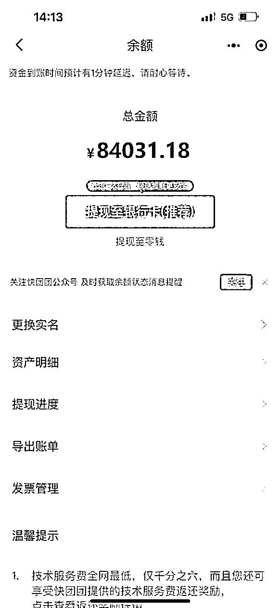
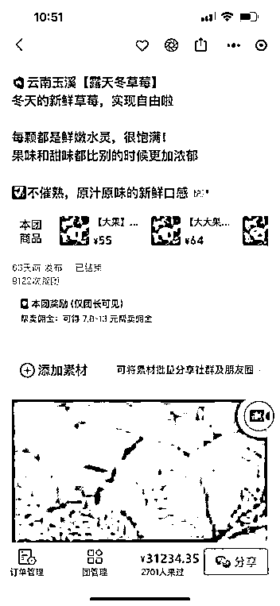

# 副业做快团团，单月帮卖佣金8万

这篇内容整理自贾璐Luca在3月8日大航海快团团经验分享中的讲述，发布于2023年4月11日。

我目前线上收入的大头来自无人直播电商。抖音、快手直播规则变化快，粉丝复购也弱；虽然赚到了一些钱，但压力一直不小，对以后怎么做也有些迷茫。

快团团给我的感受不同：它靠社群沉淀关系，复购黏性很强。于是从去年12月起，我开始小步测试，把它当成“一个人的副业”来做。下面是这段快团团实验的阶段性结果。

**成绩单**
- 30天内，全国排名升到1797位；
- 当月帮卖佣金合计8万元；
- 疫情期间在小区组织面包团购，净赚2万元。

**我主推什么**
**帮卖方向**
（一）三类主推货品
我做快团团帮卖，主要聚焦三类：
1. 应季鲜果，比如草莓、橙子、枇杷、芒果；
2. 围绕生活氛围的货品，像鲜花、香薰蜡烛；
3. 预制菜，凉皮、鸭掌煲、螺蛳粉都在其中。

为什么锁定这三类？我的理解是要看快团团里的“人货场”：货要跟人的需求对得上。先读懂人，再按需求配货，销量才起得来。这部分后面再展开。

（二）把草莓做成爆款
这里重点说草莓。仅草莓这一项，一个月就带来3万多元收入；平均每单佣金11元，卖出2800多单，复购率超过40%。

选它做爆款，原因有三：
1. 应季水果，一年只有3个月当季，用户惦记很久；
2. 酸甜口，小朋友尤其爱吃，家长容易持续下单；
3. 草莓客单价和利润都高，线下水果店普遍卖得贵，电商价格更有优势。

更详细的内容可查看飞书：
https://r7weuqivm5.feishu.cn/docx/SYkqdYJ4FoEXOlxQpitcWY8Rnqg?from=from_copylink

**评论区互动**
评论区里，林家少爷和成为精锐都在问飞书密码，作者回复现在应该能正常打开、不用密码了；蛋总同在广州，想加🛰️，作者表示会私聊、不便公开；张乐乐关心团品怎么配送，作者答“快递”；星漫🍊留言说很受用。