# 私域团购实战笔记：牛肉品牌月销40万+

作者：深藏 blue（chu*）｜2023-03-06

这篇文章写给想在私域渠道卖货的朋友，核心回答四个问题：怎样洞察用户需求；怎样围绕自己的客群挑商品；怎样判断并选择靠谱的上游合作方；怎样持续获取新用户并提升复购意愿。我会用自己经营牛肉品牌的过程来展开。

先讲背景。我在英国待了十多年，回国后进入一家世界五百强企业，做信息技术项目管理。一个偶然的机会，我踏入牛肉进出口行业，负责面向消费者的零售端。现在自己做牛肉品牌，销售主要依托私域。疫情比较严重时，每月销售额能做到60至70万，平时稳定在40至50万。不到一年时间，我们完成了品牌从0到1，上线了天猫旗舰店和有赞商城，也在抖音和视频号布局，随后进入拼多多系团购。半年累计销售额接近1000万，其中快团团单个团一个月做到过50多万。我加入龙哥盟两年多，目前是快团团大航海教练，趁这个机会分享社区团购和私域经营的心得。

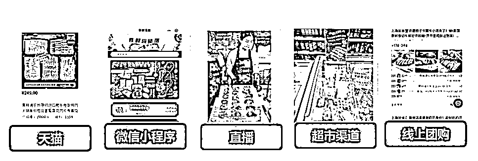

赚钱里很多朋友正在尝试“快团团”这类社区团购，我想先从“怎样把团购做起来”讲起。原本的分享角度是品牌方：新零售品牌负责人怎么布局团购、通过社群运营实现快速增长。但考虑到不少朋友以个人团长身份参与，我改从对团长更有用的角度，结合实战来讲。

全文分两篇。上篇谈定位：自我定位、客户定位、寻找匹配团长、设计适配商品；下篇谈私域运营：重点讲🛰️群里的获客、活跃和复购。

## 上篇：定位

### （1）自我定位

第一件事，客户定位。想知道用户要什么，得先搞清楚你自己是什么。个人团长要问自己：我的强项是什么？可以给用户带来什么价值？你是那个帮人选美食的美食达人，还是给穿搭建议的时尚买手，或者是分享母婴经验的妈妈？方向没有标准答案，但两条原则很关键：一是贴合自身优势，二是选垂直赛道。

品牌方也要有清晰的定位，知道精准用户是谁，能画出用户画像。拿我在做的牛肉来说，货源是美国谷饲中高端大厂进口，单价普遍超过200元。典型用户集中在：30岁以上、有家庭的女性；喜欢自己下厨；教育背景不错，对牛肉和牛排有一定研究；收入较宽裕，每月买2到3次生鲜，每次花300到500元。

### （2）团长定位

定位想清楚后，再去考虑找怎样的供货方和合作团长。从品牌方视角，找合作团长分两步：第一步，从哪里找；第二步，拿什么标准筛。

找团长和找对象很像，只看表面条件不行，最后能长久的往往是“门当户对”。渠道方面，我分成线上和线下。线上主要看供应链领域的👸号，它们会定期发布团长销售排名，帮你形成基本判断。比如“快团帮”：https://mp.weixin.qq.com/s/2xnSwbH53-0AAbMF_MlnKA 。这个👸号会更新团长的卖货数据和榜单。

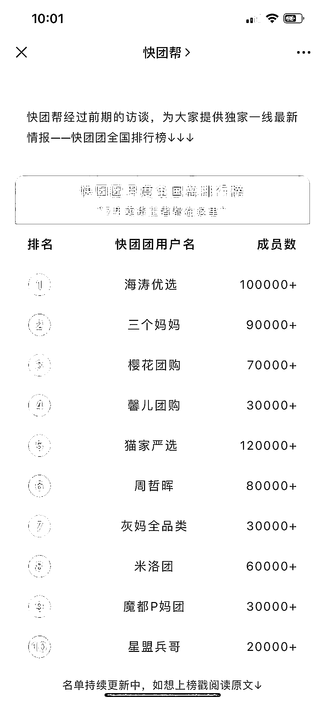

比如这是2021年的数据，新数据里魔都P妈已经是稳稳的头名。榜单里还有团长二维码，拿到二维码才有机会直接联系。

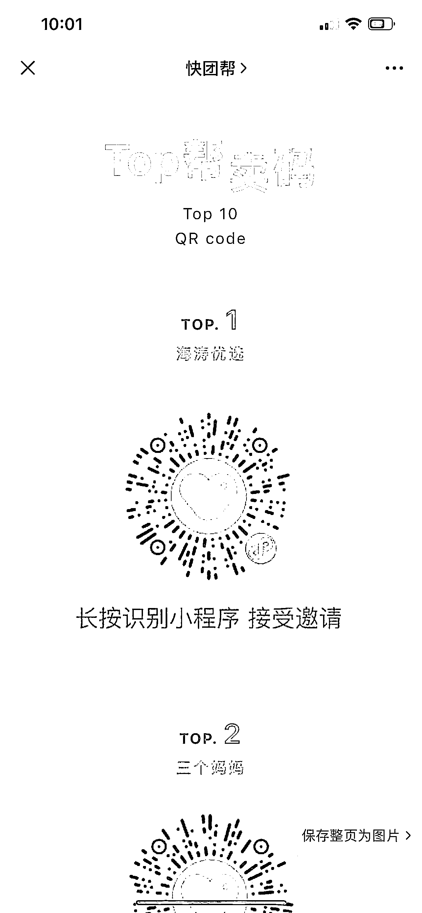

扫码之后，能看到团长在快团团的主页，包括联系方式、帮卖要求、近期团购动态。

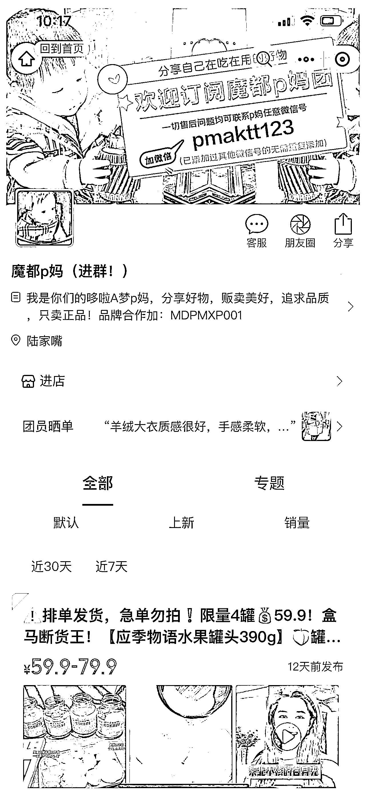

像现在长期排第一的魔都P妈，听说每月流水接近2亿，可见团购盘子有多大。主页上可以看到她的🛰️和品牌合作方式。但加🛰️这件事相当难。

大团长的商务每天要接待无数品牌方和上游供应商，消息根本看不过来。为了加上🛰️，大家各出奇招。最夸张的一个案例，发申请发了100次才通过，最后话术是：“姐，我从冬天加您到夏天，再不通过，一年就过去了。”也许商务被这种韧劲触动，终于通过了。但说实话，超过90%的申请都会被忽略。越大的团长，供应链越成熟，已经有固定合作伙伴定期推新品，没有特色的新品牌很难得到回应。

我们后来的做法是主攻中腰部优质团长。用“门当户对”的逻辑说，要么你自己是知名品牌，要么手握顶级热门资源，否则别硬攀头部。为了提升筛选效率，我专门让同事做了团长画像和数据分析，以下是我的经验。

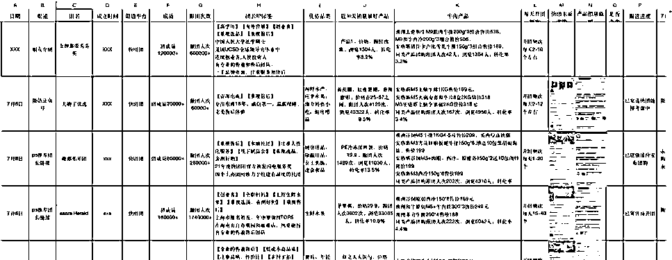

我们设计了一张评估表，重点看这些维度：

【团长个人IP】团长背景不同，IP形象也不同，常见的有宝妈、小资女性、电器达人、装修达人。因为牛排单价高，在宝妈这个方向里，我们更聚焦高学历、爱烹饪的高知女性。

【成员数量和跟团次数】主要看规模，两项数据越高，说明盘子越大。

【优势品类】主要看团长擅长什么，是否卖过生鲜，是否卖过和目标客群重合的商品。第一，卖过牛肉、牛排、海鲜之类吗？第二，卖过母婴、健身、厨房用品这类与目标用户属性一致的商品吗？

【近30天销量最好的产品】用来观察团长最近的推品节奏和销售趋势。

【是否卖过牛肉】如果卖过，要对照产品重叠度，再看我们的差异化机会在哪里。

【开团频次】从一天一次到十几次不等，通常大盘子团长开团更频繁。但我们想找少而精的团长，开团很勤但人气转换一般的，不是理想选择。我们的参考线：每天开团链接不超过10个，跟团人数超过100，成交转化率在2%以上。

综合这些标准，我们筛出了二十几位团长：上海女神团、小荷才露尖尖角、miu家万能团、Winky等。

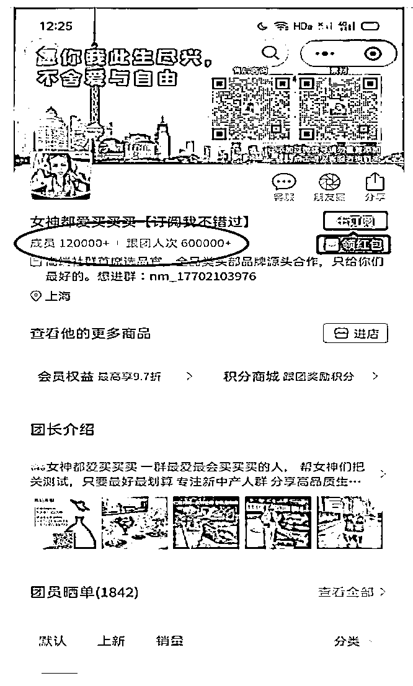

接下来就是不断沟通、寄样品、再沟通。这一步最要紧的是双方认知和价值观合拍，整个过程和谈恋爱一样，需要了解、适应。

### （3）产品定位

社区团购这个渠道，团长普遍追求极致性价比，所以品牌方很容易被要求给最低价。我们也面临这种压力。当时天猫渠道已经有寿喜烧套餐在卖，由于用料标准高，毛利本身不高。如果想在社区团购渠道给更低价格，只能靠高额补贴，而没有利润的生意很难持续。

后来产品团队针对社区团购做了商品差异化，主要调整了三点。

一是保留寿喜烧套餐的核心品种，同时换掉2款产品，换成2款重新开发的新品，新品毛利更高，我们也能给团长更低的供货价。

二是从场景和规格两个方向做创新。场景上，我们发现很多牛肉消费者在追求低脂和健身餐，于是推出低脂牛肉套餐。规格上，我们做了100克小包装，取名“独自美丽包”，让用户感觉花同样的钱能拿到更多盒。当时我们还设计了99元10盒的限时福利。

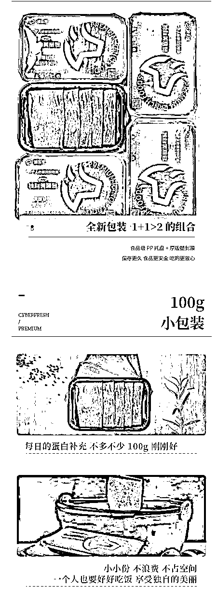

三是用和牛产品打开高端市场。我们算是比较早在社区团购中卖和牛的，而且一开始就是M9最高等级，吸引了不少高消费力用户。

看开团效果就知道方向是对的。在女神团，我们的商品很快就收获好评，第三次开团卖了2000多单，在食品类目排到前三。以200元单价估算，销售额差不多40万。

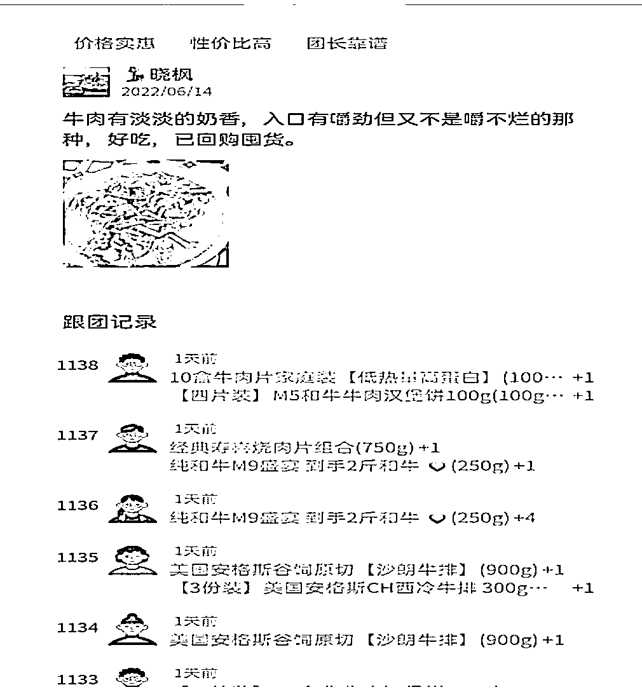

总结一句：社区团购渠道如果能提供定制化、有差异的商品，是最好不过的。品类差异、规格差异、场景差异，都能避免同一款商品在不同渠道被不断比价。

## 下篇：私域运营

除了和团长合作，我们也自己以团长身份向终端用户卖货，相当于品牌方直营私域渠道，增长情况很理想。私域运营的核心是两件事：用低成本找到新客，以及让老用户持续买单。

### （4）活动拉新

私域要保持增长，就必须不断有新用户进入。拉新的手段很多：熟人转介绍、朋友圈拉人进群、活动建群、📕等公域引流。这些方法论平台上有不少分享，我重点讲一个我们做得比较多的路径——线下活动拉新。

食品生意有个天然逻辑：让用户低成本试吃。只要东西够好，用户试过就容易成为长期买家。我们的商品定价偏中高端，为了找到精准用户，经过多次测试，最终把资源投到目标用户聚集的社群活动上。这些活动包括：青少年体育俱乐部、企业工会、中高端社区以及其他类似场合。

线下活动很耗时耗力，所以精准度和转化率很重要。但找到用户只是第一步，后续转化和留存才是关键。早期我们让用户关注👸号，然后发优惠券，结果发现链路太长，用户关注后很难继续触达，流失率很高。后来调整为：试吃满意后当场用个人🛰️或企业🛰️加好友，马上发券，同时做好分类标签，之后按标签做个性化跟进，再邀请进🛰️群，为持续运营打好基础。

### （5）🛰️群运营

很多人会把用户拉进群，但群运营的难度远远被低估了。我判断一个群是否合格，就看两个指标：互动率和下单转化率。它们互相牵连，互动率不行，转化率基本没戏。

互动率本质上是用户对群消息的注意力。你发的内容或链接，有多少人点开看？如果没人看，更不会有人买。做群之前，你得先回答一个问题：这个群能给用户什么价值？信息爆炸的时代，用户只愿意把注意力花在真正有价值的群里，价值不够，群最后只会变成死群。

这个群，我们做了两类安排。

首先，定期输出和牛肉有关的高质量内容，比如美食分享、烹饪经验、购买知识。内容有价值，用户才会持续关注。我们重点做了两件事：每周抛出适合讨论的话题，引导大家发言。目前互动最好的三个话题，按热度排：一是吃火锅时大家必备的蘸酱是什么，自己怎么调；二是冷冻牛肉能不能反复解冻，会不会影响品质；三是低温慢煮在家怎么做，有没有低成本操作方法。

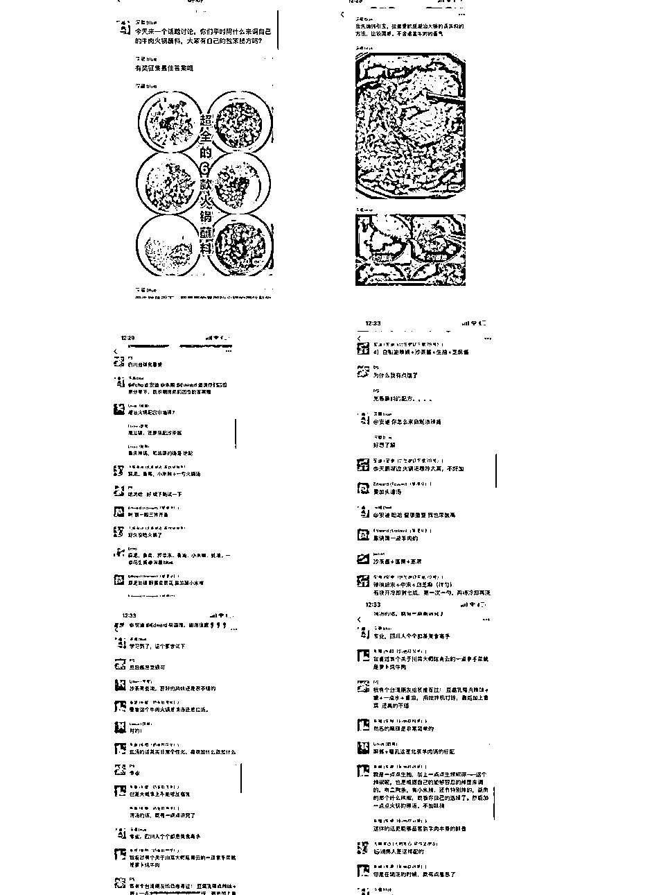

从聊天记录能看出来，用户对内容感兴趣，才会去看群消息、参与互动，群的活跃度也就上来了。

其次，定期释放只有群内才有的福利。用户愿意进群，多多少少是想获得专属权益，这种权益就是群的价值。常规操作是：每周一次群内专享折扣；不定期做新品试吃、抽奖等互动福利。还有一点值得强调：福利内容重要，玩法形式同样重要。有趣、好玩、又能占到便宜，才是最理想的。我们试过两种效果不错的玩法：

【半价拍卖】选一款商品，在群里从0元起拍，限时1分钟，最终出价最高者获得，但这个价格上限是原价的一半，避免用户吃亏。

【现金券膨胀】在指定时段，用户花10元购买抵扣券。第1位购买的人，10元可以当50元用；第2到第5位购买的人，10元可以当30元用；第6到第20位购买的人，10元可以当20元用。

这两种玩法的共同点，是把福利变成不确定的结果，利用大家“搏一搏”的心态，参与度和群的活跃度都会明显提高。

### （6）复购转化

互动率有起色后，再谈复购转化。这里我要特别提醒：复购不是拼命给用户发下单链接，那样反而招人烦。给用户推送商品要讲究两点。

第一，时机。推送频率要看用户的购买周期，不是越多越好。最好的节点，是用户上次买的东西快要消耗完的时候。以牛肉为例，用户通常一个月买两次，那么每周推送一次就够了，最多不超过三次。

第二，内容。不要做千篇一律的群发，结合用户具体情况来做定制推荐效果最好。我习惯先问对方上次买的产品体验如何，有没有反馈，再根据新的需求给出建议。比如用户说最近想吃瘦一点的牛肉，我就推荐后腿肉；用户说下周要请朋友来家里吃火锅，我就推荐火锅套餐。推荐越精准，成单概率越高。

## 完结篇：最后想说的话

总结一下，社区团购要做好，离不开两个关键点：一是商品选得好，能击中用户需求，价格有竞争力；二是拉新和复购两条腿走路，新用户源源不断，老用户持续复购。这两点做好了，销售额增长只是时间问题。

但如果回看我们快速增长的那三个月，还有一个客观背景是疫情。疫情让团购市场异常火热，但也给我们带来了巨大挑战——配送。当时顺丰很多网点不能配送，我们的货被退回。我们并没有坐等，而是做了一个当时看起来很难、后来证明很正确的决定，这为品牌后续增长打下了重要基础。

所以在最后，我想分享的是：极端条件下如何保证服务和履约。我始终认为，能够提供别人做不到的服务，让用户感受到超出预期的体验，就是核心竞争力。当时的情况是，每天有150到200多个订单，顺丰只能完成不到一半。我清楚记得，越靠近上海封城那几天，局面一天比一天艰难。

记得有一天，手头突然压了近150个订单没发。我当时跟合伙人说，要是这批单子最后送不到、客户纷纷退款，那我们好不容易积攒起来的那波巨大流量就等于白费了，对品牌后续的发展会很伤。两个人一合计，下定决心：不管要付出多大代价，都得把这些订单履约完成。

具体怎么送？我们准备了三条路：第一，叫货拉拉；第二，找骑手；第三，用自己的私家车跑——说白了，就是我也亲自下场送。

我们照着上海的区域做了切分：宝山、杨浦、虹口划为一个片区，黄浦、静安、徐汇归为一个片区，长宁和闵行合在一起，浦东单独成片，松江又是一个片区；然后针对每个片区，分别去对接合适的货拉拉和骑手资源。

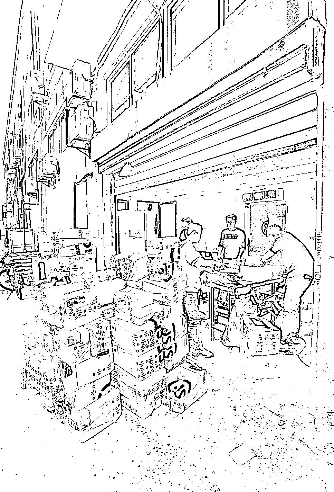

当时不少小区还在封控，只能无接触送货。为了确保司机和骑手都能把货完好交到客户手里，我们给他们下了一个硬性要求：配送完成必须拍照留底。

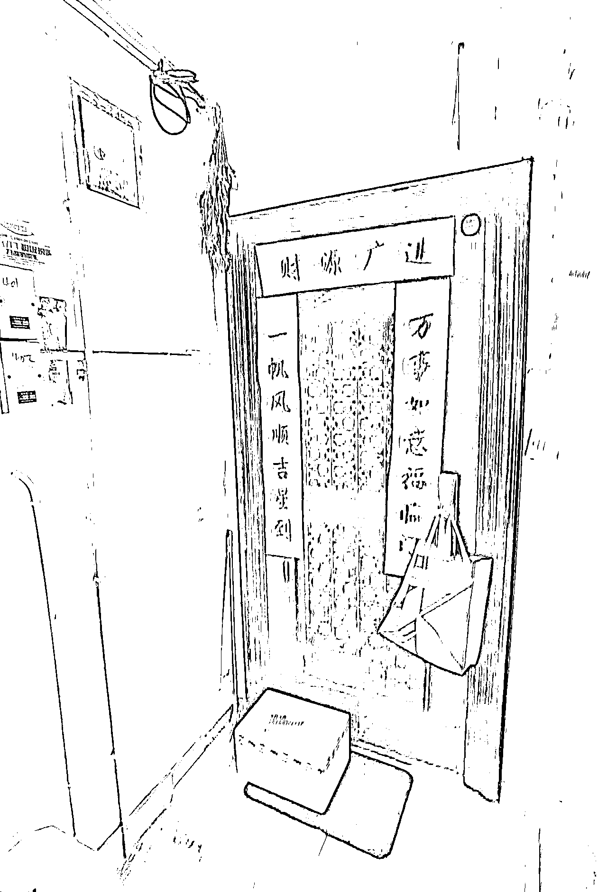
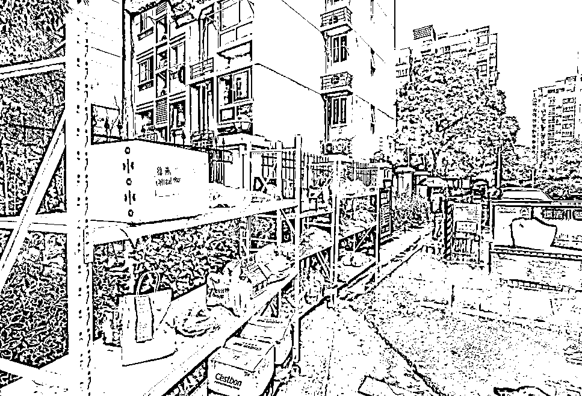

就这样，我们打出了单日自配送150单的最高纪录。当然，背后的成本也不低：平均每单配送费大约30元，比平时走普通物流贵了一倍。

可是回过头看，恰恰是这种不计成本的履约投入，帮我们赢得了团长和客户们的认可。当时不少竞品根本没法把货送到客户手里，而我们拼下来了。等疫情阶段过去之后，销售额也因此迎来了飞速增长。

现在再复盘，无论团购的形式怎么变，最后还是要回到商业本质。借用最近被很多人转发的刘强东那段话：别扯那些乱七八糟的，管理层也别整天抛花哨理念、造新词，回归常识，回到商业最根本的五个要素——产品、价格、服务、成本、效率。

与大家共勉。

评论区里，大家也聊开了：

Unstoppabl*：福利活动设计得真心不错。
许锐：人群切分精准，复购提升的思路特别受用，学到了。
深藏 blue（chu*：哈哈，后面还有很多实用招数，有机会再给大家分享。
安神：共勉。
龙哥：感谢分享，已设为精华。
倪大胖：商业本质那几句太认同了，产品、价格、服务、成本、效率，一个都不能偏。
光子郎：你们这个产品的毛利率大概在什么区间？
芷蓝：这篇写得太细了，厉害。