# 新手宝妈副业两年，靠小红书+微信私域赚了30W＋，我的完整复盘

文/小野 2023-02-08

我在一家药企做互联网医疗方向的运营岗，早先也在医疗互联网公司干过产品和运营。同时，我是个新手妈妈，家里有个2岁的娃。2020年底生完孩子，我本来以为日子会变成上班和带娃两头转，没想到业余时间竟把小红书引流和私域卖货这条路跑通了，两年累计利润30万多一点。

这个数字放在生财有术里确实不算什么，但对很多人来说，已经抵得上一份全职工作一年的收入了。既然做出了结果，就说明有些动作是对的；把对的部分沉淀出来，一方面希望给圈友贡献点能直接上手的方法，另一方面也算给自己做个记录和复盘。

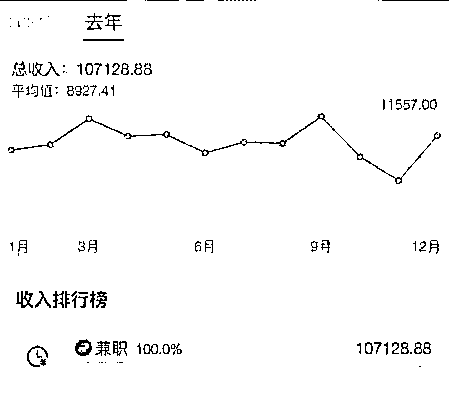 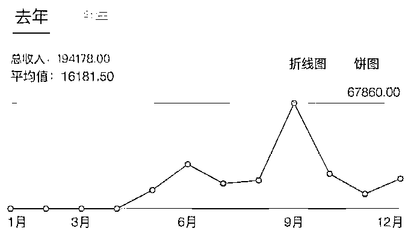

一、启蒙期：互联网前辈们给我种下了流量思维

我入行第一站是在一家互联网医疗公司做产品和运营。从那时候起，“攒流量—运营流量—变现流量”这条链路就刻在我脑子里了。只不过当时流量是替公司攒的：每周给业务公众号写行业拆解、蹭热点，吸引行业用户进来，再为B端产品的销售转化铺路。

更关键的是，那年代已经有了「个人IP」的启蒙。这里真的要感谢生财有术的嘉宾大辉和二爷。看着大辉做「小道消息」、二爷做「二爷鉴书」，我也在8年前开了个「小野食堂」。原本想好好经营内容，结果工作一忙（其实就是偷懒的借口），更新频率从每月变成每年，最后干脆断更。

公众号虽然没做起来，但微信里的人脉我一直在攒。

二、引流期：让加好友成为像吃饭喝水一样的事

1、泛流量：每一回能加微信的机会都别放过

2021年认真筹备私域变现之前，我微信里大概躺着4000个好友。我当时的想法很朴素：微信私域早晚能变现，只是时间问题，所以好友数量必须先堆起来，工作中一切能加人的场景都不能错过。

那段时间我做过医药医疗方向的投资经理，出差多，每到一个地方都要主动认识业内的人，主动加微信。刚开始确实不太适应，转念一想，这些人说不定就是以后私域变现的种子用户，于是放开手脚去干。

从那以后我的微信一直开着免验证，加人的效率才上得去。后来回头看，泛流量这条路走对了：当年认识的那些同行，有人成了我的代理，有人变成了我的VIP客户。

2、精准流量：有相似经历的人，就是最同频的用户

当妈的都懂，备孕怀孕那几个月，满脑子疑问，第一反应就是去小红书搜一搜、问一问。我起初加过一个备孕群，后来琢磨着：与其在别人的群里泡着，不如自己建一个当群主。

于是我开始在小红书记录备孕、怀孕、生娃的真实日常。基本不用想选题，生活本身就是内容库，只需要把日常用心加工成对别人有参考价值的经验就行。从备孕一路记录到生产，小红书粉丝虽然只有600多，但导到微信的妈妈估计有1000～2000人，这批人现在是我副业的基本盘。

还有个我挺得意的操作：我在南京鼓楼医院生孩子，产检时发现这家医院居然没有官方孕妈群。那我自己建一个呗，但从哪拉人？临产前我发了一篇小红书笔记，标题是「南京鼓楼医院助产士才会告诉你的待产注意事项」。就这么一篇帖子，帮我拉起了近500人的鼓楼医院孕妈群。其实那些内容就是助产士门诊都会给的注意事项清单，我只是做了一遍整理加工。

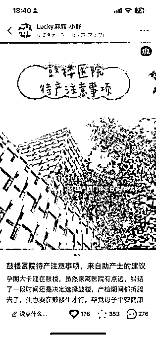

有相似经历的人，就是最同频也最精准的流量，这个规律放到哪个领域都成立。

3、微信标签：私域里的“精准推送”，就是手动打标签

这几年“精准推送”的概念满天飞，但微信私域里的精准，最原始也最管用的方法反而简单——手动打标签。我主要做两类：分组标签和名字备注标签。

分组标签：本质上是为发朋友圈服务的。我按城市、公司、行业、认识渠道等维度给好友分组，发圈的时候选合适的组投递，既能避开不相干的人，也能精准触达目标。刚开始做母婴社群招募时，我就是用分组发圈，没打扰其他好友，很快就拉来100人入群。

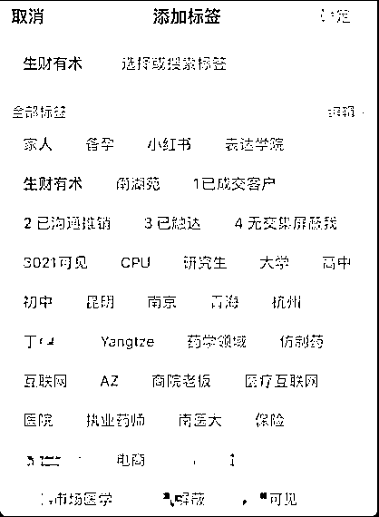

名字备注标签：主要为了必要时群发，以及快速触达同类型的客户。

（1）把好友/客户粗略分成4档：已经下单的标1，后缀写清楚品类（美食/母婴/减脂）；聊过还没下单的标2，后缀写咨询品类；还没接触但以后可能有戏的标3；还没接触而且把我朋友圈屏蔽掉的标4。

（2）顺带记录身高体重、在哪认识的、孩子性别生日这些基础信息，放不下就写进微信描述栏。把客户信息记下来，这是销售的地基功。微信其实就是个超强的CRM库，用好了，私域变现真的省力不少。

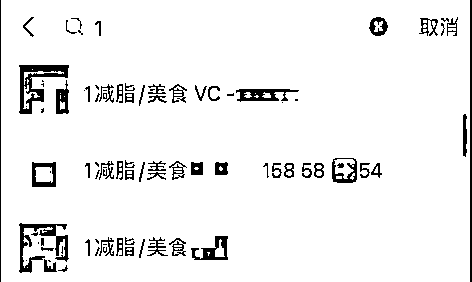

三、变现期：产假哪是奶娃假，分明是赚钱窗口期

只有生过孩子的人才知道，产假根本不是休息。孩子一落地，你必须短时间内学会伺候人类幼崽的一切技能；从此再没有完整的睡眠，深夜随时可能被哭声拽起来喂奶、换尿布、抱着哄；产假期间只有微薄的基本工资，房贷和日常开销却一样不少。

所以休满2个月产假后，我清醒过来：该搞副业了，多一个收入管道，心里才不慌。当了妈以后，我不奢求每样东西都给娃顶配，但也不想因为手头紧，看到好东西只能眼馋，最后无奈给孩子找平替。

现在回头看去，还挺有成就感的。别人产假奶娃，我产假却成了私域变现的黄金窗口。

1、从美食起步：吃货的副业，自然从吃开始

那一阶段的思路极简单：手上有什么就卖什么，喜欢什么就卖什么，好吃的谁不爱呢？虽然之前攒了不少妈妈流量，但母婴货源还没有，于是我选择从自己最有热情的方向切入——美食。

我是昆明人，对家乡味道有执念，8年前就做了「小野食堂」这个美食公众号，吃一直是我最大的热情所在。恰好闺蜜手里有云南包浆豆腐的货源，这款小吃在云南人心里很有分量，利润不算厚，但产品力相当能打。于是我建了「小野食堂」美食群，注册了快团团，发出第一条卖货朋友圈。

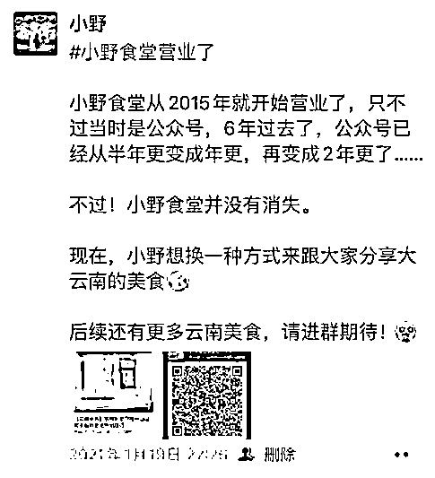

为什么选快团团？说来也巧，我自己常年泡在小区团购群里，亲测这小程序好用；又打听到它是2021年才流行起来的工具，属于拼多多旗下，背靠大树，应该差不了。没想到误打误撞，快团团后来成了私域领域里发展最猛的工具之一。

工具就位后，我开始动用云南老家的资源到处找货。从《去有风的地方》带火的鲜花饼、米线、乳扇，到沃柑、普洱茶、云南咖啡、版纳小玉米、饵丝……几乎把云南味都搬进了我的选品池。正好赶上过年采购季，加上朋友捧场，第一个月利润细细一算有7000多，特别开心。

但那段时间是真累：货源自己找，团购文案和图片自己编，订单自己导，发货自己管，物流单号自己传，售后自己抗。每天都是哄睡2个月的娃之后才开始上传单号，经常一手抱娃一手操作电脑，手脚并用的样子又好笑又心酸。

后来我一度迷上“什么都要自己来”的模式，结果费时费力，效率低得吓人。仔细复盘过后我得了个结论：供应链不是我的强项，议价能力弱，利润薄，而且副业本来就没多少时间。于是我把边界扩大：不只做云南美食，全国美食都纳入进来；不只自己开团，也去快团里帮别人卖。

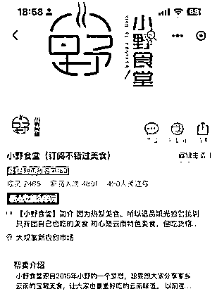

当然，做美食产品，品控永远是第一位，至于怎么选品，那是另一个大话题。

2、顺势切入母婴：妈妈的身份就是天然入场券

美食团购跑完2个月，我的产假只剩下不到一个月了。看着群里的宝妈们跑去别的团购买个不停，我有点焦虑。于是费了番功夫找到母婴货源后，果断新注册一个母婴团购号，同时开了个母婴好物分享群。

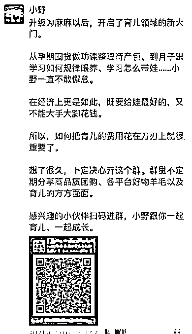

母婴属于刚需品类，根本不用堆文案去制造需求。尤其是0～1岁这个阶段，只要把宝宝吃喝玩乐用的货源找齐，价格上有优势，群里姐妹信得过我，服务跟得上，订单自然会来。运营了一年，母婴群差不多到了500人，团购月利润明显往上走，如今已是我每月最稳的利润来源之一。

3、瘦了20斤之后，又入了变美这行

为什么选「营养私教减脂和大健康」？原因有三层。

第一层，为我自己。产后我胖了20斤，花2万多上了半年多瑜伽课，居然一斤没瘦……实在忍不下去，决定抓最后一根稻草试试。而作为药学硕士和执业药师，我从心底排斥节食、代餐这类路子，最后选了一套科学的大健康营养私教方案。一边瘦一边分享，走的正是“自用—分享—成交”的生意逻辑。

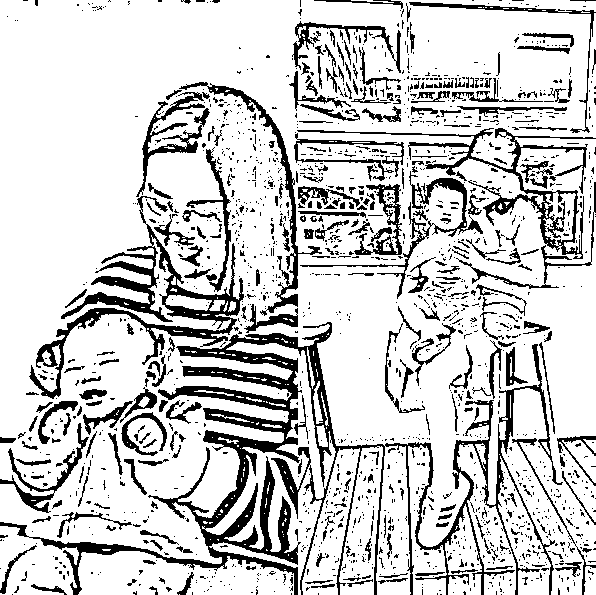

第二层，为客户。我手里有母婴群，里面的客户大多是妈妈，她们大概率跟我有同样的身材烦恼。我不能只满足妈妈们给孩子买东西的需求，也得照顾妈妈自己变美的愿望。我打心眼里觉得，每个妈妈都配得上认认真真地瘦一次。后来8个月时间里，我带30多个客户成功减了下来。目标达成了，结果也交付了，我很满足。

第三层，为利润。健康服务类产品的利润空间本来就更高，那8个月里，每个月利润都在1万以上，最高一个月营业额做到6万+。

四、进阶期：会发朋友圈、会做销售、会当榜样

1、发朋友圈：把自己经营成高级货架，但货架上不能只有货

做私域，头一项基本功就是发朋友圈。

什么叫“发好”？我自己总结成三条：

（1）每日持续冒泡。跟做自媒体一个道理，不断更是底线。一天发1条也好，10条也行，但必须出现；你要是一个月没动静，客户就会默认你三天打鱼两天晒网，甚至以为你不干了，信任感就在沉默里蒸发掉了。

（2）有货，更要有活生生的自己。你挑的产品、做的服务，背后都是你所认可的生活价值和审美品位。所以朋友圈不能刷成广告墙，也得有情绪、有观点、有态度，让人看到屏幕后面是个真实立体的人。

（3）不自用就不推荐，没体验就不推广。团购里的美食我大多会先买一份自己尝，自己拍照，为此还特意配了个不便宜的镜头。育儿过程中用到的物件，我也优先在自己团里下单，再拿到群里分享。减肥同样是自己先瘦了20斤，才有底气开口。我一直相信，最好的零售生意是用自己亲测过、认真思考过、真正擅长的方式，去满足客户的需求，顺带创造价值。

2、做销售：没人能替别人做决定，只能点燃对方心里的火苗

开始做变美项目后，我发现减脂服务这类产品跟团购完全两个打法：团购聊几句就能成单，这种服务型产品必须耐心挖掘需求。慢慢我才悟到，销售是以人为中心的事——先找到客户本来就有的需求，再去满足它，而不是拿着产品从头到尾讲一遍。

有句话我一直很喜欢：没有人能真正说服别人，好销售只是把客户心里那根小火柴划亮。

还有一件事必须学会：和客户保持粘性。服务过程里其实有很多话题和触点可以持续和客户产生连接，顺着这些触点继续挖需求，自然就会有更多生意机会。

做私域，一个客户沉淀下来的信任和持续的复购，比什么都金贵。

3、当榜样：做别人赚钱路上的“推土机”，本身就是件快乐的事

我还没加入生财有术时，就发朋友圈吸引过2个好友想进来（后来还真都进了，哈哈）。

加入生财、跑完小红书航海后，我跟闺蜜聊起小红书，然后开始不厌其烦地给她的“推土机”加油打气，推了相当久。就在今晚，她一口气引流了十几个好友，成交了5单。

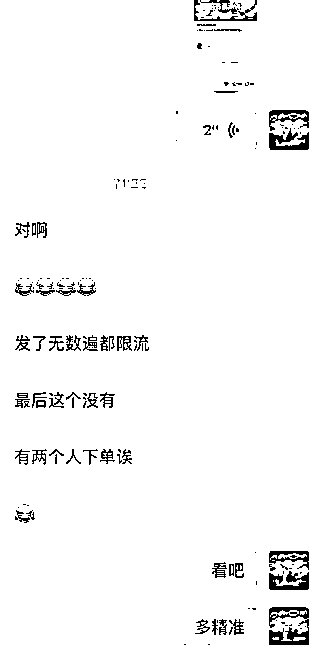

等我跑通小红书+私域的链路后，陆续有新手妈妈来问我副业怎么做。聊完发现大家的处境几乎一样：有了孩子后想给他更好的生活，不愿意被困在现状里，想靠副业多进一笔钱、找到一点自我价值。很多次有人跟我说：小野，你的朋友圈很有力量，我想跟着你干。那好，我就当大家的“推土机”，把生财有术分享出去，把赚钱思路讲出来，现在她们也都迈出了实战的第一步，拿到了自己的小成绩。

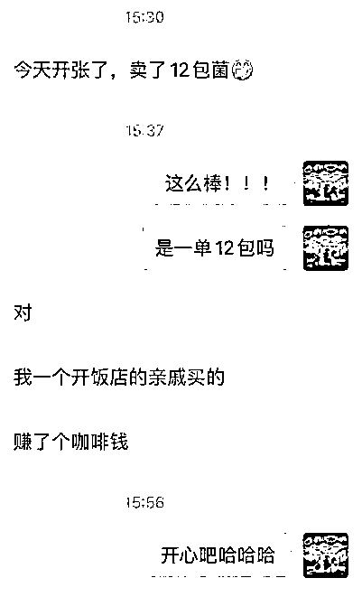

原来我也可以成为给别人力量的人。当别人赚钱路上的推土机，那种快乐很不一样。

五、往后怎么走：把三件事平衡好，把真诚当作底牌

1、上班、带娃、副业，能兼顾吗？

我也问过自己这个问题：白天上班，晚上带娃，剩下时间都扑在副业上，累吗？说不累肯定是骗人的。副业意味着在做好本职工作、当好妈妈之外，再额外压上大把时间。多数夜晚，我都是把孩子哄睡了才拿起手机继续打理副业。时间就这么多，效率成了必修课。我自己的经验有两条：

（1）善用工具。工具本来就是给人提效的。比如「讯飞输入法」，把常用话术、产品资料提前整理进去，跟客户聊天一下快很多；再比如团购素材量大的时候，把相册夹里的图片分类摆放，要实拍图、要好评反馈时一秒钟就能调出来……

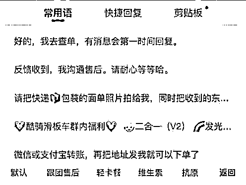

（2）善用人。利润攒到一定程度，就花钱请个助理吧。我去年5月招了一个大学生助理，帮我打理团购素材、售后沟通和各种琐碎整理工作。这一下把我从重复劳动里解放出来，省下的碎片时间都用来拓客或者琢磨生意怎么优化。

2、真诚是永远的必杀技

学了一堆销售技巧、运营方法、文案套路之后，我依然交过学费：被一个客户退款后拉黑删除过，也面对过一个高复购客户默默退群的无解局面。那之后我彻底想明白了——真诚才是唯一的捷径。2022年底，我给50多位客户手写了新年贺卡，还随卡片寄了礼物。这个时代，手写的字迹特别稀缺，也特别有分量。我相信客户能感受到那份诚意。副业也好，生意也罢，想走得远，底下垫着的一定是真诚。

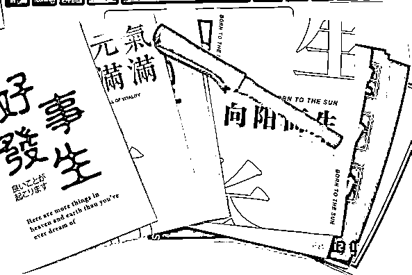 

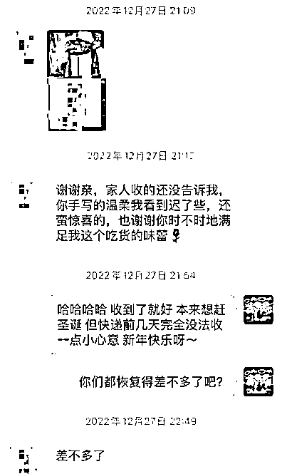 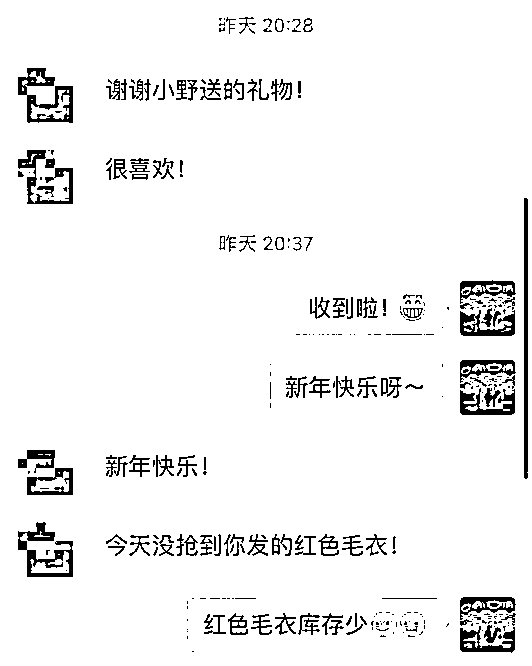 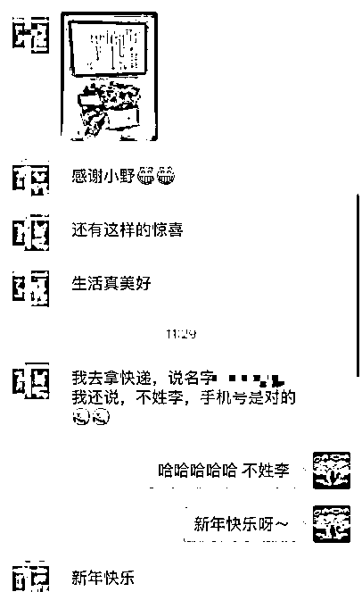

写在最后

这篇复盘，算是对我两年副业的一个交代。很庆幸自己一直在往前走，累是累了点，但看着孩子一天天长大，这两年靠自己的努力让他过上更好的生活，工作、育儿、副业三头都没耽误，我觉得值。孩子从来不是阻碍妈妈追梦的石头；恰恰相反，妈妈拼命努力的样子，就是给孩子最好的示范。

如果非要问做对了什么，可能就一条：像亦仁说的，做个实战的人。趁着能出发的时候出发，心动的时候就动手，别让自己想要的生活，永远停在梦里。

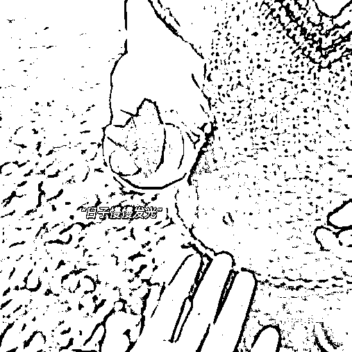

最后，谢谢在生财有术遇到的各位朋友，谢谢圈友梁靠谱、张亚萨帮我改稿，谢谢亦仁助理鱼丸不厌其烦地当我的“推土机”，谢谢那么多精华帖给我启发，谢谢亦仁大大！

大家一起生财有术！:D

互动区：评论区里有读者留言想加好友，作者在回复中留下了微信号 muyexy；还有圈友感慨“太厉害啦”“牛啊牛啊”，也有人问起 ChatGPT 账号的事，作者都一一回复了。