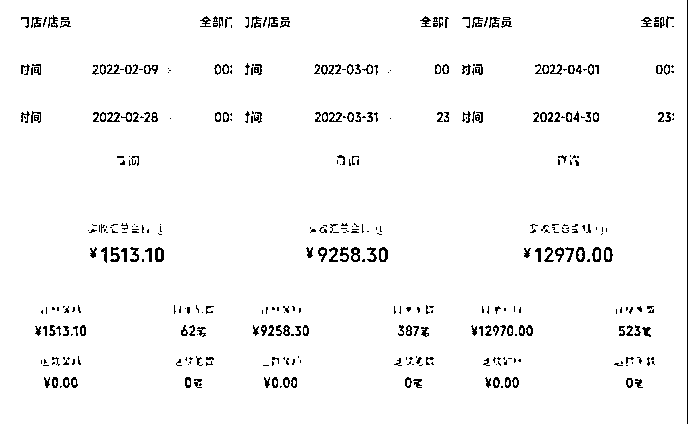
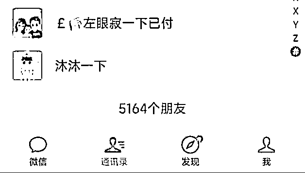
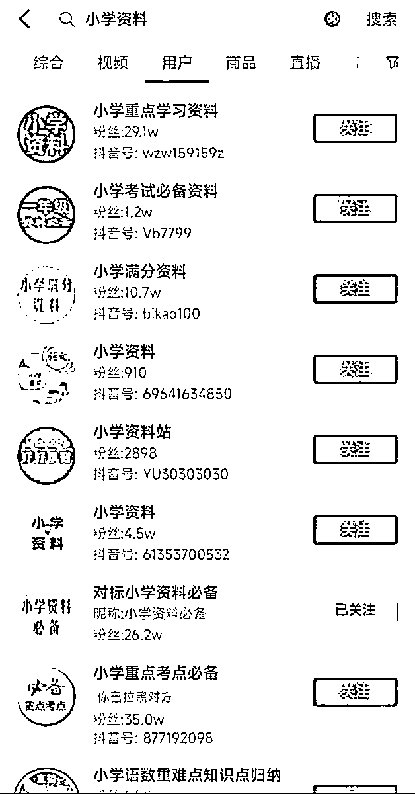
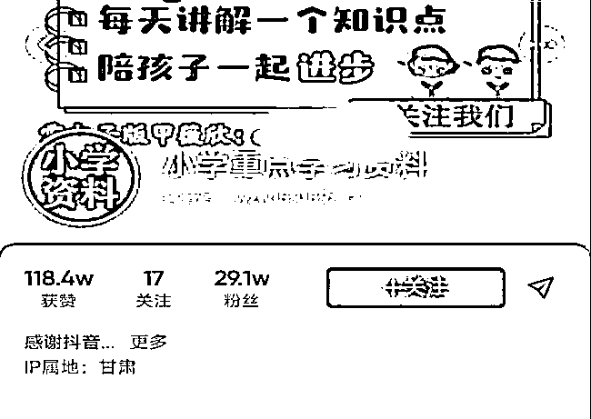
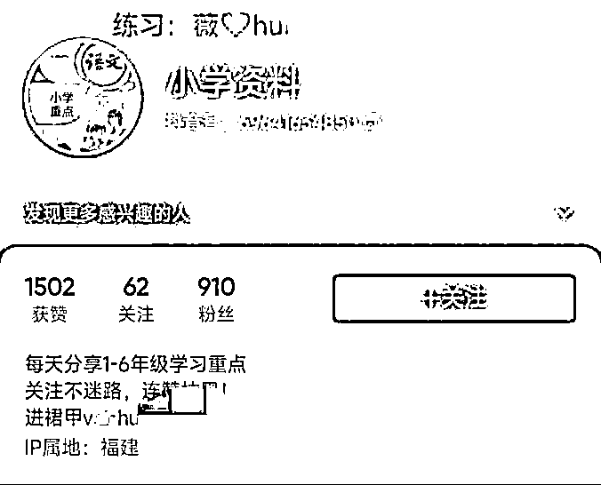

# 发图引家长，私域卖资料：我的小项目复盘

胖猫 / 2022-07-29

先看账本：这个副业从今年2月正式启动，2月11号出现第一位买单家长，单笔收费19.9元。金额不大，却给了我继续跑下去的理由。到4月30号，项目回款约2.7万元，个人号好友净增三千多。

 

这些数字放到星球里不算什么；但对一个摸索很久、屡屡碰壁的人而言，确实是一股推力。如果你也卡在迷茫期，又愿意赚每月几千块的辛苦钱，下面这套做法可以参考。

我2019年5月进入生财有术。此前没认真想过副业，职业路径就是上班、晋升。因为想多赚点钱，偶然加入星球，才发现商业世界还有另一面。后来我折腾过淘宝客、抖音小程序、书单号、知乎好物、闲鱼无货源、线下拉新、摆地摊、外卖CPS等，觉得能试的都试了，基本没跑通。就在准备收手时，我遇到现在这个项目，终于拿到一点正反馈。

**1. 一句话说清玩法**

在短视频平台发布小学学习资料的图片组，把看到内容的父母导到个人号，再引导他们付费进学习群。“双减”落地后，学科类培训在平台不好明着做，但父母想让孩子提分的需求还在，因此卖电子学习资料仍有空间。

**2. 我为什么选它**

一是能力匹配。我硕士毕业，读书时成绩一直靠前，整理文档、搜集材料、解答学习疑问都不排斥；再加上做过视频号和抖音，剪辑、账号运营的底子有一些。

二是看到别人真金白银赚到了，我很受刺激。

三是能沉淀家长资源。把人加到私域后，这批用户有长期价值，后面可做的空间不小。

四是反馈快。只要持续更新内容，就可能看到进账，容易坚持。

**3. 落地步骤**

玩法分两条线：前端搞流量，后端养资料库。

**1）前端流量线**

要做四件事：包装账号、发布图片组、把用户往个人号引、单聊转化后拉进QQ群。

先看账号包装。主页一般由昵称、头像、底图、个人说明、平台粉丝群构成。

昵称要让父母一眼看懂，比如“小学资料铺”“X年级学习资料”“李老师的学习素材”等。

 

头像通常用昵称文字图。主页底图可以写“要电子版，加 微 心 XXXXX”，用谐音把联系方式藏进去。

我实测过：没人举报时，底图带联系方式不影响流量；企业号例外，系统能识别。由此我判断，平台对账号动作大多看得见，只是处不处理的问题。

个人说明可写“每天发电子学习材料，领取请加V：XXXX”。平台粉丝群要开过一次直播后才能建；它不是为了在平台内做私域，而是多一个导流入口。我的做法是先把人拉进平台粉丝群，用户入群后自动@他，并提示“付费学习群一学期24.9元，想进请加V：XXXXX”，再把人往个人号引。

接着是图片组内容。这一步影响曝光，也影响收入。我的播放数据大多在2万以上，最高约120万；单条内容最高带来4000元左右，那条曝光约70万。

哪些图片容易起量？一是靠经验。发得多了，能判断父母对什么内容敏感，知道什么会触发点赞、收藏和私信。二是跟着热门走：看对标账号哪条互动高，下载后二次处理再发。后者不提倡，也有风险。更稳的做法有两种：找到对方视频对应的文档，用电子稿直接生成图片，这样就是原创；如果找不到原文档，就做相近主题，比如别人“看图写话”爆了，你找一份同类材料做成图片或视频。还可以去小红书翻近期热门学习材料，收藏高的下载后做成多图发到平台，起量概率也不低。这本质上是电商选款里“跟着爆款走”的逻辑：不知道发什么时，跟着已经被验证的内容做。无水印视频怎么下？在微信里搜一个小程序，输入“去水印”即可，挑顺手的用。

学习资料账号有节奏。期中刚结束再发期中题，效果通常一般；提前一周左右发练习、知识归纳，更容易爆。我那条4000元内容就是踩了期中节点。所以做这行要懂学生进度，内容跟考试节奏对上，数据才容易起来。

除了踩节点，还有一类内容吃香：让父母觉得“拿到就是赚到”。比如同样是数学，一份列出50个必会知识点，另一份只是第二单元的随堂练习，前者通常更受欢迎。

自己出图也不复杂。手里有不错的PDF，可以用WPS转成图片，挑6到9张发出去。做图片组时有个小动作：用文字或贴纸遮住部分页面。一是防别人直接保存，遮住后下载也没法用，只能来找你；二是制造吐槽点，评论区热起来，更容易上热门。

话题词最好固定几个，并跟内容相关。发一年级看图写话时，可以挂“一年级”“语文”“下册”“看图写话”，再补“知识分享”“图文来了”，后两个流量池更大。发布时间看粉丝习惯，我的粉丝晚上8点到11点活跃，所以我多在下午或晚上发。

再讲导流。平台内别直接写“微信”两字，可用“违心”“微心”“胃新”等谐音。我留联系方式的位置有三处：主页底图、粉丝群欢迎语、合集名（把合集名改成“要资料+VX”）。也有人放在个人说明里，写法差不多：“要电子版请+VX：XXXX”。我见过更猛的，直接把号印在资料页上，照样有几千赞。这几个位置里，我认为粉丝群最稳：安全性和效率都更高。有些父母不看底图，不知道怎么进粉丝群，也不懂“+VX”“+违心”是什么意思，甚至不会加好友；但他们都有一个共同需求：给孩子找学习材料。

最后是单聊转化。这一步最花时间，因为要逐个沟通。我的流程是：对方加上后，先发一份材料，再问“要不要进付费学习群”。不回复或明确不需要，我就不再追。若对方有兴趣，比如问“什么群”“多少钱”，我就发群介绍，同时发群内资料的实拍视频。对方说可以，我再发收款码和QQ群二维码；付款后通过入群申请。

这里有两个坑：内容爆了后加人集中，回复太频繁可能触发聊天限制，所以人多时要放慢回复节奏；收款别长期用红包、转账，量大了对方会看到风险提示，影响付款。更稳的办法是申请商业收款码，安全、稳定，也能长期用。

**4. 资料库的日常维护**

**1）开QQ群**

普通号最多建500人群；要建1000、2000甚至3000人的群，得开通群容量会员，官网或淘宝、拼多多都能买，一二百块能解决。我现在一个2000人群里有1300多人，这学期大概率不会满。新手建2000人群够用。

**2）找电子材料**

渠道不少：淘宝、拼多多、小红书、公众号等。最省事的是找对标账号，花几十块进对方QQ群，把群文件批量下载。如果对方持续更新，就他传一份，你跟一份。

**3）清洗材料**

拿来的文档常带别人联系方式，要先处理水印。一般用WPS删页眉页脚、去水印，再换成自己的。我常在页眉写“领取更多内容，加V：XXXXX”，既不影响阅读，也留下钩子。遇到加密文档也有办法：淘宝、拼多多找人解密；或用WPS转图片，再合成PDF，最后用“编辑-擦除”去掉标识；还可以搜密码破解工具直接处理。解密后就能编辑。懒得找工具的，可以找我要。

**4）更新节奏**

我固定在周六往群里放材料，不随时有随时传。这样省自己的时间，也少打扰群成员。群文件要分好类，不同版本分开，练习和测试分开，方便查找。不会分就照对标账号的分类抄。

**5. 几个常见疑问**

**1）需要什么条件？**

时间相对自由，能及时回消息，转化率才高；会基础剪辑；会用WPS调格式、转图片、图片转PDF；有一定文化基础，能回应父母的学习问题，偶尔还能讲题；有搜集和整理材料的能力。个人看法：大学生、宝妈比较适合。

**2）曝光起不来怎么办？**

第一，持续发。第二，尝试扩宽话题。比如账号叫“三年级资料铺”，正常只发三年级内容，但三年级受众窄，可以发面向整个小学阶段父母的内容，比如“小学生值得培养的10个习惯”，人群基数更大，更容易破圈。当然，账号主体仍要围绕定位。

**3）平台粉丝群怎么管？**

除了定期发材料，还要决定是否限制所有人发言。限制发言能挡住同行或乱发广告的人；不限制则方便大家交流，交流中会有热心用户替我们告诉新人怎么加个人号。欢迎语虽然设了，但有人看不懂，会在群里问，然后别人回复。也可以限制发言后定期群发加好友方法。我没精确统计，但体感是不限制时转化更好。

**4）竞争大不大？**

我觉得在激烈和有机会之间。网上一搜做的人不少，确实有竞争；但我这种新手跑几个月也能赚到钱，说明还有空间。而且学习资料和别的项目不同，父母给孩子找材料不会嫌多，用户可能既买我的群，也买你的群，因为想看看有没有不一样的内容。我的付费客户里，确实有人同时买了几个学习群。

**5）最后一句**

不会做就先拆对标账号。同行就是现成的老师。