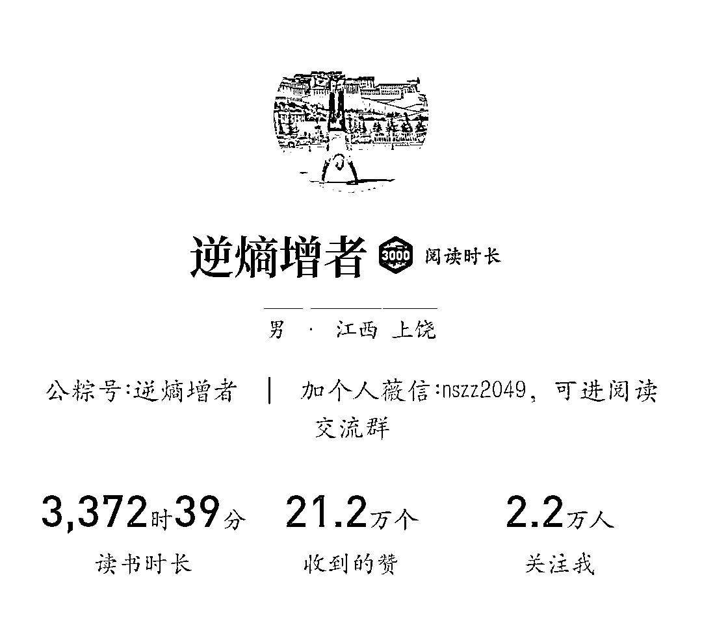
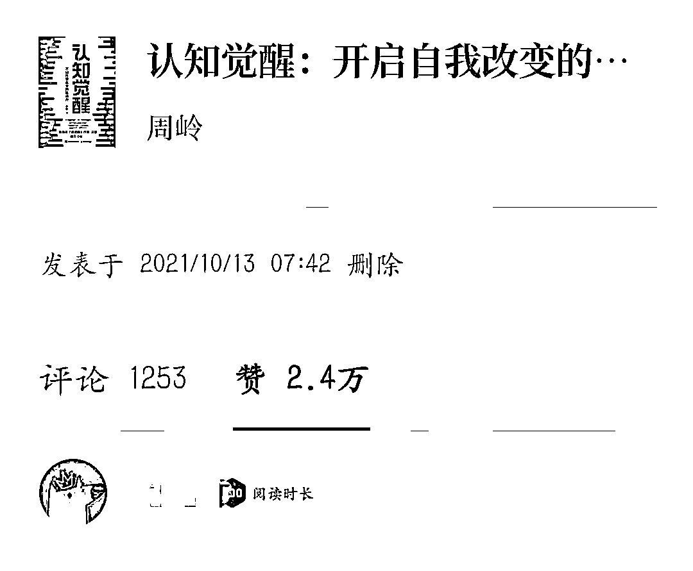

# 下班就打王者，到副业月入3W：普通人的两年逆袭复盘

圈里的朋友大家好，我是逆熵增者，90后上班族。主业之外，我把大量精力投入到自媒体和社群运营上。这篇文章是我在生财有术的第一次分享，想系统讲一讲：一个起点几乎为零的普通人，怎么靠阅读和写作在两年多时间里赚到40W，让副业月收入稳定在3W。

两年多前，我还过着完全不同的生活。工作之余，几乎所有时间都砸进游戏里，每天在线时长维持在6小时左右。2020年初居家隔离，实在闲得慌，随手拿起书开始看，没想到竟停不下来。当年我读的书是170本，第二年又刷掉130本，两年合计300本。这些书里，个人成长类约占一半，搞钱相关占据三分之一，投资理财、财商思维都囊括其中，为后来做知识付费埋下了伏笔。

2020年1月，我开始在网上输出内容，先后入驻简书和微信读书，连续写了10个月，成绩惨淡，粉丝稀少，阅读量长期停滞在两位数。转折发生在2020年10月，我加入阿猫读书的成长星球，参加日更写作100天打卡，并同步注册了自己的公众号。同年12月底，我正式创办付费成长社群，至今已经一年零十个月，超过1000位朋友加入。在2020年10月至2022年10月的两年中，我完成了700天公众号日更，积累了1.5万粉丝，钱包进账40W；同时从微信读书和公众号导流到个人微信近万人，手上运营着两个微信号。2022年，我还在5天内单枪匹马成交114单，拿下剽悍私域成交高手实战营冠军。

回看这段经历，我可以说是从真正的零基础起步：没有背景、没有人脉、没有资源。我能倚仗的，无非是三点：自律能力强、学习能力不差、写作功底还算扎实，加上对自己够狠，目标感极其明确。这些特质叠加在一起，撑起了我副业月入3万的结果。

我的分享将按六步展开：一、我是怎么借生财有术补上商业认知的；二、这个项目从零启动的完整路径；三、做付费成长社群的经验分享；四、新人入局需要迈过哪些门槛；五、我和生财有术之间的缘分；六、后续如何继续优化、放大。

一、生财有术怎么帮我补上了商业认知？

我很早就关注了生财有术公众号，当时没条件付费进圈，每周的精华帖就成了我免费拜师的地方。亦仁在公开内容里谈过一些原则，我看完后记录如下，也一直在践行。

第一条，主动增加表达和输出。只有让别人看见你在做什么、认同你的价值观，影响力才有可能生长出来。这也解释了我为什么会在微信读书、公众号、知识星球高频更新。

第二条，沉下心做一件事。做的事本身未必重要，重要的是持续行动，在迭代中拿出成果，再叠加表达，双向发力。我选择的方向是阅读、写作、社群运营，虽然耗费大量时间，但回报远大于付出。

第三条，抓住流量红利的关键在于欲望、敏锐度和执行力。用亦仁的比喻来说，欲望是发动机，敏锐度是方向盘，执行力是油门。我有发动机也有油门，最缺的是方向盘，所以我加入生财有术，正是为了补齐敏锐度这块短板。

第四条，用算账和概率的思维做判断。例如，写一篇推文长期价值是否达到1000元？自己的时薪如何计算？我按这个思路核算过：日更600天变现30万，平均每篇文章值500元，将来可能涨到更高。正因为形成了正向反馈闭环，日更对我来说不再是一种负担。

这几条建议的核心可以浓缩为：利他、长期主义、算账意识、深耕、知行合一、持续输出。

亦仁还有一句与赚钱无直接关系但对我影响很深的话：认知上的最大竞争，其实是信息输入量的竞争。信息的摄入量越大，看问题的角度就越丰富，思考的纵深感也越强，久而久之，人的洞察力自然会被磨出来。为此，我每天保持3小时阅读输入，连续1000多天从未间断，大年三十也在看书。如今我的阅读速度每小时大约2万字，每天输入不少于6万字，年输入量超过2000万字，每年花在学习上的时间超过1500小时。这些数字背后，是认知水平的悄悄更替。

第二个对我影响很大的是明白老师的“赚钱兵器库”。他提炼的赚钱四要素为：需求、流量、营销、变现。需求这一环，要在用户的痛点、痒点、爽点里去挖，搞清楚哪些问题值得解决、哪些事情能创造价值。流量指所有获取用户的渠道与方法。营销解决产品推广、文案写法与信任建立。变现则对应不同产品的赚钱模式和交付路径。这套框架被我直接用在社群搭建上。互联网上赚钱，无非锁住流量、做出产品，再用营销手段完成变现。

第三个是曹大关于赚钱本质的解读，出自《生财日历》。他的核心观点是：赚钱的本质是交易，一切皆交易。交易成立的两个条件是：你拥有某种资源，同时能找到愿意为它付费的买家。完全对等的价值交换未必存在，但互惠的交换永远是常态。这让我开始审视自己有哪些可以拿出来交换的东西。读完170本书之后，我的学习力、认知水平有了质变，个人成长速度远超以往，于是我思索着把一年来的方法整理成课程，打包为知识付费产品，再去各平台寻找需要的人——微信读书、简书以及后来的公众号，都是我发布内容的根据地。

第四个是肖厂长的私域“五力”模型。这套模型对我现在的规模起了决定性作用，可以浓缩为五句话和一个公式：

001 第一性原理：与粉丝维持长远而忠诚的关系，把他们当朋友对待。
002 两大主阵地：公众号和朋友圈。
003 内容三要素：真实真诚、持续分享、干湿结合。
004 成交四步法：引导加好友、发圈建信任、活动造势能、私聊促成交。
005 五力模型：个人IP力、加微力、产品力、运营力、内容力。
私域资产的计算公式是：IP力×加微力×产品力×运营力×内容力²。

内容力是唯一带平方的指标，说明它才是私域成败的根基。内容是那个“1”，其他要素都是后面的“0”：引流靠内容，信任靠内容，成交靠内容，交付也靠内容。这两年多，我的核心动作始终围绕内容展开。公众号这边，日更已经走到第700天，每天投入约两小时；微信读书方面，每读完一本书我就同步一份书评，目前关注者已有2万；朋友圈自今年元旦起每天更新三到四条，一天没断，总量超过了1200条。这一系列动作带来的结果是：一年零十个月里，超过1000位老铁付费进入了我的社群。猫叔那句“持续分享，黄金万两”，我是真信了。持续分享等于持续释放价值、累积信任，而信任恰好是私域成交的地基。先把价值给出去，收获自然会回来——利他才是最高级的利己。

二、这个项目是怎么从零跑起来的？

做成长社群的念头诞生于2020年8月，那阵子我第一次意识到付费社群的存在，好奇地参加了几期，发现自己未来也能做。想运营一个付费社群，至少要满足两个条件：在某个领域足够强，以及拥有一批信任自己的粉丝。彼时这两条我都不达标。不过，我那时已经读完100多本书，个人成长、时间管理、快速阅读等领域都有了不少积累，知识体系初步成形。

2020年末，我给自己的全年进展做复盘，把阅读、写作、运动、理财各方面的数据列出来，发现自己一年的成长速度远超以往。于是我想：为什么不把这一年学到的东西整理成课程，带着那些想成长但不知道该怎么做的人一起走？独自看书，不如结伴共读；独自写字，不如组队同写；独自精进，不如邀人同行。带着这个念头，项目正式启动了。

产品方面，我做的是年度成长社群，方向锁定在阅读写作和个人成长，年费365元。交付主阵地是微信群，固定每周一场分享，一年保底52场，另外还会组织共读营，共读《逆熵增成长之路》或《纳瓦尔宝典》《财富自由之路》《认知觉醒》等经典。知识星球专门沉淀分享内容，同时安排写作打卡，帮成员练读功和写功。为什么选微信群而不选其他工具？虽然维护成本高，但我更看重它的互动浓度和信任深度，排期固定的每周分享也让成员有稳定期待。

用户从哪来？我的公域渠道其实很单一，主阵地是微信读书和简书，靠爆款书评把用户导流到公众号和私人微信。引流思路一句话：有鱼的地方才好钓鱼。对我来说，微信读书就是那个鱼塘。我在这上面累计阅读3000+小时，关注马上破2万。

微信读书里有三个地方可以做引流。

一是个人信息介绍区。这里不方便直接写“公众号”“微信”，我就用谐音代替，同时放一个吸引人的钩子，比如拉人进免费阅读群、赠送电子书或学习资料。很多用户需要微信读书尚未上架的电子书，这些都是天然的引流品。

二是每本书的评论区。我习惯了看完一本书就写一篇书评，发到微信读书，再在文末挂上公众号。迄今已经发了200多篇。其中《认知觉醒》的评论点赞破了2.4万，很可能是目前微信读书最高的单篇点赞数。

那篇书评每天都在带来新的关注和互动。流量好的时候，还可以在书评下面再补一条评论，比如“我有这本书的电子版，需要可加微信领取”，或者“两年读完300本书，有免费读书群，想进加好友”。

三是在微信读书里维护自己的公众号。每天把文章精华同步到书评区，关注我的人都能看到，连带公众号也被顺藤摸瓜关注。这一套组合拳下来，公众号每天新增20个左右粉丝，每天也有十多个书友加我微信。

公众号要再导到个人微信，有三个常用位置：一是文章底部，放钩子，比如“加微信免费领价值999的《个人成长52条干货笔记》”，这套资料两个月帮我引流了1000多人；二是关注后的自动回复，除了文字，还可以配一张带个人二维码的图片，降低添加门槛；三是自定义菜单栏，留下自己的微信和产品入口，比如知识星球、成长社群。

至于转化与变现，路径是靠日更公众号和朋友圈持续积累信任，然后用知识付费产品承接，一年多时间在私域里成交了1000个付费用户。

三、付费社群运营与转化心得

朋友圈的价值，我是第二年才真正体会到的。第一年我很少发圈，转化主要靠公众号推文，一篇最多带来6个人入群；而同样一条朋友圈，有时能成交10几个人，最高纪录一天25人从朋友圈加入。数据对比更惊人：2021年全年付费用户只有200多；今年开始每天发4条朋友圈，连续260天、累计1100条，10个月就转化了600人，是去年同期的两倍。朋友圈就像自己开的一间店，装修得好不好，直接决定进店率。

朋友圈发什么？我归纳为四类。

第一类是生活内容。个人品牌先要有“人味”，用户购买的对象首先是你这个人。如果朋友圈清一色广告，别人只会把你当作营销号，根本不可能建立信任。所以我会穿插晒娃、晒风景、晒美食，让大家看到一个真实、有趣的灵魂。

第二类是专业价值。我会分享阅读心得、写作方法、时间管理技巧，向用户证明自己的专业度。只有让人觉得你有料，对方才愿意留下来。分享时要注意与定位一致，给用户真正可用的方法，哪怕是自己付费内容里截取的知识点也可以。

第三类是用户反馈和成交截图。以前我不好意思发这类图，总怕显得营销味重。直到试水后发现，这类内容天然具备说服力——用户看到有人下单、有人好评、有人真的发生了改变，才会放心买单。这些截图相当于买家秀，最好能够展示入群前后的变化。记得打码或征得对方同意。这类素材用得太频繁容易刷屏，一般在新品发布或活动期间集中释放效果更好，可以借鉴浪潮式发售的思路，我目前也正在学习中。

第四类是产品信息。终极目的当然是带货，但直接发硬广不如发用户故事和案例。比如谁在社群里养成了阅读习惯、谁坚持写作复盘了多久，这些转变本身就是最好的产品说明。节假日也可以配合优惠活动推出促销，我通常都会这么做。

关于发布时间，我总结过三个效果不错的窗口：早晨7点到8点，大多数人刚起床或走在通勤路上，适合发一张早起打卡图配上金句，或者推荐一本书，为好友注入一天的正能量；中午11点到13点的午休时间，适合输出专业内容，我会转发前一天的公众号文章，配上简短的导读，相当于给文章做二次曝光；傍晚17点到19点在途时段，内容可以轻松一些，晒晒生活、美食、遛娃，展示工作之外的一面。其他时段也可以根据用户群体的习惯再微调，但守住这三个高峰，发圈效果会稳定不少。

以上是我对这套玩法最核心的复盘。如果对你有启发，后续我可以接着展开聊聊社群的交付细节，以及生财有术如何进一步放大这套系统。期待和大家在圈里继续交流。

3.4 晚上9点到11点：发福利，也发收获

晚上九点到十一点，是许多人睡前抱着手机不放的高峰。此时更新动态，别讲大道理，直接给甜头：互动话题、限时折扣、优惠券，越实在越好。深夜人的消费冲动容易被点燃。临睡前，我会再发一条当日总结，给一天画个句号。

多久发一次比较合适？我觉得没有标准答案，找到合拍的节奏最重要。我一直保持每天3到5条，不靠闹钟，就是到点自然知道该放什么内容。生财那边也有不少人把动态经营得可圈可点。

我的年度会员群，价值清单如下
· 群内一年至少组织52场分享，配套课程围绕“阅读、思考、行动、写作、复盘、迭代”这条主线，也覆盖阅读方法、写作进阶、资料整理、自律习惯、时间规划、账号运营等具体话题。
· 一年共读12本精选好书。
· 可免费获得一次价值66元的共读体验。
· 赠送我写的一本个人手记。
· 星球内容库里沉淀了50万字成长类干货。
· 可以认识800多位同频伙伴。

定价：原定价465元/年，现在优惠100元，折后365元/年，一天约一元。优惠即将截止；20个早鸟名额只剩5席。

这个社群的使命，是用一人之火点燃众人之路，帮一万个人因为阅读和学习爱上成长，再用自律和行动把生活过得丰盈。欢迎你来，和800多位伙伴结伴同行：一起读、一起写、一起行动，也一起升级认知。

4. 招募贴：少一点套路，多一点心理学

文案是成交前的临门一脚。我没报过写作班，平时就做三件事：看心理学和营销类书籍，拆解同行的动态，再不断打磨自己的产品介绍。底层方法还是那几条：制造稀缺、设置期限、借权威背书、利用从众心理。

会员权益我按上面清单呈现，价格上强调“原定价465元，现在365元”，名额上强调“仅剩5个”，再用“马上涨价”来制造紧迫感。

四、新人入场要满足什么条件

想做好这件事，需要四种能力：持续产出内容，把流量引到微信，写出有转化力的文案，以及不间断输入学习。心态方面，要耐得住慢，每天只推进一步、只交出一份成果，日积月累，信任自然生长出来。内容变现本来就是慢生意，急不得。做这个项目最大的门槛，我始终认为是耐心。

下面聊一聊我如何保证日更，以及内容从哪来。

内容创作：先“借”，再“攒”

刚开始写作时，我底子几乎为零：高考作文分数很低，八百字的题目都能把我难住，经常写到交卷还凑不满。后来我还能持续创作，靠的就是一个“借”字。

第一步，向书借。最初我的内容几乎全是摘录，把书里的金句和重点挑出来，做成一篇篇干净的笔记；之后才升级为拆书稿，不再满足于摘抄，而是把个人想法、经历和逻辑结构也放进去，最后补上几条待办。分享一个容易上手的模板：开头写今天读了哪本书，挑三个触动最大的点；正文分三点展开，把原文观点和个人体验串起来；最后再列几条接下来要做的动作，顺带写一小段感想。我的许多文章都靠这个模板长出来。

接着是建一个素材库。后面积累越厚，前面更新越快。我在两年里读完300本书，顺手攒下3300多条笔记、近300万字，都收在手机记事本里。分类就几类：阅读、写作、时间安排、学习、账号定位、思维方法。内容号的更新和会员群的交付也都稳在同一个方向上。还有个笨办法：进一个新领域，先写100个问题，再逐个找答案。整个认知框架就像拼乐高——大结构先立住，再把小模块一块块填进去，最后拼出别人复制不了的版图。

还有一招是把旧素材“回炉重造”。苹果创始人讲过一个观点：所谓创新，就是把不同事物连接到一起；把旧元素换种顺序重新组装，本身也是创新。内容创作也能套用这个逻辑，但不能照搬，一定要换成有个人色彩的表达，再纳入我的叙事框架。那最该写什么？是真实经历。经历各不相同，所以那些你硬扛着走出舒适区、最终拿到结果的片段，是最有辨识度的个人名片。

最后是排期。我会在周日把下周的内容表先排出来：周日发一篇周结；周中发两篇拆书稿、顺便荐书；另外再分别安排阅读、写作、学习、时间安排的文章各一篇。

五、我与“生财”的缘分

一年多前，经由一位朋友的推荐，我知道了“生财”——一个可以坦荡聊钱的地方。他平时常提到那里的成员，每年会员日之前还会帮忙吆喝。今年4月18日，我跟着他的链接正式加入。此前，我主要通过社区的公开内容和日历做功课；后来读到一份百位大咖的搞钱建议合集，又入手了日历。内容虽短小精悍，含金量却很高。顺着这些信息，我关注到几位活跃达人，陆续加入了他们的星球。那阵子天天泡在里面，一天吸收一点，搞钱视野慢慢打开，后来才有了优化付费产品的底气。

六、接下来怎么优化、怎么做大

有位同行说过：没有资源与人脉的独立创作者，能稳定月入三万基本就是一道隐形上限。我恰好走到这个位置，并且维持了九个月，明显感到增长空间变窄。趁这个机会，想请教平台主理人和各位圈内前辈：到了这一步，还能从哪些方向突破、放量？

我自己琢磨了三条路。
第一，把产品结构铺厚。现在只有365元的会员群，太薄；未来想补一个便宜的引流款、一个千元上下的专项课，再配一档按年服务的高阶产品。
第二，把获客面撒开。过往主要靠阅读类App带来的自然流量，来源单一；下一步要把内容同步发到内容社区和短视频平台，让更多人看到。
第三，把人手配齐。这件事我已经在推动，产品做厚、流量做宽，靠个人硬撑肯定完不成，必须分工协作。

以上三点是否成立，希望各位帮忙把关。谢谢！

留言区里，几位朋友送来了鼓励，有人直呼“太了不起”，有人说见过那篇拆书稿；作者也逐一回应，感谢大家的认可和校稿。