# 小红书资料号实操：一部手机跑出月入5万+

大家好，我是九京。过去七年，我的主线一直是轻资产创业，重点放在私域成交。

2015年，我就在微信里摸索变现，陆续换过多种打法；个人履历这里不展开，旧文里有。今天这套小红书资料号打法，我把它看作普通人未来十年做轻创业的一个入口。无论你是刚做副业、做自由职业，还是经营公司，下面这些内容都尽量做到听得懂、学得会、能落地、能赚钱。

先想三个场景：如果有一套自动赚钱的系统，每天都有现金进来；如果每天都有大量精准客户，早上打开微信就是上百条好友申请；如果客户付完钱还愿意把亲友介绍来。经验少、资金少、时间少的人若能做到这三点，确实令人振奋。若你愿意，下面的落地指南或许能帮到你。

2021年9月，我们团队开始在小红书做流量变现，那时一个账号一个月净赚一万以上，日常投入也就一两个小时。

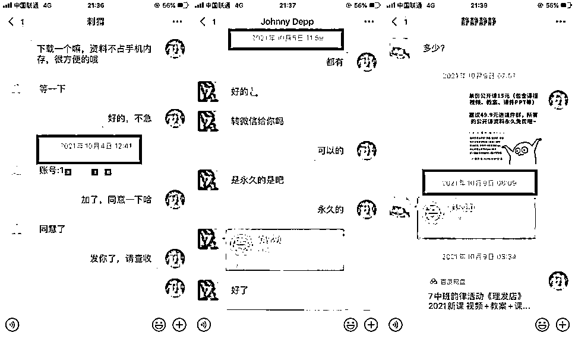

2022年5月，我组织内测，10位信任的老朋友参加，其中8人做到一天赚300元以上。

很多人说大环境差，我反而觉得这是历史上对草根最友好的阶段：不问出身，机会多。生财有术这类平台，把市场上大量项目的一线打法汇总起来，往往领先外面一到两年，对普通创业者像一座资料库。

去年刚做小红书时，我们对规则不熟，疯狂测试，封了不少号，但团队没停。一路摸索到今天，单日收益已经不错。过程中踩过的坑，我整理成了一套系统方法，希望能让你少走弯路。

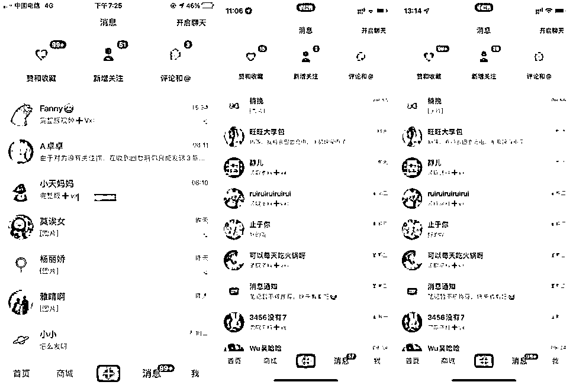

下面是大纲：

一、玩法定位
二、玩法准备
三、账号注册、养号与信息完善
四、内容获取
五、图文制作
六、上传分发
七、获客策略
八、转化成交
九、后端盈利模式

**一、玩法定位**

先讲清楚我们做什么。在小红书发笔记，把有需求的人引到微信领资料，单份资料按行业不同卖19.9到199元，转化率约三到四成。小红书用户消费力强，后端还有别的变现空间。

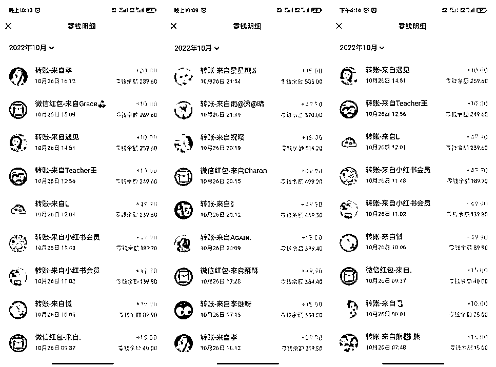

**1、核心商业导图**

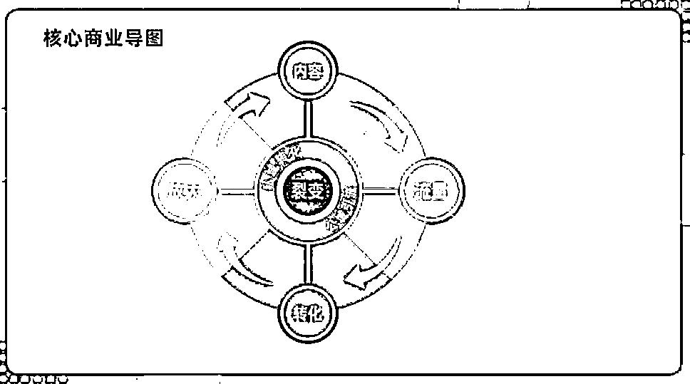

七年下来，我们只盯一件事：从公域平台获客，再引入微信私域，多次成交。上图是七年经验的商业总图，也是本文主线。

以幼师/小学赛道为例，我们在小红书、抖音、快手、视频号、知乎、微博、B站、西瓜视频等平台铺内容，用户感兴趣后，用多种隐蔽且相对安全的方式把他引到微信，在微信卖资料，再靠后端产品反复成交。

项目心法五句：

1. 定位即人群
2. 人群即内容
3. 内容即流量
4. 流量即转化
5. 转化即模式

定位影响客户群，客户群影响内容方向，内容方向影响用户层次，用户层次影响转化，转化方式决定商业模式。这套逻辑不只适用于小红书，也是内容生意的底层规律。

达成这个共识后，我会把核心玩法拆开讲，按流程1:1操作，结果大概率能拿到。

**2、为什么选小红书？**

平台很多，抖音快手视频号都在，我们为何主攻小红书？有四点。

**⑴女性用户集中，付费力强。**

王兴有个说法：付费能力排序是女性大于狗大于男人。小红书七成用户为女性，购买力强。我们实测转化能到四成，100个加微信40个付费。

**⑵不露脸、不囤货、不拉人头。**

不用做IP，不用出镜，只做素材发内容；粉丝数不是重点，第一个粉丝就能变现；不用拉亲戚朋友，也不用发展人头，自己安静做。

**⑶门槛低、成本低、上手快。**

一部手机起步，账号正常一两周开始进账，不限学历能力。其他项目前期动辄上万几十万，这个几乎零投入。

**⑷后端空间大、可放大。**

多数同行只卖资料，领域窄模式单一；我们做全品类选品，并设计多种后端盈利方式，整体收入能提升。跑起来后从账号、流程拆分放大，后端利润可扩5到10倍。

**二、玩法准备**

成本很低，手机、手机卡、微信号即可。

**1、手机**

安卓苹果新旧都行，装抖音快手小红书建议32G以上。购买渠道可选闲鱼、本地市场，生财圈也有做手机的朋友。

**2、手机卡**

一机一卡一账号，每台手机配一张卡，不要连WiFi。不是说连WiFi必封，而是怕一个号违规牵连其他号。去营业厅办，每人可办15张，移动联通电信各5张。套餐不限，主副卡可同时办，单卡月流量10G以上，不够再升。

**3、收款微信**

前期一个够用，账号设置和人格化包装后面细讲。

**三、账号相关**

**1、小红书注册**

应用市场下载小红书，手机号注册。细节：不用170、171等虚拟号段；一机一号一IP，别频繁切换；若已有老号，老号拿来研究同行；尽量不用假人设，比如男生填女生。

**2、小红书养号**

新号别急着发作品，先养权重。最新SOP：第一天1次；第二天1次；第三天2次；第四天2次；第五天2次；第六天2次并发1篇图文；第七天2次并发2篇图文；之后每天2篇图文。养号就是随意刷20到30分钟。

最高境界是忘记养号，把小红书当日常应用正常用。有老师主张只刷本领域，我不认同：平台把内容生产者和消费者分开，刷同类只会被同类推荐，对后期流量爆发没帮助。我天天看漂亮小姐姐，发美女视频就必火吗？所以平常心，不跟风，也别神化。

**3、小红书信息完善**

头像名字简介参考同行，同行就是老师。

**⑴头像**

百度搜卡通头像，挑高清的换上。

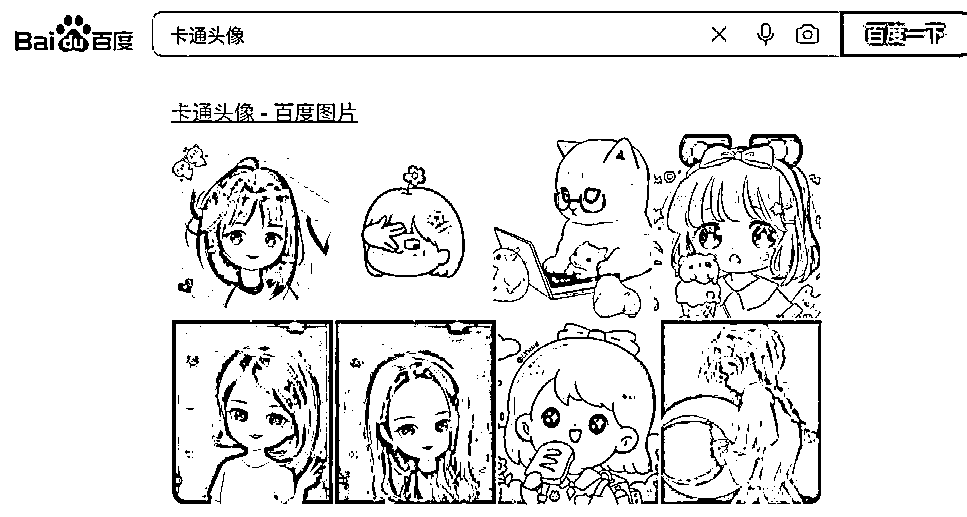

**⑵名字**

昵称加领域，如琳琳公考资源、娟姐PPT资源。

**⑶简介**

参考同行写3到4行，加一句提示：这些资料都有电子版和完整版。用意是暗示客户，你看到的只是一部分，想要完整内容就来私信。

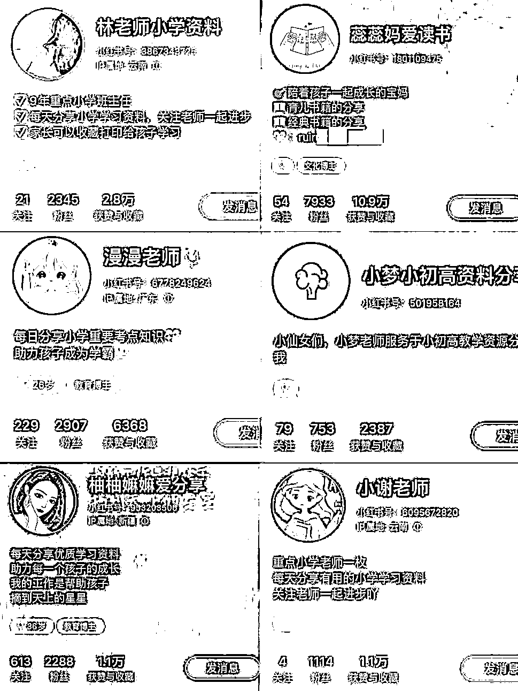

生日地区职业随意。

**4、微信注册与养号**

实操中频繁收款，微信无风控很关键。持续微信收款会被风控，建议小鹅通、快团团、支付宝等多渠道收。注册后实名认证、绑银行卡，一人可实名5个微信。

细节：手机号别用170、171虚拟号段，要用正常实体卡；手机卡实名，选大流量套餐，少用WiFi多用流量；一机一卡一号；注册时不开WiFi用流量。

**⑴基本信息设置**

头像三种：真人出镜、淘宝手绘、卡通头像。名字常见昵称+业务，如杨杨｜小学资料、桃子｜幼师资料。签名三种方向：展示核心价值、引导新客户、传递价值观。

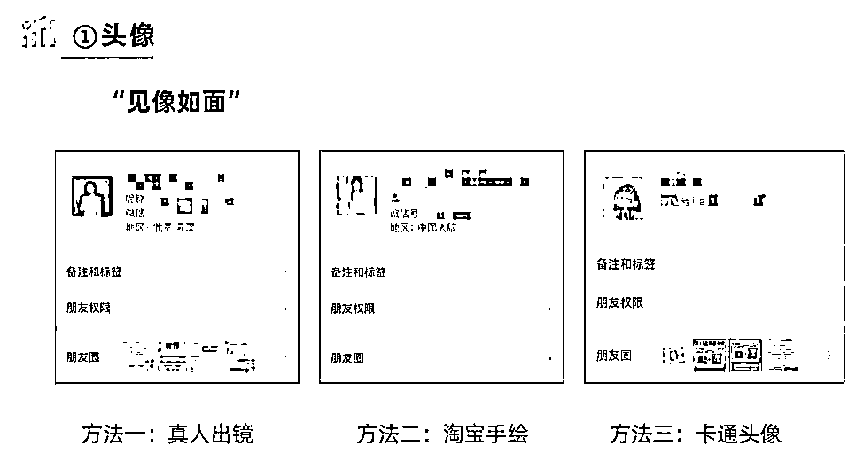 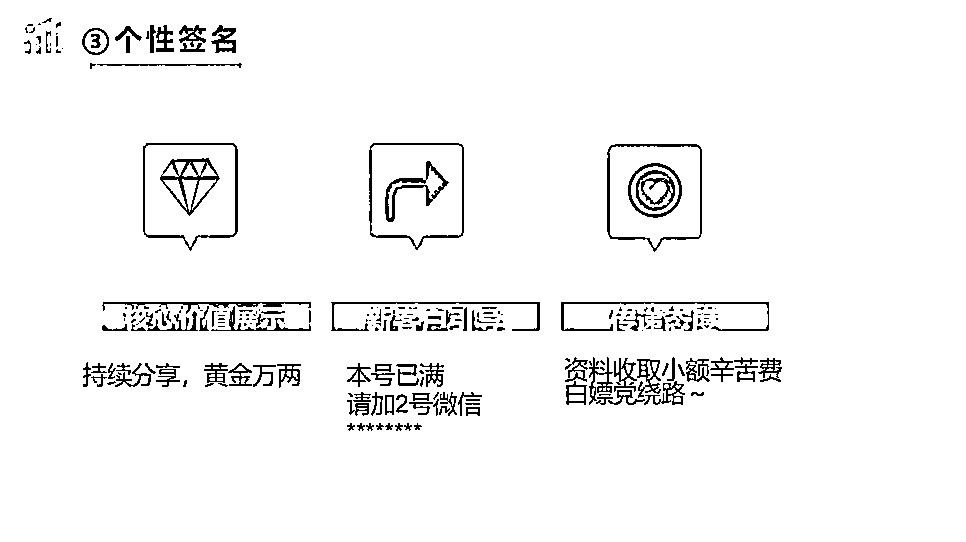

**⑵养号细节**

微信号是私域从业者最重要的资产。新微信权重低，频繁加人容易被限制，所以花1到2周养。我总结为7做5不做。

7做：

1. 资料填完整
2. 和老号、朋友、微信群聊天
3. 平均三天发1条原创朋友圈，生活、随笔、感想都行
4. 公众号文章阅读点赞评论转发
5. 绑银行卡并适当收发红包购物
6. 开启定位，多带微信出门
7. 多用微信功能：视频号、搜一搜、看一看、直播、购物、游戏、小程序、手机充值、生活缴费、腾讯公益、医疗健康、火车票机票、滴滴出行、酒店

5不做：

1. 不用第三方软件
2. 不做营销动作
3. 不在多设备间来回切换
4. 聊天不发违规违禁词
5. 养号期不大量加人

独家快速养号法：带手机去菜市场买菜，买不同菜扫不同摊位二维码付款，微信不会老待在一个地方，权重涨得快。

**四、内容获取**

资料号前两层变现是卖资料、卖会员。有货才有得卖，渠道两种。

**1、找同行买**

在小红书找到同行，直接买资料复制，价格通常几十块。小学和幼师资源无版权问题，其他领域要留意版权。

**2、淘宝拼多多买**

搜索下单，放进百度网盘即可。资料太多可开超级会员。

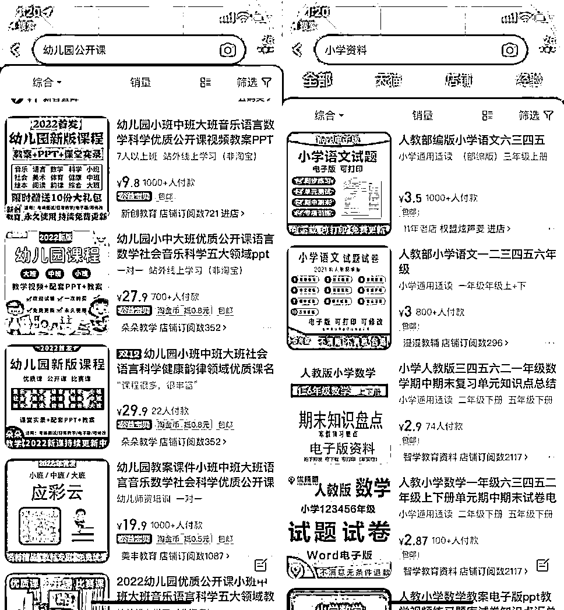

**五、图文制作**

小红书有视频和图文。视频易查重、制作麻烦、新手不友好，我们重点做图文。工具包括PPT、PS、美图秀秀、黄油相机、创客贴等，基础操作不展开。

**1、引流类**

这是重中之重，因为最终目的就是把用户引到微信。做法是“发一半留一半”，用暗示告诉用户这只是部分，完整版加微信。注意暗示，不是明示。常见样式：

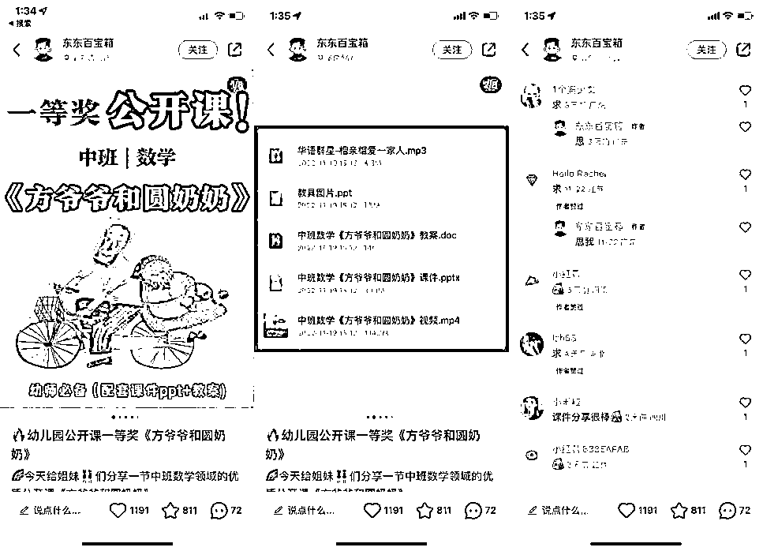 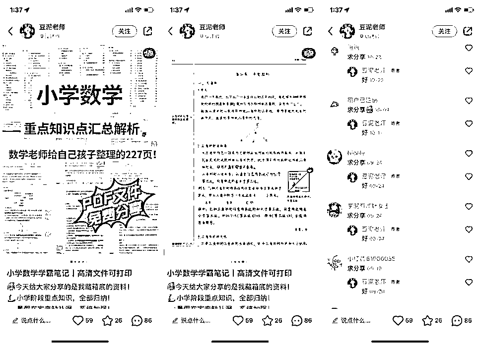

截图里出现百度网盘截图、PDF完整版文件，引导评论私信领取，这是资料号最常见的引流形式。

**2、干货类**

对直接引流帮助有限，用户往往点赞收藏却不私信。为什么还发？因为收藏是人的底层心理，看到好东西先存着，哪怕之后不看。发干货能快速增加获赞和收藏，提高账号权威感和权重。

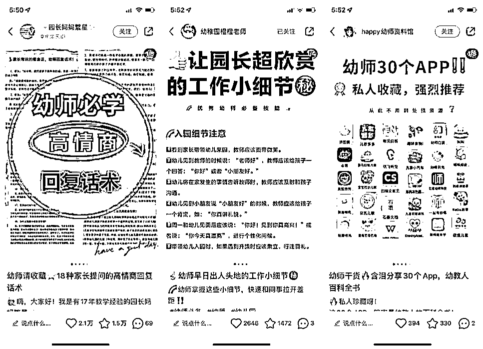

**六、上传分发**

**1、发布时间**

上午12点到1点、下午5点到7点、晚上8点到10点，这些是目标用户刷小红书的高峰，按此发布上热门概率更高。

**2、发布数量**

每个账号每天两条左右，最多别超3条。超过3条可能被当营销号，影响权重；只发1条又浪费流量。

标题参考案例：

小班语言活动《营救汪汪队》公开课参考  
小班音乐《营救汪汪队》先收藏  
新手幼师必备｜优质公开课《营救汪汪队》  
园长也认可的小班公开课《营救汪汪队》，快收藏  
《营救汪汪队》这节小班课，现场氛围值得期待

**3、发布细节**

先看标题，按上面思路。

**⑴标题**

按案例思路写。

**⑵正文**

一般写活动目标、活动准备、活动过程、活动重点和难点。幼师资料里的教案都有，直接复制粘贴。

**⑶标签**

常用标签可直接取用：

#幼儿园公开课  
#幼儿园优质公开课  
#幼儿园优质课  
#幼儿园教案  
#幼儿园大班课件  
#幼儿园大班优质课  
#幼儿园大班公开课  
#幼儿园中班公开课

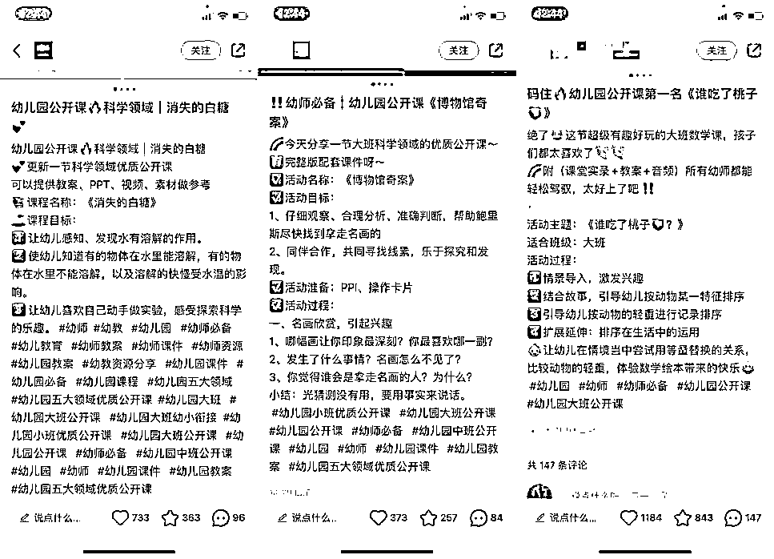

以及：

#幼儿园小班公开课  
#幼儿园小班优质课  
#幼儿园小班优质公开课

这些操作都不难，最好的办法是找同行对标，按你的领域找合适账号。

**七、获客策略**

**1、公域和私域**

公域流量是通过平台获得的用户关注，如抖音、知乎、小红书、豆瓣、微博、贴吧、B站；私域流量是沉淀到个人微信、能一对一精准运营的用户。核心区别：公域属于平台，私域属于自己。小红书大V流量本质也属于平台，平台可给曝光也可不给。所以整套模式的目标只有一个：把公域流量引入微信私域。

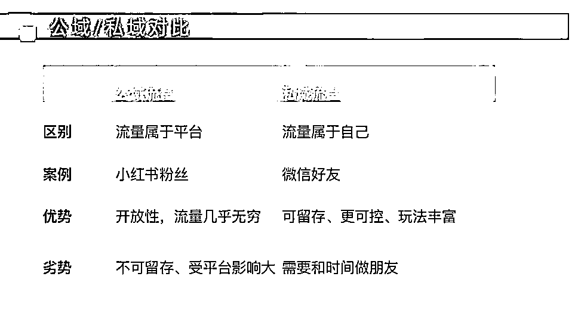

**2、怎么选流量平台**

我总结四个关键：流量精准度、对手竞争度、内容生产难度、平台容忍度。

流量精准度：平台有没有匹配客户。去天涯发小学资料引家长？去虎扑发幼儿园公开课引幼师？也许有，但同样成本小红书回报更高。钓鱼要去有鱼的地方。

对手竞争度：平台有没有现成同行。完全没有对手的平台，我反而觉得不值得做；非做不可，要么成先驱要么成先烈。创业多年，我认为同行是最好的伙伴，有竞争才有市场。

内容生产难度：内容引流本质是用内容换精准客户，拼的是生产效率和成本。不能低成本高效率生产内容，引流就难。抖音知识IP成才率低，核心就是内容成本高。

平台容忍度：平台初期需要内容生产者建设社区，对引流有一定容忍；同质内容饱和后，管控会越来越严。

**3、十种引流方法**

发完内容后，评论区常有人留言“求分享”，目标是把他们引到微信。下面分享10种方法。

先说清楚：没有100%安全的引流方式。平台不希望流量外流到微信，任何导流都不被鼓励。账号安全要平常心，把账号当消耗品，封了就换。我们当年做闲鱼流量，封了几百上千个号，封了就复盘，高峰期一天涨上万粉。

**①小红书号引流**

把小红书号设成微信号，客户私信时回复“加我小红书号”。

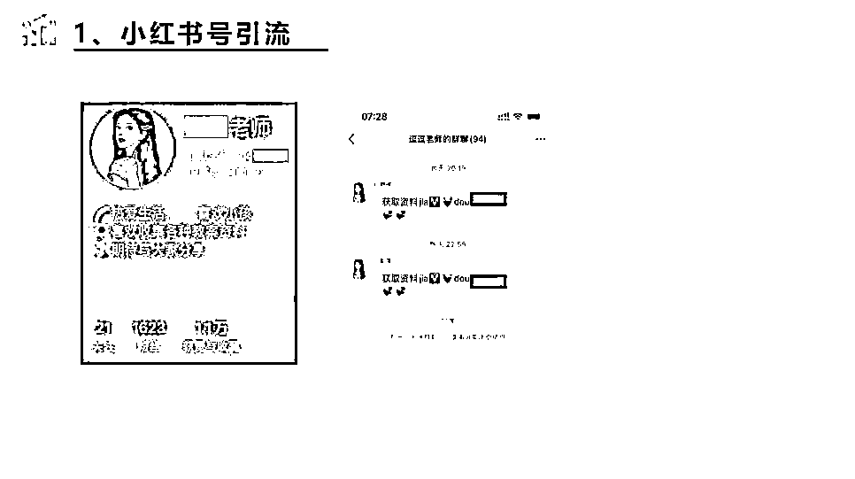

**②邮箱号引流**

两种做法，一是邮箱自动回复话术引导加微信，路径较长；二是留QQ号并绑定微信。

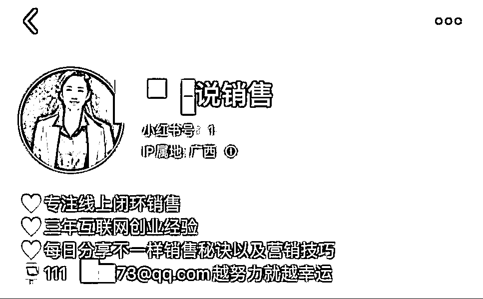

**③全网同名引流**

适合后期做大，在知乎抖音微博等平台统一名字做矩阵，客户可去其他平台找你。

**④简介艾特小号引流**

小号发引流信息，大号简介艾特小号，引导客户关注小号再加微信。

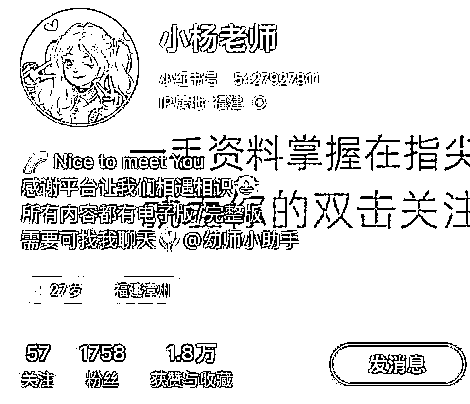

**⑤瞬间引流**

把微信号拆开，用打卡形式分步展示，引导客户拼出微信号后添加。新号不建议用，容易触发风控。

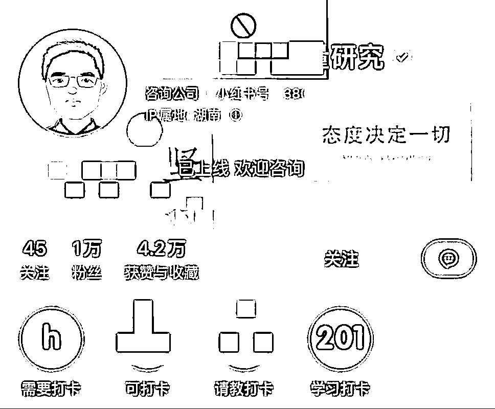

**⑥评论区小号互动**

客户评论“想要”“求分享”时，用小号引导私信或加微信。封号风险较大，要多备小号。

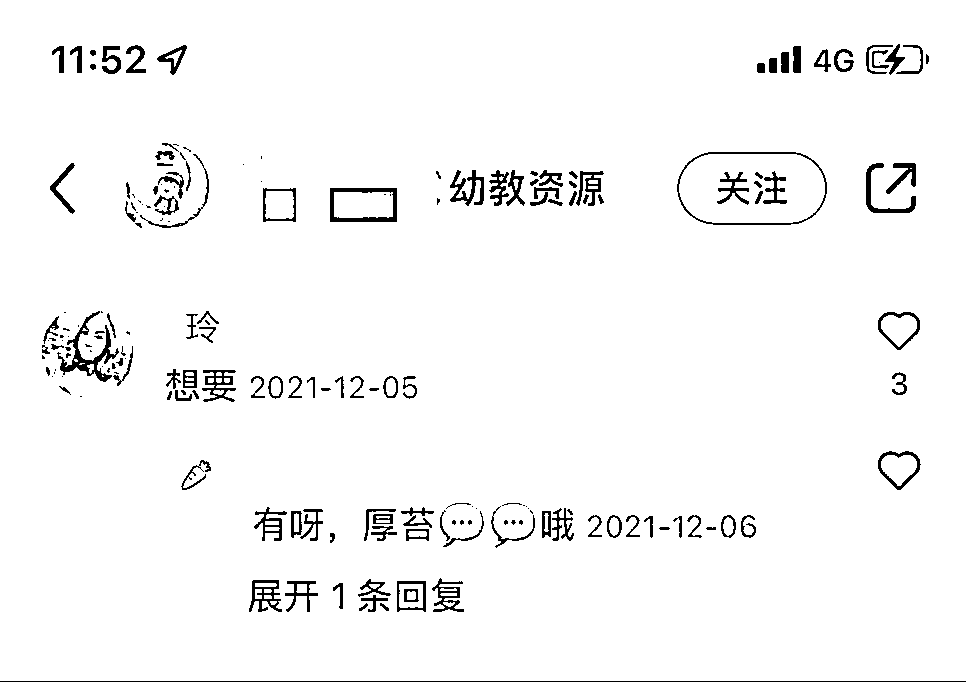

**⑦钩子引流**

小红书卖资料：从私信导流到微信收款的玩法拆解

先说说“钩子”是啥。说白了，就是你手里有点硬货——整理好的文档、成套的模板、压箱底的技巧，先拿出来亮一亮，让看的人心痒，再带一句：想要更多，后台找我。

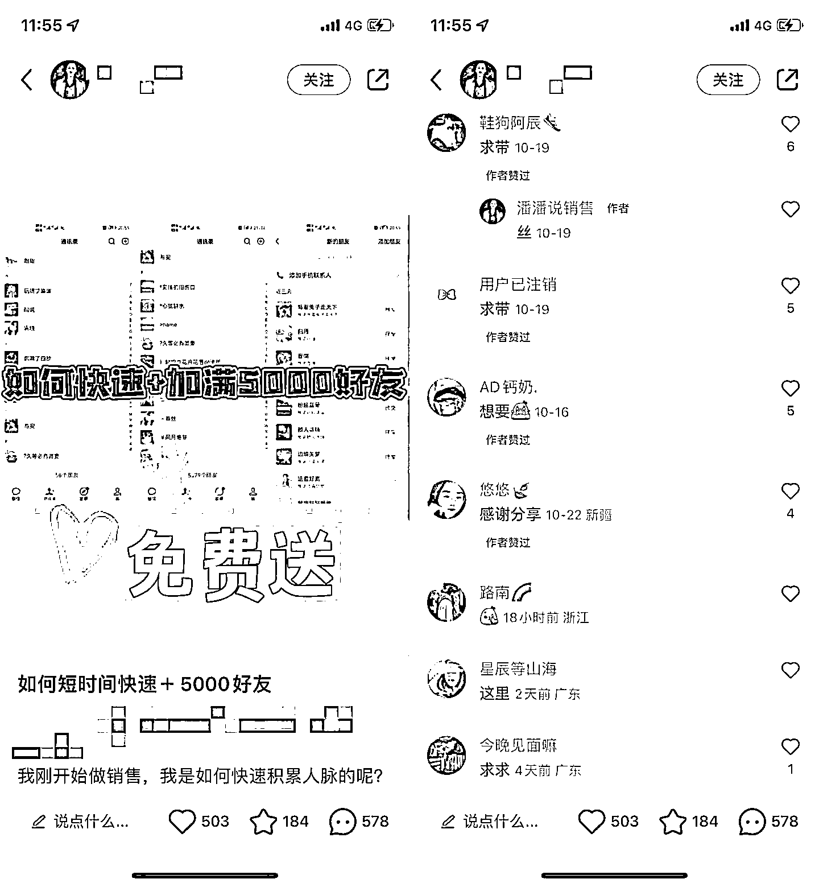

前面几种导流方式不重复讲了，直接看后面这三种。

**⑧后台私信导流**
把人引到后台开口，对方一冒泡，立马把话术甩过去。举个例：“领完整版，+\/ 123456”。平台审核严的词——加、私信、微信、公众号——尽量用谐音或符号拆开写。

**⑨群聊导流**
群聊环境相对宽松，直接留号被管的概率小。建群也简单：进小红书点“消息”，再点“开启聊天”，然后“创建群聊”，三步搞定。

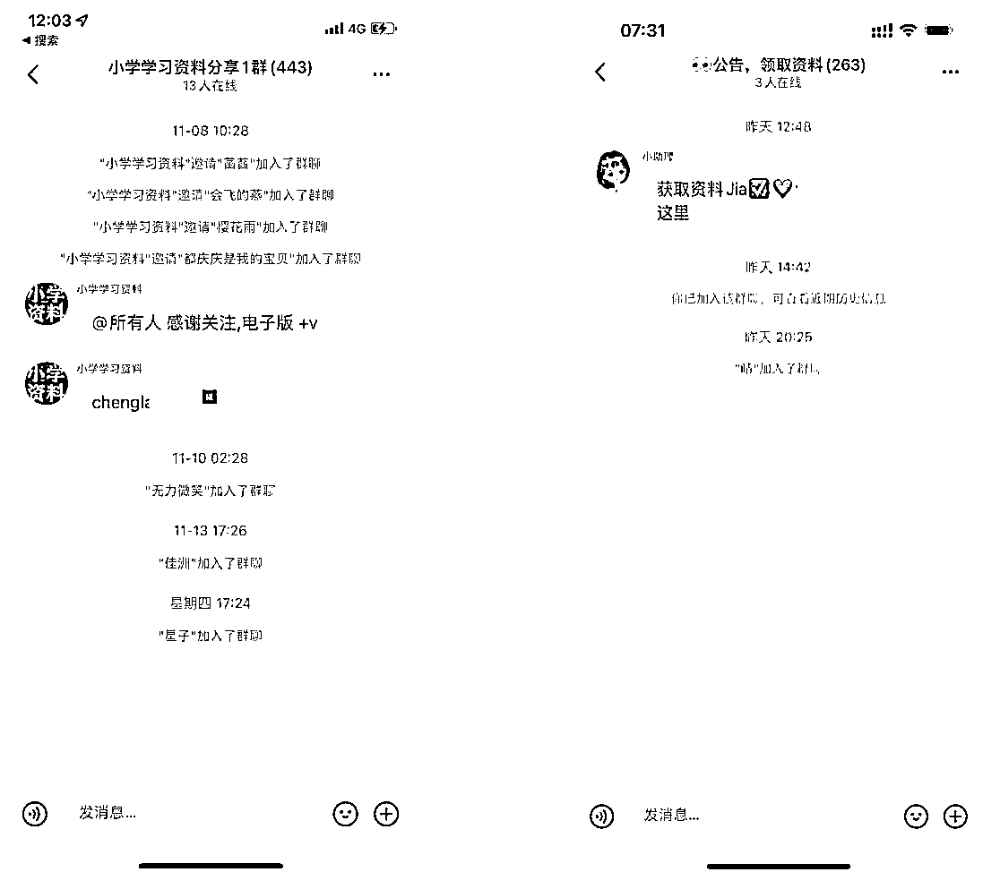 

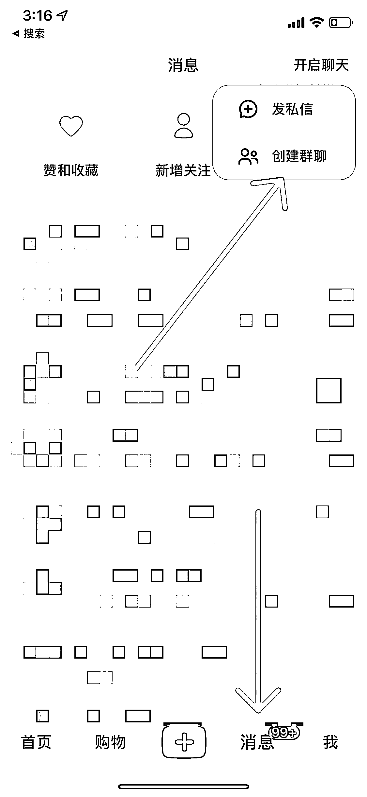

**⑩收藏夹导流**
这个玩法是大小号配合：大号去收藏小号发的广告帖。有人私信问，甩一句“看我的收藏”就行。

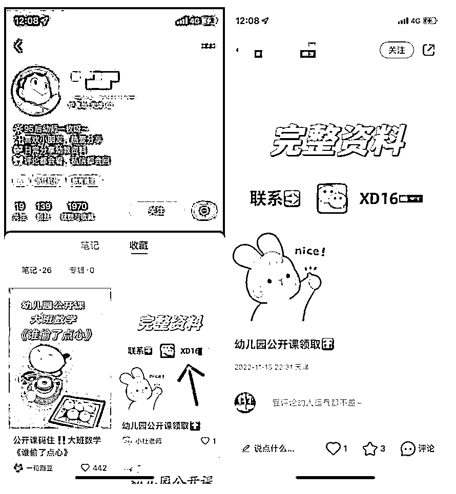

上面十种路子，可以单独用，也可以组合着用。新手建议优先玩第1、4、7、8、9、10这几种。

**八、转化成交：让流量直接换钱**

精准的人加到微信了，接下来就是在微信里把钱收了。

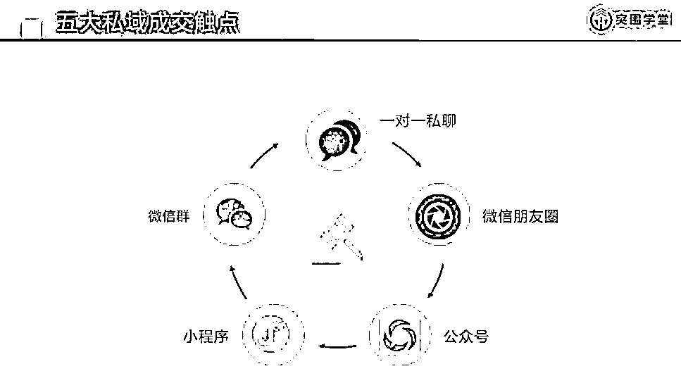

微信的每个角落都能埋收钱口子：私聊、朋友圈、公众号、视频号、直播、微信群，全算。但对卖资料这门小生意来说，把整套系统全铺开，属实有点高射炮打蚊子。所以这期只拆最核心的一环：单聊收款。

**1、下单三问**

做互联网项目七年，一直泡在最前线，我们攒下的转化经验不算少。回头看，大多数人下单前犹犹豫豫，绕不开三个结：这钱花得值不值？为啥找你买？为啥非得现在买？

客户嘴上没问，心里全在盘算。三个结没解开，订单就难落地。

**⑴ 为啥非买不可？**
先想清楚：你给的东西，到底能替对方摆平什么具体的麻烦？你能摆平的事越多、越硬，赚到的回报就越大。再说了，人家从小红书一路跟到微信，需求已经是明的了，这种精准流量别浪费。

**⑵ 为啥非你不可？**
卖资料的同行满地都是，她凭啥挑你？是价格有优势，还是服务更贴心，还是交货效果更扛打？这问题想透了，才接得住客户的心。

**⑶ 为啥必须现在？**
前两个问题过了，最后卡在时机。现在买和过阵子买，差在哪？马上下单能得到什么？一直拖又会错过什么？

心理学有个效应叫“厌恶损失”：人对失去的在意，远超对得到的满足。同样一千块，白捡的开心，通常压不住弄丢的心疼。所以做宣传，多强调“不买会吃什么亏”，比反复说“买了有多赚”更催单。

这三个结捋直了，其实就是产品本身的价值、你这条渠道的价值、当下时间窗口的价值。

**2、五位一体成交飞轮**
私域里的转化是有套路、有节奏的，不靠天赏饭，也不靠碰运气。整套打法我理成了五个环节：

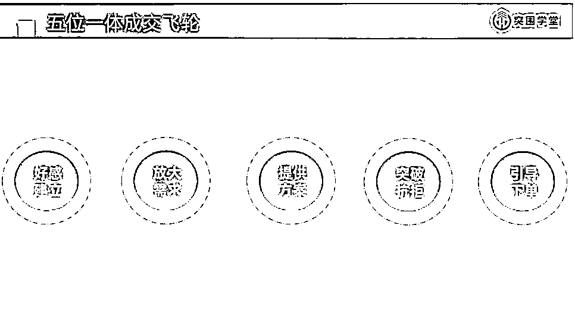

**①破冰：好感先行**
加上好友的头一件事，是寒暄，不是报价。好比两个生人刚碰面，总得先问问她怎么称呼、大概做啥的。像朋友一样处，生意才好谈。

话术示例：“你好，我是多多，专门收资料、整资料的。认识你挺高兴，想找哪方面的？”

**②诊断：把痛点挖深**
基本情况摸清后，就要挖她到底想要啥，还得把这份想要放大。赚钱的路子，本质是帮人填坑；连坑在哪都没闹清，后头根本没法谈。

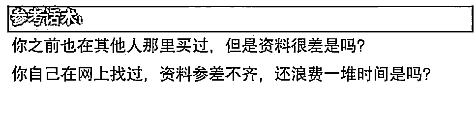

**③方案：先铺垫价值**
一句话：价值没到位，价格免谈。需求摸清了，就给出一套对应的解法，再把这套解法的好讲透——能帮她卸下哪些具体的麻烦。

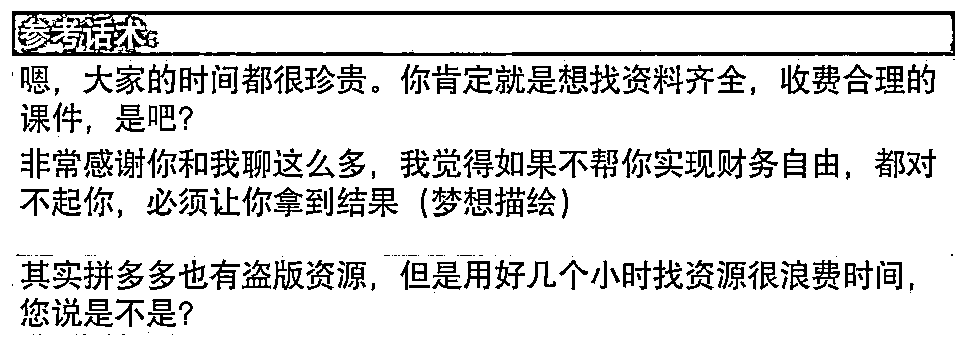

**④信任：把心墙拆掉**
方案递过去，最关键的环节来了。很多人在这掉链子，眼看到手的客户又跑了。方案再好，对方心里也会犯嘀咕，这时候要做的，是把她的防备卸下来。

最管用的招：晒证据。之前成交的付款截图、对方的反馈、感谢消息，比你说一百句都好使。

**⑤收款：把单敲定**
临门一脚，有人就是踢不进去。明明问题都聊完了，钱还是没动静。我一般用三招：
递上有时限的赠品或福利；
把风险揽过来，比如“不满意可退”；
把付款动作说到明处，告诉她点哪、怎么付。

具体话术看配图。

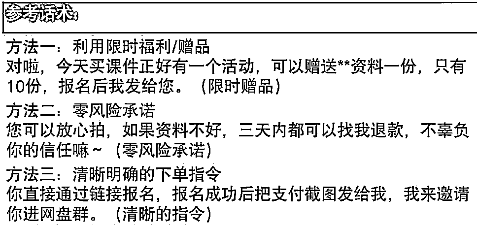

**九、怎么把盘子放大10倍甚至100倍？**

市面上大多数人，走到上一步就停了。说句实话，照这套打法卖资料、卖教程、卖素材，确实能挣到钱，但那真是辛苦钱，一天五六百，顶多一两千，很难再往上蹿。

想放大十倍百倍？给两条路。

**1、把后端盈利模式架起来**

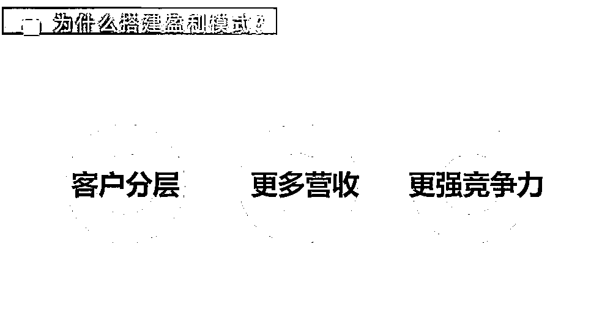

后端为啥得搭？

同样的东西，有人只肯掏9块9，有人愿意花99、990、9900甚至99000……当然也少不了想白拿的。后端搭好，就能按每个人不同的付费能力去接，营业额自然被抬高。

先看一张坐标图：横轴是客户对咱们的信任，越往右越深；纵轴是标价，越往上越贵。

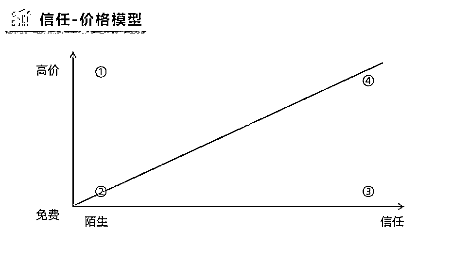

对应四种情况：

头一种，信任薄、标价高。刚加上好友，你就推一个10万的老板社群，对方能理你才怪。
第二种，信任薄、标价低。这才符合常理。
第三种，信任厚、标价低。客户早成了你的铁粉，你挂啥她买啥，还拉着亲戚朋友来买，可你的上限就9块9……这是守着金山讨饭。
第四种，信任厚、标价高。这才是干私域的最高追求：优质客户、过硬产品、交付超出预期。

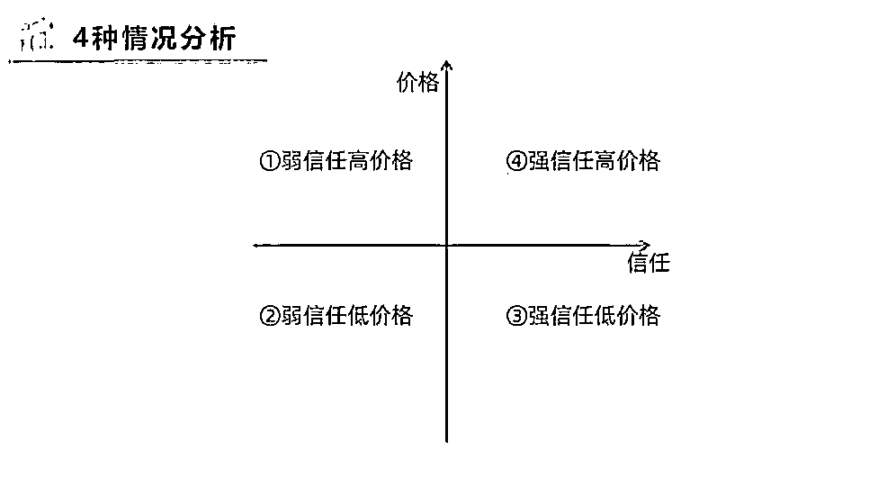

看懂这张图，货架就能搭了：

第一层：新人刚来，送点免费资料或卖点低价资料，先把信任垫起来。
第二层：有了第一回金钱往来，推中低价位的会员，比如70到200的资料会员，信任再厚一层。
第三层：中度信任了，上实体U盘、发展代理、推3000到8000的正式课。
第四层：信任到铁杆了，再谈分公司、加盟、合伙，把利益捆在一起。

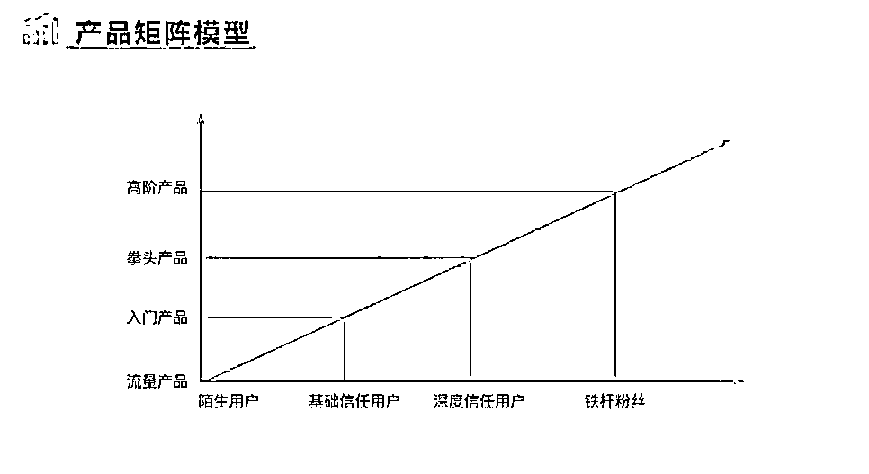 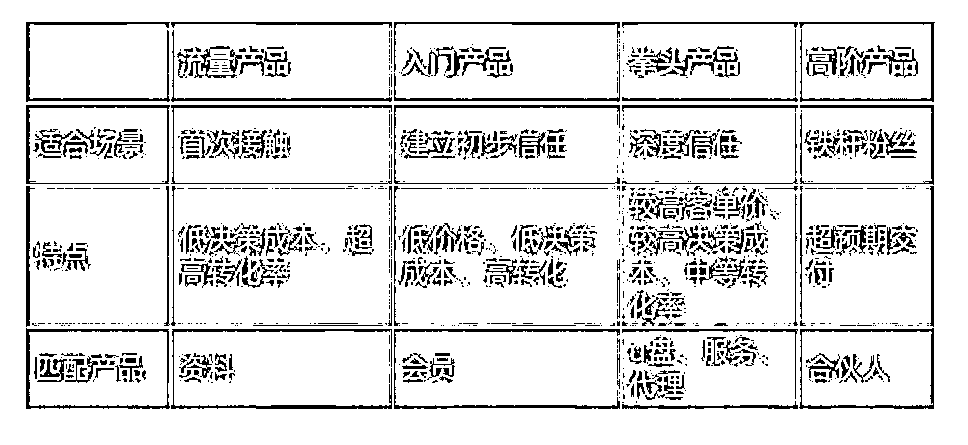

私域掘金有个万能公式：销售额=流量×客单价×转化率。

进来的流量不变，想每月多赚10倍，只能从客单价和转化率上抠。转化率这玩意，全行业都差不多，拉不开差距，真正能折腾的，是客单价的产品布局。

**2、持续挖蓝海选品**

我们现在跑得比较多的方向，是幼教、小学资料、中医这几块。看完全篇，你不必都挤进来，完全可以自己找更冷门的赛道。

想拓品，先把玩法底层吃透。很多人天天想赚大钱，使劲折腾却没结果，问题出在哪？一句话：钱不是用力赚来的，是把市场的某个空缺填平之后，市场反哺给你的。

给人打工，价值靠帮老板摆平事情兑现；自己创业，价值靠替客户化解麻烦兑现。你化解的事越大、越多，回来的回报就越厚。

那需求去哪找？绕不开马斯洛需求层次理论——从底往上，分别对应生理、安全、归属、尊重、自我实现这五层。

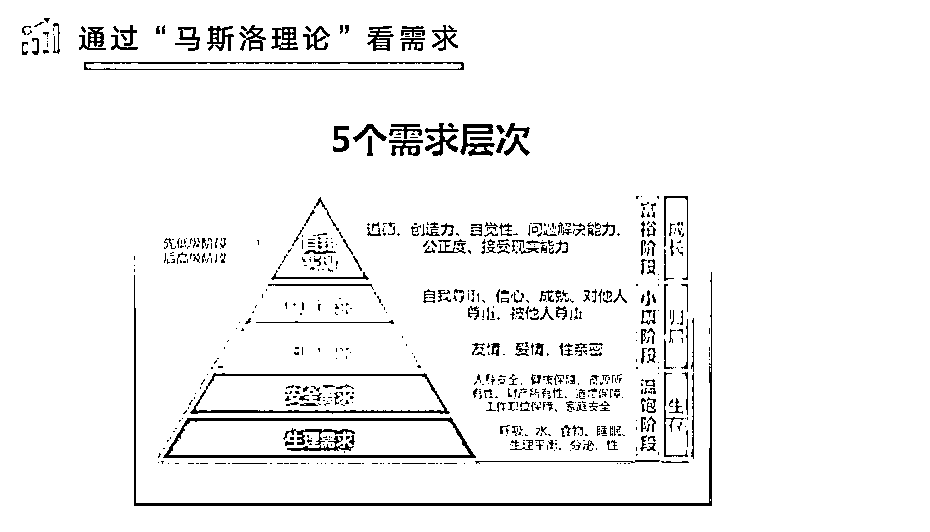

社会再怎么变，市面上总有不满足的空档。合格的生意人，就是先闻到空档里的味儿，再把对应的解药端上来，钱也就顺路赚了。

浓缩成一句：赚钱=用哪套方案，帮哪类客户，消掉哪个麻烦。

比如：
婴幼儿养育课，填的是新手父母在生理层面的刚需；
做财产保值增值的保险，填的是中产对安全感的渴求；
帮人挽回感情的生意，填的是男女对归属感的依恋；
各类职业技能考证班，填的是人往上走的自我实现需求。

三百六十行，行行都有没被喂饱的需求，都值得用小红书再盘一遍。虚拟资料的选品门道，我们实操七年攒了不少，真有兴趣，给这篇点个赞，过100我就再写一篇选品全攻略。

结尾说几句：

这套玩法，底层逻辑说白了就八个字：公域引路，私域收款。能玩明白，往哪个行业都能搬。所以它是个能长期干的活，未来十年不会过时，这话我说得理直气壮。

这次复盘就到这。眼下红利还很大，感兴趣完全可以照着一步步操作，遇到卡壳的地方，欢迎留言区来聊。

其他分享：
——全网引流300w的底层逻辑和方法论（精华）
——《我如何在闲鱼一天引流1.5w精准母婴粉》（精华）
——从农村穷学生，到年入150万

留言区：
SKY: 图片没加载出来
九京: 正在修改中……编辑器bug了
入微: 图破了！！！
九京: 抱歉久等了，已经搞定
拱卒: 干[强]
九京: [抱拳]
小沫: 👍
美德布耀布耀德: 赞